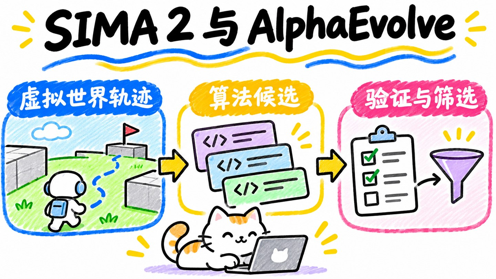

> **生成工具**：Codex\
> **生成模型**：gpt-6.2-sol

## 先用大白话理解

一名机器人学徒在虚拟训练场试着完成任务，失败后收集经验，下次再训练。一名厨师拿到三种做法，先让人尝是否合格，再比较哪一种省时间。两者都在使用反馈。学徒改变了自己的行动能力，厨师挑选和改写的是食谱。SIMA 2 和 AlphaEvolve 分别接近这两种情况。

SIMA 2 是 Google DeepMind 公开的三维虚拟世界 Agent。AlphaEvolve 是同一团队公开的算法搜索系统。Gemini 在两种系统里都提供能力，但理解论文时要问清 Gemini 负责布置任务、估计奖励、提出代码，还是训练后更新了参数。

## 1. SIMA 2 把行动与反馈留给下一代

三维任务需要 Agent 连续观察环境、采取动作。公开材料描绘的自改进循环，从 Gemini 提供任务和对表现的奖励估计开始。SIMA 2 在虚拟环境行动，形成可以训练的经验。系统把经验加入经验库，随后训练后续代。官方展示了原来失败的部分任务在后代改善的例子。公开说明还展示了在 Genie 3 环境的一代训练前后，观察范围以示例和研究材料为限。 [Google DeepMind 的 SIMA 2 发布材料](https://deepmind.google/blog/sima-2-an-agent-that-plays-reasons-and-learns-with-you-in-virtual-3d-worlds/)

```text
环境与任务 → 当前 SIMA 2 行动 → 轨迹与奖励估计
          → 加入经验库 → 后续训练 → 用后代执行后续任务
```

在这条链路里，轨迹记录「怎么做」，奖励估计记录「做得怎么样」，最值得复核的是奖励是否真正反映了任务。训练任务改善以后，评估新的环境或指令，才能观察这份经验能否迁移。原示例的训练数据如何生成与基本模型如何形成是两个阶段。

## 2. AlphaEvolve 提出程序，再用验证器选

这里的候选是代码。模型提出修改，执行环境运行验证器和评分器。通过约束的程序进入候选库，高分程序参与后续提案，继续搜索。适用场景通常能写出可执行的正确性检查以及明确评分，例如矩阵乘法必须给出一致结果，性能则要在同一硬件和负载下比较。 [AlphaEvolve 论文](https://arxiv.org/abs/2506.13131)

我们用退款表做机制类比。四个输入一共有 11 行。两遍程序分别求和、计数，共访问 22 行。一遍程序在同一轮做这两件事，共访问 11 行。另有一个更草率的一遍程序，把缺失当成 0，访问数也写成 11，但只答对一题。

| 候选 | 正确性 | 逻辑行访问数 | 决策 |
| --- | ---: | ---: | --- |
| 两遍执行 | 4/4 | 22 | 保留作基线 |
| 缺失填零 | 1/4 | 11 | 淘汰 |
| 一遍同时计数与求和 | 4/4 | 11 | 在合格候选中选中 |

计数表示算法对输入行的逻辑访问，不是 CPU（中央处理器）指令数或秒数。这次用预先写好的候选跑验证，说明「先过正确性，再评分」的机制，未运行 AlphaEvolve 或 SIMA 2。 [类比代码](experiments/agent-evolution/iteration_lab.py) · [实际输出](experiments/agent-evolution/iteration-results.json)

## 3. 看清改进的对象和报告的分母

DeepMind 报告 AlphaEvolve 优化了 Gemini 使用的一项矩阵乘法计算内核，该内核提速 23%，对应总训练时间约减少 1%。计算内核是执行某个数值操作的一段底层实现。把 23% 理解成整个训练或模型推理快了 23%，会混淆两种分母。AlphaEvolve 优化了一个会影响后续训练成本的部件。SIMA 2 的自生成经验则用来训练后代的行动能力。公开材料支持这两条具体结论，Gemini 产品代际发布的全流程仍需另找对应证据。 [DeepMind 的 AlphaEvolve 工程结果](https://deepmind.google/blog/alphaevolve-a-gemini-powered-coding-agent-for-designing-advanced-algorithms/)

## 4. 怎么读下一条「系统自己改进了」的消息

先找起点、改动和评估三个字段。对 SIMA 2，起点是某代行动策略，改动是后续训练，评估的一项是它能否完成指定虚拟任务。对 AlphaEvolve，起点是已有程序，改动是把可验证的候选保留进搜索池，评估可以是正确性和实际运行成本。两种工作里，环境和验证器都由工程团队定义或参与设计，研究结果应放回这些限制下理解。

训练内核的数字也可以做一轮粗略手算。假设总训练要 100 分钟，其中 5 分钟用于某内核，吞吐提升约 23% 后，其他条件相同，该部分用时约为 `5 / 1.23 ≈ 4.07` 分钟，总共节省约 0.93 分钟。这是帮助理解分母的假设演算，公开材料没有用这个例子披露训练时长分配。实践中更应看芯片型号、负载、算子覆盖以及端到端测量方式。
