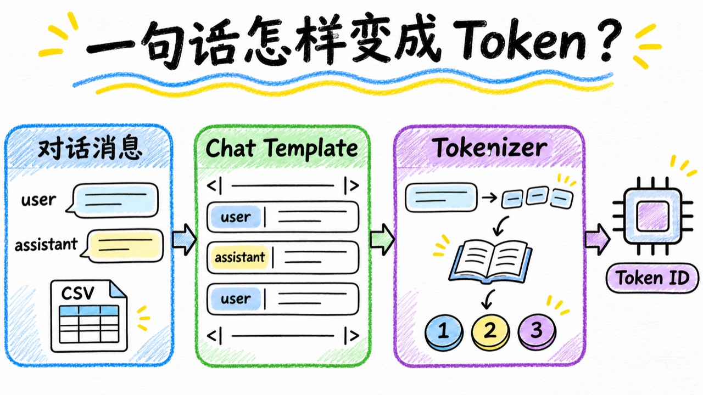

你在聊天框输入「请汇总 CSV。」，界面上只有一句话。按下面的实验配置，送进模型的输入有 **21 个整数**。单独给这句话编码，只有 **4 个整数**。多出来的 17 个从哪来？

假设应用还交代了一句「你是报表助手」。发给模型的输入得写清这两句话分别是谁说的，接下来轮到谁回答。**Chat Template（对话模板）**负责把这些信息写进一段文本，**Tokenizer（分词器）**负责把这段文本变成整数序列。我们用 Qwen2.5 的真实配置走一遍，两步都可以在普通电脑上运行。会复制命令、运行 Python 就能跟上。

## 1. 先把一句话变成四个整数

先只看用户输入「请汇总 CSV。」。Qwen 的 Tokenizer 将它切成四段。为方便阅读，下表把每一段还原成了人能直接读懂的文字。

| 顺序 | Token 对应的文本 | Token ID |
| --- | --- | ---: |
| 1 | `请` | 14880 |
| 2 | `汇总` | 108788 |
| 3 | `␣CSV` | 27445 |
| 4 | `。` | 1773 |

`␣` 代表一个普通空格。由此得到 `[14880, 108788, 27445, 1773]`。**Token** 是编码后的一个单位，**词表**可以理解成一张「片段 ↔ 编号」的登记表，**Token ID** 是片段在这张表里的编号。后续模型会用编号查找对应的向量。同一编号的含义取决于用的是哪一份词表。

为什么有时一个字是一块，有时两个字甚至空格加三个字母也是一块？一种常用方法叫 **BPE**（Byte Pair Encoding）。可以把它想成先从小片段起步，训练词表时反复把常一起出现的相邻片段合成新片段。编码新文本时，Tokenizer 使用已经学好的合并规则。合并好的片段可以是完整单词、单词的一部分、多个汉字，也可以带空格或标点。[Hugging Face 的 BPE 教程](https://huggingface.co/learn/llm-course/chapter6/5)

用同一份 Qwen 词表试四个短例子：

| 输入 | Token ID 序列 | 数量 |
| --- | --- | ---: |
| `你好` | `[108386]` | 1 |
| `Hello` | `[9707]` | 1 |
| `␣Hello` | `[21927]` | 1 |
| `sum(x)` | `[1242, 2075, 8]` | 3 |

前置空格可以改变编号，即使 Token 数仍然一样。代码的切法也有点出人意料，`sum(x)` 被切成了 `sum`、`(x`、`)`。真要计算某个输入占多少 Token，就用目标模型对应的 Tokenizer 测量。

## 2. Chat Template 怎样交代谁在说话

应用里，我们把对话存成一组有角色的消息：

```json
[
    {"role": "system", "content": "你是报表助手。"},
    {"role": "user", "content": "请汇总 CSV。"}
]
```

`system` 是应用给助手的说明，`user` 是用户说的话，已有的助手回复通常以 `assistant` 记录。这里还没有历史回复。把这两条消息交给 Qwen2.5 的模板，并要求接下来由助手回答，渲染结果如下：

```text
<|im_start|>system
你是报表助手。<|im_end|>
<|im_start|>user
请汇总 CSV。<|im_end|>
<|im_start|>assistant
```

可以把它读成一份带角色标签的剧本。每段用 `<|im_start|>` 开头，接角色名、换行和正文，已说完的段落以 `<|im_end|>` 收尾。最后一行只打开一个新的助手段落，行尾还有一次换行，接下去的正文就由模型生成。这个段落开头是 `add_generation_prompt=True` 在当前模板里追加的 **生成提示**，它属于输入。[Qwen2.5 的模板配置](https://huggingface.co/Qwen/Qwen2.5-0.5B-Instruct/blob/7ae557604adf67be50417f59c2c2f167def9a775/tokenizer_config.json)

`<|im_start|>` 和 `<|im_end|>` 是这份词表里预留的**特殊 Token**，分别占一个编号 `151644`、`151645`。角色名、换行也会编码。例如最后的 `<|im_start|>assistant\n` 占三个 Token，对应 `[151644, 77091, 198]`。其他模型可以定义不同的标记和排版，服务接入时应使用该模型对应的模板。[Transformers 对话模板文档](https://huggingface.co/docs/transformers/v5.13.0/en/chat_templating)

| 输入从哪里来 | 新增 Token 数 | 累计 |
| --- | ---: | ---: |
| 用户正文「请汇总 CSV。」 | 4 | 4 |
| 加上完整系统段落（9 个）和用户段落的角色名、边界与换行（5 个） | 14 | 18 |
| 加上助手段落的开头 | 3 | 21 |

```text
角色消息
  │  Chat Template 加上角色、边界和回答起点
  ▼
带标记的文本
  │  Tokenizer 切分并查词表
  ▼
Token ID 序列（本例共 21 个）
  │  交给文本模型继续计算
  ▼
模型预测下一个 Token
```

## 3. 动手看 Token 和 ID

准备 Python 3.10 或更新版本。以下命令适用于 macOS 和 Linux，会在当前目录创建独立的 Python 环境。首次运行脚本需要联网获取公开的 Tokenizer 配置及词表。实验在 CPU 上完成，整个过程只加载分词器相关文件。

```bash
python3 -m venv .venv
source .venv/bin/activate
python -m pip install "transformers[chat-template]==5.13.0" "tokenizers==0.22.2"
```

Windows PowerShell 可以用 `py -m venv .venv` 创建环境，安装依赖和运行脚本时均用 `.\.venv\Scripts\python.exe` 代替 `python`。

把下面的代码保存为 `tokenizer_demo.py`。固定 `REVISION` 是为了让大家用同一份词表和模板。代码最后的 `assert` 会在结果不符合预期时直接报错。

```python
from transformers import AutoTokenizer

MODEL_ID = "Qwen/Qwen2.5-0.5B-Instruct"
REVISION = "7ae557604adf67be50417f59c2c2f167def9a775"
tokenizer = AutoTokenizer.from_pretrained(MODEL_ID, revision=REVISION)

samples = ("你好", "Hello", " Hello", "sum(x)", "请汇总 CSV。")
for text in samples:
    ids = tokenizer.encode(text, add_special_tokens=False)
    pieces = tokenizer.convert_ids_to_tokens(ids)
    decoded = tokenizer.decode(ids, clean_up_tokenization_spaces=False)
    print(f"{text!r} → {pieces} → {ids}（{len(ids)} Token）")
    assert decoded == text

messages = [
    {"role": "system", "content": "你是报表助手。"},
    {"role": "user", "content": "请汇总 CSV。"},
]

rendered = tokenizer.apply_chat_template(
    messages, tokenize=False, add_generation_prompt=True
)
with_prompt = tokenizer.apply_chat_template(
    messages, tokenize=True, return_dict=False, add_generation_prompt=True
)
without_prompt = tokenizer.apply_chat_template(
    messages, tokenize=True, return_dict=False, add_generation_prompt=False
)
body_only = tokenizer.encode(messages[-1]["content"], add_special_tokens=False)

print("\n模板渲染结果")
print(rendered, end="")
print("\n完整 IDs", with_prompt)
print("正文 / 无生成提示 / 有生成提示", len(body_only), len(without_prompt), len(with_prompt))

# 先渲染再编码，结果应和一步得到的 ID 序列完全相同。
assert with_prompt == tokenizer.encode(rendered, add_special_tokens=False)
assert with_prompt[:len(without_prompt)] == without_prompt
added_ids = with_prompt[len(without_prompt):]
print("模板追加的 IDs", added_ids)
# 边界检查，去掉人可读输出中的特殊标记。
print("保留特殊标记", repr(tokenizer.decode(added_ids, skip_special_tokens=False)))
print("跳过特殊标记", repr(tokenizer.decode(added_ids, skip_special_tokens=True)))
```

在脚本所在目录运行：

```bash
python tokenizer_demo.py
```

先看输出末尾的这几行：

```text
正文 / 无生成提示 / 有生成提示 4 18 21
模板追加的 IDs [151644, 77091, 198]
保留特殊标记 '<|im_start|>assistant\n'
跳过特殊标记 'assistant\n'
```

第一组输出里，`你好` 对应的原始片段可能让人愣一下，脚本会打印 `['ä½łå¥½']`。这是这个分词器用来表示 UTF-8 字节的内部字符形式。想看还原出来的文本，调用 `decode()`。脚本也验证了这几个样本编码再解码后能恢复原文。对任意文本逐个 ID 解码时，有些片段可能只包含汉字或表情的部分字节，查看完整序列更容易读懂。

两个检查值得亲手做一次：

1. **对照两种编码路径。** `apply_chat_template(..., tokenize=True)` 会一次拿到 ID。手动分两步时，先用 `tokenize=False` 拿渲染文本，再用 `encode(..., add_special_tokens=False)` 来编码，保留模板给出的边界。断言验证两条路径的完整序列逐项相同。这样也能避免在某些模型上把模板已有的起止标记额外插入一遍。
2. **观察特殊标记与普通文本的区别。** 把生成提示的三个 ID 解码两次。开关 `skip_special_tokens=True` 后，特殊标记 `<|im_start|>` 被跳过，普通文本 `assistant` 和换行还在。想拿到实际回复时，应从生成结果中取出新增的那段 ID，再解码。

**试着多加一轮对话。** 在列表末尾再加一条 `assistant` 消息「请上传文件。」和一条 `user` 消息「已上传。」。重新运行，观察 `assistant` 为什么出现两次。一次是历史回复的角色，后面有文本及结束标记。另一次只打开下一轮将要生成的回复，仍在输入末尾。原脚本的 `body_only` 在这时会测量最后一条用户消息。

## 4. 想读源码，从这三步进入

如果只是第一次学大模型，能解释 4 → 18 → 21，并跑出相同结果，就可以继续下一篇。想知道库里把两步接在哪里，可以沿着固定版本看：

1. 找到 **Qwen 的 `tokenizer_config.json`**，搜索 `chat_template`。普通文本对话走模板中的消息循环，最后由 `add_generation_prompt` 决定是否追加助手段落的开头。[Qwen 模型文件](https://huggingface.co/Qwen/Qwen2.5-0.5B-Instruct/blob/7ae557604adf67be50417f59c2c2f167def9a775/tokenizer_config.json)
2. 打开 **Transformers 的 `PreTrainedTokenizerBase.apply_chat_template()`**，找到 `render_jinja_template()`。它用 Jinja 模板把消息展开成文本。沿 `tokenize=True` 分支继续往下，会看到它把文本交给 Tokenizer，同时传入 `add_special_tokens=False`。[Transformers v5.13.0 源码](https://github.com/huggingface/transformers/blob/v5.13.0/src/transformers/tokenization_utils_base.py#L3002)
3. 打开 **Qwen 的 `tokenizer.json`**，找 `added_tokens` 和 `model` 里的 BPE 配置。用实验里的 `151644` 和 `151645` 对照特殊标记，再用普通文本的例子体会分词规则如何将片段对应到编号。[Qwen 词表与分词配置](https://huggingface.co/Qwen/Qwen2.5-0.5B-Instruct/blob/7ae557604adf67be50417f59c2c2f167def9a775/tokenizer.json)

## 下一篇

同一句「请汇总 CSV。」现在已经变成了 21 个有顺序的编号。**F-02《Transformer 如何从 Token 算出 logits》**会从这里接下去，看编号如何查到向量，又如何经模型计算，成为对下一个 Token 的一组打分。系列入口见 [LLM 与 Agent 学习路线图](https://blog.lacknb.cn/articles/2026/11/19/1795058329577.html)。
