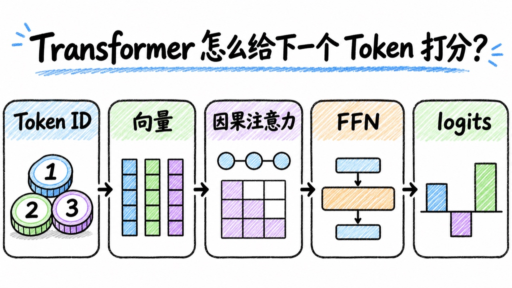

你输入「请汇总 CSV。」，助手可能以「当然」开头。在「当然」出现在屏幕以前，模型已经给词表里的每一个候选 Token 打了分。**这组原始分数就是 logits**。分数可以为负，也可以大于 1。至于真正选中哪个 Token，要等后续的解码规则决定。

[上一篇 F-01](https://blog.lacknb.cn/articles/2026/11/19/1795068393122.html)已经把这条请求和它的角色标记变成了 21 个整数。这篇沿着同一条请求看：这些整数怎样变成一整排分数？先用三个位置和一支笔跟上计算。文末的 NumPy 实验只需普通电脑，真实 Qwen 验证也可以单独做。

## 1. 每个编号先查出一行向量

把 Token ID 当成字典里的页码。编号 `14880` 对应「请」。模型拿这个编号去**嵌入表（Embedding）**里取出第 14880 行。那一行是一串训练过程中学到的数字，叫**向量**。两个编号的差值没有语义，后面的计算用的是查出来的向量。

假设教学词表只有四个 Token，每个向量只有两个数。输入 `[0, 1, 2]`，查表后得到如下三行：

| 输入位置 | Token ID | 向量 |
| --- | ---: | --- |
| 第 1 个 | 0 | `[1, 0]` |
| 第 2 个 | 1 | `[0, 1]` |
| 第 3 个 | 2 | `[1, 1]` |

一张三行两列的表，形状就是 **`[3, 2]`**。下面的教学计算省略批次轴，每行仍对应原来的一个位置。真实 Qwen 可以一起处理多条输入，所以它还会多一个批次轴。

同一个 ID 在不同位置查到的是同一行嵌入。模型还需要知道顺序。**位置编码**负责提供位置信息。有些实现把位置向量加到嵌入上，Qwen2.5 用 **RoPE**（旋转位置编码），按位置旋转稍后会用到的 Q 和 K，使它们的匹配分数能够反映相对位置。这篇手算例子省略旋转，先把注意力的基本计算走通。 [RoPE 论文](https://arxiv.org/abs/2104.09864)

## 2. 注意力让每个位置从前文取信息

查表时，同一个 Token 在不同句子里拿到相同的起始向量。想让它结合前文，就得从其他位置取一点信息。每个位置的向量会经过三套学到的线性变换，得到 Q、K 和 V：

| 名字 | 可以先这样理解 | 计算里负责什么 |
| --- | --- | --- |
| Q（Query） | 我现在想找什么 | 用当前行的 Q 去和各位置的 K 比较 |
| K（Key） | 我有什么内容可供匹配 | 参与计算每个位置的匹配分数 |
| V（Value） | 选中我以后能取走什么 | 按匹配权重混合到当前行 |

拿第 2 个位置来算，教学例子把三个投影都设为单位矩阵，因此 Q、K、V 都等于查表得到的原向量。第 2 行的 Q 是 `[0, 1]`。和第 1 行的 K `[1, 0]` 做点积，结果是 `0×1 + 1×0 = 0`。和第 2 行的 K `[0, 1]` 做点积，结果是 1。和第 3 行的 K `[1, 1]` 做点积，结果也是 1。

### 为什么第 2 行不能看第 3 行？

每一行的结果都可以用来预测它后面一个 Token。第 2 行若能直接读第 3 行，就等于提前看到了它要预测的答案。因此，文本生成模型用**因果遮罩（causal mask）**把未来位置屏蔽掉。行是正在查询的位置，列是可被查询的位置：

| 查询位置 ↓ / 被查询位置 → | 第 1 个 | 第 2 个 | 第 3 个 |
| --- | --- | --- | --- |
| 第 1 个 | 可看 | 屏蔽 | 屏蔽 |
| 第 2 个 | 可看 | 可看 | 屏蔽 |
| 第 3 个 | 可看 | 可看 | 可看 |

第 2 行的注意力具体分三步：

1. **缩放。** 将三个点积分数都除以 `√2`，这里的 2 是每个头的 Q、K 向量宽度。除完约为 `[0, 0.707, 0.707]`。
2. **屏蔽并归一化。** 把第 3 个分数设为负无穷，再对这一行应用 Softmax。Softmax 可以先理解成「给分数取指数，再除以指数之和」。`exp(-∞)` 为 0，最终权重约为 `[0.330, 0.670, 0]`，和为 1。
3. **混合 V。** 用权重给三个 V 加权求和。第 2 个位置从第 1 行的 `[1, 0]` 取 33%，从自己的 `[0, 1]` 取 67%，得到 `[0.330, 0.670]`。第 3 行贡献为 0。

三个查询位置都做一次，就得到三个新向量。这里的 Softmax 是在**输入位置之间**分配读取权重。到了选词阶段，如果再对分数做 Softmax，归一化的是**候选 Token**。这两个操作沿着不同的轴。 [Transformer 原论文，第 3.2.1 节](https://arxiv.org/abs/1706.03762)

## 3. 一层 Transformer 怎样更新这三行向量

注意力让每一行从可见位置取信息。取回来的向量还要经过 **FFN（前馈网络）**，它对每一行独立做变换。可以先记住一个分工：注意力在**位置之间**混合信息，FFN 在**同一位置的向量分量之间**做计算。

**残差连接**就是把模块的输出加回该模块之前的输入。第 2 行原来的 `[0, 1]` 加上注意力算出的 `[0.330, 0.670]`，变成 `[0.330, 1.670]`。FFN 处理完这一行后，也把算出的更新加回去。这样每个模块都能在现有表示上做增量更新，两次相加前后行数和宽度都相同。

把教学例子的一层展开，各处的**张量形状**就是这张图。张量在这里可以当成按轴排列的数字表。

```text
查表后的输入 X [3, 2]
    │  Q、K、V 各 [3, 2]
    │  三个查询 × 三个候选位置 → 注意力权重 [3, 3]
    ▼
注意力输出 [3, 2] → 加回 X → [3, 2]
    │  FFN：每行从 2 个分量扩到 3 个，再变回 2 个
    ▼
FFN 输出 [3, 2] → 加回 FFN 的输入 → 隐藏状态 [3, 2]
    │  输出头：把每一行的 2 个分量换算成 4 个候选分数
    ▼
logits [3, 4]
```

真实 Qwen2.5 会堆叠 **24 层**。每层有多个注意力头，FFN 使用带门控的变换，并在注意力前、FFN 前以及整个堆栈末尾做 RMSNorm。RMSNorm 在这里先理解成按当前向量的数值尺度做归一化。教学脚本保留计算顺序和残差，用单头、两层线性变换加 ReLU 演示 FFN，便于看清张量变化。 [Qwen 模型配置](https://huggingface.co/Qwen/Qwen2.5-0.5B-Instruct/blob/7ae557604adf67be50417f59c2c2f167def9a775/config.json) · [Qwen2 的解码层源码](https://github.com/huggingface/transformers/blob/v5.13.0/src/transformers/models/qwen2/modeling_qwen2.py#L269)

## 4. 输出头怎样给词表里的每个 Token 打分

经过最后一层，每个位置都有一个结合了可见前文的向量，叫**隐藏状态**。**输出头（LM Head）**给词表里的每个候选 Token 算一个分数。在教学例子里，最后一个位置的隐藏向量约是 `[2.628, 2.628]`。输出头沿用嵌入表里的四行，每行拿来跟隐藏向量做一次点积：

| 候选 ID | 取来打分的向量 | 算出的 logit |
| --- | --- | ---: |
| 0 | `[1, 0]` | 2.628 |
| 1 | `[0, 1]` | 2.628 |
| 2 | `[1, 1]` | 5.255 |
| 3 | `[-1, 0]` | −2.628 |

表中分数按完整精度计算后再四舍五入，所以 ID 2 的分数按显示值直接相加可能差 0.001。Qwen2.5-0.5B-Instruct 也配置了输入嵌入与输出头共享权重，具体模型是否共享要看它的配置。 [Qwen 模型配置中的 `tie_word_embeddings`](https://huggingface.co/Qwen/Qwen2.5-0.5B-Instruct/blob/7ae557604adf67be50417f59c2c2f167def9a775/config.json)

**为什么生成时从最后一行拿分数？** 第 1 行只看到了第 1 个 Token，给第 2 个 Token 打分。第 2 行看到了前两个，给第 3 个打分。我们已经知道整段输入，想要第 4 个 Token，就从看完前三个的最后一行取分数。真实请求也一样，完整的 21 个输入位置里，取第 21 个位置的分数来预测第 22 个 Token。

## 5. 动手验证因果遮罩

本实验推荐用 Python 3.11 或 3.12。可沿用 F-01 的虚拟环境，也可以在空目录运行 `python3 -m venv .venv` 创建一个，再运行 `source .venv/bin/activate`。Windows PowerShell 可用 `py -m venv .venv` 创建环境，并用 `.\.venv\Scripts\python.exe` 代替下面命令中的 `python`。

```bash
python -m pip install "numpy==2.3.5"
```

把下面的程序存成 `mini_transformer.py`，再运行 `python mini_transformer.py`。`@` 是矩阵乘法，`.T` 是把行和列互换。

```python
import numpy as np

# 词表有 4 个 Token，每个 Token 的向量有 2 个分量。
embedding = np.array([[1, 0], [0, 1], [1, 1], [-1, 0]], dtype=float)
w_up = np.array([[1, 0, -1], [0, 1, 1]], dtype=float)
w_down = np.array([[0.5, 0], [0, 0.5], [0.25, -0.25]], dtype=float)


def forward(token_ids):
    x = embedding[token_ids]                       # [3, 2]
    q = k = v = x                                  # 三个投影都取单位矩阵
    scores = q @ k.T / np.sqrt(q.shape[-1])          # [3, 3]

    # 只屏蔽对角线上方，也就是比当前查询位置更靠后的 Key。
    future = np.triu(np.ones_like(scores, dtype=bool), k=1)
    scores[future] = -np.inf
    exp_scores = np.exp(scores - scores.max(axis=-1, keepdims=True))
    weights = exp_scores / exp_scores.sum(axis=-1, keepdims=True)

    attention = weights @ v                        # [3, 2]
    after_attention = x + attention                # 第一条残差连接
    expanded = np.maximum(after_attention @ w_up, 0)  # ReLU，[3, 3]
    ffn_output = expanded @ w_down                 # [3, 2]
    hidden = after_attention + ffn_output          # 第二条残差连接
    logits = hidden @ embedding.T                  # [3, 4]
    return weights, hidden, logits


np.set_printoptions(precision=3, suppress=True)
weights, hidden, logits = forward([0, 1, 2])
print("注意力权重")
print(weights)
print("最后一个位置的隐藏向量", hidden[-1])
print("logits 的形状", logits.shape)
print("最后一个位置的 logits", logits[-1])

# 替换最后一个输入 Token，前两个位置的 logits 应保持一致。
_, _, changed = forward([0, 1, 3])
np.testing.assert_allclose(weights.sum(axis=1), [1, 1, 1])
assert weights[1, 2] == 0
np.testing.assert_allclose(logits[:2], changed[:2])
assert not np.allclose(logits[2], changed[2])
print("改动第 3 个 Token 后，前两个位置的 logits 一致")
```

```text
注意力权重
[[1.    0.    0.   ]
 [0.33  0.67  0.   ]
 [0.248 0.248 0.503]]
最后一个位置的隐藏向量 [2.628 2.628]
logits 的形状 (3, 4)
最后一个位置的 logits [ 2.628  2.628  5.255 -2.628]
改动第 3 个 Token 后，前两个位置的 logits 一致
```

验收时看两件事。第 2 行最后一列是 0，说明它对未来位置分配了零权重。把输入从 `[0, 1, 2]` 换成 `[0, 1, 3]`，前两行 logits 保持相同，第 3 行发生变化。这一项直接检查了信息有没有从第 3 个位置泄漏给前两个。

## 6. 对照真实 Qwen 的 21 个位置

这一节可选。小实验已经能验证机制，下面用 Qwen2.5-0.5B-Instruct 看真实尺寸。需要安装 PyTorch，首次运行还会从 Hugging Face 下载模型权重，约 1 GB。以下实验用 CPU 和 FP32 运行，加载后仅模型权重就约占 2 GB 内存。 [Qwen 模型权重文件](https://huggingface.co/Qwen/Qwen2.5-0.5B-Instruct/blob/7ae557604adf67be50417f59c2c2f167def9a775/model.safetensors)

```bash
python -m pip install "torch==2.11.0" "transformers[chat-template]==5.13.0" "tokenizers==0.22.2"
```

把下面的代码保存为 `qwen_logits.py`，运行 `python qwen_logits.py`。它调用 `model(...)` 做一遍前向计算。`logits_to_keep=0` 会保留全部输入位置的 logits，`topk(3)` 会列出分数最高的三个候选供观察。

```python
import torch
from transformers import AutoModelForCausalLM, AutoTokenizer

MODEL_ID = "Qwen/Qwen2.5-0.5B-Instruct"
REVISION = "7ae557604adf67be50417f59c2c2f167def9a775"

tokenizer = AutoTokenizer.from_pretrained(MODEL_ID, revision=REVISION)
model = AutoModelForCausalLM.from_pretrained(
    MODEL_ID, revision=REVISION, dtype=torch.float32
).eval()

messages = [
    {"role": "system", "content": "你是报表助手。"},
    {"role": "user", "content": "请汇总 CSV。"},
]
inputs = tokenizer.apply_chat_template(
    messages, add_generation_prompt=True, tokenize=True,
    return_dict=True, return_tensors="pt",
)

with torch.inference_mode():
    outputs = model(**inputs, use_cache=False, logits_to_keep=0)
    next_scores = outputs.logits[0, -1, :]
    top_scores, top_ids = next_scores.topk(3)

print("input_ids:", tuple(inputs["input_ids"].shape))
print("全部 logits:", tuple(outputs.logits.shape))
print("最后一行:", tuple(next_scores.shape))
for token_id, score in zip(top_ids.tolist(), top_scores.tolist()):
    print(token_id, repr(tokenizer.decode([token_id])), round(score, 2))

assert tuple(inputs["input_ids"].shape) == (1, 21)
assert tuple(outputs.logits.shape) == (1, 21, 151936)
```

这次 CPU 实跑的输出如下。具体分数会受设备与数值精度影响，张量形状由输入和模型配置决定。

```text
input_ids: (1, 21)
全部 logits: (1, 21, 151936)
最后一行: (151936,)
103942 '当然' 18.71
99165 '很' 17.9
99692 '好的' 17.84
```

| 观察点 | 真实形状 | 每一维的意思 |
| --- | --- | --- |
| 输入 ID | `[1, 21]` | 一条对话，有 21 个输入位置 |
| 嵌入及每层输出 | `[1, 21, 896]` | 每个位置用 896 个数字表示 |
| 全部 logits | `[1, 21, 151936]` | 每个位置给输出词表中的 151936 个编号打分 |
| `outputs.logits[0, -1, :]` | `[151936]` | 第 1 条对话的最后一个位置，取全部候选分数 |

实际源码可按三站阅读。以下入口固定在 Transformers `v5.13.0`：

1. `Qwen2ForCausalLM.forward()` 调用 `self.model()`。进入 `Qwen2Model.forward()`，看 `embed_tokens` 怎样查表，随后怎样创建因果遮罩并循环执行解码层。 [模型与嵌入入口](https://github.com/huggingface/transformers/blob/v5.13.0/src/transformers/models/qwen2/modeling_qwen2.py#L332)
2. `Qwen2DecoderLayer.forward()` 按顺序执行注意力、FFN 和两次残差相加。进入 `Qwen2Attention.forward()`，顺着 `q_proj`、`k_proj`、`v_proj` 找到旋转位置编码及实际注意力计算。 [解码层](https://github.com/huggingface/transformers/blob/v5.13.0/src/transformers/models/qwen2/modeling_qwen2.py#L269) · [自注意力](https://github.com/huggingface/transformers/blob/v5.13.0/src/transformers/models/qwen2/modeling_qwen2.py#L187)
3. 回到 `Qwen2ForCausalLM.forward()`，跟到 `self.lm_head(...)`。这一行把选中位置的隐藏向量投影到词表大小，得到每个位置的一排分数。 [输出头调用](https://github.com/huggingface/transformers/blob/v5.13.0/src/transformers/models/qwen2/modeling_qwen2.py#L475)

## 下一篇

这一篇沿着 decoder-only 模型走完了一次前向计算。按路线图，下一篇是 **F-15《Encoder-only、Decoder-only 与 Encoder-Decoder》**，会拿同一段文本来对照三种模型的注意力连接、训练目标和输出。想沿着 logits 继续看模型如何选词，可接着读路线图里的 **F-04「自回归生成与采样」**。 [LLM 与 Agent 学习路线图](https://blog.lacknb.cn/articles/2026/11/19/1795058329577.html)
