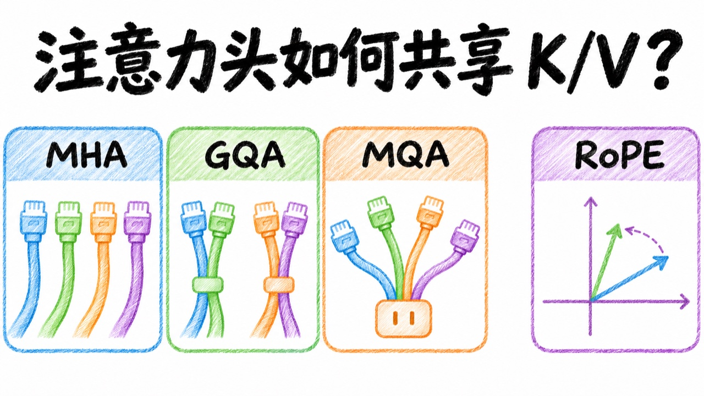
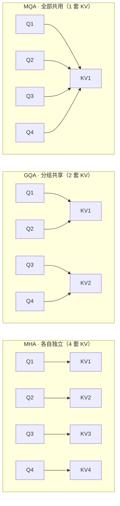
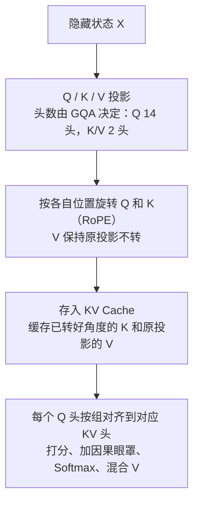

还是前面那条 CSV 备注「退款金额缺失」。阅读这句话时，我们的脑子里往往同时盯着好几层意思：一个念头在看「退款金额」讲的是哪个统计字段，另一个念头在看「缺失」对应的空值处理规则。Transformer 里的**多头注意力（Multi-Head Attention）**也是同理——与其只派一个注意力模块硬着头皮全包，不如开十几个「注意力头」，让不同头各自盯不同线索。

但「多开几个头」很快会撞上一个头疼的问题：**内存账单太吓人了**！每个头都要存一份 K（匹配键）和 V（干货值）的笔记，文章越长、并发越多，内存瞬间爆掉。于是工程师发明了 **MHA → GQA → MQA** 的「拼桌共享」设计。与此同时，还得解决另一个问题：**怎么用尽可能省事的办法，让 Q 和 K 算相似度时顺便感知到「咱俩隔了几个字」？** 这就是 **RoPE（旋转位置编码）** 登场的地方。

> **先用大白话讲明白**：
> 1. **Q、K、V 与多头**：把自注意力想象成去图书馆查资料——**Q** 是你手里写的「检索问题」，**K** 是书脊上的「索引标签」，**V** 是书翻开后真正的「正文内容」。多头就是派 4 个（或 14 个）带着不同问题清单的检索员同时去查。
> 2. **MHA vs GQA vs MQA**：如果 4 个检索员每人必须独占一套书架（K 和 V），这就是 **MHA**（最占空间）；如果让他们两两拼桌共用一套书架，就是 **GQA**（既省下大半书架空间，各人问的问题 Q 依然可以不一样）；如果全班只留一套书架大家共用，就是 **MQA**（最省空间）。
> 3. **RoPE（旋转位置编码）**：相当于给每个座位的卡片按顺序挂一个时钟指针（第 1 座转 30°、第 2 座转 60°……）。只要两个人座位间隔没变，他俩指针的夹角就**永远不变**——模型借此直接感知「距离差」。

下面沿用「退款」「金额」「缺失」「。」四个教学 Token（真实模型仍以各自 Tokenizer 为准）把每一步算透。

## 1. Q、K、V 从同一张表出发，但各干各的活

先只看一个头。对「退款」「金额」「缺失」三个位置，输入是一张特征向量表 `X`（形状 `[3, 2]`）。在第一层，`X` 来自词表查表；到深层，它已经吸收了前几层的上下文信息。

同一个 `X`，分别乘以三张在训练中学出来的权重矩阵 `W_Q`、`W_K`、`W_V`，就变出了三种角色分明的向量：

| 投影结果 | 大白话怎么理解 | 计算里负责什么 |
| --- | --- | --- |
| **Q（Query，查询）** | 我手里攥着的搜索问题 | 拿当前位置的 Q，去和前面每个可见位置的 K 做点积打分 |
| **K（Key，键）** | 我书脊上的检索标签 | 负责和别人的 Q 对暗号，决定权重有多大 |
| **V（Value，值）** | 翻开书能抄走的干货 | 权重确定后，用权重乘各个位置的 V 再加起来 |

下面我们用一组极简的 `2 × 2` 手工权重来演练一次矩阵乘法：

```text
X 的三行分别对应「退款」「金额」「缺失」
X   = [[1, 0], [0, 1], [1, 1]]
W_Q = [[0, 1], [1, 0]]  # 交换两个分量
W_K = [[1, 0], [0, 1]]  # 保持不变
W_V = [[2, 0], [0, 4]]  # 分量分别放大 2 倍和 4 倍

Q = X × W_Q    K = X × W_K    V = X × W_V
```

拿第 2 行「金额」（`[0, 1]`）算一遍：`[0, 1]` 乘以 `W_Q`（交换分量）变成 `[1, 0]`；乘 `W_K` 还是 `[0, 1]`；乘 `W_V` 变成 `[0, 4]`。三个位置全部算完，得到下面三张 `[3, 2]` 的表：

| 位置 | 输入向量 `X` | 发问用的 `Q` | 供人匹配的 `K` | 供人抄走的 `V` |
| --- | --- | --- | --- | --- |
| 1「退款」 | `[1, 0]` | `[0, 1]` | `[1, 0]` | `[2, 0]` |
| 2「金额」 | `[0, 1]` | `[1, 0]` | `[0, 1]` | `[0, 4]` |
| 3「缺失」 | `[1, 1]` | `[1, 1]` | `[1, 1]` | `[2, 4]` |

接着只替「金额」这一个位置把结果算出来：
1. **对暗号（打分）**：拿「金额」的 `Q = [1, 0]` 依次与三个 `K` 做点积，得 `[1, 0, 1]`。除以头宽平方根 `√2`，约 `[0.707, 0, 0.707]`。
2. **遮住未来 + Softmax**：位置 3 在后面，设为 `-∞` 再做 Softmax，得到权重 `[0.670, 0.330, 0]`（位置 1 占 67%，自己占 33%）。
3. **抄走干货（混合 V）**：`0.670 × [2, 0] + 0.330 × [0, 4] + 0 × [2, 4]` ≈ **`[1.340, 1.321]`**。

把全部位置合起来的通用公式是：

```text
Attention(Q, K, V) = Softmax( (Q × Kᵀ) / √d_k + mask ) × V
```

- `Q`、`K`、`V` 形状均为 `[序列长度, 每头宽度 d_k]`（本例 `3 × 2`）；`Kᵀ` 是把 `K` 行列转置；`mask` 对可见位置加 `0`、不可见位置加 `-∞`；`Softmax` 沿行方向归一化（无量纲概率）。
- **怎么直观验证 K 和 V 分工不同？** 保持 `Q` 和 `K` 丝毫不动，只把「退款」的 `V` 从 `[2, 0]` 翻倍成 `[4, 0]`——算出来的注意力权重依然是 `[0.670, 0.330, 0]`（没变！），但加权后的结果第一维从 `1.340` 翻倍成了 `2.679`。也就是说：**K 管「选谁、权重给多少」，V 管「选定之后带走什么内容」**。

## 2. MHA、GQA、MQA 怎样分配和共享 K/V？

单头算完，把视角拉大到多头（比如固定 4 个 Query 头：`Q₁～Q₄`）。每个 Query 头都有自己独立的一套 `W_Q` 来提不同问题，区别在于它们怎么使用后台保存的 K 和 V（记作 `KV₁, KV₂...`）：



| 名称 | Query 头数 | K/V 头数 | 分配方式 | 特点 |
| --- | ---: | ---: | --- | --- |
| **MHA**（Multi-Head Attention） | 4 | 4 | 一对一：每个 Q 配自己独享的 K/V | 表达最自由，但 K/V 缓存最庞大 |
| **GQA**（Grouped-Query Attention） | 4 | 2 | 分组拼桌：2 个 Q 共用 1 套 K/V | **现代主流折中**：效果逼近 MHA，显存大瘦身 |
| **MQA**（Multi-Query Attention） | 4 | 1 | 全员共用：所有 Q 读同一套 K/V | 最省显存与带宽，但多视角表达略受限 |

常见实现里，Query 头数必须能被 K/V 头数整除（比如 Qwen2.5-0.5B 有 14 个 Q 头和 2 个 K/V 头，每组正好 7 个 Q 头共享 1 套 K/V）。 [MQA 原论文](https://arxiv.org/abs/1911.02150) · [GQA 原论文图 2](https://arxiv.org/html/2305.13245#S2.SS2)

### 容易误解的问题：共用同一套 K/V 后，两个 Q 头算出的结果会一模一样吗？

**不会！** 它们共享的是「历史书架（K 和 V）」，但手里拿的「检索问题（Q）」完全不同！沿用第 1 节「金额」位置的同一套 K 和 V，让第 1 个头问 `Q₁ = [1, 0]`，第 2 个头问 `Q₂ = [0, 1]`：

| Query 头 | 对「退款」「金额」点积 | Softmax 权重（含遮罩） | 加权混合出的结果 |
| --- | --- | --- | --- |
| `Q₁ = [1, 0]` | `[1, 0]` | `[0.670, 0.330, 0]` | `[1.340, 1.321]` |
| `Q₂ = [0, 1]` | `[0, 1]` | `[0.330, 0.670, 0]` | `[0.660, 2.679]` |

看，`Q₁` 偏重读取「退款」，`Q₂` 偏重读取「金额」，混合出来的向量完全不同！

## 3. 算一次账：GQA 到底省了多少 KV 显存？

写回答时每吐一个新字，都要回看前面所有的字。如果把之前所有字每一层算过的 K 和 V 都存下来，后面每步就不用重算旧词，直接把新词的 Q 拿去和旧词缓存匹配就行——这就是 **KV Cache（键值缓存）**。缓存按 K/V 头数保存，因此 GQA 能实打实省出空间。

> **想再深入一层？** 下面的显存账本公式能帮你评估任意模型的单序列缓存需求（单位：字节 Byte；`1 KiB = 1024 B`，`1 MiB = 1024 KiB`）：

```text
单条序列 KV Cache 总字节数
= 2（K 和 V 两份）× 层数 × 序列长度 × K/V 头数 × 每头宽度 × 每个数值的字节数
```

拿真实的 **Qwen2.5-0.5B-Instruct** 配置代入试试：24 层、14 个 Query 头、2 个 K/V 头、隐藏总宽 `896`（所以每头宽 `896 ÷ 14 = 64`），使用 BF16（每数 2 字节）。当对话长度达到 **4096 Token** 时：

`2 × 24 × 4096 × 2 × 64 × 2 = 50,331,648` 字节 = **48 MiB**。

把模型规模固定，只在纸上切换 K/V 头数做对比：

| 对照配置 | Query 头数 | K/V 头数 | 每多 1 个 Token 占用 | 4096 Token 合计占用 |
| --- | ---: | ---: | ---: | ---: |
| MHA 对照 | 14 | 14 | 84 KiB | 336 MiB |
| **Qwen2.5 实际配置（GQA）** | 14 | **2** | **12 KiB** | **48 MiB** |
| MQA 对照 | 14 | 1 | 6 KiB | 24 MiB |

GQA 只用原来 **1/7** 的显存就搞定了同样长度的对话缓存，后续并发开几十条请求时，省出来的就是几 GB 的显存和读内存带宽！ [固定版 Qwen2.5 config.json](https://huggingface.co/Qwen/Qwen2.5-0.5B-Instruct/blob/7ae557604adf67be50417f59c2c2f167def9a775/config.json)

## 4. RoPE 怎样用「转动角度」记住相对位置？

现在来看第二个难题：注意力矩阵打分本身不区分顺序——把输入顺序打乱，点积结果几乎一模一样。模型怎么知道「退款」在「金额」前面 1 步，而不是后面 5 步？

**RoPE（Rotary Position Embedding，旋转位置编码）** 的想法非常巧妙：把 Q 和 K 向量的数字两两配对当成平面上的小箭头（二维向量），**它在第 `p` 号位置，就把箭头逆时针旋转 `p × 基础角度`**。注意：在 Qwen2.5 里，**只有 Q 和 K 要转动角度，V 不转**。

假设原始 Q 和 K 都是指向正右方的单位箭头 `[1, 0]`，规定每往后移 1 个位置就转 **30°**。两个单位向量的点积，数学上正好等于它们**夹角的余弦（cos）**：

| Q 在第几位 | K 在第几位 | 各自转了多少度 | 两者夹角 | 旋转后点积（`cos(夹角)`） |
| ---: | ---: | --- | ---: | ---: |
| 3 | 1 | 90°、30° | **60°** | **0.500** |
| 4 | 2 | 120°、60° | **60°** | **0.500** |
| 3 | 2 | 90°、60° | **30°** | **0.866** |

看前两行：两个词整体从 `(3, 1)` 平移到 `(4, 2)`，绝对位置全变了，但**相对间隔依然是 2 步**，所以夹角死死稳在 60°，打分还是 0.500！到了第三行，两者间距缩短成 1 步，夹角变成 30°，打分立刻变成 0.866。这就是 RoPE 能「自动编码相对距离」的数学秘密——`(R(p)Q) · (R(s)K) = Q · R(s-p)K`，只跟距离差 `s - p` 有关！

把 Qwen2.5 一层注意力里涉及 GQA、RoPE 和 KV Cache 的**严格先后顺序**串成一张图：



> **细节注意**：存入 KV Cache 的是**已经按历史位置转好角度的 K**，这样后续每一步生成新字时，老 K 拿出来直接就能用，新来的 Q 和 K 只需按自己的新位置编号转一次就行！ [RoPE 原论文](https://arxiv.org/abs/2104.09864)

## 5. 用标准库 Python 复算旋转点积和缓存账本

无需任何第三方库，存成 `rope_and_cache.py` 并运行 `python3 rope_and_cache.py`：

```python
from math import cos, isclose, radians, sin


def rotated_dot(query_position, key_position):
    # 教学情形：原始 Q 和 K 都是 (1, 0)，每个位置转 30°。
    query_angle = radians(30 * query_position)
    key_angle = radians(30 * key_position)
    return cos(query_angle) * cos(key_angle) + sin(query_angle) * sin(key_angle)


original = rotated_dot(3, 1)
shifted = rotated_dot(4, 2)
closer = rotated_dot(3, 2)
assert isclose(original, shifted)
assert not isclose(original, closer)
print(f"RoPE 同时右移：{original:.3f} → {shifted:.3f}")
print(f"RoPE 缩短间隔：{original:.3f} → {closer:.3f}")

layers = 24
sequence_length = 4096
head_dim = 64
bytes_per_value = 2
for name, kv_heads in (("MHA", 14), ("GQA", 2), ("MQA", 1)):
    per_token = 2 * layers * kv_heads * head_dim * bytes_per_value
    total = sequence_length * per_token
    print(f"{name}: {per_token / 1024:.0f} KiB/Token, {total / 1024**2:.0f} MiB")
```

实跑输出：

```text
RoPE 同时右移：0.500 → 0.500
RoPE 缩短间隔：0.500 → 0.866
MHA: 84 KiB/Token, 336 MiB
GQA: 12 KiB/Token, 48 MiB
MQA: 6 KiB/Token, 24 MiB
```

## 6. 在真实 Qwen2 模块里观察 KV Cache 形状与源码

> **想再深入一层？** 这一节可选。用三个随机初始化的单层 Qwen2 模块（纯 CPU 离线运行，无需下载权重），把 `num_key_value_heads` 分别设成 4、2、1，直接验证内存占用的倍数关系与张量维度。

```bash
python -m pip install "torch==2.11.0" "transformers==5.13.0" "tokenizers==0.22.2"
```

存成 `inspect_attention_cache.py` 并运行 `python inspect_attention_cache.py`：

```python
import torch
from transformers import Qwen2Config, Qwen2ForCausalLM

# 四个教学 Token：退款、金额、缺失、句号。
input_ids = torch.tensor([[2, 3, 4, 5]])
for name, kv_heads in (("MHA", 4), ("GQA", 2), ("MQA", 1)):
    config = Qwen2Config(
        vocab_size=16,
        hidden_size=32,
        intermediate_size=64,
        num_hidden_layers=1,
        num_attention_heads=4,
        num_key_value_heads=kv_heads,
        attn_implementation="eager",
    )
    model = Qwen2ForCausalLM(config).float().eval()

    with torch.inference_mode():
        output = model(input_ids=input_ids, use_cache=True, output_attentions=True)
        cache = output.past_key_values.layers[0]

    attention = model.model.layers[0].self_attn
    assert cache.keys.shape == cache.values.shape == (1, kv_heads, 4, 8)
    assert output.attentions[0].shape == (1, 4, 4, 4)
    assert output.logits.shape == (1, 4, 16)
    total_bytes = sum(
        tensor.numel() * tensor.element_size() for tensor in (cache.keys, cache.values)
    )
    print(
        f"{name}: Q/K 投影宽度 "
        f"{attention.q_proj.out_features}/{attention.k_proj.out_features}, "
        f"K/V 各 {tuple(cache.keys.shape)}, 合计 {total_bytes} B"
    )
```

实跑输出：

```text
MHA: Q/K 投影宽度 32/32, K/V 各 (1, 4, 4, 8), 合计 1024 B
GQA: Q/K 投影宽度 32/16, K/V 各 (1, 2, 4, 8), 合计 512 B
MQA: Q/K 投影宽度 32/8, K/V 各 (1, 1, 4, 8), 合计 256 B
```

注意看第 2 轴和总字节数：从 MHA → GQA → MQA，K/V 缓存从 `1024 B` 砍半到 `512 B` 再砍半到 `256 B`；而注意力权重张量始终是 `(1, 4, 4, 4)`——也就是说**四个 Query 头该算的打分一个都没少算，只是省掉了重复存盘的 K/V 副本**。

对应到 Transformers `v5.13.0` 源码三处关键代码：
1. **投影宽度差异**：[q_proj / k_proj / v_proj 定义](https://github.com/huggingface/transformers/blob/v5.13.0/src/transformers/models/qwen2/modeling_qwen2.py#L200)
2. **先旋转再入缓存**：[apply_rotary_pos_emb 与 past_key_values.update](https://github.com/huggingface/transformers/blob/v5.13.0/src/transformers/models/qwen2/modeling_qwen2.py#L217)
3. **计算前按组对齐**：[eager_attention_forward 中的 repeat_kv](https://github.com/huggingface/transformers/blob/v5.13.0/src/transformers/models/qwen2/modeling_qwen2.py#L161)

## 下一篇

注意力部分告一段落，接下来回到每一层里接在注意力后面的「前馈网络（FFN）」。在早期模型里，每个词经过这一关都要调用同一套完整大网络；而在现代大模型里，它进化成了**「按需点将」的混合专家结构**。请看下一篇 [F-13《MoE 如何选择专家与分配计算？》](f-13-moe-routing.md)；如果你想趁热继续看 KV Cache 怎样随推理长度增长，也可以对照跳读后面的 [F-06《KV Cache 如何加速 Decode》](f-06-kv-cache.md)。系列入口见 [LLM 与 Agent 学习路线图](llm-agent-learning-roadmap.md)。
