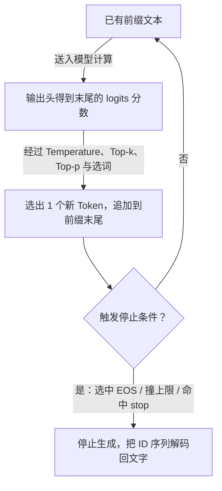

接续前面的场景：助手要补全「退款金额为空时，记为……」。经过前面一整套 Transformer 计算，输出头已经给词表里的候选字算出了原始分数（logits）。假如眼下只考虑四个候选：**「缺失」「为零」「。」**，外加一个表示「我说完了」的结束牌 **EOS（End of Sequence）**。

问题来了：每次都无脑挑分数最高的「缺失」，还是有时也允许「为零」被抽中？调 API 时经常看到的 **`temperature`、`top_k`、`top_p`、`max_tokens`、`stop`** 这堆旋钮到底在拧什么？

> **先用大白话讲明白**：大模型写句子就像**一轮一轮「查分数 → 抽签点菜 → 接在句尾再问下一轮」**：
> - **自回归（Autoregressive）**：字是一个个蹦出来的！先挑出第 1 个字粘到题目后面，整段更长的话**重新送回模型算下一轮分数**，再挑第 2 个字，直到触发停止条件。
> - **挑词旋钮怎么分工**（就像餐厅点菜决定吃什么）：
>   1. **Greedy（贪心）**：永远闭眼点排行榜第 1 名的招牌菜，稳但死板；
>   2. **Temperature（温度）**：调一调菜品之间的「受宠差距」——低温让第一名把后面远远甩开，高温让冷门菜也有机会上桌；
>   3. **Top-k**：先画死线「只留排行榜前 k 名」，其余零头一脚踢飞再抽签；
>   4. **Top-p（核采样）**：不管固定几名，把菜按热度从高到低累加，**攒够 `p`（比如 80%）把握就拉闸停手**，剩下全踢掉再抽签；
>   5. **停止条件**：遇到 **EOS**（菜上齐了自己喊停）、撞到 **`max_new_tokens`**（吃满字数上限强制结账）、或命中 **`stop`**（看到指定停止词立刻放下筷子）。



下面用一个只有 4 个词的迷你词表（先不考虑具体业务规则谁对谁错，专心看数学怎么转），手把手算完整个过程。 [F-01 分词](f-01-tokenizer-chat-template.md) · [F-02 logits 计算](f-02-transformer-logits.md)

## 1. 先把原始分数变成「抽签概率」（Softmax）

模型算出的 logits 可正可负，没法直接当抽签比例。为了让数字加起来刚好是 100%，用 **Softmax** 先求自然指数 `exp(x)`，再除以全部指数的和。

为了让你用口算就能核对，第一轮 logits 特意选成 `[ln(6), ln(3), ln(2), ln(1)]`（因为 `exp(ln(6)) = 6`，正好抵消！）：

| 候选词 | 原始分数 `logit` | 求指数 `exp(logit)` | Softmax 抽中概率 |
| --- | --- | ---: | ---: |
| 缺失 | `ln(6)` | 6 | `6 / 12 = 0.5000` |
| 为零 | `ln(3)` | 3 | `3 / 12 = 0.2500` |
| 。 | `ln(2)` | 2 | `2 / 12 ≈ 0.1667` |
| `<EOS>` | `ln(1)` | 1 | `1 / 12 ≈ 0.0833` |

分母总和是 `6 + 3 + 2 + 1 = 12`。注意区分两处出现的 Softmax：在 [F-02](f-02-transformer-logits.md) 的注意力里，Softmax 是在**已输入的位置之间**分阅读权重；而在选词这里，Softmax 是在**词表的所有候选字之间**分中签概率。

## 2. Greedy、Temperature、Top-k、Top-p 分别拧了什么？

### Greedy（贪心选择）：永远认第一名

**Greedy** 不抽签，直接挑最高分（代码里叫 `argmax`）。上表最高分是「缺失」（`ln(6)`），每次都稳稳选它。因为只比大小顺序，用不用 Softmax 结果完全一样。如果想在随机采样（**Sampling**）模式下按上面那张概率抽签，「缺失」有 50% 机会中签，「为零」也有 25% 机会。

### Temperature（温度 `T > 0`）：拉大或缩小贫富差距

在求 Softmax 之前，把每个 logit 先除以正数 `T`（`logit / T`）：
- `T = 1`：原汁原味不改。
- `T = 0.5`（降温，更稳重保守）：分数翻倍，`exp(2 × ln(6)) = 6² = 36`。四项变成 `[36, 9, 4, 1]`（和为 50），「缺失」的中签率一下从 50% 猛冲到 **`36/50 = 72%`**！
- `T = 2`（升温，更发散有创意）：分数折半，变成 `[√6, √3, √2, 1]`，第一名跌到 `37.14%`，连 `<EOS>` 都有了 15% 的机会。

| 温度 `T` | 缺失 | 为零 | 。 | `<EOS>` |
| ---: | ---: | ---: | ---: | ---: |
| **0.5** | **0.7200** | 0.1800 | 0.0800 | 0.0200 |
| **1.0** | 0.5000 | 0.2500 | 0.1667 | 0.0833 |
| **2.0** | 0.3714 | 0.2626 | 0.2144 | 0.1516 |

> **容易踩的坑**：数学公式里不能真的除以 `0`，所以你在模型 API 里传 **`temperature=0`** 时，实际上是服务框架拦截后帮你直接切成了 **Greedy 贪心模式**（`do_sample=False`），并不会真拿去当分母除。

### Top-k vs Top-p：怎么把不靠谱的尾巴砍掉？

- **Top-k（硬按名额卡）**：比如设 `k = 2`，只保留前两名「缺失（0.50）」和「为零（0.25）」，后两名直接归零。前两名加起来只有 0.75，重新除以 0.75 拉回总和 1，新抽签概率变成 **`[2/3, 1/3, 0, 0]`**。
- **Top-p / 核采样（按把握程度动态卡）**：比如设 `p = 0.8`，先从高到低排队往里加，累计刚满 `0.8` 立刻关门：

| 加入候选 | 单项概率 | 累计到这儿 | 满 0.8 了吗？ |
| --- | ---: | ---: | --- |
| 缺失 | 0.5000 | 0.5000 | 还没 |
| 为零 | 0.2500 | 0.7500 | 还没 |
| 。 | 0.1667 | **0.9167** | **够了！保留这一项后关门** |
| `<EOS>` | 0.0833 | — | 被踢掉 |

留下的前三项 `[6/12, 3/12, 2/12]` 重新归一化为 **`[6/11, 3/11, 2/11, 0]`**。Top-p 最聪明的地方在于「看菜下碟」：如果模型非常笃定第一名占 90%，那菜单瞬间缩成只剩 1 个选项；如果十几个词势均力敌，菜单就自动放宽留多几个候选。 [核采样原论文](https://arxiv.org/abs/1904.09751)

### 两个参数一起开，到底谁先谁后？


在 Transformers `v5.13.0` 默认顺序里，按 **`Temperature → Top-k → Top-p`** 流水线执行！举个例子你就懂这顺序有多重要：如果直接单开 `top_p=0.65`，原本前两项 `0.50 + 0.25 = 0.75`，所以会留 2 项；但如果你同时开了 `top_k=2` + `top_p=0.65`，`Top-k` 先把前两项归一化成了 `[2/3≈0.667, 1/3]`——轮到 `Top-p` 时，第一项独自就已经 `0.667 >= 0.65`，于是直接砍成只剩第 1 名！ [Transformers 采样流程源码](https://github.com/huggingface/transformers/blob/v5.13.0/src/transformers/generation/utils.py#L1261)

## 3. 走两轮生成，分清三种停止条件

现在用 Greedy 贪心法连续跑两三步，观察前缀变长后分数表怎么跟着变化（下面直接写出指数权重以便心算）：

| 第几轮 | 已追加进来的内容 | 指数分数 `[缺失, 为零, 。, EOS]` | 本轮挑谁 |
| ---: | --- | --- | --- |
| 第 1 轮 | （空） | `[6, 3, 2, 1]` | **缺失** |
| 第 2 轮 | `缺失` | `[1, 1, 8, 2]` | **。** |
| 第 3 轮 | `缺失。` | `[1, 1, 2, 8]` | **`<EOS>`** |

注意看三种停止方式到底是怎么在半路截停的：

| 停止条件 | 哪一轮停下 | 用户最后看到的文字 | 大白话解释与边界注意 |
| --- | --- | --- | --- |
| **选中 `<EOS>`** | 第 3 轮 | `'缺失。'` | 模型自己说完主动交卷。注意：如果预算不够 3 轮，它根本没机会走到选中 `<EOS>` 那步！ |
| **`max_new_tokens=2`** | 第 2 轮结束 | `'缺失。'` | 只算**新增**生成的 Token 数（不算开头喂进去的提示词），刚吐满 2 个强行切断 |
| **停止文本 `stop="。"`** | 第 2 轮命中 | `'缺失'` | 按字符内容匹配末尾（一段停止词可能跨几个 Token），命中后通常会把停用词裁掉 |

> **容易踩的坑**：不同推理服务和 SDK 对 `stop` 停用词「到底吐不吐出来、留不留尾巴」约定可能不一样，做 JSON 或文本解析前一定要拿目标引擎实测一次。 [Transformers 停止条件源码](https://github.com/huggingface/transformers/blob/v5.13.0/src/transformers/generation/stopping_criteria.py)

## 4. 用标准库 Python 复现五种采样和三种停法

把代码保存为 `decode_demo.py`，只用 Python 标准库，运行 `python3 decode_demo.py`（注：计算 `exp` 前先减去最大值 `peak` 是为了防浮点数上溢，分子分母同除常数不影响概率分布）：

```python
from math import exp, isclose, log
from random import Random

VOCAB = ("缺失", "为零", "。", "<EOS>")
EOS = VOCAB[-1]
FIRST_LOGITS = [log(mass) for mass in (6, 3, 2, 1)]


def candidate_probs(logits, temperature=1.0, top_k=None, top_p=1.0):
    scores = [score / temperature for score in logits]
    peak = max(scores)
    masses = [exp(score - peak) for score in scores]
    ranked = sorted(range(len(scores)), key=lambda index: scores[index], reverse=True)
    kept_by_k = ranked[:top_k]
    total = sum(masses[index] for index in kept_by_k)

    kept_by_p = []
    cumulative = 0.0
    for index in kept_by_k:
        kept_by_p.append(index)
        cumulative += masses[index] / total
        if cumulative >= top_p:
            break

    remaining_mass = sum(masses[index] for index in kept_by_p)
    return [masses[i] / remaining_mass if i in kept_by_p else 0.0 for i in range(len(scores))]


for name, options in (
    ("T=1", {}),
    ("T=0.5", {"temperature": 0.5}),
    ("T=2", {"temperature": 2.0}),
    ("Top-k=2", {"top_k": 2}),
    ("Top-p=0.8", {"top_p": 0.8}),
    ("Top-k=2, Top-p=0.65", {"top_k": 2, "top_p": 0.65}),
):
    probs = candidate_probs(FIRST_LOGITS, **options)
    assert isclose(sum(probs), 1.0)
    print(name, [round(prob, 4) for prob in probs])

weights = candidate_probs(FIRST_LOGITS, top_k=2)
picked = Random(0).choices(VOCAB, weights=weights, k=1)[0]
print("固定种子抽一次", picked)

# 用固定分数模拟模型。键是相对于提示已经追加的 Token。
SCORE_MASSES = {
    (): (6, 3, 2, 1),
    ("缺失",): (1, 1, 8, 2),
    ("缺失", "。"): (1, 1, 2, 8),
}


def greedy_generate(max_new_tokens, stop_text=None):
    generated = []
    for _ in range(max_new_tokens):
        logits = [log(mass) for mass in SCORE_MASSES[tuple(generated)]]
        index = max(range(len(logits)), key=lambda i: logits[i])
        token = VOCAB[index]
        generated.append(token)

        if token == EOS:
            return generated, "".join(generated[:-1]), "EOS"

        text = "".join(generated)
        if stop_text and text.endswith(stop_text):
            return generated, text[:-len(stop_text)], "stop_text"

    return generated, "".join(generated), "max_new_tokens"


for limit, stop in ((4, None), (2, None), (4, "。")):
    generated, text, reason = greedy_generate(limit, stop)
    print("逐步选中的 Token", generated, "可见文本", repr(text), "停止于", reason)

assert greedy_generate(4) == (["缺失", "。", EOS], "缺失。", "EOS")
assert greedy_generate(2) == (["缺失", "。"], "缺失。", "max_new_tokens")
assert greedy_generate(4, "。") == (["缺失", "。"], "缺失", "stop_text")
```

实跑输出：

```text
T=1 [0.5, 0.25, 0.1667, 0.0833]
T=0.5 [0.72, 0.18, 0.08, 0.02]
T=2 [0.3714, 0.2626, 0.2144, 0.1516]
Top-k=2 [0.6667, 0.3333, 0.0, 0.0]
Top-p=0.8 [0.5455, 0.2727, 0.1818, 0.0]
Top-k=2, Top-p=0.65 [1.0, 0.0, 0.0, 0.0]
固定种子抽一次 为零
逐步选中的 Token ['缺失', '。', '<EOS>'] 可见文本 '缺失。' 停止于 EOS
逐步选中的 Token ['缺失', '。'] 可见文本 '缺失。' 停止于 max_new_tokens
逐步选中的 Token ['缺失', '。'] 可见文本 '缺失' 停止于 stop_text
```

> **想再深入一层？** 试着把第 4 节最后一组的 `(4, "。")` 改成 `(4, "缺失。")` 再跑一遍，能直观验证「停止文本可以跨越多于 1 个 Token 才触发」。文中五组温度与截断概率分布，已对照 Transformers `v5.13.0` [LogitsProcessor 实现](https://github.com/huggingface/transformers/blob/v5.13.0/src/transformers/generation/logits_process.py#L473) 核对一致。

## 下一篇

搞明白了「怎么一轮接一轮往外蹦字」后，工程上的核心问题马上来了：第 1 个字和第 2 个字跑一次模型的速度为什么天差地别？请看下一篇 [F-05《Prefill 与 Decode：第一个 Token 从哪来？》](f-05-prefill-and-decode.md)，用 Qwen 实测跟踪整段输入（Prefill）与单字增量（Decode）的两段真实计算。系列入口见 [LLM 与 Agent 学习路线图](llm-agent-learning-roadmap.md)。
