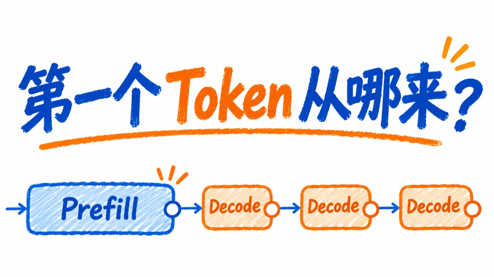

我们向报表助手发出「请汇总 CSV。」。CSV 是逗号分隔值文件。系统说明、用户消息和回答起点经过对话模板后，在上一篇 Qwen 实验里一共是 **21 个 Token**。Token 是分词器切出的处理单位，词表给每个单位分配一个整数编号，也就是 **Token ID**。假如模型的第一段回答是「当然」，这两个字是什么时候算出来的？ [F-01 的完整输入](https://blog.lacknb.cn/articles/2026/11/19/1795068393122.html)

这里讨论普通的从左到右生成，一次选出一个新 Token。**Prefill（预填充）**处理已经知道的提示。**Decode（逐步解码）**在前一轮选出 Token 之后，处理新增位置，为下一个 Token 打分。两阶段用的是同一个模型，主要区别是本次送进模型的输入范围。

## 1. 先看 21、21、22 这三个数

模型做一次**前向计算**，就是拿输入和已经训练好的权重，沿着网络算出结果。对文本模型，输出头会给词表中的候选 Token 打分，这一排原始分数叫 **logits**。已有提示的位置 1～21 在 Prefill 中一起处理，紧接着就能从位置 21 的 logits 选出第 22 个位置的 Token。 [F-02 的输出头实验](https://blog.lacknb.cn/articles/2026/11/20/1795135053358.html)

| 操作 | 这次实际送入模型的位置 | 计算后已缓存的长度 | 这一轮的分数用来选择 |
| --- | --- | ---: | --- |
| Prefill 前向 | 1～21，共 21 个 | 21 | 第 22 个位置，也就是首个输出 |
| 用 Prefill 的分数选择 | 这一步比较分数，不跑新的模型前向 | 21 | 把首个新 ID 追加到序列 |
| 第一次增量 Decode 前向 | 第 22 个位置，共 1 个 | 22 | 第 23 个位置，也就是第二个输出 |
| 再选择一个 | 比较上一行刚算出的分数 | 22 | 把第二个新 ID 追加到序列 |

```text
提示 21 个 ID → Prefill → 位置 21 的分数 → 选出输出 1
                                 保存历史 K、V       │
                                                     ▼
                            Decode 读缓存 + 输入输出 1 → 选出输出 2
```

如果只生成一个 Token，模型在选出第一项后就可以停下来。此时这个新 Token 已经是输出序列的一员，但本次请求没有再把它送入下一次前向计算。观察缓存长度时，数的是已经**计算过**的序列位置。服务的追踪记录有时会把首个 Token 的选择和回传也划入「首轮解码」，理解具体记录时要看事件边界。

## 2. 为什么提示能一起算，输出却要等上一轮？

提示的 21 个 ID 在计算前就已经齐了。在每一层里，模型可以组成带有 21 个位置的张量，让这些已知位置一起进行矩阵运算。**因果遮罩**保证第 8 个位置只能读它自己及前 7 个位置。并行计算与可见范围可以同时成立，因为遮罩会把未来位置排除。层与层仍依次运行。

后续输出则有数据依赖。模型还不知道第 22 个位置会选「当然」还是「好的」，也就无法确定第 23 个位置应该接着哪一条内容计算。确定新 ID 后，常规增量计算只需给它做一遍前向，之前位置的 **K（Key，匹配用的键）**和 **V（Value，读取用的值）**直接从 **KV Cache（键值缓存）**取。第 22 个位置的 **Q（Query，当前查询）**仍可以查阅全部有效历史。 [Transformer 因果注意力](https://arxiv.org/abs/1706.03762) · [Transformers 缓存说明](https://huggingface.co/docs/transformers/v5.13.0/en/cache_explanation)

这里的**解码**也常用来称呼选词规则，包括 F-04 里的贪心与采样。本文说「Decode 前向」时，专指把新增位置送进网络，算下一轮分数的这一步。

## 3. 在 Qwen 上跑两次前向

沿用 F-02 的 Python 环境。建议 Python 3.11 或 3.12，用 `python -m pip install "torch==2.11.0" "transformers[chat-template]==5.13.0" "tokenizers==0.22.2"` 安装依赖。首次运行需要从 Hugging Face 下载约 1 GB 模型权重，按 32 位浮点数加载后权重约占 2 GB 内存。实验只走两步，使用 CPU（中央处理器）。

把代码保存为 `prefill_decode.py`，运行 `python prefill_decode.py`。`argmax` 选择分数最高的候选编号。形状里的第一轴是样本数，第二轴是这次送入的位置数。`logits_to_keep=1` 要求只保留最后一个位置的输出分数，提示中的 21 个位置仍经过模型主体。

```python
import torch
from transformers import AutoModelForCausalLM, AutoTokenizer

NAME = "Qwen/Qwen2.5-0.5B-Instruct"
REVISION = "7ae557604adf67be50417f59c2c2f167def9a775"
tokenizer = AutoTokenizer.from_pretrained(NAME, revision=REVISION)
model = AutoModelForCausalLM.from_pretrained(
    NAME, revision=REVISION, dtype=torch.float32
).eval()
messages = [
    {"role": "system", "content": "你是报表助手。"},
    {"role": "user", "content": "请汇总 CSV。"},
]
prompt = tokenizer.apply_chat_template(
    messages, add_generation_prompt=True, tokenize=True,
    return_dict=True, return_tensors="pt",
)["input_ids"]

with torch.inference_mode():
    prefill = model(input_ids=prompt, use_cache=True, logits_to_keep=1)
    first = prefill.logits[:, -1, :].argmax(dim=-1, keepdim=True)
    cache_length = prefill.past_key_values.get_seq_length()
    step = model(
        input_ids=first, past_key_values=prefill.past_key_values,
        use_cache=True, logits_to_keep=1,
    )
    second = step.logits[:, -1, :].argmax(dim=-1, keepdim=True)
    full = model(
        input_ids=torch.cat((prompt, first), dim=1),
        use_cache=False, logits_to_keep=1,
    )

assert prompt.shape == (1, 21)
assert cache_length == 21 and step.past_key_values.get_seq_length() == 22
torch.testing.assert_close(step.logits, full.logits, atol=1e-4, rtol=1e-4)
print("Prefill 输入", tuple(prompt.shape), "缓存长度", cache_length)
print("首个输出", first.item(), repr(tokenizer.decode(first[0])))
print("Decode 输入", tuple(first.shape), "缓存长度", step.past_key_values.get_seq_length())
print("第二个输出", second.item(), repr(tokenizer.decode(second[0])))
print("增量计算和整段重算得到的下一步 logits 在容差内一致")
```

实跑输出如下。用固定权重与计算设置对照时，应看到提示长度为 21，第一次增量输入只有 1 个位置。最后的断言比较的是整个词表的下一轮分数，允许浮点计算的小误差。

```text
Prefill 输入 (1, 21) 缓存长度 21
首个输出 103942 '当然'
Decode 输入 (1, 1) 缓存长度 22
第二个输出 73670 '可以'
增量计算和整段重算得到的下一步 logits 在容差内一致
```

再想一个边界：如果在选出首个输出后立刻停止，就不会调用上面的 `step = model(...)`。此时缓存长度仍是 21。对比整段重算是验收用的控制组，实际推理不会在同一个生成步重复跑两条路径。

## 4. 源码从哪里进

1. 在固定版 Transformers 的 `Qwen2ForCausalLM.forward()` 找 `logits_to_keep`，看输出头如何只对选中的位置打分。 [Qwen2 输出头源码](https://github.com/huggingface/transformers/blob/v5.13.0/src/transformers/models/qwen2/modeling_qwen2.py#L417)
2. 到 `Qwen2Attention.forward()` 看 K、V 怎么进入 `past_key_values.update()`。首次传整段输入，增量轮传新位置加旧缓存。 [Qwen2 注意力源码](https://github.com/huggingface/transformers/blob/v5.13.0/src/transformers/models/qwen2/modeling_qwen2.py#L217)

下一篇 **F-06《KV Cache 如何加速 Decode》**会把缓存拆成每层的 K、V 张量，继续数长度和字节。 [学习路线图](https://blog.lacknb.cn/articles/2026/11/19/1795058329577.html)

[F-04 自回归生成与采样](f-04-autoregressive-sampling.md) · [F-06 KV Cache 如何加速 Decode](f-06-kv-cache.md)
