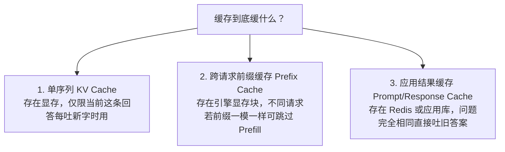

在 [F-05《Prefill 与 Decode》](f-05-prefill-and-decode.md) 里，我们已经看见模型每往外吐一个新字，只需要把这 **1 个新字** 送进网络，不用把前面 21 个旧字全部重头再跑一遍——靠的就是名叫 `past_key_values` 的 **KV Cache（Key-Value Cache，键值缓存）**。

但如果对话一路写到 4096 个词，这个小本子究竟在内存里记了什么？它能省下多少计算量，又会花掉多少宝贵的显存？工程上常听到的「前缀缓存（Prefix Cache）」和「接口缓存」跟它是一回事吗？

> **先用大白话讲明白**：想象你在写一篇长作文，每写完一个新词，都要回头参考前面所有字的意思。
> - **没有 KV Cache**：每写一个新词，你都要把前面已经写过的几千字**从第 1 页重新提炼笔记一遍**——写第 1000 个字重算 999 个旧字，累死个人！
> - **有了 KV Cache**：第一遍读完题干（Prefill）时，顺手把每一层注意力提炼出的 **K（索引标签）** 和 **V（干货内容）** 抄进笔记本留着（**因为因果眼罩的存在，前面旧字的笔记绝不会被后面的新字改变**）。之后每写一个新词（Decode），只需算这个新词自己的 Q、K、V，把新 K、V 贴在笔记本最后一行，再翻翻整本笔记就能算出答案——**省下了天量的重复计算，代价比是多占一块存笔记的内存**。


## 1. 为什么旧位置的 K、V 抄下来以后永远不用改？

假设提示缩成四个教学 Token：「退款」「金额」「缺失」「。」。模型有好多层，**每一层都必须独立存一本自己的 KV 笔记**，因为第 1 层算的是字面意思，第 24 层算的是抽象语义，每层输入和权重都不一样。

写完第 4 个词后，本子里记着 `K = [K1, K2, K3, K4]` 和 `V = [V1, V2, V3, V4]`。为什么现在追加第 5 个词时，不需要回过头去改写 `K1..K4`？

答案就在前几篇讲过的**因果遮罩（Causal Mask）**：在算第 1～4 个位置的时候，它们本来就严禁偷看第 5 个位置！所以只要模型权重不变、前面四个词的序列和位置编号不变，哪怕后面跟来第 5 个词、第 500 个词，前面这四个位置产出的 K 和 V **数学上恒定不变**。

至于第 1～4 个位置的 **Q（Query，查询）** 为什么不存？因为 Q 只用来在当年那一步「主动去打探历史」，算完那一轮就彻底用废了，后面的新词永远不会来查前面旧词的 Q。

## 2. 打开笔记看一眼：四维张量的每一维代表什么？

拿一个迷你两层模型来查账：1 条请求（批次 `1`）、每层 2 个 K/V 头（按 [F-03](f-03-attention-heads-rope.md) 的 GQA 分组共享）、每个头向量宽 `8` 个数、使用 **FP32（32 位浮点数，每个数占 4 字节）**。

追加第 5 个 Token 前后，**每一层**的 K 张量和 V 张量形状变化如下：

| 第几维（轴） | 代表什么含义 | 追加第 5 个前 | 追加第 5 个后 |
| ---: | --- | ---: | ---: |
| 0 | **批次（Batch）**：同时服务几条请求 | 1 | 1 |
| 1 | **K/V 头数**：独立的键值组数 | 2 | 2 |
| 2 | **序列位置（Seq Len）**：笔记本目前已记几行 | **4** | **5** |
| 3 | **每头宽度（Head Dim）**：每行向量的数字个数 | 8 | 8 |

单看一层的 K（形状 `[1, 2, 5, 8]`）：一共 `1 × 2 × 5 × 8 = 80` 个数，占 `80 × 4 = 320` 字节；加上同样大小的 V，单层占 640 字节；一共两层就是 **1280 字节**。

> **想再深入一层？** 把这一算法写成通用显存账本公式（单位：字节 Byte；`1 MiB = 1024² B`）：

```text
KV Cache 内容总字节数 = 2 × 层数 × 批次数 × 已存位置数 × K/V 头数 × 每头宽度 × 单数字节数
```
（开头的 `2` 代表 K 和 V 两份张量。）

代入真实 **Qwen2.5-0.5B-Instruct** 的参数：24 层、2 个 K/V 头、每头宽 64，使用 **BF16（2 字节）** 存储。当 1 条对话拉长到 **4096 Token** 时，光是内容张量就占：
`2 × 24 × 1 × 4096 × 2 × 64 × 2 = 50,331,648` 字节 = **48 MiB**。

## 3. 省下了重算，但留下了一笔「读取内存」的账单

> **容易踩的坑**：很多人以为「既然存了缓存，Decode 无论对话多长，速度永远一样快」。
> **并不完全对！** KV Cache 省掉了「重新把旧词送过 24 层矩阵乘一遍」的算力开销，但每新吐一个字，新字的 Q 依然要去跟笔记本里**所有历史 K 打一遍分，再把所有历史 V 读出来加权平均**！当上下文翻倍变成 4096、32768 甚至十万字时，单步 Decode 要从显存往计算核心搬运的 K/V 数据量也会同步成倍暴涨，最终把显卡带宽彻底挤满。

另外，工程界常混用三种名字里都带「Cache」的技术，一次分清它们存在哪、谁用得上：



| 缓存名称 | 存的是什么 | 什么时候能复用？ | 后续 [SERV-04](serv-04-paged-attention-batching.md) 会展开 |
| --- | --- | --- | --- |
| **单序列增量缓存** | 本条会话正在算的各层 K/V | 同一句回答继续吐下一个字时 | 避免每步重算已写出的历史 |
| **跨请求前缀缓存** | 已经算好的一大段固定前缀 K/V 块 | 新请求开头（如同一份超长系统规范+CSV 字段说明）与老请求一字不差时 | 省掉重复的 Prefill 阶段，但仍要逐字 Decode 新回答 |
| **应用结果缓存** | 现成的文字回答或 JSON 产物 | 业务允许相同输入直接沿用上次答案时 | 模型压根不用启动计算 |

生产环境下开启前缀缓存时，必须特别小心**租户隔离**——不同客户的私有数据前缀哪怕凑巧一样，权限上也绝不能乱共享；而如何把内存切成小页按需分配减少碎片，就是 [SERV-04](serv-04-paged-attention-batching.md) 要讲的 **PagedAttention（分页注意力）**。 [PagedAttention 原论文](https://arxiv.org/abs/2309.06180)

## 4. 打开两层真实缓存，亲手校验旧切片和 1280 字节

下面用两层随机初始化的 Qwen2 模型在 CPU 上离线运行（无需下载大模型权重）。存为 `inspect_kv.py`，执行 `python inspect_kv.py`：

```python
import torch
from transformers import Qwen2Config, Qwen2ForCausalLM

torch.manual_seed(7)
config = Qwen2Config(
    vocab_size=32, hidden_size=32, intermediate_size=64,
    num_hidden_layers=2, num_attention_heads=4, num_key_value_heads=2,
    attn_implementation="eager",
)
model = Qwen2ForCausalLM(config).eval()
prompt = torch.tensor([[2, 3, 4, 5]])
next_id = torch.tensor([[6]])

with torch.inference_mode():
    first = model(input_ids=prompt, use_cache=True)
    cache = first.past_key_values
    old_keys = [layer.keys.clone() for layer in cache.layers]
    old_values = [layer.values.clone() for layer in cache.layers]
    print("追加前", [tuple(layer.keys.shape) for layer in cache.layers])
    step = model(input_ids=next_id, past_key_values=cache, use_cache=True)
    full = model(input_ids=torch.cat((prompt, next_id), dim=1), use_cache=False)

for i, layer in enumerate(step.past_key_values.layers):
    assert layer.keys.shape == layer.values.shape == (1, 2, 5, 8)
    torch.testing.assert_close(layer.keys[:, :, :4, :], old_keys[i])
    torch.testing.assert_close(layer.values[:, :, :4, :], old_values[i])
torch.testing.assert_close(step.logits[:, -1], full.logits[:, -1], atol=1e-5, rtol=1e-5)

size = sum(
    tensor.numel() * tensor.element_size()
    for layer in cache.layers for tensor in (layer.keys, layer.values)
)
assert size == 2 * 2 * 1 * 5 * 2 * 8 * 4
print("追加后", [tuple(layer.keys.shape) for layer in cache.layers])
print("两层 K/V 内容字节数", size)
print("历史切片保持一致，增量 logits 与整段重算一致")
```

实跑输出：

```text
追加前 [(1, 2, 4, 8), (1, 2, 4, 8)]
追加后 [(1, 2, 5, 8), (1, 2, 5, 8)]
两层 K/V 内容字节数 1280
历史切片保持一致，增量 logits 与整段重算一致
```

> **代码细节提醒**：脚本里特意先 `.clone()` 复制了旧切片，才把 `cache` 传进下一步。因为在 Transformers `v5.13.0` 的 [Qwen2Attention.forward()](https://github.com/huggingface/transformers/blob/v5.13.0/src/transformers/models/qwen2/modeling_qwen2.py#L217) 调用的 `past_key_values.update()`（见 [cache_utils.py](https://github.com/huggingface/transformers/blob/v5.13.0/src/transformers/cache_utils.py)）会**原地修改（in-place）**这个缓存对象，如果不提前拷贝就对比不出来追加前后的差异。

## 下一篇

搞清楚跨步骤常驻内存的 KV Cache 后，接下来看注意力计算「正在进行的那一瞬间」产生的短命临时大表——当一次输入长达几万字时，计算 `Q × Kᵀ` 产生的一张 `N × N` 注意力打分表甚至能直接塞爆显卡！下一篇 [F-14《FlashAttention 如何减少注意力的显存读写？》](f-14-flashattention.md) 拆解它怎么做到「不写大表、精准算对」。系列入口见 [LLM 与 Agent 学习路线图](llm-agent-learning-roadmap.md)。

[F-05 Prefill 与 Decode](f-05-prefill-and-decode.md) · [F-14 FlashAttention 如何减少注意力的显存读写](f-14-flashattention.md)
