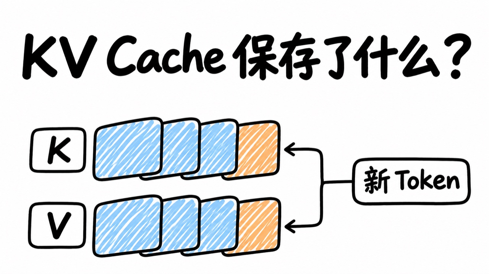

上一篇 F-05 让模型先读完「请汇总 CSV。」的提示，再增量计算首个新位置。CSV 是逗号分隔值文件。现在把历史记录缩成四个教学 **Token**，也就是四个分词位置，看看新位置加入时，哪些数据需要重读，哪些数据需要重算。

**KV Cache（Key-Value Cache，键值缓存）**在这里是每层注意力保留的历史向量。**K（Key，键）**负责和当前 **Q（Query，查询）**匹配打分，**V（Value，值）**提供被加权读取的信息。**Decode（逐步解码）**每步生成一个新 Token，当前查询需要历史 K、V；之前位置的 Q 已经用完。 [F-03 的 Q、K、V 手算](https://blog.lacknb.cn/articles/2026/11/20/1795154536776.html) · [Transformers 缓存说明](https://huggingface.co/docs/transformers/v5.13.0/en/cache_explanation)

## 1. 从四个位置到五个位置

设提示是「退款、金额、缺失、。」四个教学 Token，随后新增一个位置。只看一个注意力层，先把旧位置的 K、V 写入缓存，新一轮再把第五个位置的 K、V 接到历史后面。

```text
提示前向后  K = [K1 K2 K3 K4]       V = [V1 V2 V3 V4]
增量前向后  K = [K1 K2 K3 K4 K5]    V = [V1 V2 V3 V4 V5]
计算位置 5 时，Q5 拿这五份 K 打分，并按权重读取五份 V。
```

每一层都独立保存自己的 K、V，因为各层的输入与权重不同。因果遮罩保证第 1～4 个位置在旧计算中无法看到第 5 个位置。在同一请求、模型、位置规则和前缀保持一致时，追加第 5 个位置不会改变前面已有的表示，这使复用成为可能。相同文本若处在不同前缀或位置，复用条件就要重新判断。

选出位置 5 的编号和处理位置 5 是相继发生的两件事。缓存增加到 5，发生在这个编号真正被送进模型之后。

## 2. 张量的每一轴代表什么？

下面用一条请求、两层、每层两个 K/V 头、每头 8 个数字来演示。**头**是一组并行注意力计算。例子有 4 个 Query 头，分成两组共享 K、V，这种结构叫 **GQA（Grouped-Query Attention，分组查询注意力）**。常见的缓存轴排列如下。

| 轴 | 含义 | 追加前 | 追加后 |
| --- | --- | ---: | ---: |
| 批次 | 一次处理的序列数 | 1 | 1 |
| K/V 头 | 独立的键值向量组数 | 2 | 2 |
| 序列位置 | 已计算并保留的位置数 | 4 | 5 |
| 头宽 | 每个头的一条向量有几个数 | 8 | 8 |

所以每层 K 和 V 都从 `[1, 2, 4, 8]` 变到 `[1, 2, 5, 8]`。如果用 **FP32（32 位浮点数）**，每个数占 4 字节，一层的 K 和 V 共占 `2 × 1 × 2 × 5 × 8 × 4 = 640` 字节，两层就是 **1280 字节**。

一般地，在每层形状相同且完整保留所有位置时，可以用这条算式计算：

```text
K/V 内容字节数 = 2 × 层数 × 批次 × K/V 头数 × 已保留位置数 × 头宽 × 单元素字节数
第一项 2 表示 K 和 V 两份张量。
```

例如固定版 **Qwen2.5-0.5B-Instruct** 有 24 层、2 个 K/V 头、每头宽 64。`0.5B` 表示约五亿模型参数。用 **BF16（BFloat16，16 位浮点格式）**缓存，每个数 2 字节，一条 4096 位置序列的 K/V 内容为 `2 × 24 × 1 × 2 × 4096 × 64 × 2`，合 **48 MiB**。MiB 是以 `1024²` 字节为单位。显存还要容纳模型权重、临时张量和缓存管理的开销。 [Qwen 固定版配置](https://huggingface.co/Qwen/Qwen2.5-0.5B-Instruct/blob/7ae557604adf67be50417f59c2c2f167def9a775/config.json)

## 3. 省下的是重算，历史读取还在

缓存省下了每步重复处理前面全部位置的工作。常规全注意力仍要让新 Q 和历史 K 匹配，并按权重读取历史 V。上下文翻倍时，公式中的历史缓存内容翻倍，一步解码要访问的历史范围也扩大。用上例的 48 MiB，可以理解 4096 位置下历史张量的逻辑大小，实际内存读写量还受实现、分块、并行和硬件缓存影响。用这个容量直接预测毫秒数会漏掉其他开销。

工程里有三种容易混淆的「缓存」：

| 场景 | 存什么 | 什么时候复用 |
| --- | --- | --- |
| 单序列增量缓存 | 当前请求的各层历史 K/V | 同一条输出继续生成时 |
| 跨请求前缀缓存 | 已算过的前缀 K/V 块 | 有有效、完全匹配的 Token 前缀，且模型和运行配置兼容时 |
| 应用结果缓存 | 最终答案或业务产物 | 应用层确定同一请求条件可以直接重用产物时 |

前缀复用可以跳过已命中的提示计算，仍要生成当前请求需要的新输出。生产实现还会考虑模板、模型版本、租户与访问边界。PagedAttention 是按固定大小的块管理缓存位置的一种方法，路线图在 SERV-04 继续展开。 [PagedAttention 论文](https://arxiv.org/abs/2309.06180)

## 4. 打开实际缓存做一次验收

实验用两层随机初始化的 Qwen2 模型，在 CPU（中央处理器）上执行，运行时无需下载预训练权重。用 Python 3.11 或 3.12，安装 `python -m pip install "torch==2.11.0" "transformers==5.13.0" "tokenizers==0.22.2"`。保存为 `inspect_kv.py` 后执行 `python inspect_kv.py`。

`past_key_values` 保存各层的缓存，`numel()` 统计元素数，`element_size()` 给出每个元素的字节数。程序检查旧切片保持一致，并将增量计算的最后一行 logits（候选原始分数）和整段重算对照。

```python
import torch
from transformers import Qwen2Config, Qwen2ForCausalLM

torch.manual_seed(7)
config = Qwen2Config(
    vocab_size=32, hidden_size=32, intermediate_size=64,
    num_hidden_layers=2, num_attention_heads=4, num_key_value_heads=2,
    attn_implementation="eager",
)
model = Qwen2ForCausalLM(config).eval()
prompt = torch.tensor([[2, 3, 4, 5]])
next_id = torch.tensor([[6]])

with torch.inference_mode():
    first = model(input_ids=prompt, use_cache=True)
    cache = first.past_key_values
    old_keys = [layer.keys.clone() for layer in cache.layers]
    old_values = [layer.values.clone() for layer in cache.layers]
    print("追加前", [tuple(layer.keys.shape) for layer in cache.layers])
    step = model(input_ids=next_id, past_key_values=cache, use_cache=True)
    full = model(input_ids=torch.cat((prompt, next_id), dim=1), use_cache=False)

for i, layer in enumerate(step.past_key_values.layers):
    assert layer.keys.shape == layer.values.shape == (1, 2, 5, 8)
    torch.testing.assert_close(layer.keys[:, :, :4, :], old_keys[i])
    torch.testing.assert_close(layer.values[:, :, :4, :], old_values[i])
torch.testing.assert_close(step.logits[:, -1], full.logits[:, -1], atol=1e-5, rtol=1e-5)

size = sum(
    tensor.numel() * tensor.element_size()
    for layer in cache.layers for tensor in (layer.keys, layer.values)
)
assert size == 2 * 2 * 1 * 5 * 2 * 8 * 4
print("追加后", [tuple(layer.keys.shape) for layer in cache.layers])
print("两层 K/V 内容字节数", size)
print("历史切片保持一致，增量 logits 与整段重算一致")
```

实跑结果：

```text
追加前 [(1, 2, 4, 8), (1, 2, 4, 8)]
追加后 [(1, 2, 5, 8), (1, 2, 5, 8)]
两层 K/V 内容字节数 1280
历史切片保持一致，增量 logits 与整段重算一致
```

在 Transformers v5.13.0 中，沿 `Qwen2Attention.forward()` 找到 `past_key_values.update(...)`。通过该调用进入缓存对象的对应层，留意更新可能修改原缓存实例。因此程序在追加前先复制旧切片用于验收。 [Qwen2 注意力源码](https://github.com/huggingface/transformers/blob/v5.13.0/src/transformers/models/qwen2/modeling_qwen2.py#L217) · [缓存更新源码](https://github.com/huggingface/transformers/blob/v5.13.0/src/transformers/cache_utils.py)

下一篇 **F-14《FlashAttention 如何减少注意力的显存读写》**将处理注意力计算内部的临时矩阵。它与这些跨步骤保存的 K/V 有不同的生命周期。 [学习路线图](https://blog.lacknb.cn/articles/2026/11/19/1795058329577.html)

[F-05 Prefill 与 Decode](f-05-prefill-and-decode.md) · [F-14 FlashAttention 如何减少注意力的显存读写](f-14-flashattention.md)
