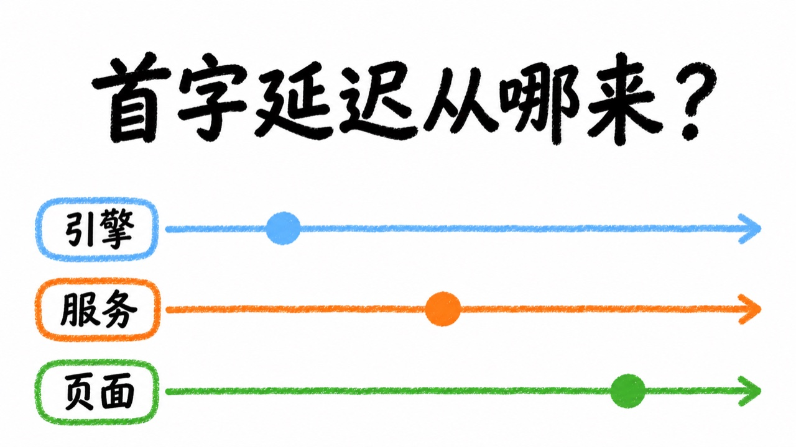

用户在聊天网页里点「请汇总 CSV。」。CSV 是逗号分隔值文件。页面迟迟没有文字，但引擎日志说第一个 Token 已经生成。**Token** 是分词后的处理单位。这里可能有三段不同的等待：模型生成之前，模型生成后到服务发送之间，以及客户端收到内容到页面显示之间。F-05 的 Prefill（预填充）和 Decode（逐步解码）解释了模型内部的前后两段，本篇把服务和页面也画进去。

## 1. 先记时钟的起点和终点

下面是一条**教学轨迹**，用于验证指标怎么算。固定输入 21 个 Token、输出 4 个 Token。为便于演算，假设所有事件已对齐到同一时间轴，以请求开始为 `0 ms`。实际跨机器时先用同一进程的单调时钟计算局部时长，再用请求 ID（标识符）和追踪跨度关联，避免直接用两台机器的墙上时钟相减。

| 事件 | 相对请求开始 | 由谁观测 |
| --- | ---: | --- |
| 后端接收请求 | 10 ms | 服务 |
| 调度开始运行 Prefill | 40 ms | 引擎 |
| 服务先送出角色信息 | 75 ms | 服务，流里还无可见正文 |
| 引擎产出第一个 Token | 120 ms | 引擎 |
| 服务发出首个带正文的事件 | 128 ms | 服务 |
| 页面首次呈现文字 | 160 ms | 客户端 |
| 最后一个 Token 在引擎产生 | 210 ms | 引擎 |
| 客户端收到完成并处理完 | 245 ms | 客户端 |

按这个教学约定，端到端观察到引擎首 Token 是 120 ms；引擎从请求接收到首 Token 是 `120−10 = 110 ms`；从被调度到引擎首 Token 是 `120−40 = 80 ms`。都可以是有用的读数，报指标时必须写起点。通往页面的 **SSE（Server-Sent Events，服务器发送事件）**也可能先送角色或状态。第一个网络块、第一个 SSE 事件、第一个含文字的事件和第一段呈现的文字可能落在不同时间。 [vLLM 的延迟指标定义](https://docs.vllm.ai/en/latest/design/metrics/) · [HTML 标准的服务器发送事件](https://html.spec.whatwg.org/multipage/server-sent-events.html)

## 2. 首个之后怎么算？

| 指标 | 含义 | 本例 |
| --- | --- | --- |
| **TTFT**（Time to First Token，首 Token 延迟） | 从指定起点到第一个 Token | 同一教学时钟上为 120 ms |
| **ITL**（Inter-Token Latency，相邻 Token 间隔） | 每一对相邻输出的时间差 | 引擎记录 120、145、171、210 ms，对应 25、26、39 ms |
| **TPOT**（Time per Output Token，首个之后平均每输出 Token 用时） | 用最后一个减第一个输出时刻，再除以间隔数 | `(210−120)/(4−1) = 30 ms` |
| **E2E 延迟**（End-to-End Latency，端到端延迟） | 客户端从发起到完成的时间 | 245 ms |
| **吞吐**（Throughput） | 在同一观测窗口完成的请求数或输出 Token 数除以秒数 | 0.4 秒完成两条、每条输出 4 个，就是 5 请求/秒、20 输出 Token/秒 |

一个 Token 没有相邻间隔，因此 ITL 和这里的 TPOT 无定义。流式实现也可能把多个 Token 放在同一事件里，只能直接观测**事件间隔**。如果用它近似 ITL，需要注明事件粒度。客户端常以最后一个响应文本事件计算 TPOT，也可能在结束事件处截时间。口径不同就会有不同数据。 [vLLM 基准测试的指标与口径](https://docs.vllm.ai/en/latest/benchmarking/cli/)

## 3. 固定负载，分别移动两段时间

对照只改变等待阶段。增加 50 ms 排队，后续事件整体后移，模型相邻输出间隔保持原值；只让页面首文本晚显示 40 ms，测到页面首段变慢，引擎和服务事件时间可以保持原值。

保存为 `latency_metrics.py`，运行 `python3 latency_metrics.py`。脚本使用标准库，通过固定的事件轨迹校验算式。它不发推理请求。

```python
OUTPUT_TOKENS = 4
ENGINE_TOKENS = [120, 145, 171, 210]
SERVICE_EVENTS = [128, 155, 185, 222]


def measure(engine, events, rendered, completed):
    assert len(engine) == len(events) == OUTPUT_TOKENS
    gaps = [right - left for left, right in zip(engine, engine[1:])]
    tpot = (engine[-1] - engine[0]) / (len(engine) - 1)
    assert tpot == sum(gaps) / len(gaps)
    return engine[0], events[0], rendered, gaps, tpot, completed


baseline = measure(ENGINE_TOKENS, SERVICE_EVENTS, 160, 245)
more_queue = measure(
    [time + 50 for time in ENGINE_TOKENS],
    [time + 50 for time in SERVICE_EVENTS],
    210, 295,
)
more_ui_delay = measure(ENGINE_TOKENS, SERVICE_EVENTS, 200, 245)

for name, result in (
    ("基线", baseline), ("多排队 50 ms", more_queue), ("页面晚呈现 40 ms", more_ui_delay)
):
    engine_ttft, event_time, rendered, itl, tpot, e2e = result
    print(
        f"{name}: 引擎 {engine_ttft} ms, 首文本事件 {event_time} ms, "
        f"页面 {rendered} ms, ITL {itl}, TPOT {tpot:.1f} ms, 端到端 {e2e} ms"
    )

assert more_queue[4] == baseline[4]
assert more_ui_delay[0] == baseline[0] and more_ui_delay[2] == baseline[2] + 40
elapsed_seconds = 0.4
completed_requests = 2
print(f"{elapsed_seconds:.1f} 秒窗口: {completed_requests / elapsed_seconds:.1f} 请求/秒, "
      f"{completed_requests * OUTPUT_TOKENS / elapsed_seconds:.1f} 输出 Token/秒")
```

实跑结果：

```text
基线: 引擎 120 ms, 首文本事件 128 ms, 页面 160 ms, ITL [25, 26, 39], TPOT 30.0 ms, 端到端 245 ms
多排队 50 ms: 引擎 170 ms, 首文本事件 178 ms, 页面 210 ms, ITL [25, 26, 39], TPOT 30.0 ms, 端到端 295 ms
页面晚呈现 40 ms: 引擎 120 ms, 首文本事件 128 ms, 页面 200 ms, ITL [25, 26, 39], TPOT 30.0 ms, 端到端 245 ms
0.4 秒窗口: 5.0 请求/秒, 20.0 输出 Token/秒
```

## 4. 本地引擎固定长度实测

用 F-05 的同一版 Qwen2.5-0.5B-Instruct，固定 21 个提示位置和 4 个输出位置。沿用 F-05 的依赖与模型权重，保存为 `engine_timing.py` 后执行。以中央处理器（CPU）前向开始为零点，包含贪心选词，不计下载、模型加载、排队、网络和浏览器。FP32 是 32 位浮点数。为保持对照长度，遇到 EOS（End of Sequence，序列结束标记）亦继续，正式业务生成仍按其停止规则执行。

```python
from statistics import median
from time import perf_counter

import torch
from transformers import AutoModelForCausalLM, AutoTokenizer

name = "Qwen/Qwen2.5-0.5B-Instruct"
revision = "7ae557604adf67be50417f59c2c2f167def9a775"
torch.set_num_threads(2)
tokenizer = AutoTokenizer.from_pretrained(name, revision=revision)
model = AutoModelForCausalLM.from_pretrained(
    name, revision=revision, dtype=torch.float32
).eval()
messages = [
    {"role": "system", "content": "你是报表助手。"},
    {"role": "user", "content": "请汇总 CSV。"},
]
prompt = tokenizer.apply_chat_template(
    messages, add_generation_prompt=True, tokenize=True,
    return_dict=True, return_tensors="pt",
)["input_ids"]
assert prompt.shape == (1, 21)


@torch.inference_mode()
def run():
    # 测固定长度。即使选中 EOS，也继续到 4 个输出位置。
    start = perf_counter()
    positions = []
    ids, cache = prompt, None
    for _ in range(4):
        step = model(input_ids=ids, past_key_values=cache, use_cache=True, logits_to_keep=1)
        ids = step.logits[:, -1, :].argmax(dim=-1, keepdim=True)
        cache = step.past_key_values
        positions.append((perf_counter() - start) * 1000)
    assert cache.get_seq_length() == 24
    return positions[0], (positions[-1] - positions[0]) / 3


for _ in range(2):
    run()
samples = [run() for _ in range(5)]
ttft, tpot = (median(column) for column in zip(*samples))
print(f"{torch.__version__} CPU FP32, 21 → 4, 预热 2 次，测量 5 次")
print(f"引擎计算 TTFT 中位数 {ttft:.1f} ms，TPOT 中位数 {tpot:.1f} ms")
```

本机的一次实跑记录如下。时间受硬件和系统负载影响，验收时重点核对长度、间隔数和口径。

```text
2.11.0 CPU FP32, 21 → 4, 预热 2 次，测量 5 次
引擎计算 TTFT 中位数 142.3 ms，TPOT 中位数 82.4 ms
```

要在真实服务重复这个实验，固定模型与版本、21 个输入位置、目标 4 个输出位置、并发、预热次数和流式开关。实际返回提前结束时记录真实输出长度，并与固定长度组分开报告。引擎记录入队、调度、首个和末个 Token；服务记录首个有正文事件；页面在请求发起、收到首正文和更新页面时用同一浏览器时钟打点。浏览器回调提供的是呈现近似边界，如需定位真实绘制应对照浏览器性能记录。跑多次时同时记录中位数和 **P95**（约 95% 的测量值不超过的分位点）。 [vLLM 生产指标](https://docs.vllm.ai/en/latest/usage/metrics/) · [W3C Performance Timeline](https://www.w3.org/TR/performance-timeline/)

下一篇 **F-08《模型精度与量化》**会计算压缩权重和缓存各自能影响哪部分开销，并保留同样的固定输入与验收口径。 [学习路线图](https://blog.lacknb.cn/articles/2026/11/19/1795058329577.html)

[F-14 FlashAttention 如何减少注意力的显存读写](f-14-flashattention.md) · [F-08 模型精度与量化](f-08-model-precision-and-quantization.md)
