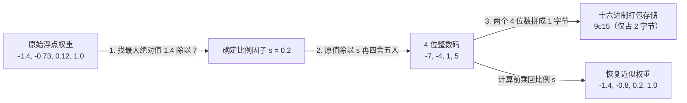

「请汇总 CSV。」的模型已经跑通了，但很多时候我们手头的设备根本塞不下动辄十几 GB、几十 GB 的模型参数。怎么给模型「瘦身」，又不让它变成只会胡言乱语的笨蛋？

答案叫**量化（Quantization）**：把原本用 16 位、32 位精细小数存储的数字，压缩成只占 8 位甚至 4 位的粗略整数。既能压模型**静态权重**，也能压运行时不断膨胀的 **KV Cache**。

> **先用大白话讲明白**：你可以把量化想象成**「拿精确到小数点后五位的游标卡尺，改抄进一个只有 15 格的小格子笔记本」**：
> - 先量一下这一排数字里最大有多宽，定一个**换算比例尺（Scale `s`）**——比如规定「纸上 1 格代表现实 0.2」；
> - 把原本带好多小数点的体重/权重，除以 0.2 四舍五入写进格子（存成 **-7 到 +7 的整数码**，4 位二进制就能塞下！）；
> - 以后拿出来算乘法时，再乘回 `0.2` 还原成近似小数。虽然丢掉了一点零头（最大误差不超过半格），但原本 16 位占 2 字节的数现在只要半个字节，**模型体积瞬间缩到四分之一**！



## 1. 先认清常见的位宽格式：FP16、BF16、INT8、INT4

| 格式名称 | 怎么切这 16 / 8 / 4 个比特？ | 大白话怎么理解？ |
| --- | --- | --- |
| **FP16**（半精度浮点，2 字节） | 1 符号 + 5 指数 + 10 小数 | 尺子刻度很细（10 位小数），但总长度偏短，最大只能写到 **65,504**，一不小心就会算爆溢出 |
| **BF16**（脑浮点，2 字节） | 1 符号 + **8 指数** + 7 小数 | 同样占 2 字节，牺牲一点小数细腻度，换来跟 32 位浮点一样巨大的数字跨度，训练推理都不易算炸 |
| **INT8**（8 位整数，1 字节） | 共 256 个整数格 | 只是格号！**必须搭配比例因子 `s`**，才知道每一格代表多少真实小数 |
| **INT4**（4 位整数，0.5 字节） | 共 16 个整数格 | 2 个权重挤进 1 字节；精度非常娇气，通常必须「分组设比例尺」才不至于崩坏 |

注意区分布局：**存放权重时的位宽**、**中间激活（算出的中间数字）的位宽**、以及**乘加器内部累加时的位宽**完全可以各用各的！比如硬盘里存 INT4 权重，算的时候在芯片里临时恢复成 FP16 相乘，最后累加用 FP32 防精度丢失。 [NVIDIA 浮点格式指南](https://docs.nvidia.com/cuda/cuda-programming-guide/05-appendices/mathematical-functions.html)

## 2. 纸笔手算：把四个权重压进 4 位整数格

设某层线性计算有一小排权重 `[-1.4, -0.73, 0.12, 1.0]`，输入向量是 `[1, 2, 3, -1]`。用原本精度算一遍点积做标准参考：
`(-1.4×1) + (-0.73×2) + (0.12×3) + (1.0×-1) = -3.500`。

现在采用**对称量化**（让实数 `0` 严丝合缝对齐整数 `0`，正负一样宽），选 INT4 范围为 **`[-7, +7]`**（留出 `-8` 不用以便对称，不同量化格式也可调整规则）：
1. **定比例尺**：找绝对值最大的是 `1.4`，除以最大刻度 `7`，得比例因子 **`s = 1.4 ÷ 7 = 0.2`**。
2. **入格（Quantize）**：每个数除以 `0.2` 后四舍五入进 `[-7, 7]`。
3. **恢复（Dequantize）**：整数码乘回 `0.2`。

| 原始权重 | 除以比例 `0.2` | 四舍五入整数码 | 乘回 `0.2` 恢复值 | 这一个数的误差 |
| ---: | ---: | ---: | ---: | ---: |
| `-1.40` | `-7.00` | **-7** | `-1.40` | 0.00 |
| `-0.73` | `-3.65` | **-4** | `-0.80` | 0.07 |
| `0.12` | `0.60` | **1** | `0.20` | 0.08 |
| `1.00` | `5.00` | **5** | `1.00` | 0.00 |

拿恢复后的权重 `[-1.4, -0.8, 0.2, 1.0]` 再算一次输入点积：`(-1.4×1) + (-0.8×2) + (0.2×3) + (1.0×-1) = -3.400`。与真实值 `-3.500` 只差了 `0.1`！并且每个单个权重的舍入误差**绝不超过半格 `s / 2 = 0.1`**。

> **容易踩的坑（为什么必须「分组量化」？）**：如果这组权重里混进了一个极少见的「超大离群值」比如 `14.0`，那整组比例尺 `s` 会瞬间被拉粗到 `14 ÷ 7 = 2.0`，原本 `0.12`、`0.73` 这种精细小权重全都被四舍五入抹成 `0` 了！所以工业界做 INT4 时，往往**每 64 或 128 个权重单独切一组配一个自己的比例因子**，隔离离群值传染；如果用**非对称量化**（比如全正数范围 `[0, 10]`），还会额外多存一个「零点偏移（zero-point）」来充分利用格子。

## 3. 权重预算 vs 缓存预算：别把两笔账算混！

拿一个 **1B（10 亿）参数**的模型直接算裸数据大小（这里 1 GB 按十亿字节计）：
- **FP16**：约 **2 GB**
- **INT8**：约 **1 GB**
- **INT4**：裸权重约 **0.5 GB**；但如果每 128 个权重多存一个 2 字节的 FP16 比例因子，这些比例尺自己还要再多占 `(10⁹ ÷ 128) × 2 ≈ 15.6 MB`。

关键区分来了：
- **权重量化**：压的是模型本身的固定参数，省的是「装模型的基础起步门槛」。
- **KV Cache 量化**：压的是 [F-06](f-06-kv-cache.md) 算过的注意力历史 K、V 笔记，省的是「并发一多、上下文一长时不断暴涨的动态显存」。如果只下载了 INT4 权重文件，运行时框架没开启 KV 量化，那推理时缓存照样还是按 BF16（2 字节/数）占空间！ [KIVI 缓存量化论文](https://arxiv.org/abs/2402.02750)

## 4. GPTQ 与 AWQ：同样压到 4 位，各在保护谁？

直接粗暴四舍五入往往会让模型变笨，**PTQ（Post-Training Quantization，训练后量化）** 会先喂一小批代表性数据（校准集）摸清模型内部数值脾气，再聪明地压：
- **GPTQ**：边量化边「拆东墙补西墙」——先量完一部分权重看它造成了多大输出误差，立刻微调同一行还没量化的其余权重，把刚才那点误差抵消回来。 [GPTQ 论文](https://arxiv.org/abs/2210.17323)
- **AWQ（Activation-aware Weight Quantization，激活感知权重量化）**：先用校准数据看哪些通道上的「输入激活值特别大」。只要发现某个通道特别敏感、动一动就影响巨大，就先通过数学等价缩放把这一列权重放大保护起来，再去四舍五入，保住关键神经通路不失真。 [AWQ 论文](https://arxiv.org/abs/2306.00978)

## 5. 用 Python 复算 4 位打包与精度差

只用 Python 标准库，保存为 `quantize_demo.py` 并运行 `python3 quantize_demo.py`。注意看第 87 行：`& 15` 截取 4 位补码，`<< 4` 把前一个数塞进字节高 4 位，后一个塞进低 4 位，四个权重真真正正缩进了短短 2 个字节！

```python
from math import isclose

weights = [-1.4, -0.73, 0.12, 1.0]
inputs = [1.0, 2.0, 3.0, -1.0]


def quantize(values, bits):
    limit = 2 ** (bits - 1) - 1
    peak = max(abs(value) for value in values)
    scale = peak / limit if peak else 1.0
    codes = [max(-limit, min(limit, round(value / scale))) for value in values]
    restored = [code * scale for code in codes]
    return scale, codes, restored


def dot(left, right):
    return sum(a * b for a, b in zip(left, right))


reference = dot(weights, inputs)
print(f"浮点点积 {reference:.3f}")
for bits in (4, 8):
    scale, codes, restored = quantize(weights, bits)
    max_error = max(abs(a - b) for a, b in zip(weights, restored))
    assert max_error <= scale / 2 + 1e-12
    print(
        f"INT{bits}: 比例 {scale:.6f}, 编码 {codes}, "
        f"最大误差 {max_error:.6f}, 恢复后点积 {dot(restored, inputs):.3f}"
    )
_, codes, restored = quantize(weights, 4)
packed = bytes(((codes[i] & 15) << 4) | (codes[i + 1] & 15) for i in (0, 2))
print("四个 4 位整数打包", packed.hex(), f"共 {len(packed)} 字节")
assert isclose(dot(restored, inputs), -3.4)
assert quantize([0.0, 0.0], 4)[2] == [0.0, 0.0]
```

实跑结果：

```text
浮点点积 -3.500
INT4: 比例 0.200000, 编码 [-7, -4, 1, 5], 最大误差 0.080000, 恢复后点积 -3.400
INT8: 比例 0.011024, 编码 [-127, -66, 11, 91], 最大误差 0.003150, 恢复后点积 -3.494
四个 4 位整数打包 9c15 共 2 字节
```

> **上线前提醒**：部署量化模型时，千万不能只测显存够不够！务必检查两件事：1）你的推理引擎（如 vLLM、llama.cpp）和显卡架构到底支不支持这种打包格式的**高速解压算子**（不支持的话解压甚至比 FP16 还慢）；2）拿自己业务的留出测试集对照一遍，防止关键字段规则在低比特下悄悄失真。

## 下一篇

到这一篇，纯文本大模型从分词、计算、加速、量化到指标的全流程已经完整走通。接下来如果用户发过来的不是文字，而是一张「退款表格截图」，模型又怎么看懂像素？请看下一篇 [F-09《多模态请求如何进入模型？》](f-09-multimodal-input.md)。系列入口见 [LLM 与 Agent 学习路线图](llm-agent-learning-roadmap.md)。

[F-07 TTFT、TPOT、ITL 与吞吐怎样量？](f-07-inference-latency-metrics.md) · [F-09 多模态请求如何进入模型](f-09-multimodal-input.md)
