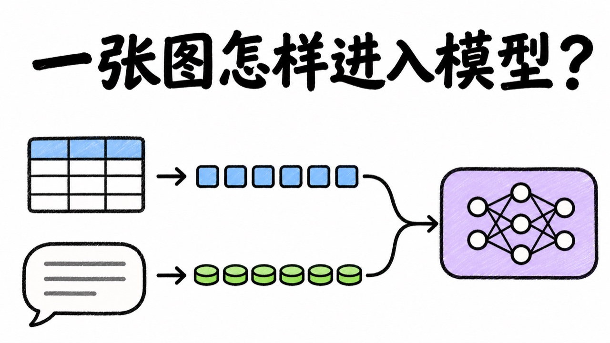
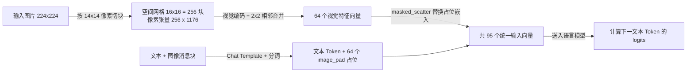

用户拍了一张退款报表截图发给助手，问道：「截图里是否有蓝色高亮的单元格？」

前面八篇讲的都是文字怎么变成数字。现在请求里同时夹了一张图片，大模型总不能直接把 PNG 文件的二进制扔进字词词典吧？图片和文字究竟是在哪里「碰头」的？为什么传一张高清大图，Token 账单一下子涨这么多？

> **先用大白话讲明白**：多模态（Multimodal）请求在进入语言模型前，走的是**「两条管道分头处理，最后在座位表里并排坐」**的路线：
> 1. **文字走老路**：照常经过 Chat Template 排版和分词器，但**图片位置先留好一排空椅子**（专用占位标记 `<|image_pad|>`）。
> 2. **图片先切块翻译**：视觉处理器把图片像撕邮票一样切成 `14 × 14` 像素的小方格，送进视觉编码器翻译成一串特征向量（每 `2 × 2` 个小格再合成一个大块）。
> 3. **拆掉占位牌，对号入座**：把算出来的视觉向量**直接覆盖填进刚才预留好的那排空椅子里**！接下来大模型跑注意力和算分时，眼里看到的就只是一整排对齐的向量——跟纯文本没啥区别。



下面用 **Qwen2.5-VL-3B-Instruct**（VL 即 Vision-Language，视觉语言模型）做个直观实测。不同模型切块和计费口径会有差异，先修可对照 [F-01 分词](f-01-tokenizer-chat-template.md)。 [Qwen2.5-VL 技术报告](https://arxiv.org/abs/2502.13923)

## 1. 一条消息里为什么既套图片块又套文字块？

在标准多模态输入格式里，同一条 `user` 消息的 `content` 不再只是单一字符串，而是一个内容块数组，用 `type` 字段注明哪块是图、哪块是字：

```json
{
    "role": "user",
    "content": [
        {"type": "image", "image": "report.png"},
        {"type": "text", "text": "截图里是否有蓝色高亮的单元格？"}
    ]
}
```

Online API 有时会换成图片 URL 或 Base64 编码，这里演示的是本地处理器的写法。经过 **Chat Template（对话模板）**后，文本内容正常分词查词表，图片所在的位置则插上一串专门的图像起止边界标记和占位 Token，等后续视觉特征替换进来。 [Qwen2.5-VL 模型卡示例](https://huggingface.co/Qwen/Qwen2.5-VL-3B-Instruct)

## 2. 拆解账本：224×224 的图片为什么正好变成 64 个占位？

跟着像素步步算一遍，数字严丝合缝：
1. **转成像素矩阵**：把图片整理成红绿蓝（RGB）三通道数值。
2. **撕成 `14 × 14` 像素小块**：Qwen2.5-VL 的基本小块边长是 **14 像素**。一张 `224 × 224` 的方图，横竖各切 `224 ÷ 14 = 16` 刀，变成 **`16 × 16 = 256`** 个小块（即处理器的网格标记 `image_grid_thw = [1, 16, 16]`，三轴依次是时间、高、宽）。
3. **相邻 `2 × 2` 合并成 1 个入模位置**：为了别让序列太长算不过来，视觉网络编完码后把每 `2 × 2 = 4` 个相邻小块合并成一个语言位置，于是 `256 ÷ 4 = 64` 个视觉占位符！换算起来，相当于图上每 `28 × 28` 像素占用语言模型 **1 个输入位置**。

| 同一个问题 | 总输入位置数 | 其中视觉占位数 | 视觉切块网格 |
| --- | ---: | ---: | --- |
| 纯文本提问 | 29 | 0 | 无 |
| 加 `224×224` 截图 | **95** | **64** | `[1, 16, 16]` |
| 加 `448×448` 截图 | **287** | **256** | `[1, 32, 32]` |

> **大白话小结 & 坑点提醒**：
> 1. 加 `224×224` 图后多出的 `95 - 29 = 66` 个位置，其中 64 个是图像本身，另外 2 个是包裹图片的起止特殊边界符号。
> 2. **分辨率翻倍，位置数翻四倍！** 边长从 224 拉到 448 只是翻了一倍，但面积翻了 4 倍，视觉占位直接从 `64` 飙到 `256`！高清截图能看清小字，但也会成平方级抬高耗时和 Token 账单。

> **想再深入一层？** 下方实验输出的 `pixel_values` 形状是 `(256, 1176)`，为什么每块是 `1176` 个数字而不是 `3 × 14 × 14 = 588` 个？因为 Qwen2.5-VL 用同一套架构兼容视频与静态图，时间切片宽为 2，单张图片预处理时会自动填充凑满 2 帧，所以 `2 × 3 × 14 × 14 = 1176`。另外，配置里的 `mrope_section` 给旋转位置编码分了时间、高度、宽度三组坐标，让模型即便铺平进了一维序列，仍能认得出图像原本的「上下左右」二维邻居关系！

## 3. 动手实验：对比纯文本与两种分辨率的入模张量

只需拉取几十 MB 的处理器和词表文件，无需下载 3B 完整权重（后半段用随机初始化的 1 层迷你多模态模型检查输出形状）。Python 3.11 或 3.12 下运行：

```bash
python -m pip install "torch==2.11.0" "torchvision==0.26.0" "transformers[chat-template]==5.13.0" "pillow==12.3.0"
```

保存为 `multimodal_shapes.py` 后运行 `python multimodal_shapes.py`（若本地已有同版处理器目录，可通过环境变量 `VL_PROCESSOR_DIR` 指定路径）：

```python
import os

import torch
from PIL import Image, ImageDraw
from transformers import AutoProcessor, Qwen2_5_VLConfig, Qwen2_5_VLForConditionalGeneration

MODEL = "Qwen/Qwen2.5-VL-3B-Instruct"
REVISION = "66285546d2b821cf421d4f5eb2576359d3770cd3"
processor = AutoProcessor.from_pretrained(
    os.environ.get("VL_PROCESSOR_DIR", MODEL), revision=REVISION,
)
question = "截图里是否有蓝色高亮的单元格？"
text = [{"type": "text", "text": question}]


def make_image(size):
    picture = Image.new("RGB", (size, size), "white")
    draw = ImageDraw.Draw(picture)
    step = size // 4
    draw.rectangle((step, step, 2 * step, 2 * step), fill="royalblue")
    for index in range(1, 4):
        position = index * step
        draw.line((0, position, size, position), fill="gray", width=2)
        draw.line((position, 0, position, size), fill="gray", width=2)
    return picture


def prepare(content):
    messages = [{"role": "user", "content": content}]
    return processor.apply_chat_template(
        messages, add_generation_prompt=True, tokenize=True,
        return_dict=True, return_tensors="pt",
    )


plain = prepare(text)
print("纯文本输入位置", plain["input_ids"].shape[-1])
assert "pixel_values" not in plain
for size in (224, 448):
    result = prepare([{"type": "image", "image": make_image(size)}, *text])
    grid = result["image_grid_thw"][0].tolist()
    image_id = processor.tokenizer.convert_tokens_to_ids("<|image_pad|>")
    placeholders = (result["input_ids"] == image_id).sum().item()
    print(
        f"{size}×{size}: 入模位置 {result['input_ids'].shape[-1]}, "
        f"视觉占位 {placeholders}, 网格 {grid}, "
        f"像素张量 {tuple(result['pixel_values'].shape)}"
    )
    assert placeholders == (size // 28) ** 2

torch.manual_seed(7)
config = Qwen2_5_VLConfig(
    text_config={
        "vocab_size": 152064, "hidden_size": 32, "intermediate_size": 64,
        "num_hidden_layers": 1, "num_attention_heads": 4, "num_key_value_heads": 2,
        "rope_parameters": {"rope_type": "default", "mrope_section": [2, 1, 1]},
    },
    vision_config={
        "depth": 1, "hidden_size": 32, "out_hidden_size": 32,
        "num_heads": 4, "intermediate_size": 64, "fullatt_block_indexes": [0],
    },
)
model = Qwen2_5_VLForConditionalGeneration(config).eval()
with torch.inference_mode():
    plain_logits = model(**plain, logits_to_keep=1).logits
    image_logits = model(**result, logits_to_keep=1).logits
print("随机小模型首步分数", tuple(plain_logits.shape), tuple(image_logits.shape))
assert plain_logits.shape == image_logits.shape == (1, 1, 152064)
```

实跑结果：

```text
纯文本输入位置 29
224×224: 入模位置 95, 视觉占位 64, 网格 [1, 16, 16], 像素张量 (256, 1176)
448×448: 入模位置 287, 视觉占位 256, 网格 [1, 32, 32], 像素张量 (1024, 1176)
随机小模型首步分数 (1, 1, 152064) (1, 1, 152064)
```

看最后一行：不管输入是纯文本还是夹了 256 个图像位置，经过模型主干汇合后，从同一张输出头吐出来的首步 logits 形状一模一样，都是 `(1, 1, 152064)`！

## 4. 源码跟踪与后续延展

> **想再深入一层？** 对照 Transformers `v5.13.0` 源码看两处衔接点：
> - **怎么展开 `<|image_pad|>` 占位符**：[processing_qwen2_5_vl.py](https://github.com/huggingface/transformers/blob/v5.13.0/src/transformers/models/qwen2_5_vl/processing_qwen2_5_vl.py)
> - **怎么拿视觉向量换掉占位符嵌入**：在 [modeling_qwen2_5_vl.py](https://github.com/huggingface/transformers/blob/v5.13.0/src/transformers/models/qwen2_5_vl/modeling_qwen2_5_vl.py) 里搜 `get_image_features()` 和 `masked_scatter()`。
> - 如果换成真实 3B 权重做业务验收，记得**故意跑一组「不传图只提问」的对照样本**，检查模型在没看见图时会不会老实说「缺少截图」，防止它瞎蒙猜中蓝色高亮！至于音频与实时双向语音流，后面 [API-08](api-08-realtime-voice-agent.md) 会单独拆解。

## 下一篇

搞清了推理阶段「多模态怎么进模型」，接下来换个视角看模型**出生与成长**的秘密：一个只会做普通文字接龙的基座模型，是怎么一步步变成听得懂「忽略空值、返回合计 20」的报表助手？请看下一篇 [F-10《模型从预训练到会按要求回答》](f-10-model-training-stages.md)。系列入口见 [LLM 与 Agent 学习路线图](llm-agent-learning-roadmap.md)。

[F-08 模型精度与量化](f-08-model-precision-and-quantization.md) · [F-10 模型从训练到可用的过程](f-10-model-training-stages.md)
