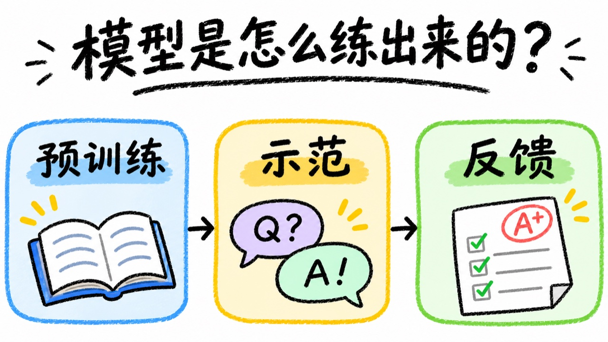

报表里有三行退款金额 `[12, 空, 8]`。用户说「空值记为缺失，只返回合计和缺失数」。希望助手答「合计 20，缺失 1」。从会接续文字到会遵守这条规则，模型能从哪些训练数据学习？

**训练**是根据样本计算误差，再用这个误差调整模型的可学习数值，也就是参数或权重。推理则使用已经训练好的权重来算输出。F-04 解释了**自回归**如何根据上文逐个生成 Token；Token 是分词后的处理单位。这篇看相同的下一 Token 分数如何变成训练信号。

## 1. 预训练先学会预测下一段

**预训练（Pretraining）**在大量文本中构造下一 Token 预测任务。比如看到「退款金额」，预测后面会出现哪个子词或标点。用已有文本本身就能得到训练目标。为方便手算，把一条示例压成四个教学 Token：

| 位置 | 示意文字 | 教学 ID |
| --- | --- | ---: |
| 1 | 退款列数据 | 0 |
| 2 | 请按规则汇总 | 1 |
| 3 | 合计 20 | 2 |
| 4 | 缺失 1 | 3 |

`ID` 是词表里的编号。下面的几个长短语在真实分词里通常会分成多个位置。本例将输入 `[0,1,2]` 的各位置与右移一位的目标 `[1,2,3]` 对齐。第一行预测 1，第二行预测 2，第三行预测 3。

如果词表只有四项，模型最初给四项等概率，正确项概率 `p = 1/4`，对应的**交叉熵损失**是 `−ln(p) = 1.3863`。`ln` 是自然对数。模型把更多概率放在正确项时，损失就会下降。反向传播计算权重改动对损失的影响，优化器根据这些梯度决定怎样更新。 [Transformer 原论文](https://arxiv.org/abs/1706.03762)

## 2. 有示范时怎样训练助手回复？

**SFT（Supervised Fine-Tuning，监督微调）**在已有模型上训练「请求 → 理想回答」样本。应用把角色、提示、回答组织成一条序列。在一种常见的回答监督配置里，提示仍参与前向计算，为回答提供上下文，损失只统计回答的目标位置。

| 在哪一行打分 | 这行预测的 Token | 预训练式标签 | 只监督回答的标签 |
| --- | --- | ---: | ---: |
| 读到 0 | 1，提示的一部分 | 1 | -100，忽略 |
| 读到 1 | 2，回答的开始 | 2 | 2 |
| 读到 2 | 3，回答的后续 | 3 | 3 |

`-100` 是下面 PyTorch 实验指定的忽略标签。训练工具也可以配置监督全部位置、助手位置或只监督完成部分。做多轮样本时，应实查真正参与损失的掩码，确认所选对话模板能正确标出各角色。真实 Transformer 里，提示位置仍可能通过对回答的影响收到梯度。 [InstructGPT 的示范训练流程](https://arxiv.org/abs/2203.02155) · [TRL 监督微调的标签与遮罩](https://huggingface.co/docs/trl/sft_trainer#label-shifting-and-masking)

## 3. 偏好和奖励分别在给什么信号？

| 方式 | 给模型看什么 | 退款例子 |
| --- | --- | --- |
| 继续预训练 | 特定领域原始文本 | 大量财务字段字典、统计说明等，继续预测下一 Token |
| SFT | 一份指定的示范答案 | 给出输入与「合计 20，缺失 1」，让模型学着生成 |
| **DPO**（Direct Preference Optimization，直接偏好优化） | 同一输入的一对偏好输出 | 偏好「合计 20，缺失 1」，劣选「合计 20，缺失 0」 |
| 奖励式强化学习 | 从旧策略生成的候选和评分 | 程序根据合计、缺失数给每条候选打分，由训练算法更新策略 |

**策略**是模型把概率分给各种输出的规则。经典 **RLHF（Reinforcement Learning from Human Feedback，从人类反馈中进行强化学习）**可以训练一个奖励模型来近似人工偏好，再用强化学习调整语言模型。也可直接用程序给有标准答案的任务评分。DPO 的经典做法以固定偏好对和参考模型构造训练损失，让偏好答案相对劣选答案更有优势。它使用的训练数据和在线采样再打分的流程不同。模型生产流程可以按目标选择这些阶段。 [InstructGPT 论文](https://arxiv.org/abs/2203.02155) · [DPO 论文](https://arxiv.org/abs/2305.18290)

## 4. LoRA 决定改哪些参数

**LoRA（Low-Rank Adaptation，低秩适配）**是限制参数更新范围的办法。以一个线性层为例，原来的权重叫 `W`。冻结 `W` 后，新增两张小矩阵 `A` 和 `B`，用乘积 `B × A` 表达改动。若原权重为 `4096 × 4096`，选择秩 `r = 8`，就可以用 `A [8,4096]` 和 `B [4096,8]`。秩在这个例子里相当于更新矩阵通过的窄通道宽度。

因此原层有 16,777,216 个参数，两张新增矩阵合计 65,536 个。实际数学实现通常还会对更新乘缩放系数。这个计数只针对选中的一层，节省多少训练内存还取决于激活、优化器和目标层范围。SFT 定义了监督信号，LoRA 可以用来执行一次 SFT，也可以用于其他需要更新模型参数的训练目标。 [LoRA 论文](https://arxiv.org/abs/2106.09685)

## 5. 运行一次下一 Token 损失与标签遮罩

用 Python 3.11 或 3.12 运行 `python -m pip install "torch==2.11.0"` 安装依赖，再保存为 `training_mask.py`，执行 `python training_mask.py`。这个三位置实验用一张可学习表给词表打分，每个输入编号有独立的一行。它足够观察损失与梯度，实际 Transformer 会在多位置间共享参数并传递上下文。

```python
import torch
import torch.nn.functional as F

tokens = torch.tensor([0, 1, 2, 3])
inputs = tokens[:-1]
pretrain_labels = tokens[1:]
sft_labels = pretrain_labels.clone()
sft_labels[0] = -100


def train_once(labels):
    table = torch.zeros(4, 4, requires_grad=True)
    loss = F.cross_entropy(table[inputs], labels, ignore_index=-100)
    loss.backward()
    updated = table.detach() - 0.5 * table.grad
    new_loss = F.cross_entropy(updated[inputs], labels, ignore_index=-100)
    changed = (table.grad.abs().sum(dim=1) > 0).nonzero().flatten().tolist()
    return loss.item(), new_loss.item(), changed


pretrain = train_once(pretrain_labels)
sft = train_once(sft_labels)
assert pretrain[2] == [0, 1, 2] and sft[2] == [1, 2]
assert pretrain[1] < pretrain[0] and sft[1] < sft[0]
print("预训练标签", pretrain_labels.tolist())
print("回答监督标签", sft_labels.tolist())
for name, (before, after, changed) in (("预训练", pretrain), ("回答监督", sft)):
    print(f"{name}: {before:.4f} → {after:.4f}, 更新输入行 {changed}")
```

实跑结果：

```text
预训练标签 [1, 2, 3]
回答监督标签 [-100, 2, 3]
预训练: 1.3863 → 1.2640, 更新输入行 [0, 1, 2]
回答监督: 1.3863 → 1.2049, 更新输入行 [1, 2]
```

两条路径的平均损失计入的目标数量不同。可以分别比较各自更新前后；这两个末尾数字不能用于判断 SFT 比预训练更有效。要评估业务收益，需要给两种训练得到的模型使用相同的未见报表题，检查结构、数值、缺失处理及通用能力。

源码可从 PyTorch 的 `cross_entropy(..., ignore_index=-100)` 看到忽略标签如何参与归约，再看 Transformers v5.13.0 的因果模型损失如何移动标签来对齐下一 Token。本文显式切片，因此可以直接看到错位的边界。 [PyTorch 交叉熵](https://docs.pytorch.org/docs/stable/generated/torch.nn.functional.cross_entropy.html) · [Transformers 损失源码](https://github.com/huggingface/transformers/blob/v5.13.0/src/transformers/loss/loss_utils.py)

下一篇 **F-11《GRPO 如何用于推理模型后训练》**从同一个题目下的四条候选出发，把奖励变成可计算的更新方向。路线图的 TRN-02、TRN-04 和 TRN-05 会把这里的训练路径扩展成独立实验。 [学习路线图](https://blog.lacknb.cn/articles/2026/11/19/1795058329577.html)

[F-09 多模态请求如何进入模型](f-09-multimodal-input.md) · [F-11 GRPO 如何用于推理模型后训练](f-11-grpo.md)
