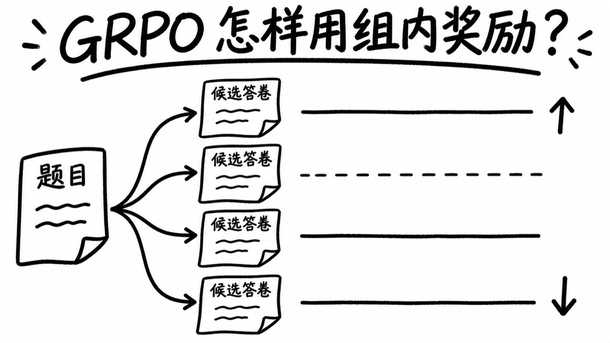

给模型一条报表题「退款值为 12、空、8。只输出合计和缺失数」。怎样让它以后更常答「合计 20，缺失 1」？F-10 区分了模仿示范答案与按奖励调整模型。这里选后一条路径。

**GRPO（Group Relative Policy Optimization，组相对策略优化）**首先用一个策略为同一道题采样多条回答，再根据各自的奖励，在组内决定哪些回答值得提高生成概率。它由 DeepSeekMath 论文提出，是 **PPO（Proximal Policy Optimization，近端策略优化）**的一种变体。PPO 通过限制过大的概率变化来做多步策略更新。原始 GRPO 用同组结果估计相对好坏，省去 PPO 语言模型方案里另训练的价值估计模型。 [DeepSeekMath 原论文，第 4 节](https://arxiv.org/abs/2402.03300) · [PPO 论文](https://arxiv.org/abs/1707.06347)

## 1. 从可验证答案给奖励

**策略（Policy）**是模型对可能输出的概率分布。先用一份冻结在本轮采样时刻的模型生成多条候选，这份分布叫**旧策略**。**奖励（Reward）**是从程序或评价模型取得的分数。退款这题可以用程序验证两项数字，并接受中英文分号。假设收到四条候选：

| 候选 | 回答 | 奖励 | 理由 |
| --- | --- | ---: | --- |
| A | 合计=20;缺失=1 | 1 | 两项正确 |
| B | 合计=20；缺失=1 | 1 | 两项正确 |
| C | 合计=20;缺失=0 | 0 | 缺失数错误 |
| D | 合计=21;缺失=1 | 0 | 合计错误 |

如果奖励函数只找「合计=20」，C 也拿到高分。模型优化的是评分规则提供的信号，所以要把真正需要的行为写进校验。测试规则时同时准备正确、半对、格式错误和多余内容。

## 2. 把奖励变成组内优势

**优势（Advantage）**在这里衡量某条回答比同组其他候选强多少。将第 `i` 条候选的奖励记成 `r_i`。`μ` 是组内平均奖励，`σ` 是组内标准差。优势可写成 `A_i = (r_i − μ) / σ`。教学脚本使用总体标准差，并为很小的分母设下限。

这一组奖励 `[1,1,0,0]` 的平均值是 0.5。各项离平均值都是 0.5，所以总体标准差也是 0.5。相除得到 `[+1,+1,−1,−1]`。正值对应同组中比较好的结果，负值对应比较差的结果。

整组答案都对时，奖励可能是 `[1,1,1,1]`。分子全为 0，加上安全分母后优势也全为 0，这一组奖励没有给出相对区分信号。整组都错也一样。训练时可以记录无差别奖励组的比例，发现评分器是否过宽、过严或没有区分力。

## 3. 旧策略、当前策略和参考策略做什么？

把当前策略给某个动作的概率除以旧策略给它的概率，得到**概率比率** `ratio`。动作在真实模型里通常指生成某个 Token；Token 是分词后的单位。原始 GRPO 的一种结果监督形式把同一回答的组内优势分给这条回答的各个输出位置，然后按位置构造更新目标。下列实验把每条回答当一个动作，专门展示这个运算方向。

设裁剪范围为 `[0.8,1.2]`。若一个正优势样本的比率已经升到 1.3，裁剪会限制它继续取得更多更新收益。代码对比 `ratio × advantage` 和「裁剪后的比率乘优势」，用较小的一项作为目标贡献。这个裁剪作用于目标，更新后的所有概率未必都落在该区间。

还有一个常见角色叫**参考策略**，通常是一份更稳定的参照模型。原始 GRPO 还加入 **KL（Kullback–Leibler）散度**惩罚，用来度量当前分布相对参考分布的偏离。旧策略负责说明样本当时按什么概率产生，参考策略用于约束训练漂移。下面的演示将参考惩罚省略，单看组内奖励的方向，完整目标和实现变体见原论文。 [DeepSeekMath 的 GRPO 目标](https://arxiv.org/html/2402.03300#S4)

## 4. 跑一次更新，看好答案的概率怎么变

用 Python 3.11 或 3.12 运行 `python -m pip install "torch==2.11.0"` 安装依赖，再保存为 `grpo_group_demo.py` 后执行 `python grpo_group_demo.py`。四个候选的初始分数都设为 0，Softmax 归一化后各占 0.25。`loss.backward()` 计算梯度，使用一次学习率为 0.5 的更新。学习率表示沿梯度调整的步长。

```python
import re
import torch

answers = ["合计=20;缺失=1", "合计=20；缺失=1", "合计=20;缺失=0", "合计=21;缺失=1"]
pattern = re.compile(r"合计=(-?\d+)[;；]缺失=(\d+)")


def reward(answer):
    match = pattern.fullmatch(answer)
    return float(bool(match and tuple(map(int, match.groups())) == (20, 1)))


def relative_advantages(rewards):
    scale = rewards.std(unbiased=False)
    return (rewards - rewards.mean()) / scale.clamp_min(1e-8)


rewards = torch.tensor([reward(answer) for answer in answers])
advantages = relative_advantages(rewards)
assert relative_advantages(torch.ones(4)).tolist() == [0.0] * 4
scores = torch.zeros(4, requires_grad=True)
old_probs = scores.detach().softmax(dim=0)
ratio = scores.softmax(dim=0) / old_probs
clipped = ratio.clamp(0.8, 1.2)
loss = -torch.minimum(ratio * advantages, clipped * advantages).mean()
loss.backward()
new_probs = (scores.detach() - 0.5 * scores.grad).softmax(dim=0)
assert torch.all(new_probs[:2] > old_probs[:2])
assert torch.all(new_probs[2:] < old_probs[2:])
print("奖励", rewards.tolist())
print("组内优势", advantages.tolist())
print("更新前", old_probs.tolist())
print("更新后", [round(value, 4) for value in new_probs.tolist()])
print("整组奖励相同", relative_advantages(torch.ones(4)).tolist())
```

实跑结果：

```text
奖励 [1.0, 1.0, 0.0, 0.0]
组内优势 [1.0, 1.0, -1.0, -1.0]
更新前 [0.25, 0.25, 0.25, 0.25]
更新后 [0.2811, 0.2811, 0.2189, 0.2189]
整组奖励相同 [0.0, 0.0, 0.0, 0.0]
```

校验重点是正确候选的概率上升、错误候选下降，并且整组同分时组内优势为 0。把奖励改成只检查第一个数字，C 会与 A、B 得到同样的奖励。训练前在小而可控的样本里做这种反例测试，可以先发现评分漏洞。

## 5. 训练结束后怎么确认学到了可用能力？

用未参与训练、校准或调规则的报表题，包括零值、空值、正负抵消和多字段样本。固定提示、输出口径和解码设置，对比训练前后正确率、格式通过率、未通过的案例。再用一般文本任务或原有业务测试检查能力回归。若同一表格或改写后的答案跨到验证集，分数可能高估真实泛化。

阅读工程实现时，可以从训练器的生成、奖励打分、组内归一化和损失计算四处跟踪。学习时固定实现版本并核对是否除标准差、怎样归约 Token 损失、是否启用 KL 项。原论文先定义数学目标，真实框架可能支持多种改法。 [Transformers Reinforcement Learning 训练器说明](https://huggingface.co/docs/trl/grpo_trainer)

下一篇 **F-12《推理时计算与 Reasoning 模型》**会把场景切回模型已经上线之后，量不同推理预算下的正确率、用量和延迟。GRPO 的多轮训练流程在 TRN-08 继续展开。 [学习路线图](https://blog.lacknb.cn/articles/2026/11/19/1795058329577.html)

[F-10 模型从训练到可用的过程](f-10-model-training-stages.md) · [F-12 推理时计算与 Reasoning 模型](f-12-inference-time-reasoning.md)
