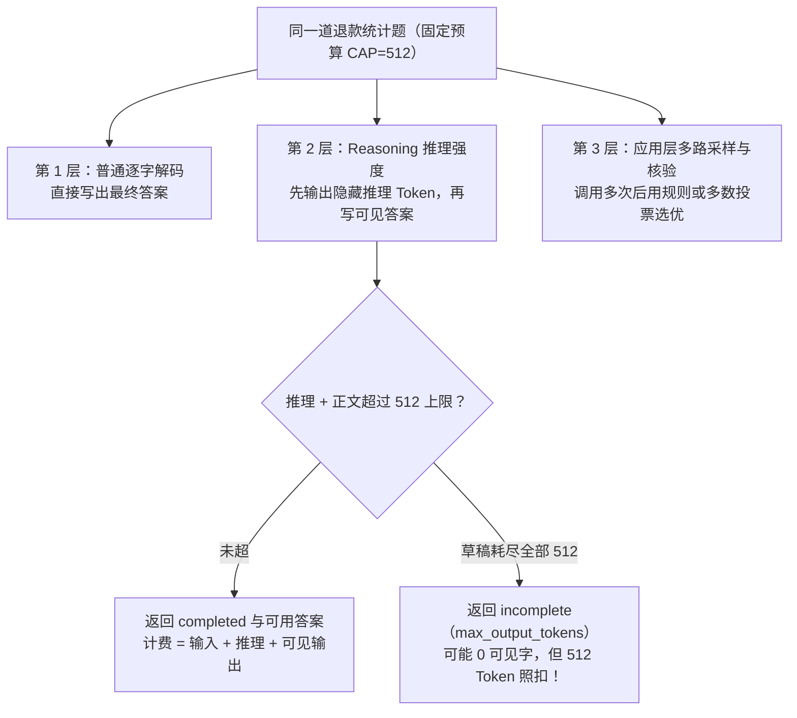

发给模型同一道退款汇总题，有时候秒回、有时候转了十秒钟圈才答完——可屏幕上最后显示出来的字数明明差不多长！难道后台网卡了，还是模型暗地里多算了一大通「打草稿」的过程？

这背后涉及的核心概念叫**推理时计算（Inference-time Compute）**：模型权重已经彻底训好冻住了，但在**回答你这一条具体请求时**，愿意多投入多少计算时间去思考或验算。前面学过的 GRPO 是在「训练阶段」重塑大脑，这一篇看「考试现场」怎样花计算换正确率。

> **先用大白话讲明白**：当一个学生面对一道绕弯的财务对账题，除了「重新复读一年重训脑子」，在考场上还有三层办法能把准确率提上去：
> 1. **第一层 · 常规逐字答题（普通自回归解码）**：看见题目直接按 F-04 流程一个字接一个字往外写答案。
> 2. **第二层 · 考场先打草稿再写卷面（Reasoning 模型 + `reasoning.effort`）**：先在草稿纸上默默推演十几步，算确认了再往最终答案里写最终数。传给接口的 **`reasoning.effort`（`low` / `medium`）** 就是在控制草稿允许写多细——**注意！草稿纸也是要算在总输出字数预算和账单里的**。
> 3. **第三层 · 多做几遍互相验算（多次采样 + 验证/投票）**：应用层同时让模型答 5 份卷子，有核验程序就挑通过验算的那份；没程序就少数服从多数投票（Self-Consistency）。



## 1. 先盯住三层各自的职责边界

| 层次 | 运行在哪一层？ | 我们今天用什么开关/做法来观察？ |
| --- | --- | --- |
| **一般自回归解码** | 模型和推理引擎底层 | [F-04](f-04-autoregressive-sampling.md) 讲过的「打分 → 采样 → 追加前缀」基本循环 |
| **可配置推理强度** | 模型接口暴露的参数 | 对同一模型切换 `reasoning={"effort": "low"}` 或 `"medium"`，观察输出与 `reasoning_tokens` |
| **多次采样与验证** | 用户自己的业务应用 | 同一题发多次调用，再用代码核验规则或归组投票（成本与耗时成倍叠加） |

如果你做的是报表计算这种**能用代码验算对错**的任务，优先让应用层接个规则核验或直接调用计算器工具，比盲目拉高推理档位或投票更省钱更可靠；而在代码生成、复杂逻辑拆解领域，推理预算的收益往往十分显著。 [OpenAI Reasoning 模型指南](https://developers.openai.com/api/docs/guides/reasoning) · [Self-Consistency 多样采样论文](https://arxiv.org/abs/2203.11171)

## 2. 固定四道测试题，每次只拧 `effort` 一个旋钮

为了防止对比掺杂水分，四道题目全部固定规则：「空值（`None`）不计入合计，缺失数只数空值，严格输出 `合计,缺失数`」：

| 题号 | 退款金额列表 | 标准答案 | 专测哪个容易踩的坑？ |
| --- | --- | --- | --- |
| **A** | `12, 空, 8` | `20,1` | 正常金额混合空值 |
| **B** | `0, 5, 空, −2` | `3,1` | `0` 是有效金额、负数照算合计 |
| **C** | `空, 空, 7` | `7,2` | 连续多个空值 |
| **D** | `4, −4, 0` | `0,0` | 合计恰好抵消成 `0`，和「缺失」两码事 |

做科学对照时，把模型版本、提示词、输出格式、输出上限 `CAP = 512`、串行并发全部锁死，**唯一改变的变量就是 `effort`（`low` vs `medium`）**。评分用严格**完全匹配**：格式不对、数字错、或者半路超预算被截断，统统记为失败。

## 3. 读账单和指标：别漏算「光思考没来得及写答案」的废单！

在 OpenAI Responses API 里，同一条返回包里可以读到下面几个核心账本字段：

| 观测指标 | 字段来源或算法 | 为什么要看它？ |
| --- | --- | --- |
| **正确率** | `完整且答对的题数 ÷ 总题数` | **截断的半截题必须留在分母里**，不能只算有字的题！ |
| **输入 & 缓存输入** | `usage.input_tokens` / `cached_tokens` | 缓存输入包含在总数里，通常计费单价更低 |
| **输出 & 推理 Token** | `usage.output_tokens` / `reasoning_tokens` | **关键**：在 Responses API 里，推理 Token **已经算进了总 `output_tokens` 账单里** |
| **客户端延迟** | 发请求到收完响应的秒数（取中位数 / 尾部） | 感知用户等待时长 |
| **预算触顶率** | `status == "incomplete"` 且 `reason == "max_output_tokens"` 占比 | 专门用来抓「草稿想太久把 512 额度花光、一个字没吐出来」的隐形亏损 |

> **容易踩的坑（触顶亏钱陷阱）**：假如模型开 `medium` 档时在一道题上陷入纠结，脑子里写了整整 512 个推理 Token 还没得出结论，碰到 `max_output_tokens = 512` 强制截断！这时返回给你的是空字符串 `""`（`status="incomplete"`），**你一分答案没拿到，但这 512 个输出 Token 账单照样按全价扣费！** 所以对比模型时一定要同时报告正确率、触顶率和「每答对一题的真实总成本」。 [Responses 用量与不完整状态说明](https://developers.openai.com/api/docs/guides/reasoning)

## 4. 先离线跑通统计链路，再选跑真实计费接口

把代码存为 `reasoning_budget.py`：
- **离线直接跑** `python3 reasoning_budget.py`：走内置教学构造样例 `fixture()`，不联网不花钱，用来核对四项统计汇总与触顶率逻辑。
- **线上实测（可选）**：装上 `python -m pip install "openai==2.44.0"` 并配好 `OPENAI_API_KEY` 后，运行 `python reasoning_budget.py --model YOUR_MODEL_ID`（换成自己账户可用且支持 `low`/`medium` 的模型）。脚本故意设了 `max_retries=0` 关闭 SDK 自动重试，免得网络抖动重发把计数和延迟混在一起。

```python
import argparse
from statistics import median
from time import perf_counter

CASES = [
    ("A", [12, None, 8], "20,1"),
    ("B", [0, 5, None, -2], "3,1"),
    ("C", [None, None, 7], "7,2"),
    ("D", [4, -4, 0], "0,0"),
]
EFFORTS = ("low", "medium")
CAP = 512


def row(text, status, reason, inputs, cached, outputs, reasoning, seconds):
    assert 0 <= cached <= inputs and 0 <= reasoning <= outputs
    return {
        "text": text.strip(),
        "status": status,
        "cap_hit": status == "incomplete" and reason == "max_output_tokens",
        "counts": (inputs, cached, outputs, reasoning),
        "seconds": seconds,
    }


def fixture():
    # 答案、输出 Token、其中的推理 Token、秒。只用于验证统计。
    samples = {
        "low": [("20,1", 50, 40, 0.4), ("3,0", 64, 54, 0.6),
                ("7,2", 76, 66, 0.5), ("0,1", 56, 46, 0.8)],
        "medium": [("20,1", 110, 100, 0.9), ("3,1", 132, 122, 1.1),
                   ("", CAP, CAP, 2.5), ("0,0", 112, 102, 1.2)],
    }
    return {
        effort: [
            row(text, "completed" if text else "incomplete",
                None if text else "max_output_tokens", 60, 0, outputs, reason_tokens, latency)
            for text, outputs, reason_tokens, latency in samples[effort]
        ]
        for effort in EFFORTS
    }


def live(model):
    from openai import OpenAI

    client = OpenAI(max_retries=0, timeout=60)
    groups = {effort: [] for effort in EFFORTS}
    for case_id, values, _ in CASES:
        for effort in EFFORTS:
            prompt = f"退款列为 {values}，None 表示缺失。求非缺失之和与缺失数。只输出总和,缺失数。"
            start = perf_counter()
            response = client.responses.create(
                model=model, input=prompt, reasoning={"effort": effort},
                max_output_tokens=CAP, store=False,
            )
            elapsed = perf_counter() - start
            usage = response.usage
            if usage is None:
                raise RuntimeError(f"{case_id}/{effort} 未返回用量")
            record = row(
                response.output_text, response.status,
                getattr(response.incomplete_details, "reason", None),
                usage.input_tokens, usage.input_tokens_details.cached_tokens,
                usage.output_tokens, usage.output_tokens_details.reasoning_tokens, elapsed,
            )
            groups[effort].append(record)
            print(case_id, effort, response.model, record)
    return groups


parser = argparse.ArgumentParser()
parser.add_argument("--model", help="传入支持 low、medium 的模型以发出真实请求")
options = parser.parse_args()
groups = live(options.model) if options.model else fixture()
for effort in EFFORTS:
    records = groups[effort]
    correct = sum(
        record["status"] == "completed" and record["text"] == case[2]
        for record, case in zip(records, CASES)
    )
    hits = sum(record["cap_hit"] for record in records)
    counts = [sum(column) for column in zip(*(record["counts"] for record in records))]
    latency = median(record["seconds"] for record in records)
    print(
        f"{effort}: 正确 {correct}/{len(CASES)}, 到达预算 {hits}/{len(CASES)}, "
        f"输入/缓存输入/输出/推理 Token {counts}, 延迟中位数 {latency:.2f} s"
    )
```

离线实跑输出：

```text
low: 正确 2/4, 到达预算 0/4, 输入/缓存输入/输出/推理 Token [240, 0, 246, 206], 延迟中位数 0.55 s
medium: 正确 3/4, 到达预算 1/4, 输入/缓存输入/输出/推理 Token [240, 0, 866, 836], 延迟中位数 1.15 s
```

看这组教学对比：`medium` 正确率从 `2/4` 升到 `3/4`，但总输出 Token 从 `246` 翻了三倍多涨到 `866`（其中 `836` 个全花在幕后推理），还撞了 1 次预算天花板；延迟中位数也从 `0.55 s` 拉长到 `1.15 s`。把这四份账放在一张表里权衡，才知道多花的时间和钱值不值。

## 下一篇

第一专题「LLM 基础与推理」共 15 篇到这里全部收官！现在我们已经搞清了一段文本从 Token、Attention、KV Cache 到采样得分的全部内部机理。从下一篇开始，我们正式走出模型内部，站到应用程序一侧——用原始 HTTP 协议向模型接口发请求！请看第 2 专题第一篇 [API-01《从原始 HTTP 请求认识 LLM API》](api-01-raw-http-request.md)。系列入口见 [LLM 与 Agent 学习路线图](llm-agent-learning-roadmap.md)。

[F-11 GRPO 如何用于推理模型后训练](f-11-grpo.md) · [API-01 从原始 HTTP 请求认识 LLM API](api-01-raw-http-request.md)
