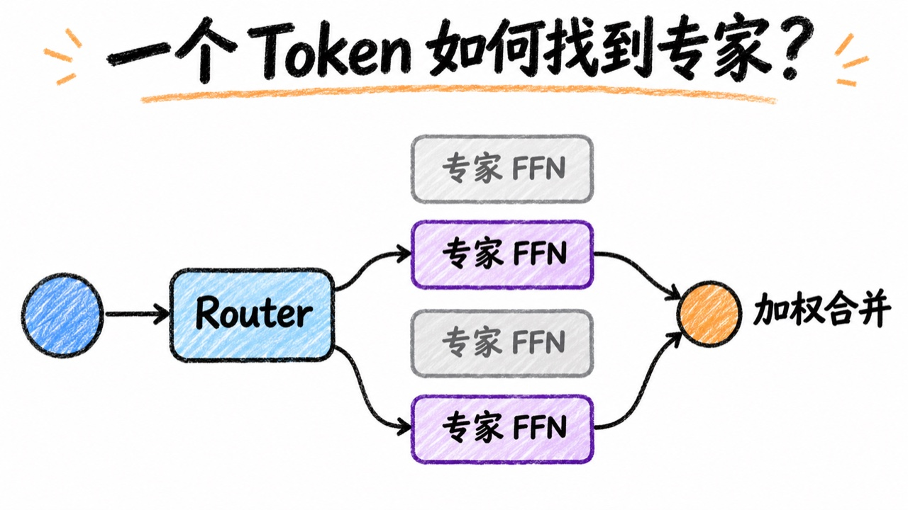

模型读到一条 CSV（逗号分隔值文件）备注「退款金额缺失。」。处理到「金额」时，**MoE（Mixture of Experts，混合专家）**模型可以从四个小网络里选两个，让它们分别处理当前向量，再把结果合成一条。这些小网络叫**专家**。它们各有一套可以学习的参数，模型训练时会同时学习如何选择专家和如何用专家处理输入。本文的四位专家用 `E0` 到 `E3` 编号，`E` 代表 Expert，编号用来区分不同网络。

**Token** 是分词后送进模型的文本单位。为了手算，我们把这句话切成「退款」「金额」「缺失」「。」四个教学 Token，每个占一个序列位置。接下来先把「金额」走完整，再看四个位置一起处理时会发生什么。实际分词由目标模型的 Tokenizer（分词器）决定。 [F-01 的分词实验](https://blog.lacknb.cn/articles/2026/11/19/1795068393122.html) · [稀疏 MoE 论文](https://arxiv.org/abs/1701.06538)

## 1. 专家放在 Transformer 的哪里？

在 Transformer 层里，**注意力**负责从不同位置读取信息，**FFN（Feed-Forward Network，前馈网络）**负责对每个位置的向量做进一步变换。常见的 FFN 先把输入投影到更宽的中间向量，经过非线性变换，再投影回原来的宽度。这里的「投影」可以先理解为对输入数字按权重乘加，算出另一组数字。**稠密 FFN** 会对所有位置使用同一套前馈网络参数。 [F-02 的 FFN 示例](https://blog.lacknb.cn/articles/2026/11/20/1795135053358.html) · [Transformer 原论文，第 3.3 节](https://arxiv.org/abs/1706.03762)

在 **Mixtral** 这类模型里，原来的一套 FFN 换成了多套专家 FFN，加上负责选择专家的 **Router（路由器）**。对每个位置，Router 用该位置的隐藏向量，也就是已经过前面计算的一组数字，给所有专家打分。只执行被选中的专家，最后把结果加权合并。这种**每次只激活一部分网络**的方式就是稀疏计算。这个环节仍逐位置处理，其他位置的信息已经可以通过先前的注意力进入隐藏向量。 [Mixtral 论文，第 2 节](https://arxiv.org/html/2401.04088#S2)

```text
注意力更新各位置的向量
           ↓
取出一个位置的隐藏向量
           ↓
路由器给每位专家打分，选出分数最高的几位
           ↓
各被选专家独立处理同一条向量
           ↓
按权重合并成一条同样宽的向量，送回该层的残差路径
```

这里的**残差路径**指模块的输出会加回原有表示，再传给后续计算。合并后的向量属于 Transformer 层内部，还要继续经过后面的层和输出头，才会形成下一 Token 的预测分数。

## 2. 手算「金额」怎样找到专家

### 第一步，Router 把向量变成四个分数

假设「金额」送进 MoE 时的隐藏向量是 `x = [1, 1]`。`x` 是输入向量，两个 `1` 是为了方便计算设置的分量。用 `a`、`b` 分别代表这两个分量。给四位专家分别配一组路由权重，用输入分量乘权重再相加：

| 专家 | 路由权重 | 打分公式 | 代入 `a = 1，b = 1` |
| --- | --- | --- | ---: |
| E0 | `[2, 0]` | `2a` | 2 |
| E1 | `[1, 0]` | `a` | 1 |
| E2 | `[-1, 1]` | `−a + b` | 0 |
| E3 | `[0, −1]` | `−b` | −1 |

四组权重分别和输入做乘加，得到四个 **router logits（路由原始分数）** `[2, 1, 0, −1]`。这条线性投影的输入宽度是 2，输出宽度等于专家数 4。这里每一列分数对应一个专家编号。F-02 里相似的计算发生在模型输出头，每一列对应词表里的一个 Token。真实模型的 Router 权重来自训练，本例用固定数字演示。

### 第二步，选分数最高的两位，再确定合并权重

**Top-k** 指按分数取前 `k` 项，`k` 是每个 Token 要选中的专家数。本例 `k = 2`，就叫 **Top-2**。按 Mixtral 的计算顺序，先做 **Softmax**。它把每个分数取指数，再除以所有指数之和，得到四项之和为 1 的路由概率。

```text
原始分数     [2,      1,      0,      −1    ]
Softmax      [0.6439, 0.2369, 0.0871, 0.0321]
专家          E0      E1      E2      E3
Top-2         ✓       ✓
```

以 E0 为例，算的是 `exp(2) ÷ [exp(2) + exp(1) + exp(0) + exp(−1)] ≈ 0.6439`。`exp` 是指数函数。选中 E0 和 E1 后，这两项的概率之和约为 `0.8808`。Mixtral 将保留的概率再除以它们的和，这一步叫**重新归一化**。用完整精度计算，E0 的合并权重约为 `0.7311`，E1 约为 `0.2689`。两项之和为 1。因为 Softmax 保留分数的排序，先选中两项再只对它们做 Softmax，也会得到同样的权重。不同 MoE 模型可以有不同的选取与加权规则。 [Mixtral 的 Top-k Router 实现](https://github.com/huggingface/transformers/blob/v5.13.0/src/transformers/models/mixtral/modeling_mixtral.py#L101)

### 第三步，两个专家处理同一输入，再加权合并

E0 和 E1 都拿到原始输入 `[1, 1]`。本例把专家的中间宽度取成 1，计算过程是「2 个分量 → 1 个数 → 2 个分量」。实际模型通常用更宽的中间向量。我们用 **ReLU（Rectified Linear Unit，修正线性单元）**做教学里的非线性变换。它把负数变成 0，保留正数。

| 被选专家 | 第一次投影 | ReLU 后 | 第二次投影，得到专家输出 |
| --- | --- | ---: | --- |
| E0 | `1×1 + 1×0 = 1` | 1 | `1 × [3, 0] = [3, 0]` |
| E1 | `1×0 + 1×1 = 1` | 1 | `1 × [0, 3] = [0, 3]` |

先把每位专家的输出乘上自己的合并权重，再逐分量相加。即 `0.7311 × [3, 0] + 0.2689 × [0, 3]`。用完整精度计算，合并结果约为 **`[2.1932, 0.8068]`**。E2、E3 有路由分数，但这一位置不会执行它们的 FFN。输出宽度仍然是 2，因此可以加回该层的原始表示。

## 3. 总参数和每 Token 激活参数怎么算？

**参数**是模型保存的可学习数值，例如表格中的路由权重和专家投影权重。用这个教学模块来数，暂时只算权重：

| 部分 | 模块拥有的参数 | 处理一个 Token 时参与计算的参数 |
| --- | ---: | ---: |
| Router 的四组两维权重 | `4 × 2 = 8` | 8，四个专家都要打分 |
| 四个专家，每个有 2 个输入和 2 个输出投影权重 | `4 × 4 = 16` | `2 × 4 = 8`，只执行两位专家 |
| 合计 | **24** | **16** |

被选专家都要计算完整的前馈变换。路由比例 `2/4` 只适用于专家 FFN 这一部分。对整个模型，还需要计入注意力、归一化等共用模块。以 **Mixtral 8×7B** 为例，每个 MoE 层有 8 位专家，每个 Token 选 2 位。论文报告整个模型约有 **47B 总参数**，每个 Token 激活约 **13B 参数**。`B` 是 billion，1B 等于 10 亿。同一批里不同 Token 可能调用不同专家，因此部署时仍需为整套权重安排存储和访问，例如分布到多个设备上。 [Mixtral 论文的摘要和架构表](https://arxiv.org/html/2401.04088)

## 4. 每个 Token 都选两位，为何有的专家特别忙？

把同一句「退款金额缺失。」的四个位置放到一批里。仍用上面的 Router，只改变各位置输入向量。表里的数字和分组都能用同一套打分公式算出来。

| Token | 教学向量 `[a, b]` | 按 E0～E3 排列的路由分数 | 选中的专家 |
| --- | --- | --- | --- |
| 退款 | `[2, 1]` | `[4, 2, −1, −1]` | E0、E1 |
| 金额 | `[1, 1]` | `[2, 1, 0, −1]` | E0、E1 |
| 缺失 | `[1, 2.5]` | `[2, 1, 1.5, −2.5]` | E0、E2 |
| 。 | `[1, −1.5]` | `[2, 1, −2.5, 1.5]` | E0、E3 |

每选中一次就算一次**分派**。四个 Token 各选两位，一共产生八次分派。E0、E1、E2、E3 实际收到 **4、2、1、1** 个 Token。平均负载为 `8 ÷ 4 = 2`，最忙的 E0 是均值的两倍。这就是**负载倾斜**。例如「金额」给 E1 的合并权重只有约 0.2689，E1 仍要为它执行一次完整的专家计算。分派数统计的是专家收到多少条向量。

训练时，部分模型会加**负载均衡损失**，也就是在主要的预测误差之外增加一个约束，鼓励 Router 减少长期把多数 Token 分给少数专家的情况。通常会观察各专家的分派比例和路由概率，训练配方各有差异，短批次里仍可出现倾斜。 [Switch Transformers 论文，第 2 节](https://www.jmlr.org/papers/v23/21-0998.html) · [Mixtral 负载均衡损失实现](https://github.com/huggingface/transformers/blob/v5.13.0/src/transformers/models/mixtral/modeling_mixtral.py#L489)

这个现象到了多卡就更直观。**GPU（Graphics Processing Unit，图形处理器）**也常用来执行模型运算。**专家并行（Expert Parallelism）**把不同专家的权重放到不同设备上。若 E0、E1 在一张卡，E2、E3 在另一张，这个例子分到两张卡的专家工作量就是 **6 对 2**。引擎要把向量发到对应专家所在的设备，完成计算后收回结果，按原 Token 位置合并。在需要等待整批结果的阶段，设备间通信和较忙设备的处理时间都可能影响延迟。路线图的 **SERV-10「多 GPU 与分离式推理部署」**会把这部分展开。 [Mixtral 论文，第 2.1 节](https://arxiv.org/html/2401.04088#S2.SS1)

## 5. 用 Python 验证路由、合并和负载

把下面保存为 `moe_demo.py`，运行 `python3 moe_demo.py`。只用 Python 标准库，无需下载模型。代码中的 `logits` 是 Router 的四个原始分数，`selected` 保存被选中的专家编号，`weights` 保存重新归一化后的合并权重，`loads` 记录每个专家收到的 Token 数。Softmax 里先给所有分数减去同一个最大值，可以避免指数结果过大。归一化后概率保持相同。

```python
from math import exp, isclose

# 每个专家用 (输入投影方向, 输出投影方向) 表示。
# 为了便于手算，教学 FFN 的中间宽度取 1。
experts = (
    ((1, 0), (3, 0)),
    ((0, 1), (0, 3)),
    ((1, 1), (1, 1)),
    ((1, -1), (1, -1)),
)
tokens = (
    ("退款", (2, 1)),
    ("金额", (1, 1)),
    ("缺失", (1, 2.5)),
    ("。", (1, -1.5)),
)
top_k = 2


def expert_ffn(x, expert_id):
    input_weights, output_weights = experts[expert_id]
    hidden = max(0, sum(value * weight for value, weight in zip(x, input_weights)))
    return [hidden * weight for weight in output_weights]


loads = [0] * len(experts)
for token, x in tokens:
    a, b = x
    logits = (2 * a, a, -a + b, -b)
    max_score = max(logits)
    exponentials = [exp(score - max_score) for score in logits]
    denominator = sum(exponentials)
    probabilities = [value / denominator for value in exponentials]
    ranked = sorted(range(len(experts)), key=lambda i: probabilities[i], reverse=True)
    selected = ranked[:top_k]
    selected_mass = sum(probabilities[i] for i in selected)
    weights = [probabilities[i] / selected_mass for i in selected]

    output = [0.0, 0.0]
    for expert_id, weight in zip(selected, weights):
        loads[expert_id] += 1
        expert_output = expert_ffn(x, expert_id)
        for axis, value in enumerate(expert_output):
            output[axis] += weight * value

    assert isclose(sum(weights), 1)
    ids = ", ".join(f"E{i}" for i in selected)
    print(f"{token} → {ids}")
    if token == "金额":
        print("  路由权重", [round(weight, 4) for weight in weights])
        print("  合并输出", [round(value, 4) for value in output])

assignments = len(tokens) * top_k
average = assignments / len(experts)
assert sum(loads) == assignments
assert loads == [4, 2, 1, 1]
print("各专家收到的 Token 数", loads)
print(f"分派总数 {assignments}，峰值/均值 {max(loads) / average:.1f}×")
```

实跑输出：

```text
退款 → E0, E1
金额 → E0, E1
  路由权重 [0.7311, 0.2689]
  合并输出 [2.1932, 0.8068]
缺失 → E0, E2
。 → E0, E3
各专家收到的 Token 数 [4, 2, 1, 1]
分派总数 8，峰值/均值 2.0×
```

可以把「金额」的输入从 `(1, 1)` 改成 `(1, 2.5)`，同时把 `assert loads == [4, 2, 1, 1]` 的预期结果改成 `[4, 1, 2, 1]`，再运行一次。「金额」的第二个专家会从 E1 换成 E2，它的合并输出约为 `[3.1888, 1.3214]`。分派总数仍然是 8。

## 6. 到 Mixtral 源码里核对这条链路

用 Transformers `v5.13.0` 的实现，可以沿着三个函数把上面的数据一一对上。

1. **看这一层从哪里接入 MoE。** `MixtralDecoderLayer.forward()` 先完成注意力和残差相加，再把归一化后的向量交给 `self.mlp`。`MLP` 是 Multi-Layer Perceptron，多层感知机。这里的 `self.mlp` 指向 `MixtralSparseMoeBlock`，也就是包含 Router 和专家的稀疏模块。解码层最后把 MoE 输出加回残差。 [解码层源码](https://github.com/huggingface/transformers/blob/v5.13.0/src/transformers/models/mixtral/modeling_mixtral.py#L354)
2. **看每个 Token 选哪些专家。** `MixtralTopKRouter.forward()` 做线性打分、Softmax、Top-k 和归一化。把批次内所有输入位置摊成 `T` 行，若有 `E` 位专家，打分表的形状就是 `[T, E]`。选中的专家编号和合并权重各是 `[T, k]`。本例分别是 `[4, 4]` 和 `[4, 2]`，第一维都对应 Token 位置。 [路由器源码](https://github.com/huggingface/transformers/blob/v5.13.0/src/transformers/models/mixtral/modeling_mixtral.py#L101)
3. **看专家结果还原到哪个位置。** `MixtralExperts.forward()` 按专家找出分到它的 Token，再对这些输入执行 FFN。输出乘对应的合并权重，最后通过 `index_add_` 按原 Token 的位置累加。这一步对应第 2 节手算的「两个专家的输出加回同一行」。 [专家计算与合并源码](https://github.com/huggingface/transformers/blob/v5.13.0/src/transformers/models/mixtral/modeling_mixtral.py#L62)

把本文的手写权重和四条输入送进这个版本的 Mixtral Router，四组专家编号和「金额」的两项合并权重都与教学脚本一致。专家部分仍用本文的简化 FFN 演示。

## 下一篇

路线图接下来是 **F-04《自回归生成与采样》**。本篇的 Top-k 在**专家集合**里选要执行的网络。下一篇会从模型输出头的分数出发，看生成时怎样在**词表的候选 Token**里选择下一个 Token。 [LLM 与 Agent 学习路线图](https://blog.lacknb.cn/articles/2026/11/19/1795058329577.html)
