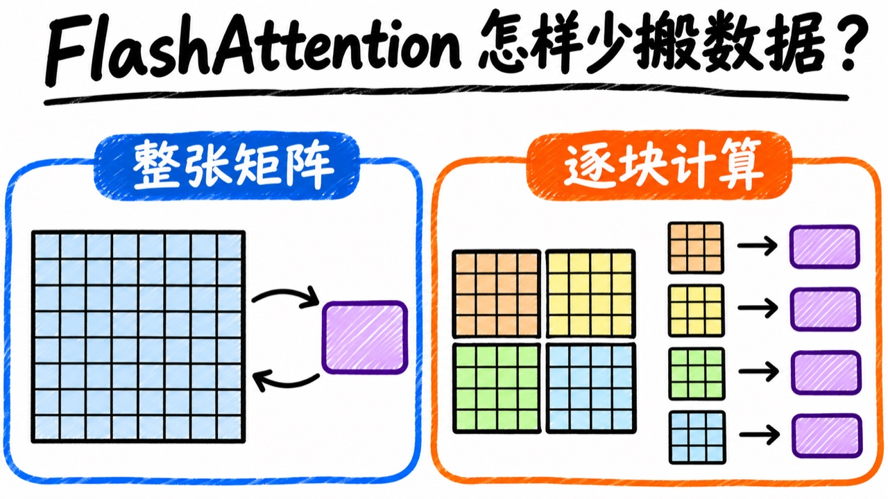
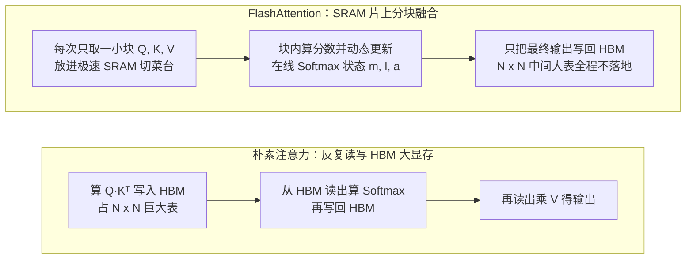

还是前面那份 CSV 报表任务。假如用户一口气贴进来一本厚厚的数据字典（长文本输入），在 Prefill 阶段，模型要计算注意力：每个位置都要和前面所有位置算一次匹配打分。

很多人听到 **FlashAttention** 时会猜：「是不是它做了一点近似、跳过一些词不算才变快的？」**恰恰相反！** FlashAttention 在实数数学上算出来的答案跟普通注意力**分毫不差**。它真正干掉的，不是「乘法次数」，而是 GPU 显存里「搬来搬去的冤枉路」！

> **先用大白话讲明白**：把 GPU 显卡里的存储分成两个地方：
> - **HBM（高带宽大显存）**：好比酒店的「地下大冷库」，空间巨大（几十 GB），但跑一趟取货极慢。
> - **SRAM（芯片上的极速缓存）**：好比厨师面前的「小切菜台」，伸手就能摸到（极快！），但桌面小得可怜（只有几十 MB）。
>
> **朴素注意力**的做法极笨：先算好一张完整的 `N × N` 巨大分数表，扛进地下大冷库（写 HBM）→ 走回冷库扛出来算 Softmax，再扛回冷库 → 又扛出来乘 V……来回搬运极其耗时，甚至可能把冷库塞爆！
> **FlashAttention** 改用「小切菜台流水作业」：**把 Q、K、V 切成小块搬上切菜台，在台面上边读块、边用「在线记账法」更新 Softmax 结果，算完直接写出最终成品，压根不往冷库里写那张巨大的中间分数表！**



先确保已看过 [F-02 注意力手算](f-02-transformer-logits.md) 和 [F-06 KV Cache](f-06-kv-cache.md)。 [FlashAttention 原论文](https://arxiv.org/abs/2205.14135)

## 1. 先算一笔账：那张中间大表有多吓人？

假设一次注意力有 `N = 4096` 个 Token，光看**1 个注意力头**产生的 `N × N` 分数矩阵，用 16 位浮点数（每数 2 字节）存放：

`4096 × 4096 × 2 = 33,554,432` 字节 = **32 MiB**。

这还仅仅是 **1 条请求、1 个头、1 张表**！如果一批并发 8 条请求、每层 16 个头，仅仅为了存这张转瞬即逝的临时表就要吞掉 `32 MiB × 8 × 16 = 4 GiB` 显存，还要从缓慢的 HBM（High Bandwidth Memory，高带宽显存）里写进去再读出来好几遍。

> **关键区分**：在标准全量注意力下，FlashAttention 算的乘加总次数（FLOPs）依然随序列长度平方增长，真正降下来的是 **HBM 访问次数（I/O 开销）** 和 **峰值显存占用**。

## 2. 切菜台这么小，怎么在没看全表前就把 Softmax 算对？

普通 Softmax 必须先看过一整行全部 `N` 个数，找到最大值再统一算分母。可现在切菜台一次只放得下 **2 个数**，后面还没读到怎么办？

答案叫 **在线 Softmax（Online Softmax）**：靠维护三个小小的「滚动账本变量」边走边修正！

用「金额」这个查询位置演示：假设它能读 4 条证据，打完分后是 `[0, 1, 2, 3]`，对应的 V 只取一维，分别为 `[2, 4, 6, 8]`。一次只看 2 个（分两块：`[0, 1]` 和 `[2, 3]`）：

| 滚动变量 | 它的含义（大白话） | 读完第 1 块 `[0, 1]` 后的值 | 读完第 2 块 `[2, 3]` 怎么修正更新？ |
| --- | --- | ---: | --- |
| **`m`** | 目前见过**最大的分值** | `1` | 新块最大值是 `3`，所以新基准 `m = 3` |
| **`l`** | 以当前 `m` 为基准的**指数总和（分母）** | `1.367879` | 旧基准是 1、新基准是 3，先把旧 `l` 乘 `exp(1 - 3)` 统一换算到新基准，再加第 2 块指数和 → `1.553002` |
| **`a`** | 以当前 `m` 为基准的**加权 V 之和（分子）** | `4.735759` | 同样先把旧 `a` 乘 `exp(1 - 3)` 缩放到新基准，再加第 2 块加权 V → `10.848192` |

最后两块都滚完了，一步做除法：`a / l = 10.848192 / 1.553002 ≈ 6.985305`。神奇吧？无论前面旧基准设低了多少，只要乘上 `exp(旧基准 - 新基准)`，在数学上就跟一开始就知道全局最大值 `3` **严丝合缝等价**！真实模型里 `a` 是多维向量，每个分量只需同乘这一个缩放系数即可。

> **细节提醒**：由于浮点数加法顺序变了，有限精度下会有极微小舍入差（约 `1e-15` 或半精度下的 `1e-3`），因此比对时用容差断言。而在因果生成时，右上角那些「完全不可见」的块甚至可以直接跳过不算，速度还能再翻一倍！ [FlashAttention 论文 Algorithm 1](https://arxiv.org/abs/2205.14135)

## 3. 先在普通电脑用 Python 验算在线 Softmax

下面脚本只用 Python 标准库，保存为 `online_softmax.py` 并运行 `python3 online_softmax.py`：

```python
from math import exp, isclose

scores = [0.0, 1.0, 2.0, 3.0]
values = [2.0, 4.0, 6.0, 8.0]
peak = max(scores)
weights = [exp(score - peak) for score in scores]
reference = sum(weight * value for weight, value in zip(weights, values)) / sum(weights)

peak = float("-inf")
mass = weighted_sum = 0.0
for start in range(0, len(scores), 2):
    block = scores[start:start + 2]
    new_peak = max(peak, max(block))
    old_scale = exp(peak - new_peak)
    weights = [exp(score - new_peak) for score in block]
    mass = mass * old_scale + sum(weights)
    weighted_sum = weighted_sum * old_scale + sum(
        w * v for w, v in zip(weights, values[start:start + 2])
    )
    peak = new_peak
    print(f"m={peak:.0f}, l={mass:.6f}, a={weighted_sum:.6f}")

result = weighted_sum / mass
assert isclose(result, reference, abs_tol=1e-12)
print(f"整行={reference:.6f}, 分块={result:.6f}, 误差={abs(result-reference):.3g}")
```

实跑结果：

```text
m=1, l=1.367879, a=4.735759
m=3, l=1.553002, a=10.848192
整行=6.985305, 分块=6.985305, 误差=1.78e-15
```

整行和分块之间误差只有 `1.78 × 10⁻¹⁵`——基本就是浮点数的机器极限精度了！

## 4. 在 CUDA 显卡上真刀真枪测显存与耗时（可选）

> **想再深入一层？** 如果你手边有 NVIDIA GPU（配备 CUDA 计算平台），可以用 PyTorch 官方提供的 **SDPA（Scaled Dot Product Attention，缩放点积注意力）** 接口，强制锁定 `SDPBackend.FLASH_ATTENTION` 后端，跟手写 `naive` 朴素注意力比一比额外峰值显存和单次耗时（本机未配 CUDA，以下代码需在支持的 NVIDIA GPU 环境运行）。

```python
import torch
import torch.nn.functional as F
from torch.nn.attention import SDPBackend, sdpa_kernel

if not torch.cuda.is_available():
    raise SystemExit("CUDA 不可用，跳过 FlashAttention 显存和耗时对照。")

torch.manual_seed(7)
shape = (1, 4, 2048, 64)
q, k, v = (torch.randn(shape, device="cuda", dtype=torch.float16) for _ in range(3))
causal = torch.ones((2048, 2048), device="cuda", dtype=torch.bool).tril()


def naive():
    scores = (q @ k.transpose(-2, -1)) / (q.shape[-1] ** 0.5)
    scores.masked_fill_(~causal, float("-inf"))
    return scores.softmax(dim=-1) @ v


def flash():
    with sdpa_kernel(SDPBackend.FLASH_ATTENTION):
        return F.scaled_dot_product_attention(q, k, v, is_causal=True)


def measure(operation):
    for _ in range(5):
        operation()
    torch.cuda.synchronize()
    before = torch.cuda.memory_allocated()
    torch.cuda.reset_peak_memory_stats()
    start = torch.cuda.Event(enable_timing=True)
    end = torch.cuda.Event(enable_timing=True)
    start.record()
    for _ in range(20):
        output = operation()
        del output
    end.record()
    end.synchronize()
    peak = torch.cuda.max_memory_allocated() - before
    return start.elapsed_time(end) / 20, peak / 1024**2


with torch.inference_mode():
    reference = naive().cpu().float()
    actual = flash().cpu().float()
    torch.testing.assert_close(actual, reference, atol=0.003, rtol=0.02)
    print(torch.__version__, torch.cuda.get_device_name())
    print("最大绝对误差", (actual - reference).abs().max().item())
    for name, operation in (("naive", naive), ("flash", flash)):
        milliseconds, peak_mib = measure(operation)
        print(f"{name}: {milliseconds:.3f} ms, 运行额外峰值 {peak_mib:.1f} MiB")
```

> **容易踩的坑**：注意代码里的 `with sdpa_kernel(SDPBackend.FLASH_ATTENTION):`。如果你不显式强制指定它，PyTorch 在发现当前头宽或显卡型号不满足 FlashAttention 硬件条件时，会默默回退成普通数学实现而不报错，让你误以为自己测出了 FlashAttention 的数据！ [PyTorch SDPA 文档](https://docs.pytorch.org/docs/stable/generated/torch.nn.functional.scaled_dot_product_attention.html)

## 5. 分清两个「分块」：FlashAttention vs KV Cache / PagedAttention

| 技术名称 | 优化的对象是谁？ | 生命周期有多长？ | 解决的核心痛点 |
| --- | --- | --- | --- |
| **FlashAttention** | 注意力计算内部的临时分数表 `N × N` | **算完这一层就丢** | 省下切块搬运 HBM ↔ SRAM 的时间和瞬时巨型显存峰值 |
| **KV Cache + PagedAttention** | 前面已算好的历史 `K` 和 `V` 向量 | **跨多个生成步常驻** | 省掉重复计算旧词，按页切块避免长短不一带来的显存碎片 |

一句话记住：**FlashAttention 优化「正在算的那一瞬间」的搬运工，PagedAttention 管理「长期存放在仓库里」的笔记本**。二者不但不冲突，现代推理引擎 vLLM 正是把它们叠在一起用——详细调度留到 [SERV-04](serv-04-paged-attention-batching.md) 拆解。 [PagedAttention 论文](https://arxiv.org/abs/2309.06180)

## 下一篇

搞明白了模型内部怎么加速算、怎么省显存，下一步把镜头拉到网页界面上：为什么引擎日志明明显示 120 毫秒就吐出了第一个字，浏览器上却过了好一会儿才看到字？请看下一篇 [F-07《TTFT、TPOT、ITL 与吞吐怎样量？》](f-07-inference-latency-metrics.md)。系列入口见 [LLM 与 Agent 学习路线图](llm-agent-learning-roadmap.md)。

[F-06 KV Cache 如何加速 Decode](f-06-kv-cache.md) · [F-07 TTFT、TPOT、ITL 与吞吐怎样量？](f-07-inference-latency-metrics.md)
