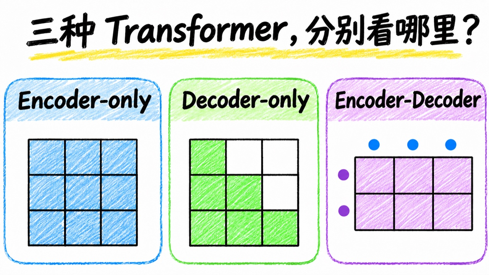

同一条 CSV 备注写着「退款金额缺失」。你可以拿它问三个不同的问题：这条备注和「空值能当 0 吗」相关吗？只给「退款金额」，下一项最可能是什么？给出整句备注，能不能生成一条简短说明？

这些任务可以由不同的模型来做。理解 **Encoder-only、Decoder-only 和 Encoder-Decoder** 的起点，是看**某个位置可以从哪里取信息**。在[上一篇 F-02](https://blog.lacknb.cn/articles/2026/11/20/1795135053358.html)里，Qwen 的第 2 个位置看不到第 3 个位置。这一篇把同一段文本送进三种结构，看看这个限制会怎样变化。

为了能拿纸笔画图，我们约定把原文切成三个教学 Token：

```text
位置       1      2      3
文本      退款   金额   缺失
教学 ID     2      3      4
```

教学 ID 只在本篇实验中使用。实际模型会各自用自己的 Tokenizer 和词表。

## 1. Encoder-only：读完前后文，再给各位置做表示

以 **BERT** 为例。编码器的每个有效位置，都可以看整段输入中的其他有效位置。这叫**双向自注意力**。这里先假设输入没有用于凑长度的填充 Token。

```text
当前查询 ↓  能看的位置 →   退款  金额  缺失
退款                        ✓     ✓     ✓
金额                        ✓     ✓     ✓
缺失                        ✓     ✓     ✓
```

中间的「金额」可以结合左边的「退款」和右边的「缺失」来形成自己的表示。把末尾改成「为零」，前两个输入 Token 没变，但「金额」所在位置的向量也可能跟着变。

BERT 的预训练包含**掩码语言建模（MLM）**。例如把输入构造成「退款 `[MASK]` 缺失」，让模型用两边的信息猜中间被盖住的「金额」。掩码训练中的 `[MASK]` 是放在输入中的占位 Token，它仍占一个位置。双向注意力中的遮罩负责控制哪些位置能互相读取，是另一个概念。原版 BERT 的预训练还包含下一句预测。 [BERT 论文，第 3.1 节](https://arxiv.org/abs/1810.04805)

只调用 **`BertModel`** 时，你能拿到每个位置的隐藏向量。例如实验里三个位置、每个向量 16 个数字，返回形状就是 `[1, 3, 16]`。要做填空，可以加 MLM 头。要为整段话打分类分数，可以接相应的分类头。要做句向量检索，通常选择为相似度任务训练过的模型，并按它的规则把位置向量汇总成一个向量。

## 2. Decoder-only：每个位置只读已出现的内容

以 **Qwen** 为例。它沿用上一篇的**因果自注意力**，每个位置可以读自己和左边的内容。对同一个输入，矩阵变成这样：

```text
当前查询 ↓  能看的位置 →   退款  金额  缺失
退款                        ✓     ·     ·
金额                        ✓     ✓     ·
缺失                        ✓     ✓     ✓
```

训练下一 Token 预测时，第 1 行用「退款」预测「金额」，第 2 行用「退款、金额」预测「缺失」。训练可以把整段序列一次送进去，因果遮罩会阻止第 2 行直接读到它要预测的第 3 个 Token。推理时，如果输入已经有「退款、金额、缺失」，就从第 3 行取 logits，预测第 4 个 Token。选出一个 Token 之后，再用更长的前缀接着生成。

聊天时，**完整提示通常都位于回答之前**。因此，生成回答的第一个位置可以利用整段已经送进去的提示，包括末尾的「缺失」。因果遮罩挡住的是某个查询位置右边的 Token。 [Qwen 模型卡与生成示例](https://huggingface.co/Qwen/Qwen2.5-0.5B-Instruct) · [F-02 的因果遮罩与 logits 实验](https://blog.lacknb.cn/articles/2026/11/20/1795135053358.html)

## 3. Encoder-Decoder：先读源文本，写答案时再回头看

以 **T5** 为例。把「请根据备注『退款金额缺失』写一条简短说明」当作**源文本**，把「空值需复核」当作示例**目标文本**。源文本先交给编码器，说明再由解码器生成。下图只画源文本里的三个核心 Token。

这里有三次不同的读取：

| 注意力 | 谁发起查询（Q） | 去哪里匹配并取值（K、V） | 可见范围 |
| --- | --- | --- | --- |
| 编码器自注意力 | 源文本位置 | 源文本位置 | 源文本双向可见 |
| 解码器自注意力 | 目标文本位置 | 目标文本位置 | 已有目标前缀，包括当前位置 |
| 解码器交叉注意力 | 目标文本位置 | 编码器输出的源文本表示 | 可读取全部有效源位置 |

**交叉注意力**就是解码器用自己的查询，去匹配并读取编码后的源文本。假设解码器当前有两个输入位置「起始、空值」，这两行都可以查阅同一份源文本：

```text
解码器自注意力              解码器对源文本的交叉注意力
         起始  空值                   退款  金额  缺失
起始       ✓     ·          起始        ✓     ✓     ✓
空值       ✓     ✓          空值        ✓     ✓     ✓
```

左边是 **2 × 2**，因为查询和被查询位置都来自解码器。右边是 **2 × 3**，因为两行来自解码器，三列来自编码器。写答案时，模型可以读取整段源文本，同时仍按顺序写出目标文本。

T5 的经典预训练做的是**片段去噪**。例如把「退款金额缺失」末尾的一段换成占位符 `<extra_id_0>`，编码器读「退款金额 `<extra_id_0>`」，解码器依次生成 `<extra_id_0>`、被移除的「缺失」和标记目标末尾的 `<extra_id_1>`。摘要、翻译等任务也能写成「给一段源文本，生成一段目标文本」。 [T5 论文，图 2 与第 3.1.4 节](https://arxiv.org/html/1910.10683#S3.SS1.SSS4)

## 4. 用一张表记住结构、目标和输出

| 代表模型 | 结构 | 本文对照的预训练任务 | 常用输出 |
| --- | --- | --- | --- |
| BERT | Encoder-only | 依据双向上下文预测选中的位置 | 每个位置的隐藏向量，或任务头的分数 |
| Qwen | Decoder-only | 根据前缀预测下一 Token | 每个输入位置的下一 Token logits，生成时取当前末尾 |
| T5 | Encoder-Decoder | 从损坏的源文本生成被删掉的片段 | 每个解码位置的下一 Token logits，依赖源文本和目标前缀 |

**结构决定信息怎么流动，训练目标决定模型练过什么，输出头决定调用者能直接取到什么。** 例如，本篇实验中的 BERT 隐藏状态和 Qwen logits 恰好都是 `[1, 3, 16]`，因为我们把 BERT 向量宽度和 Qwen 教学词表大小都设成了 16。前者的最后一维是向量分量，后者的最后一维是候选 Token 的分数。读张量时，轴的含义比数字是否相同重要。

## 5. 动手实验：换掉最后一项，谁能看到变化？

这次用 Transformers 创建三个**随机初始化的单层模型**，运行真实的 BERT、Qwen2 和 T5 模块。权重很小，设备用 CPU，安装依赖后可以离线运行。随机权重足够验证注意力形状和信息流，实验的输出分数用于结构检查。

使用 Python 3.11 或 3.12，可以沿用 F-02 的虚拟环境。第一次跑系列实验，可以在空目录用 `python3 -m venv .venv` 创建环境，再运行 `source .venv/bin/activate`。Windows PowerShell 可以用 `py -m venv .venv` 创建环境，并把下面命令中的 `python` 换成 `.\.venv\Scripts\python.exe`。进入环境后安装依赖。

```bash
python -m pip install "torch==2.11.0" "transformers==5.13.0" "tokenizers==0.22.2"
```

把脚本存为 `compare_attention.py`，运行 `python compare_attention.py`。它打印第一个注意力头，把正权重显示成 1，把被遮罩后得到的零权重显示成 0。然后把输入末尾从「缺失」换成「为零」，检查实际向量和 logits 的变化。

```python
import torch
from transformers import (
    BertConfig,
    BertModel,
    Qwen2Config,
    Qwen2ForCausalLM,
    T5Config,
    T5ForConditionalGeneration,
)

torch.manual_seed(7)
bert = BertModel(BertConfig(
    vocab_size=16, hidden_size=16, num_attention_heads=2,
    num_hidden_layers=1, intermediate_size=32, attn_implementation="eager",
)).eval()
qwen = Qwen2ForCausalLM(Qwen2Config(
    vocab_size=16, hidden_size=16, num_attention_heads=2, num_key_value_heads=2,
    num_hidden_layers=1, intermediate_size=32, attn_implementation="eager",
)).eval()
t5 = T5ForConditionalGeneration(T5Config(
    vocab_size=16, d_model=16, d_kv=8, num_heads=2, d_ff=32,
    num_layers=1, num_decoder_layers=1, decoder_start_token_id=0,
    attn_implementation="eager",
)).eval()

# 教学词表：2=退款，3=金额，4=缺失，5=为零，6=空值。
source = torch.tensor([[2, 3, 4]])
changed = torch.tensor([[2, 3, 5]])
target_prefix = torch.tensor([[0, 6]])  # 解码器起点 + 一个已知输出 Token


def check_attention(name, attention, expected):
    # 取第 1 条样本和第 1 个头。正权重显示为 1，零权重显示为 0。
    visible = (attention[0, 0] > 0).int()
    print(name, visible.tolist())
    assert visible.tolist() == expected


with torch.inference_mode():
    b = bert(source, output_attentions=True)
    q = qwen(source, output_attentions=True, use_cache=False)
    t = t5(
        input_ids=source, decoder_input_ids=target_prefix,
        output_attentions=True, use_cache=False,
    )

    print("BERT 隐藏状态", tuple(b.last_hidden_state.shape))
    print("Qwen logits", tuple(q.logits.shape))
    print("T5 logits", tuple(t.logits.shape))
    assert b.last_hidden_state.shape == (1, 3, 16)
    assert q.logits.shape == (1, 3, 16)
    assert t.logits.shape == (1, 2, 16)

    full = [[1, 1, 1], [1, 1, 1], [1, 1, 1]]
    causal = [[1, 0, 0], [1, 1, 0], [1, 1, 1]]
    check_attention("BERT 自注意力", b.attentions[0], full)
    check_attention("Qwen 自注意力", q.attentions[0], causal)
    check_attention("T5 编码器自注意力", t.encoder_attentions[0], full)
    check_attention("T5 解码器自注意力", t.decoder_attentions[0], [[1, 0], [1, 1]])
    check_attention("T5 交叉注意力", t.cross_attentions[0], [[1, 1, 1], [1, 1, 1]])

    b_changed = bert(changed).last_hidden_state
    q_changed = qwen(changed, use_cache=False).logits
    t_changed = t5(
        input_ids=changed, decoder_input_ids=target_prefix, use_cache=False,
    ).logits
    assert not torch.allclose(b.last_hidden_state[:, 1], b_changed[:, 1])
    torch.testing.assert_close(q.logits[:, :2], q_changed[:, :2])
    assert not torch.allclose(q.logits[:, 2], q_changed[:, 2])
    assert not torch.allclose(t.logits[:, 0], t_changed[:, 0])
    print("替换源序列的最后一项，三组结果均符合可见范围")
```

预期输出：

```text
BERT 隐藏状态 (1, 3, 16)
Qwen logits (1, 3, 16)
T5 logits (1, 2, 16)
BERT 自注意力 [[1, 1, 1], [1, 1, 1], [1, 1, 1]]
Qwen 自注意力 [[1, 0, 0], [1, 1, 0], [1, 1, 1]]
T5 编码器自注意力 [[1, 1, 1], [1, 1, 1], [1, 1, 1]]
T5 解码器自注意力 [[1, 0], [1, 1]]
T5 交叉注意力 [[1, 1, 1], [1, 1, 1]]
替换源序列的最后一项，三组结果均符合可见范围
```

第一个断言组检查形状，第二组检查可见矩阵。最后一组把「缺失」改成「为零」。**BERT** 的中间位置会变。**Qwen** 的前两个位置保持一致，只有末尾会变。**T5** 的目标前缀保持不变，但第一个解码位置仍会受源文本末尾的影响。

想顺着代码查证，用同一版本的三个入口：

- BERT 看 `BertModel.forward()` 在默认编码器模式如何构造双向遮罩。 [Transformers v5.13.0 · BERT 遮罩](https://github.com/huggingface/transformers/blob/v5.13.0/src/transformers/models/bert/modeling_bert.py#L708)
- Qwen 看 `Qwen2Model.forward()` 如何构造因果遮罩并传给解码层。 [Transformers v5.13.0 · Qwen2 遮罩](https://github.com/huggingface/transformers/blob/v5.13.0/src/transformers/models/qwen2/modeling_qwen2.py#L389)
- T5 看 `T5Block.forward()` 如何先做自注意力，再让解码器使用 `encoder_hidden_states` 做交叉注意力。 [Transformers v5.13.0 · T5 解码块](https://github.com/huggingface/transformers/blob/v5.13.0/src/transformers/models/t5/modeling_t5.py#L398)

## 6. 回到 CSV 报告：检索、重排和生成各拿什么结果？

假设用户追问「退款金额为空时可以当 0 吗？」知识库里有两条候选资料：

- **A · 字段字典第 3 节**：「退款金额为空时记为缺失，零金额保留。」
- **B · 报表模板第 2 节**：「退款笔数为空时按 0 展示。」

两条都提到了退款、空值和 0，但 B 说的是**笔数**。看一条带引用的回答怎样得到：

1. **向量检索（KB-02）。** 用适合检索的 Embedding 模型分别编码问题与每条资料。每条资料只需提前存一份向量，查询时用向量相似度找候选。在这个例子里，A 和 B 都可能被召回。Sentence-BERT 是用编码器构造可比较句向量的代表做法。 [Sentence-BERT 论文](https://arxiv.org/abs/1908.10084)
2. **重排（KB-04）。** Cross-Encoder 把「问题 + A」放进同一次编码，再把「问题 + B」单独跑一次。问题里「金额」和资料里的「笔数」可以在同一输入里互相参与注意力。重排头为每对输入给一个相关性分数，用它重新排序。这里的 **Cross-Encoder 是成对打分的用法**，例如将两段文本拼成一条 BERT 输入，仍然做的是编码器自注意力。T5 的**交叉注意力**指解码器读取编码器输出，是前面讲的另一种连接。 [Passage Re-ranking with BERT](https://arxiv.org/abs/1901.04085)
3. **生成与引用（KB-05）。** 应用把问题、排在前面的证据 A 和它的来源交给生成模型。以 Qwen 为例，可以把它们放在同一个对话前缀中，模型再生成「退款金额为空时记为缺失，零金额应保留（字段字典第 3 节）」。用编码器—解码器也能做生成，此时可以把问题和证据作为源文本。证据来自应用的检索结果，引用要回查原文。 [RAG 原论文](https://arxiv.org/abs/2005.11401)

这三步的输出依次是**可比较的向量、问题和资料的相关性分数、带来源的文字回答**。看见模型名时，先问它在这一步需要交出什么。

## 下一篇

接下来是 **F-03《MHA、MQA、GQA 与 RoPE》**。前两篇把注意力画成了一张矩阵，下一篇会拆开多个注意力头，看看 Query 头怎样分配给 Key、Value，以及位置编码具体在哪一步起作用。 [LLM 与 Agent 学习路线图](https://blog.lacknb.cn/articles/2026/11/19/1795058329577.html)
