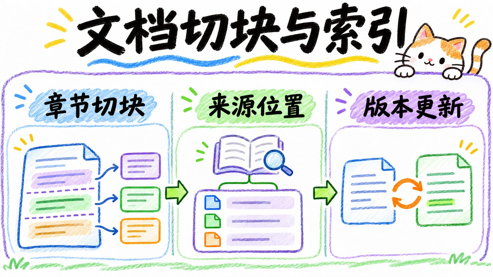

> **生成工具**：Codex\
> **生成模型**：gpt-6.2-sol

要在一本手册里查退款字段，先把有用的小段抄成索引卡。程序里的这张卡叫 Chunk（文档片段）。卡要足够小，才放得进候选列表，又要足够完整，才保得住字段、单位和说明之间的关系。

## 1. 同一段话怎么切

数据字典第 1 页的 Amount（金额）一节是 `Refund amount: refund is measured in CNY. CR-17 is the amount validation rule.`，CNY 是人民币，CR-17 是本实验定义的规则编号。

| 方式 | 第一个片段 | 影响 |
| --- | --- | --- |
| 段内每 35 个字符切一次 | `Refund amount: refund is measured i` | 单位 CNY 在后半片，字段和单位被切开 |
| 按标题与段落切 | 一张卡保留该节的 78 个字符 | 字段、单位与规则编号一起返回 |

固定窗口适合格式不规则或特别长的段落。可以设置重叠，再合并重复命中。遇到表格，优先留住表头和行键；遇到跨节问题，允许取多张卡。字符偏移 `[start,end)` 从 0 开始，含起点、不含终点，本例为段内 Unicode 字符数。页码从 1 开始。引用 `dictionary/v2/p1#amount` 把原文、版本、页码、段落 ID（标识符）一起带回。

## 2. 更新时按来源成组替换

把字典示例的 CNY 改成 USD（美元）时，版本由 2 升到 3。脚本重新生成 dictionary 的 3 张卡，移出旧版本，再查询 `amount`，读到 USD。政策和流程文件继续使用各自的版本。每张卡还携带来源租户 `school`，后续权限过滤按该字段和当前授权判定。生产索引可以先建完整的新一代索引，验证后原子切换指针。晚到的旧版本消息要和当前版本比较，防止覆盖新内容。

运行 `python3 experiments/rag-knowledge/retrieval_lab.py`，查看 `fixed_amount`、`structure_amount` 和 `index_changed`。 [数据字典](experiments/rag-knowledge/corpus.json) · [实验代码](experiments/rag-knowledge/retrieval_lab.py) · [实际结果](experiments/rag-knowledge/retrieval-results.json)
