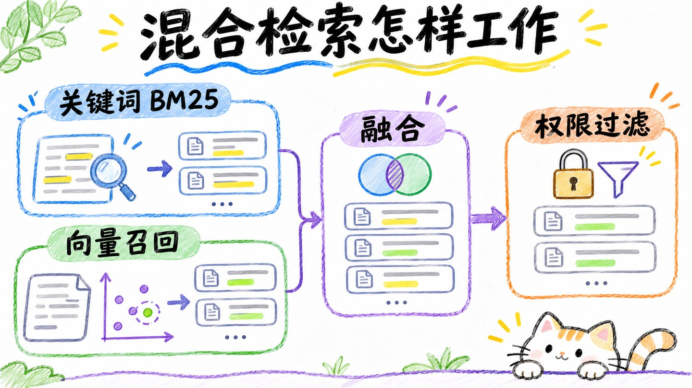

> **生成工具**：Codex\
> **生成模型**：gpt-6.2-sol

你可能只记得退款规则的编号 `CR-17`，也可能只记得「报销留空」。第一类靠找精确字词，第二类靠找相似说法。常见做法是用两台机器各找一小摞卡，再在候选集合里合并。

## 1. 词法检索怎样给 CR-17 加分

倒排索引把「词 → 出现过的文档」整理成表。BM25（Best Matching 25）会结合词在一篇文档出现的频次、词在全库的稀有程度、文档长度。以 `CR-17` 为例，学校共有 8 张卡，只有金额卡出现该词。代码中的稀有权重为 `ln(1 + (N-df+0.5)/(df+0.5)) = ln(6) ≈ 1.792`。这里 `N=8` 是文档数，`df=1` 是含这个词的文档数，`ln` 是自然对数。若该词出现一次且文档长度等于平均长度，频次与长度因子刚好为 1。长篇重复写词时，得分不会无限线性上涨。

## 2. 用名次合并两种得分

向量路径用余弦，词法用 BM25，各有自己的分数范围。RRF（Reciprocal Rank Fusion，倒数排名融合）用 `1/(c+r)` 给每个榜单中的位置加分。实验 `c=60`，位置 `r` 从 1 开始。某片段在两榜排第 1、第 2，合计 `1/61 + 1/62 ≈ 0.0325`。只在一个榜排第 1 则约 `0.0164`。 [Azure 检索与排名融合](https://learn.microsoft.com/en-us/azure/architecture/ai-ml/guide/rag/rag-information-retrieval)

用 `blank reimbursement` 查询，BM25 无候选，向量与混合的第一名均为 `missing`。用 `CR-17 refund amount currency` 时，混合第一名为 `amount`。手写向量在这里解释排序机制；随着数据增多，向量索引常用 ANN（Approximate Nearest Neighbor，近似最近邻），以可能遗漏部分精确近邻换速度。先用小集穷举作对照，再测 ANN 的召回和 P95（第 95 百分位时延）。

本例先取学校卡片，再计算两套排名。发给重排器的候选始终属于学校。否则合作方 90 天归档条款可能挤进来，仅靠最后隐藏引用来不及收回发送过的正文。 [检索与权限代码](experiments/rag-knowledge/retrieval_lab.py) · [实测结果](experiments/rag-knowledge/retrieval-results.json)
