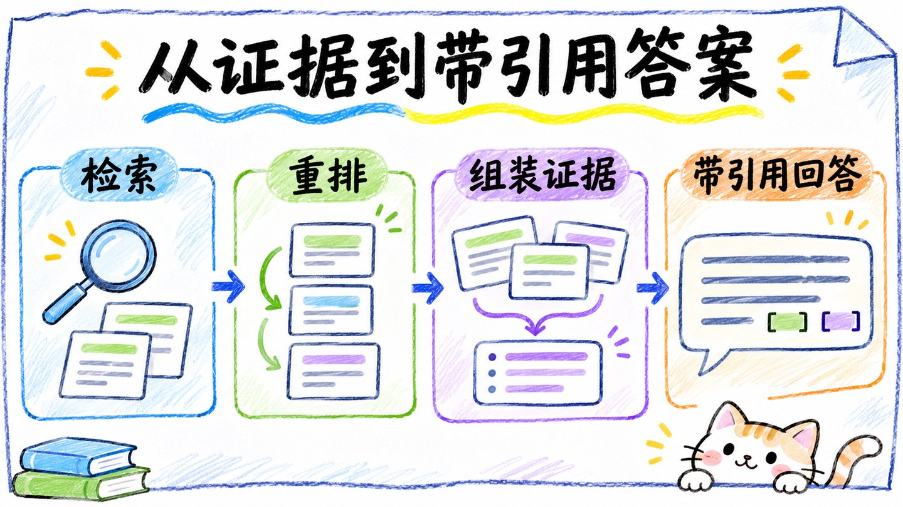

> **生成工具**：Codex\
> **生成模型**：gpt-6.2-sol

读者问「归档的退款报告留多久」。RAG（Retrieval-Augmented Generation，检索增强生成）先找和问题相关的原文，再把这些证据连同问题交给回答组件。像开卷答题，搜到手册只是开始，还要把答案落到具体句子和页码。 [RAG 原论文](https://arxiv.org/abs/2005.11401)

## 1. 从问题走到一条可点验的证据

| 阶段 | 本例发生什么 |
| --- | --- |
| 检索 | 在学校资料里找到 `retention`、`approval`、`faq`、`alias` |
| 重排 | 保留期片段与 `days` 等问题词匹配，位于第一 |
| 证据包 | 携带 `policy/v2/p2#retention` 和第 2 页原句 |
| 回答 | 批准后保留 30 天，引用该条款 |
| 校验 | 用引用回查原句版本，确认原句确实写了 30 天 |

示例回答器抽取原句，并返回 `{text,citation}`，因此读者能逐步核对。生产中若使用生成模型，通常还要给它固定的证据 ID，让它为每项事实提交引用，应用再验证 ID 确实来自当前证据包以及事实能由该段支持。引用个数有限时，优先留能共同覆盖问题的片段。

## 2. 缺证据、版本过期和冲突

问「周末国际转账手续费」，退款资料也许能召回带 `refund` 的卡，但没有手续费依据，脚本返回空答案。若同范围有两份同时有效的资料，一个写 30 天、一个写 45 天，应给出双方出处和适用范围，无法判定时暂缓回答。Wiki 实验用 30 天与 45 天演示发现冲突。权限实验中 45 天来自明确的新版本，旧引用被权威版本表拒绝。合作方自己的 90 天条款在学校候选生成之前便被过滤。

> **检查点**　扫描字典里的 `NA` 一题也沿用同样的验收。纯文本路径的证据包为空，带 OCR 单元格的路径把「Missing value」送入回答，出处是扫描 PDF 第 2 页。

运行 `python3 experiments/rag-knowledge/retrieval_lab.py`，查看 `retention`、`unknown` 和 `tenant`。 [回答与引用实验](experiments/rag-knowledge/retrieval-results.json) · [冲突实测](experiments/rag-knowledge/workflow-results.json) · [扫描证据](experiments/rag-knowledge/layout-results.json)
