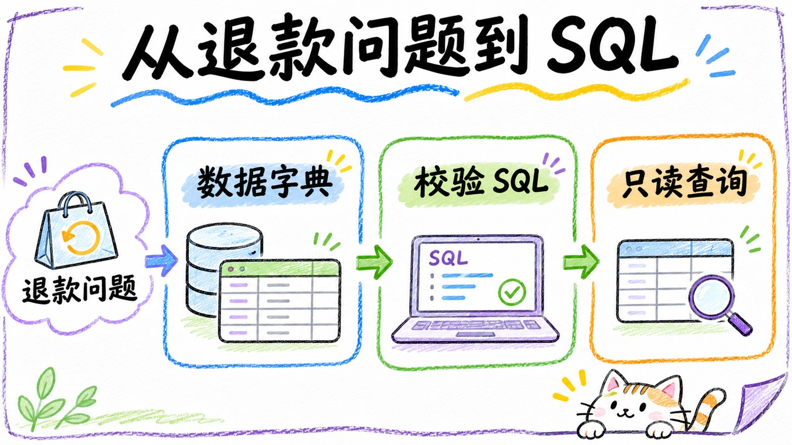

> **生成工具**：Codex\
> **生成模型**：gpt-6.2-sol

问「11 月退款有效条数和均值是多少」，SQL（Structured Query Language，结构化查询语言）能替你把记录筛出来再计算。Text-to-SQL 是从自然语言生成查询。查询能运行，仍可能把月底、空值或重复记录算错。

## 1. 先用手算写出标准答案

合成表 `refund` 中，11 月有 400 分、缺失、600 分，12 月 1 日还有 900 分。11 月的标准区间是 11 月 1 日含起点，12 月 1 日不含终点。有效记录 2 条，均值 500 分。SQLite 用 `NULL` 表示缺失。 `COUNT(cents)` 数非空值，`AVG(cents)` 只对非空做平均。字典证据为 `dictionary/v2/p1#amount` 和 `dictionary/v2/p1#missing`。

```sql
SELECT COUNT(cents), AVG(cents)
FROM refund
WHERE day >= ? AND day < ?
```

参数用驱动绑定日期，固定指标直接用这种模板。对临时分析，可让模型提出候选，然后用数据字典、允许范围和已知答案复核。本实验执行了三种预先固定的常见候选错误。

| 候选做法 | 条数 | 均值（分） | 错在哪里 |
| --- | ---: | ---: | --- |
| 固定查询 | 2 | 500.00 | 与口径一致 |
| 直接连标签表 | 3 | 466.67 | 同一条 400 分退款有两个标签，被数两次 |
| 把 NULL 换成 0 | 3 | 333.33 | 缺失被计入分母 |
| 使用含上界的 BETWEEN | 3 | 633.33 | 误计下月第一天 |

## 2. 只读和正确性分开验收

脚本用 SQLite 的只读连接，只允许声明好的查询动作、表列和函数，超过小预算中止。刻意发出的写操作得到 `SQLITE_AUTH`，高开销只读测试得到 `SQLITE_INTERRUPT`。查询最多返回 10 行；进度处理器按虚拟机步数检查预算，生产还应有数据库侧时限和资源隔离。只读无法防止上表三种误算，因此还要用已知数据做结果断言。输出中同时保留查询时间范围、单位和字典引用，便于审计。 [SQLite 授权回调](https://www.sqlite.org/c3ref/set_authorizer.html)

运行 `python3 experiments/rag-knowledge/sql_lab.py`。 [退款 CSV](experiments/rag-knowledge/refunds.csv) · [查询代码](experiments/rag-knowledge/sql_lab.py) · [实际结果](experiments/rag-knowledge/sql-results.json)
