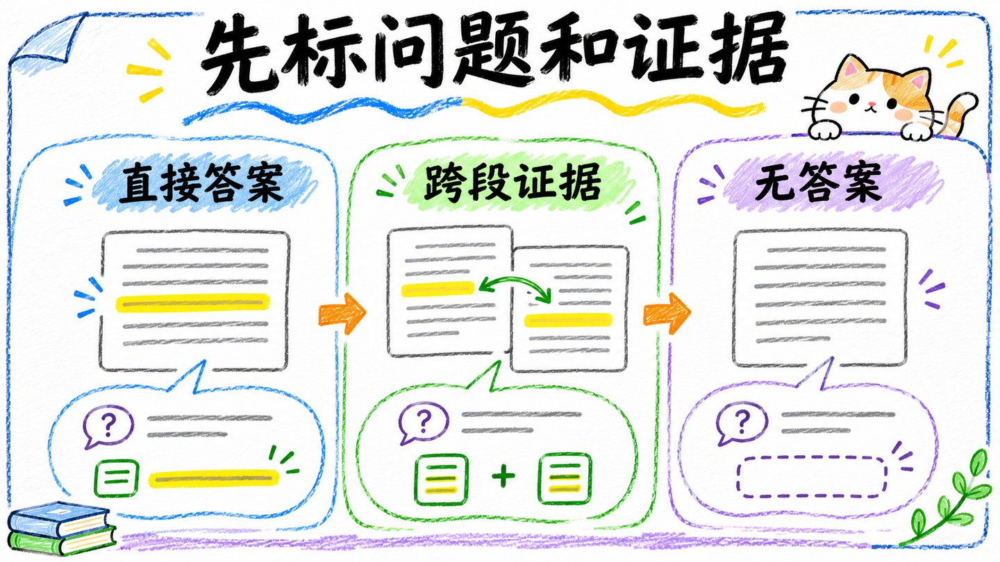

> **生成工具**：Codex\
> **生成模型**：gpt-6.2-sol

老师批开卷题，会先知道答案和它在哪一页。RAG（检索增强生成）的题集也要这样做。只写参考答案，可能无法分辨助手有没有找到正确的资料，还是碰巧答对了。

## 1. 最小题集中的三种题

| 类型 | 问题 | 参考答案与依据 |
| --- | --- | --- |
| 单段 | NA 算有效退款金额吗 | 不计入有效条数和均值，`dictionary/v2/p1#missing` |
| 跨段 | 有 NA 怎么算，整表没有有效值时怎么办 | 排除 NA；有效数为 0、均值留空。须同时拿到 `p1#missing`、`p2#empty` |
| 没依据 | 国际转账周末手续费是多少 | 资料无法回答，期望拒答，标准证据为空 |

标人或程序都应明确资料版本和可见范围。真实题集把问题、金标准证据和答案分开保存，避免在部署时把标准顺手送给模型。公开教学脚本的答案组件用已知关键词做抽取，金标准 ID 只用于评分和人工证据对照。检索函数只收到问题文本。

## 2. 给同一个回答器两份输入

跨段题给前 1 张卡时拿到 `missing`，两个金标准覆盖 1 个，Recall@1（前一条的召回覆盖率）为 `1/2`，回答器保守拒答。把人工选好的两张卡直接给同一个回答器，则覆盖率 1，两句引用齐全且严格文本比较通过。第一次失败在证据供给链。若给齐仍失败，就检查提示、组合或引用的输出逻辑。本次用确定性抽取验证隔离方法，实际模型可沿用同样的两份输入。

```bash
python3 experiments/rag-knowledge/workflow_lab.py
```

看 `diagnostics` 中的 `retrieval_budget_1` 和 `oracle_2`。没依据的题单独记拒答率，证据覆盖的分母为零，记为未定义。 [标注集](experiments/rag-knowledge/questions.json) · [诊断结果](experiments/rag-knowledge/workflow-results.json)
