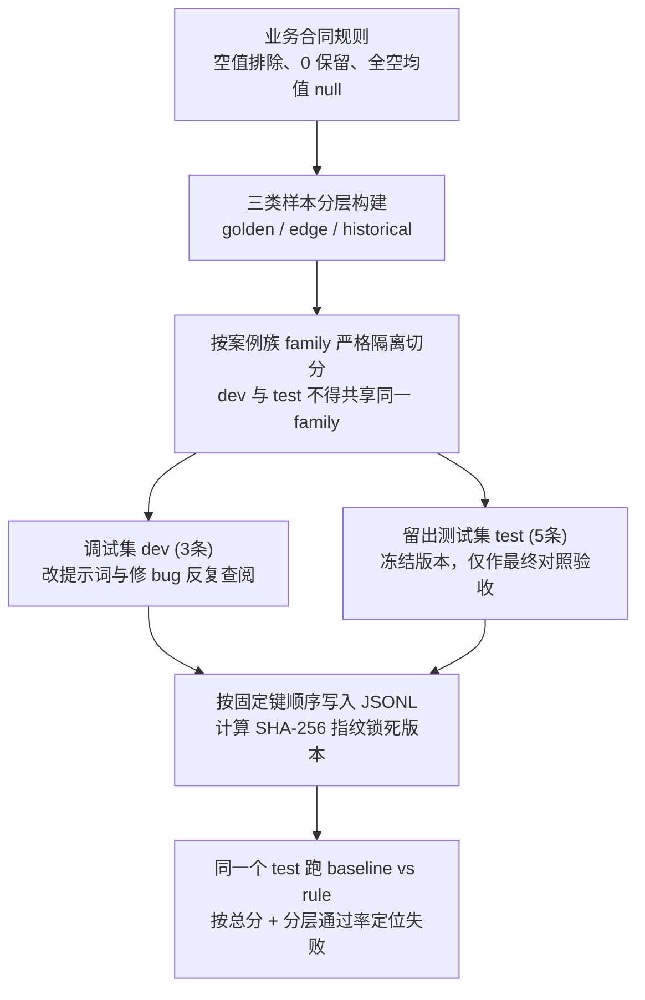

在 [LE-07](le-07-first-eval.md) 里，我们只用了 `10、空、0` 这一条样本把评分脚本跑通了。可真实用户上传来的表格五花八门：可能整列全是空白、可能全是 `0`、还可能有负数的冲正退款。要是整个考库只有一条 `10、空、0`，哪怕一个闭着眼睛写死返回 `{"count": 2, "missing": 1, "mean": 5}` 的作弊脚本也能拿满分！

今天就把一条样本扩成一套正经的**可版本化评测数据集（Versioned Evaluation Dataset）**：既能让你平时拿着改提示词，又能留出干净的考题做最后验收。

> **先用大白话讲明白**：设计评测集，就像老师整理**练习册 + 错题本 + 期末考卷**：
> - **黄金样本（Golden）**：最典型、经过人工逐字复核的标准题（比如正整数算平均），确保模型基本功别丢分。
> - **边界样本（Edge）**：专门刁难模型的极端题（比如全空列、全零列、负数退款），专治一上线就崩的边角 bug。
> - **历史失败样本（Historical / Regression）**：以前线上真实翻车过的「错题本」（比如我们在 API-10 里见过的把 `10、空、0` 的均值写成 `null`），每次改版必考一遍，防止老毛病复发。
> - **Dev（调试集）vs Test（留出测试集）**：平时改 Prompt 只能在练习册（`dev`）上反复看错题调试；期末考卷（`test`）必须密封留着，最后验收才开考，而且**同一套母题改写的变体（同一个 `family`）绝对不能一半放练习册、一半放期末考卷**——那叫提前泄题！



## 1. 从业务规则推出数据分层与防泄题切分

本次任务合同白纸黑字写清楚：**金额空白算缺失，数值 `0` 算有效；如果所有金额都缺失，均值返回 JSON `null`**。为了让你心算就能一眼核对结果，这套教学集只使用有限整数（允许负数），均值也不做四舍五入的货币舍入。真实业务项目里，动手前一定要先把币种单位、小数精度和舍入方式（比如银行家舍入还是四舍五入）写进合同，再用相应的标准答案函数去算参考值。

我们用 **分层（`stratum`）** 给每条样本贴一个主标签，方便后续统计时一眼看出模型是「常规题丢分」还是「边界题崩溃」：

| 所属划分 | 数据角色（分层） | 金额序列 | 手算标准答案 `(count, missing, mean)` 与依据 |
| --- | --- | --- | --- |
| `dev` 调试集 | 黄金样本（`golden`） | `8, 4` | 有效 2、缺失 0、均值 **6**（常规正数基本功）。 |
| `dev` 调试集 | 历史失败（`historical`） | `10, 空, 0` | API-10 的 V1 曾输出过 `mean: null`；合同标准值是 `(2, 1, 5)`。 |
| `dev` 调试集 | 边界样本（`edge`） | `空, 空, 空` | 有效 0、缺失 3、均值 **`null`**（全空不能除以 0）。 |
| `test` 留出集 | 独立测试情形（见代码） | 如 `-4, 空, -2, 空` | 有效 2、缺失 2、均值 **-3**（同时考负数与空值）。 |

**为什么必须按 `family`（案例族）切分划分？**
同一份原始退款表改两行标题、换几个相近数字或同一用户的重复请求变体，同属于一个 `family`。如果把母题放在 `dev`（你看错题、调提示词时反复见过）而把微调变体放在 `test`，评测分数就会虚高。代码里加一句 `assert dev.isdisjoint(test)`（调试集与测试集的案例族交集必须为空），就能在生成数据时自动防泄题。

顺带一提：API-10 里已经讨论过的 `10、空、0` 金额组合被归入 `dev` 的历史失败分层，留出集 `test` 挑选了另外几组独立数值。公开仓库的教学脚本方便你直接跑通逻辑；**真正上线发布前，高密度的 `test` 留出集应该放在受权限保护、调优人员平时看不到的独立仓库或评测平台里。** [评测样本与边缘情形](https://developers.openai.com/api/docs/guides/evaluation-best-practices)

## 2. 先用 SHA-256 冻结输入，再比两条候选口径

**版本化（Versioning）**的核心目的只有一个：**保证今天跑出的 5/5 和下个月跑出的 3/5 考的是同一张卷子。**

做法很朴素：每条样本都存 `id`、`family`、`split`、`stratum`、原始 `csv` 和期望结果 `expected`，按固定顺序写入 **JSONL（JSON Lines，每行一条独立 JSON 文本的轻量格式）**，然后对整个文件算一个 **SHA-256（安全散列算法 256 位数字指纹）**。只要有人悄悄改了一个数字、多加了一个空格或调换了行顺序，SHA-256 摘要就会变得面目全非。同样，评分器的版本号也该一并记下来——千万别拿 v1 批改条跑出来的分数，直接去和 v2 批改条比高下。

下面的实验暂不调大模型 API，而是先让两段确定性的 Python 统计逻辑跑在同一个冻结留出集 `test` 上，亲自验证数据集能不能抓出口径 Bug：
- **基线（`baseline`）**：故意犯一个常见工程错——把空单元格当成 `0`（`keep_empty_as_zero=True`）。
- **候选规则（`rule`）**：严格按合同排除空值、保留 `0`（`keep_empty_as_zero=False`）。

## 3. 运行脚本：冻结数据集并按分层找出失败

将代码保存为 `refund_dataset.py`，在一个空目录下运行 `python3 refund_dataset.py`。脚本会先写出一份只读规格文件 `refund-cases-v1.jsonl` 并打印它的 SHA-256 指纹，随后只在 5 条 `test` 样本上跑分：

```python
from collections import Counter
import csv
from hashlib import sha256
from io import StringIO
import json
from pathlib import Path

# 格式：ID、集合、分层、案例族、各行金额、人工核对过的期望。
specs = [
    ("dev-01", "dev", "golden", "positive-a", [8, 4], (2, 0, 6)),
    ("dev-02", "dev", "historical", "api10-mixed", [10, None, 0], (2, 1, 5)),
    ("dev-03", "dev", "edge", "empty-a", [None, None, None], (0, 3, None)),
    ("test-01", "test", "golden", "positive-b", [6, 10], (2, 0, 8)),
    ("test-02", "test", "edge", "negative-b", [-4, None, -2, None], (2, 2, -3)),
    ("test-03", "test", "edge", "empty-b", [None, None], (0, 2, None)),
    ("test-04", "test", "edge", "zero-b", [0, 0, 0], (3, 0, 0)),
    ("test-05", "test", "golden", "fraction-b", [2, 5], (2, 0, 3.5)),
]
fields = ("count", "missing", "mean")


def dataset():
    rows = []
    for key, split, stratum, family, amounts, expected in specs:
        lines = ["id,amount"]
        lines.extend(f"{i},{a if a is not None else ''}" for i, a in enumerate(amounts, 1))
        rows.append({
            "id": key, "split": split, "stratum": stratum, "family": family,
            "csv": "\n".join(lines), "expected": dict(zip(fields, expected)),
        })
    dev = {row["family"] for row in rows if row["split"] == "dev"}
    test = {row["family"] for row in rows if row["split"] == "test"}
    assert dev.isdisjoint(test)
    assert len({row["id"] for row in rows}) == len(rows)
    return rows


def predict(raw_csv, keep_empty_as_zero):
    amounts = [row["amount"].strip() for row in csv.DictReader(StringIO(raw_csv))]
    valid = [int(value) for value in amounts if value]
    missing = len(amounts) - len(valid)
    if keep_empty_as_zero:
        valid.extend([0] * missing)
        missing = 0
    return {
        "count": len(valid), "missing": missing,
        "mean": sum(valid) / len(valid) if valid else None,
    }


rows = dataset()
text = "".join(json.dumps(row, ensure_ascii=False, sort_keys=True) + "\n" for row in rows)
payload = text.encode("utf-8")
Path("refund-cases-v1.jsonl").write_bytes(payload)
print("dataset v1", sha256(payload).hexdigest())

test = [row for row in rows if row["split"] == "test"]
totals = Counter(row["stratum"] for row in test)
for label, keep_empty in [("baseline", True), ("rule", False)]:
    passes = Counter()
    for row in test:
        actual = predict(row["csv"], keep_empty)
        wrong = [key for key in fields if actual[key] != row["expected"][key]]
        if wrong:
            print(label, row["id"], "failed:", ",".join(wrong))
        else:
            passes[row["stratum"]] += 1
    print(label, f"overall={sum(passes.values())}/{len(test)}",
          " ".join(f"{k}={passes[k]}/{total}" for k, total in sorted(totals.items())))
```

> **想再深入一层？** 留意脚本第 88 行写入 JSONL 时特意传了 `sort_keys=True` 与固定换行 `\n`，并且把最终字节流直接写入后计算 `sha256(payload).hexdigest()`。这保证无论你在 macOS 还是 Linux 上生成这份文件，拿到的 SHA-256 指纹都会一模一样——在 [LE-04](le-04-regression-gates.md) 做 CI 回归门禁时，我们就会直接校验这个十六进制指纹！

运行后可以看到清晰的对比诊断：
- **基线（`baseline`）**：在 `test-02`（`-4、空、-2、空`）和 `test-03`（`空、空`）上直接挂掉，总分 **3/5**；如果你不看分层明细，你会以为它在黄金层 `golden=2/2` 全对还不错，但拆开 `edge` 层一看，边界题只有 `1/3`（唯一蒙对的还是全零样本 `test-04`，刚好空值数为 0 没触发它的 bug）。
- **候选规则（`rule`）**：总分 **5/5**（`edge=3/3 golden=2/2`）。

> **容易踩的坑**：千万不要往测试集里全塞常见「黄金正整数样本」！那样就算你的提示词或解析函数完全搞错了空值规则，黄金层照样拿 `2/2` 满分，把致命 bug 完美藏到上线之后才爆发。至少要按业务里的失败高发点专门配一批 `edge` 边界用例。

## 4. 把数据维护融进日常开发工作流

能直接对上程序字段的数值输出，一律交给代码硬规则检查；至于退款报告后面附带给客服或用户看的那段文字解释，可以另外安排人工按固定准则查两件事：**「有没有明确说明排除了空金额，且保留了真实 0」「有没有讲清均值分母为什么是有效条数」**。

每次线上用户遇到新翻车案例时，标准闭环动作是：
1. 把出问题的最小输入**脱敏复制**出来，标记成一条新的 `historical` 回归样本放进持续回归集；
2. 把留作版本验收的独立 `test` 测试集单独锁好，防止过度针对特定考题做「面向测试调提示词（overfitting to test set）」；
3. 汇报成绩时，至少列全总样本数、各分层覆盖率与具体失败类型。5 条留出样本足够验收一条规则的逻辑链路，真要估算实际线上流量的波动与胜率，后续还需要按更大样本量做统计检验。

## 下一篇

数据卷子准备好了，万一「批改老师」——评分器代码自己写错了公差、被 `{"count": true}` 蒙混过去、或者被重复 JSON 键绕过怎么办？[**LE-08《如何设计可测试的评分器与评分准则》**](le-08-testable-graders.md) 会给评分器本身写单元测试，讲清 JSON Schema、数值公差、业务不变量和开放式人工准则该怎么设计。 [LLM 与 Agent 学习路线图](https://blog.lacknb.cn/articles/2026/11/19/1795058329577.html)
