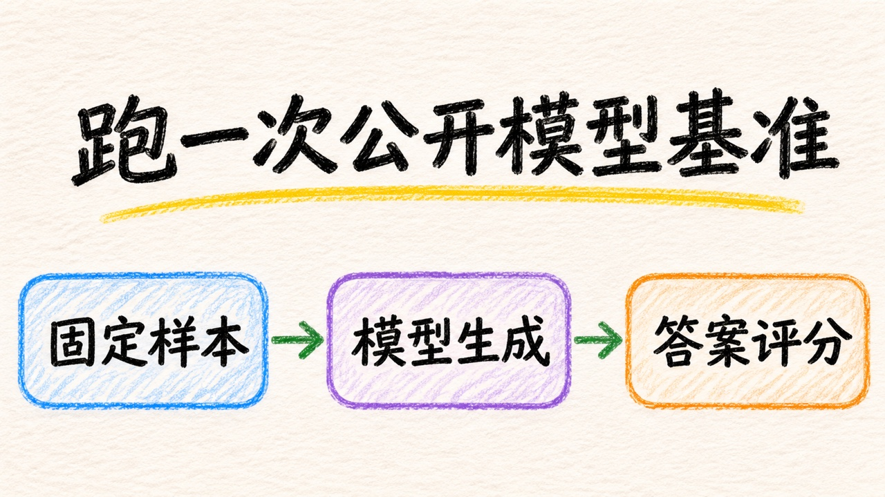

[LE-10](le-10-public-datasets.md) 解释了 GSM8K 的最终数值如何评分。这一篇用同一个评测框架跑两款小模型，观察同一条原始回复为何在一种抽取规则下得 0，在另一种规则下得 1。先把任务、样本和评分口径冻结，模型结果才有可比性。

**LM Evaluation Harness（语言模型评测框架，CLI 名为 `lm-eval`）**负责把任务配置转换成模型请求，再从生成中提取答案、运行指标并保存报告。它已有 GSM8K 的任务与过滤器，可以复用。本文保留已有的题面与评分器，只把数据版本固定。 [Harness 项目](https://github.com/EleutherAI/lm-evaluation-harness) · [GSM8K 任务配置](https://github.com/EleutherAI/lm-evaluation-harness/blob/ddd67220430a2470529f25fd5c05a576ca1057a0/lm_eval/tasks/gsm8k/gsm8k.yaml)

## 1. 冻结这次实验的范围

| 项目 | 本次配置 |
| --- | --- |
| 数据 | `openai/gsm8k` 的 `main/test`，数据修订 `740312add88f781978c0658806c59bc2815b9866`。 |
| 样本 | 原始划分的索引 0 至 7，共八条。完整测试集有 1,319 条。 |
| 模型 | Qwen2.5-0.5B-Instruct 和 SmolLM2-135M-Instruct，两份权重各固定修订。 |
| 题面 | 使用原始任务的 `Question: …\nAnswer:`。两款模型均接收相同题面文本，使用各自分词器。 |
| 示例与解码 | 0-shot（题面没有示范），每题一次贪心生成，上限 96 Token，随机种子 42。 |
| 评分 | 使用任务自带的 `strict-match` 和 `flexible-extract` 两种抽取，再做 `exact_match`。 |

两款都是指令模型，本实验刻意使用任务原始题面以固定输入协议。如果改为各自推荐的聊天模板，提示包装也会变化，应新开一组实验并公开设置。八题是用于复现流程的固定小子集，顺序抽取也没有做难度分层。 [GSM8K 数据卡](https://huggingface.co/datasets/openai/gsm8k) · [Qwen 模型卡](https://huggingface.co/Qwen/Qwen2.5-0.5B-Instruct) · [SmolLM2 模型卡](https://huggingface.co/HuggingFaceTB/SmolLM2-135M-Instruct)

## 2. 创建只改数据修订的任务副本

在空目录准备 Python 3.12 虚拟环境。首次运行会下载公开数据和权重。下面用安装包内的原任务生成新配置，保留了题面、终止条件和抽取逻辑。

```bash
python -m pip install "lm_eval[hf]==0.4.13" "torch==2.11.0" \
  "transformers[chat-template]==5.13.0" "tokenizers==0.22.2"
```

把下列代码保存为 `make_task.py`：

```python
from importlib.resources import files
from pathlib import Path

original = files("lm_eval").joinpath("tasks", "gsm8k", "gsm8k.yaml").read_text()
assert original.count("\ntask: gsm8k\n") == 1
assert original.count("\ndataset_name: main\n") == 1
config = original.replace("\ntask: gsm8k\n", "\ntask: gsm8k_pinned\n").replace(
    "\ndataset_name: main\n",
    "\ndataset_name: main\ndataset_kwargs:\n  revision: 740312add88f781978c0658806c59bc2815b9866\n",
)
Path("tasks").mkdir(exist_ok=True)
Path("tasks/gsm8k_pinned.yaml").write_text(config, encoding="utf-8")
```

之后用相同参数运行两次：

```bash
python make_task.py
export OMP_NUM_THREADS=4
export TOKENIZERS_PARALLELISM=false

run_model() {
  lm-eval run --model hf \
    --model_args "pretrained=$1" "revision=$2" dtype=float32 \
    --include_path tasks --tasks gsm8k_pinned \
    --samples '{"gsm8k_pinned":[0,1,2,3,4,5,6,7]}' \
    --num_fewshot 0 --seed 42 --device cpu --batch_size 2 \
    --gen_kwargs do_sample=False max_gen_toks=96 \
    --log_samples --output_path "$3"
}

run_model Qwen/Qwen2.5-0.5B-Instruct 7ae557604adf67be50417f59c2c2f167def9a775 qwen-run
run_model HuggingFaceTB/SmolLM2-135M-Instruct 12fd25f77366fa6b3b4b768ec3050bf629380bac smol-run
```

`--samples` 明确按原始索引取题，不能和 `--limit` 一起用。`--log_samples` 保存模型输出、过滤结果和比较结果。每个目录里有一个汇总 JSON，另一个 JSON Lines 文件按题记录两套过滤器各自的判定。因此一个运行会有 16 条过滤记录，但生成只做了八次。 [Harness 命令行说明](https://github.com/EleutherAI/lm-evaluation-harness/blob/ddd67220430a2470529f25fd5c05a576ca1057a0/docs/interface.md)

## 3. 同一生成怎样得到两个分数？

本地在 Apple Silicon CPU 运行，结果如下。**精确匹配（exact match）**在指定清理规则后比较提取值与参考值。`strict-match` 要找到 `####` 和后面的数值。`flexible-extract` 允许从文中取数，当前配置取最后一次匹配。

| 模型 | 严格抽取精确匹配 | 宽松抽取精确匹配 |
| --- | ---: | ---: |
| Qwen2.5-0.5B-Instruct | 0/8 | 2/8 |
| SmolLM2-135M-Instruct | 0/8 | 0/8 |

例如 Qwen 的 `doc_id: 3` 末尾出现 `The answer is 540.`，没有 `####`，严格抽取返回 `[invalid]`。宽松抽取拿到 `540.`，清理末尾句点后与参考值 540 一致。查看错例时，先读原始 `resps`，再看 `filtered_resps` 与 `exact_match`。宽松抽取也可能误把草稿里一个数当答案。可在报告中同时保留两套规则，以便读者知道分数是怎么来的。

## 4. 单次准确率与 pass@k

这次每题只有一次生成。要问「给模型多生成几次，其中至少有一个答案能过吗」，先为每题设定统一的采样设置和候选预算，再记录总候选数 `n` 和通过数 `c`。HumanEval 论文里的 **pass@k** 估计是从 n 个候选中不放回挑 k 个时至少有一个通过的比例。先按题算，再跨题平均。下面是四个候选、一个通过的示例：

```python
from math import comb

n, c, k = 4, 1, 2
p = 1 - comb(n - c, k) / comb(n, k)
assert p == 0.5
print(p)
```

同一组候选的 pass@1 为 0.25，pass@2 为 0.5。线上如果只展示一个候选并且没有可用验证器，不能把 pass@2 直接当成用户实际收到正确答案的概率。比较不同报告时还要核对训练数据污染、题量、数据划分、few-shot 示例、停词和抽取逻辑。看见本例的 2/8，可以继续复查两条对题和六条失败，仍需更多独立题目才能推断整体差异。 [HumanEval 论文与 pass@k](https://arxiv.org/abs/2107.03374)

## 下一篇

[**LE-03《LLM-as-a-Judge 与人工校准》**](le-03-llm-judge-calibration.md) 会回到退款报告的开放式解释，用人工准则和换位检查校准模型评分。 [LLM 与 Agent 学习路线图](https://blog.lacknb.cn/articles/2026/11/19/1795058329577.html)
