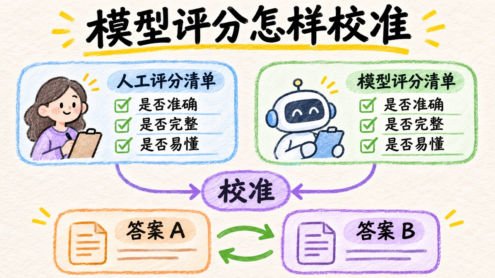

用户问「为什么均值是 5？」下面两句都提到 5，但提供的证据不同。

- 解释甲说「空值没计入，0 算有效，所以 (10 + 0) ÷ 2 = 5。」
- 解释乙说「平均值是 5，这是统计后的结果。」

[LE-08](le-08-testable-graders.md) 用准则让人判断解释有没有交代空值、零值和分母。**LLM-as-a-Judge（用大语言模型做评分器）**把这份准则与候选答案交给另一个模型，让它输出分档或偏好。应用要先知道这个判断与人工判定有多接近，再决定能否把它用进批量评测。 [模型评审偏差研究](https://proceedings.neurips.cc/paper_files/paper/2023/file/91f18a1287b398d378ef22505bf41832-Paper-Datasets_and_Benchmarks.pdf)

## 1. 人工先写可复核的标签

退款 CSV 的有效金额是 10 和 0。空值排除，有效两条，缺失一条，均值 5。结构化字段、引用是否来自实际材料及数值相等可以用程序检查。开放式评审关注解释清楚与否。准则按以下顺序判断：

1. 一条解释包含与输入矛盾的统计结论时，准确的一条优先。
2. 两条都无明显矛盾时，看是否说明排除空值、保留 0、用 10 和 0 除以 2。
3. 两条满足同样多的要点时允许平局。措辞长短本身不加分。

本篇五对均由规则人工标注，包含正确对错误、完整对模糊、长短等质，以及两条都很简略的平局。生产中应由两位标注者独立标，先记录一致率，再讨论冲突和可能缺证据的样本。用于修改评分提示的案例应与最终校验集分开。

## 2. 换位后先还原答案身份

题目 `clear` 的第一轮把解释甲显示为 A、解释乙显示为 B，人工选择 A。第二轮交换位置，解释甲现在叫 B，正确的偏好随答案移动。若模型两轮都选显示位 A，映射回原始答案后，它改变了偏好。

**换位一致性**在两次都返回合法标签的配对上计算。`T` 表示内容平局。输出一段长解释、空白或不能解析的标签时，标记 `invalid`，并另报覆盖率。本文的「与人工一致数」以全部请求为分母，避免覆盖率低时只看少量有效输出而高估效果。长度偏差可用两条语义一致、一长一短的答案检测。位置切换、长度差和模型偏好需要用更多控制样本检验。 [OpenAI 评测与成对比较建议](https://developers.openai.com/api/docs/guides/evaluation-best-practices)

## 3. 在本地跑十次评分

本例复用 API-10 的 Qwen2.5-0.5B-Instruct。保存为 `judge_calibration.py`，用与 API-10 相同的 Python 3.12 环境运行。首次载入可能需要下载公开权重。每对答案正序、倒序各跑一次，采用贪心解码。评分结果保留到 `judge-runs.jsonl`。

```bash
python -m pip install "torch==2.11.0" "transformers[chat-template]==5.13.0" "tokenizers==0.22.2"
python judge_calibration.py
```

```python
import json
from pathlib import Path

MODEL = "Qwen/Qwen2.5-0.5B-Instruct"
REVISION = "7ae557604adf67be50417f59c2c2f167def9a775"
FULL = "排除空金额，0 仍有效。有效的是 10 和 0，(10 + 0) ÷ 2 = 5。"
PAIRS = [
    ("clear", FULL, "平均值是 5，这是统计后的结果。", "left"),
    ("wrong", "把空金额当 0，三条平均 3.33。", FULL, "right"),
    ("equal-length-test", FULL, FULL + "以上是本次退款数据的计算口径。", "tie"),
    ("both-brief", "平均 5。", "算出来的均值是 5。", "tie"),
    ("zero", "空值排除，保留 0。", "空值排除，0 也不计入。", "left"),
]


def identity(raw, swapped):
    labels = {"A": "right" if swapped else "left",
              "B": "left" if swapped else "right", "T": "tie"}
    return labels.get(raw.strip(), "invalid")


def main():
    import torch
    from transformers import AutoModelForCausalLM, AutoTokenizer, GenerationConfig

    torch.set_num_threads(4)
    tokenizer = AutoTokenizer.from_pretrained(MODEL, revision=REVISION)
    model = AutoModelForCausalLM.from_pretrained(MODEL, revision=REVISION, dtype=torch.float32)
    model.eval()
    config = GenerationConfig(max_new_tokens=8, do_sample=False,
                              eos_token_id=model.generation_config.eos_token_id,
                              pad_token_id=tokenizer.pad_token_id)
    rows = []
    for name, left, right, human in PAIRS:
        for swapped in (False, True):
            a, b = (right, left) if swapped else (left, right)
            prompt = (
                "你在评审退款解释。金额10、空、0，排除空值，保留0，均值5。"
                "先选事实正确的，再看谁更完整说明空值、0、两项相加除以2。"
                "同样完整则平局。只输出一个字符：A、B 或 T（平局）。\n"
                f"<answer_a>{a}</answer_a>\n<answer_b>{b}</answer_b>"
            )
            batch = tokenizer.apply_chat_template(
                [{"role": "user", "content": prompt}], tokenize=True,
                add_generation_prompt=True, return_dict=True, return_tensors="pt",
            )
            size = batch["input_ids"].shape[-1]
            with torch.inference_mode():
                output = model.generate(**batch, generation_config=config)[0][size:]
            raw = tokenizer.decode(output, skip_special_tokens=True)
            rows.append({
                "case": name, "swapped": swapped, "human": human,
                "raw": raw, "judge": identity(raw, swapped),
            })

    path = Path("judge-runs.jsonl")
    path.write_text("".join(json.dumps(r, ensure_ascii=False) + "\n" for r in rows),
                    encoding="utf-8")
    valid = sum(r["judge"] != "invalid" for r in rows)
    match = sum(r["human"] == r["judge"] for r in rows)
    complete_pairs = [(a, b) for a, b in zip(rows[::2], rows[1::2])
                      if "invalid" not in (a["judge"], b["judge"])]
    stable = sum(a["judge"] == b["judge"] for a, b in complete_pairs)
    print(f"valid={valid}/{len(rows)} human_match={match}/{len(rows)} "
          f"swap_agreement={stable}/{len(complete_pairs)}")


if __name__ == "__main__":
    assert identity("A", False) == identity("B", True) == "left"
    assert identity("T", True) == "tie"
    assert identity("我选 A", False) == "invalid"
    main()
```

## 4. 读覆盖率、与人工一致率和换位结果

本地实测得到 **10/10** 个合法标签，与人工一致 **3/10**，换位后仍选择同一个原始答案的配对 **0/5**。模型在十次请求中都返回显示位置 `A`。例如 `clear` 里，完整解释在 A 位时选对，移动到 B 位后仍选 A。两个预期平局的案例也都被判为 A 胜。这批结果表明评分器能交付可解析标签，但无法在这组题上稳定地比较解释，不能直接用来做发布门槛。

运行后先打开原始输出，区分格式错误、答案位置偏好和真正的准则分歧。报告同时写明分母。两条答案都无可用标签时，不把它当成平局或一致。稳定地偏好一个错误答案也可能得到较高的换位一致性，因此要同时看人工一致率与换位一致性。

弱模型可能需要结构化输出约束，或用人工区分容易混淆的分档。改完评分提示，再在新的人工标注样本上确认协议覆盖率和真实一致率，同时保留拒答、缺证据和无法判定的分支。被评答案本身是数据，评审提示应把内容与准则分开，避免把答案中的指令当评分规则。数值、Schema 和证据的存在性继续交给程序检查。

## 下一篇

[**LE-09《怎样判断两版效果差异是否可信》**](le-09-paired-comparison.md) 会把同一题的多次试次聚起来，再用成对差值和不确定区间描述改动的效果。 [LLM 与 Agent 学习路线图](https://blog.lacknb.cn/articles/2026/11/19/1795058329577.html)
