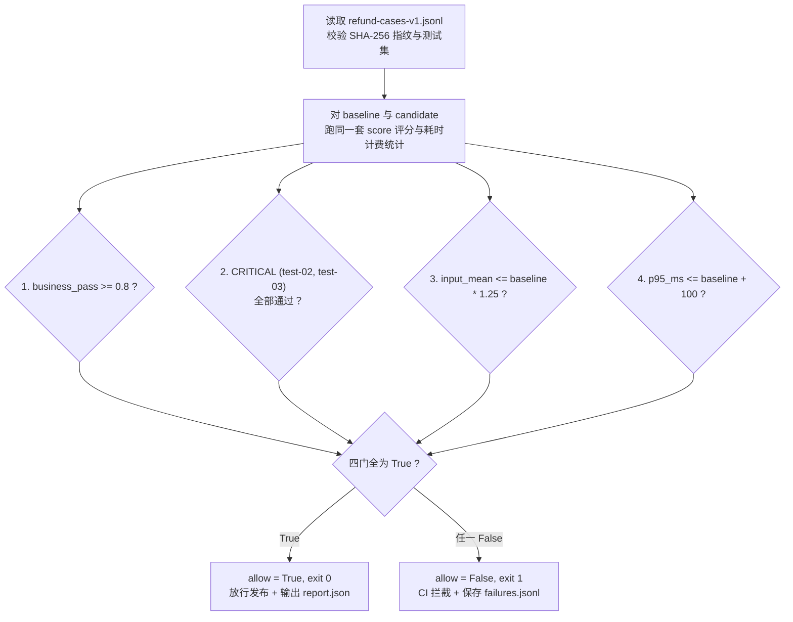

团队改出了一版新提示词，在测试盘里整体通过率从 `3/5` 涨到了 `4/5`（80%），兴高采烈地准备推上线！可翻开失败明细一看：**虽然总分变高了，它居然偏偏把 `test-02` 那张带着负金额和空值的表给算错了**；更惨的是提示词塞了太多废话，平均输入 Token 膨胀了 35%，P95 延迟慢了一大截。要是把这种结果直接放进财务总账，平均分再高能赔得起吗？

这就是我们需要**回归评测门禁（Regression Gate）**的原因——把 [LE-01](le-01-dataset-baseline.md) 冻结的考卷、[LE-08](le-08-testable-graders.md) 的评分逻辑、加上 [LE-09](le-09-paired-comparison.md) 的同题对比思维以及成本速度预算，全部焊接到每次改提示词或换模型前的自动安检通道里！对接现成生态工具时，像 **Promptfoo** 这类工具也能声明断言文件 [Promptfoo 断言文档](https://www.promptfoo.dev/docs/configuration/expected-outputs/)；下面我们用纯 Python 标准库把每一行校验条件摊开写透，方便你彻底看清门禁脚本是怎么放行和拦人的。

> **先用大白话讲明白**：接入 **回归评测门禁（Regression Gate）**就像**公司财务系统上线前的四道联合安检门**：
> 1. **总分及格门**：总体业务通过率必须至少 80%（比如 5 题至少对 4 题）；
> 2. **红线样本零容忍门**：点名几条高危样本（例如 `test-02` 负数配空值、`test-03` 全空表），哪怕总分达 99%，只要这几条有 1 条没过，立刻拉闸禁止发布；
> 3. **电表费用上限门**：候选版平均输入 Token 最多只能比老版本多 25%，防止有人靠塞进几千字说明书去强行刷分；
> 4. **尾部速度上限门**：**P95 延迟**（按最慢的那一撮请求算，第 95 百分位等待时间）最多只允许比老版本慢 `100 ms`；
> 只要这四扇门有一扇亮红灯，脚本立刻返回错误退出码 `1`，把改动死死挡在合并上线之外！



## 1. 每次安检必须锁定或落盘什么？

要想半年后还能追溯「当年为什么拦下了那一版」，一次合格的回归运行必须记全下面五件套：

| 需要冻结或落盘的东西 | 在本次退款回归门禁里的具体内容 |
| --- | --- |
| **数据版本** | `refund-cases-v1.jsonl` 的精确 **SHA-256** 摘要与测试集 `test-01..05` 列表，防考卷被悄悄调包。 |
| **评分器版本** | `grader: "refund-v1"`（检查格式 + 业务值一致；规则一变就要升版本号）。 |
| **基线与候选配置** | 模型或 Prompt 版本名、采样参数、超时设置与重试策略。 |
| **逐条运行流水** | 每条样本的 `id`、版本、原始回应 `raw`、失败标签、输入 Token 数和延迟毫秒数。 |
| **发布门禁阈值** | 总体通过率底线、关键红线列表、Token 膨胀上限、延迟上限。 |

顺便交代一下什么是 **P95（第 95 百分位）延迟**：它专门用来揪出那「最慢的少数倒霉请求」——免得平均分好看，但 5% 的用户卡到超时。本文采用简洁的**最近秩法**：把全部成功完成请求的毫秒耗时从小到大排成一排，直接取第 `ceil(0.95 × n)` 条的值（`n` 为请求总数，`ceil` 是向上取整）。样本只有 5 条时 `ceil(0.95 × 5) = 5`，刚好对应最慢那一条的最大延迟，很适合拿来手动核对逻辑；正式线上评测需要大得多的样本量，且两边必须用一模一样的计时起止点，并提前约定超时请求怎么算入分母、分别记 **TTFT（首字时间）**与整句完成时延。

## 2. 四道门禁的数字门槛与历史故障重放

为了方便你用口算一眼验算通过不通过，本篇设定的教学阈值如下（真实生产请按自家业务 SLA 和利润预算来定）：
- 总体业务通过率 `>= 80%`（即 5 题至少过 4 题）；
- 关键样本 `CRITICAL = {"test-02", "test-03"}` **必须 100% 全过**；
- 候选版平均输入 Token 不超过基线的 **1.25 倍**；
- 候选版 P95 完成耗时最多只允许比基线高 **100 ms**。

> **容易踩的坑**：注意不要把旧日志和当前隔离留出集混进同一个分母！代码里特意留了一个 `--history` 可选参数，专门用来读取我们在 API-10 保存的 `prompt-runs.jsonl` 历史真实翻车输出（V1 版本在 `mixed` 题外包了 Markdown 代码围栏）并单独重放验证：`score()` 能准确将其抓为 `invalid_json`。它只是用来确认「我们的评测器今天依然抓得住昨天的 Bug」，**绝不能混进下面计算两版通过率对比的留出集分母里！** [API-10 实测与失败记录](https://blog.lacknb.cn/articles/2026/11/21/1795268751247.html)

## 3. 实战：同份考卷演示「放行」与「拦截」

先在空目录运行 [LE-01](le-01-dataset-baseline.md) 的 `refund_dataset.py` 生成锁好版本的数据文件 `refund-cases-v1.jsonl`（如果你刚删了目录就先重新生成一遍）。接着把下面的代码存成 `eval_gate.py`。为了让你在本地不花 API 费也能稳定复现「放行」和「拦截」两条分支，程序里的模型回复、Token 数与耗时先用教学模拟夹具（`replay`）供给；真正接入公司流水线时，只需要把 `replay` 换成调模型接口的真实请求函数即可，后面的锁指纹、算指标、落盘失败文件和返回退出码的骨架一个字都不用改：

```python
import argparse
from hashlib import sha256
import json
from math import ceil
from pathlib import Path
from statistics import mean

DATA_HASH = "e52384255123e2f1e2792b36b184d9eed317200ca7e1e773430d6de818025d84"
CRITICAL = {"test-02", "test-03"}
FIELDS = ("count", "missing", "mean")


def read_cases(path):
    raw = path.read_bytes()
    if sha256(raw).hexdigest() != DATA_HASH:
        raise ValueError("unexpected dataset version")
    all_rows = [json.loads(line) for line in raw.decode("utf-8").splitlines()]
    return [row for row in all_rows if row["split"] == "test"]


def score(raw, expected):
    try:
        answer = json.loads(raw)
    except json.JSONDecodeError:
        return "invalid_json"
    if (
        not isinstance(answer, dict) or set(answer) != set(FIELDS)
        or any(type(answer[k]) is not int for k in FIELDS[:2])
        or (answer["mean"] is not None and type(answer["mean"]) not in (int, float))
    ):
        return "wrong_schema"
    failed = [key for key in FIELDS if answer[key] != expected[key]]
    return "wrong_" + "_".join(failed) if failed else None


def replay(cases, version):
    for i, case in enumerate(cases):
        answer = case["expected"]
        if case["id"] == "test-02" and version in {"baseline", "regression"}:
            answer = {"count": 4, "missing": 0, "mean": -1.5}
        if case["id"] == "test-03" and version == "baseline":
            answer = {"count": 2, "missing": 0, "mean": 0}
        raw = json.dumps(answer)
        yield {
            "id": case["id"], "version": version, "raw": raw,
            "error": score(raw, case["expected"]),
            "input_tokens": {"baseline": 100, "candidate": 118, "regression": 136}[version] + i,
            "latency_ms": {"baseline": 200, "candidate": 240, "regression": 335}[version] + i * 10,
        }


def metrics(rows):
    times = sorted(row["latency_ms"] for row in rows)
    return {
        "business_pass": sum(row["error"] is None for row in rows) / len(rows),
        "format_pass": sum(row["error"] not in {"invalid_json", "wrong_schema"}
                           for row in rows) / len(rows),
        "input_mean": mean(row["input_tokens"] for row in rows),
        "p95_ms": times[ceil(0.95 * len(times)) - 1],
    }


def main():
    parser = argparse.ArgumentParser()
    parser.add_argument("--cases", type=Path, default=Path("refund-cases-v1.jsonl"))
    parser.add_argument("--scenario", choices=["candidate", "regression"], required=True)
    parser.add_argument("--out", type=Path, required=True)
    parser.add_argument("--history", type=Path, help="optional API-10 prompt-runs.jsonl")
    args = parser.parse_args()
    cases = read_cases(args.cases)
    assert CRITICAL <= {case["id"] for case in cases}
    baseline = list(replay(cases, "baseline"))
    candidate = list(replay(cases, args.scenario))
    before, after = metrics(baseline), metrics(candidate)
    flags = {
        "business": after["business_pass"] >= 0.8,
        "critical": all(row["error"] is None for row in candidate if row["id"] in CRITICAL),
        "tokens": after["input_mean"] <= before["input_mean"] * 1.25,
        "latency": after["p95_ms"] <= before["p95_ms"] + 100,
    }
    args.out.mkdir(exist_ok=True)
    report = {
        "dataset_sha256": DATA_HASH, "grader": "refund-v1", "records_per_arm": len(cases),
        "baseline": before, "candidate": after, "checks": flags, "allow": all(flags.values()),
    }
    if args.history:
        past = [json.loads(line) for line in args.history.read_text(encoding="utf-8").splitlines()]
        mixed, = [row for row in past if row["version"] == "V1" and row["case"] == "mixed"]
        report["replayed_historical_failure"] = score(mixed["raw"], mixed["expected"])
    failures = [row for row in baseline + candidate if row["error"]]
    (args.out / "report.json").write_text(json.dumps(report, indent=2) + "\n")
    (args.out / "failures.jsonl").write_text("".join(json.dumps(row) + "\n" for row in failures))
    print(json.dumps(report, indent=2))
    return 0 if report["allow"] else 1


if __name__ == "__main__":
    raise SystemExit(main())
```

连续执行两条命令分别模拟一次合格发版（`candidate`）和一次「总分涨了却翻车」的发版（`regression`）。**注意第二条命令预期返回进程退出码 `1`**——CI 流水线（持续集成）只要看到非零退出码就会自动给 PR 挂红叉拒绝合并：

```bash
python3 eval_gate.py --scenario candidate --out passing-run
python3 eval_gate.py --scenario regression --out blocked-run
```

> **想再深入一层？** 看一下三组对比数字，门禁到底怎么抓人一目了然：

| 对比版本 | 业务通过率 | 平均输入 Token | P95 延迟 | 四项检查详况与最终决定 |
| --- | ---: | ---: | ---: | --- |
| **基线 (`baseline`)** | `3/5` (60%) | `102` | `240 ms` | 上线参照基准（`test-02`、`test-03` 均挂） |
| **达标候选 (`candidate`)** | **`5/5` (100%)** | `120` (+17.6%) | `280 ms` (+40 ms) | 关键样本全过、费用和延迟均未超标 -> **放行 (exit 0)** |
| **退化候选 (`regression`)** | **`4/5` (80%)** | `138` (+35.3%) | `375 ms` (+135 ms) | 总体虽然达标 80% 且高于基线，但 **`test-02` 败北、Token 超过 127.5 上限、延迟超过 340 ms 上限** -> **拦截 (exit 1)** |

此时你也可以试试加上 `--history` 参数指向之前 API-10 留下的 `prompt-runs.jsonl`，会在生成的 `report.json` 里多出一项 `"replayed_historical_failure": "invalid_json"`，证明历史故障重放报警依然健在。

## 4. 真接进公司 CI 流水线时该怎么做？

真实大模型 API 跑全量测试又贵又慢，没必要每次改一行无关注释就让 CI 狂刷几千次大模型。实用落地分两层：
1. **每次代码提交（PR 阶段）**：跑这套极快、零外部费用或确定性 Mock 的逻辑检查，确认数据哈希、Schema 变更和评分器本身没有被改坏；
2. **合并主干前或发布发版前（Nightly / Release Gate）**：触发真实大模型全量回归，同时跑基线与候选、保留原始 `raw` 输出与配置作为流水线构建产物（Artifact）。记住把用户隐私字段**脱敏后**再归档，并且把「上游 API 超时 / 限流等网络依赖故障」与「模型算错数、违背格式」用不同错误标签记开，别因为偶发网络抖动误杀了本来合格的版本。

## 下一篇

前面几篇我们考的都是短短的三行 CSV 小表。可真把系统搭起来，用户往提示词里塞了一大本几千字的财务字段字典——里面不仅有现行规则 `R7`，还混着已经废弃的老规则 `X2`——大模型还能从漫长文档里精准揪出真正有效的那一条吗？[**LE-06《长上下文的有效性如何评测》**](le-06-long-context-eval.md) 会把同一个关键证据分别插在文档开头、正中间和末尾，测一测「中间遗忘」和首字延迟到底怎么跟着输入变长而变化。 [LLM 与 Agent 学习路线图](https://blog.lacknb.cn/articles/2026/11/19/1795058329577.html)
