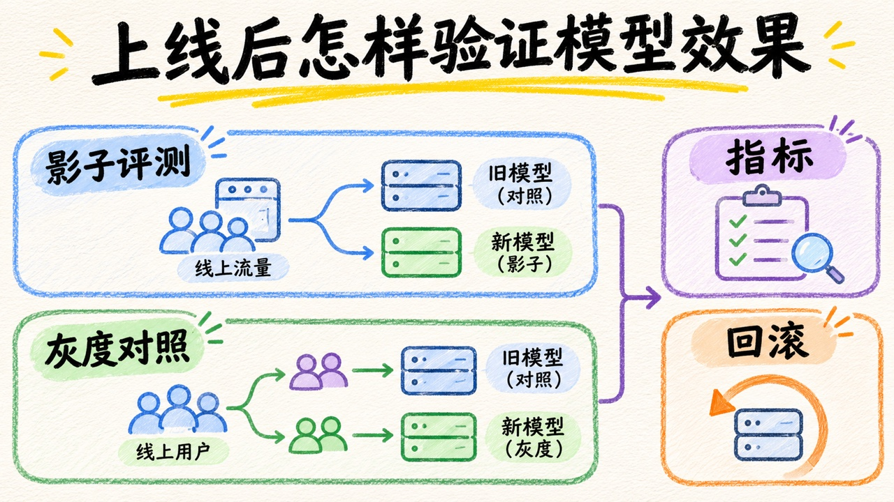

新版退款助手在线下多算对了一些空值题。真实流量里，它可能因为对不确定输入更谨慎，反而多次要求人工处理。上线验收要跟踪两件事：退款报告最终有没有正确完成，以及这个过程要花多少用户时间和人工精力。

[LE-04](le-04-regression-gates.md) 检查固定样本、成本和延迟。通过后可以先用少量只读流量做影子评测，再决定是否进入用户级灰度。这里给出设计和可运行的合成实验。

## 1. 影子评测让两版看同一份输入

**影子评测（shadow evaluation）**指线上仍由基线回复用户，另把经授权、脱敏且只读的同一份请求交给候选。候选输出写入评测日志。以退款为例，A 的报告展示给用户，B 只生成相同 CSV 的统计结果，应用对照 `count`、`missing`、`mean` 和证据。若 A 会归档报告，B 的写入权限要关闭，用模拟动作或意图记录观察它会做什么。

在影子阶段，给每条请求打上同一个实验关联 ID，分别保存 A、B 的版本和状态。抽样覆盖普通退款、空值和负金额等层，并记录抽样比例。配对回放可以估计相同输入上的输出差异。候选未被展示，用户满意度、实际接管率等体验指标需要经过真实曝光才能测。注意只保留当前任务需要的字段，并安排访问控制和留存期限。

## 2. 灰度对照用用户做随机化单位

**灰度**是让部分真实用户接触候选。有因果比较需要时，在符合条件的人群内设计 **A/B 随机对照**。用稳定的分配规则把用户放入 A 或 B，同一用户的三次请求都属于原组。这样用户不会在流程中反复切换，也能把同一用户多次请求的关联保留下来。若操作者会在租户之间共享数据，可改为以租户做随机化单位。

至少记录实验 ID、分组单位的匿名标识、分配结果、实际曝光版本、时间、请求 ID、是否完成、是否接管和总延迟。只在模型调用成功以后记录用户会漏掉部分失败。主分析遵照事先声明的分配口径处理所有符合条件的用户，并记录未曝光或版本错配作为诊断。预先设定预计组比例、观测窗口、主要指标和停止条件。 [微软可信在线实验实践](https://www.microsoft.com/en-us/research/articles/patterns-of-trustworthy-experimentation-during-experiment-stage/)

## 3. 同时读取效果和服务护栏

| 指标 | 合成实验的定义 |
| --- | --- |
| 报告成功率 | 每个用户三次请求中，最终完成且业务校验通过的比例，包括人工接管后完成的报告。再取该组用户的均值。 |
| 人工接管率 | 先计算每用户触发人工接管的请求比例，再对用户取均值。 |
| P95 完成时延 | 对当前组的所有请求用最近秩法取第 95 百分位，单位毫秒。 |
| 分配比例 | 比较两组用户数与预设的 1:1 比例，检查采集或分流是否异常。 |

**护栏指标（guardrail metric）**用于限制候选的副作用。示例预先设定，候选接管率上升超过 2 个百分点，或 P95 超过基线 100 ms，就触发回滚。主要指标的区间若跨过 0，证据仍不足。比例异常先查 **SRM（Sample Ratio Mismatch，样本比例不匹配）**，因为错误分配或埋点可能使两组无法比较。 [微软 SRM 诊断](https://www.microsoft.com/en-us/research/articles/diagnosing-sample-ratio-mismatch-in-a-b-testing/)

## 4. 本机复算一次灰度决策

把下面存为 `online_demo.py`，运行 `python3 online_demo.py`。它为 400 个合成用户各造三次请求，使用不同的成功率、接管率和延迟生成两组记录。随机化单位是用户，区间重采样也以用户为单位。下面的 3 倍标准差是沙盒快速诊断条件，正式实验应预先选择适用检验和显著性阈值。

```python
from collections import defaultdict
from hashlib import sha256
from math import ceil, sqrt
from random import Random
from statistics import mean

EXPERIMENT = "refund-rollout-v1"
VERSIONS = {"A": "refund-v1", "B": "refund-v2"}


def arm(user):
    key = f"{EXPERIMENT}:{user}".encode()
    bucket = int.from_bytes(sha256(key).digest()[:8], "big")
    return "A" if bucket < 2**63 else "B"


rng = Random(2026)
events = defaultdict(list)
for index in range(400):
    user = f"synthetic-{index:03d}"
    group = arm(user)
    risk = rng.uniform(0.0, 0.15)
    for _ in range(3):
        success = rng.random() < (0.84 if group == "A" else 0.94) - risk
        handoff = rng.random() < (0.035 if group == "A" else 0.12) + risk / 3
        latency = rng.randint(450, 800) + (65 if group == "B" else 0)
        events[user].append((group, VERSIONS[group], success, handoff, latency))

by_group = defaultdict(list)
for user, rows in events.items():
    assert all((group, version) == (arm(user), VERSIONS[arm(user)])
               for group, version, *_ in rows)
    by_group[arm(user)].append(rows)

a_users, b_users = by_group["A"], by_group["B"]
n = len(a_users) + len(b_users)
z = (len(a_users) - n / 2) / sqrt(n / 4)
if abs(z) > 3:
    raise SystemExit("HOLD: inspect sample ratio mismatch")


def summarize(users):
    success = [mean(row[2] for row in user_rows) for user_rows in users]
    handoff = mean(mean(row[3] for row in user_rows) for user_rows in users)
    durations = sorted(row[4] for user_rows in users for row in user_rows)
    p95 = durations[ceil(0.95 * len(durations)) - 1]
    return success, handoff, p95


a_success, a_handoff, a_p95 = summarize(a_users)
b_success, b_handoff, b_p95 = summarize(b_users)
resample = Random(41)
boot = sorted(
    mean(resample.choices(b_success, k=len(b_success)))
    - mean(resample.choices(a_success, k=len(a_success)))
    for _ in range(2000)
)
low, high = boot[49], boot[1949]
delta = mean(b_success) - mean(a_success)
handoff_delta = b_handoff - a_handoff
guardrail = handoff_delta > 0.02 or b_p95 - a_p95 > 100
decision = "ROLLBACK" if guardrail else ("EXPAND" if low > 0 else "HOLD")

print(f"users A={len(a_users)} B={len(b_users)}")
print(f"success delta={delta*100:+.1f} pp; interval [{low*100:+.1f}, {high*100:+.1f}] pp")
print(f"handoff delta={handoff_delta*100:+.1f} pp; p95 A={a_p95} B={b_p95} ms")
print(decision)
assert decision == "ROLLBACK"
```

本机复跑得到每组各 200 人。B 的成功率高 **6.5 个百分点**，名义 95% 区间为 **[+1.7, +11.2] 个百分点**。A、B 的 P95 分别为 781 和 844 ms，差 63 ms，仍在预算内。人工接管率上升 **11.7 个百分点**，触发回滚。

代码中的 `ROLLBACK` 表示触发预设规则。实际系统要通过发布控制面恢复旧版本，并核对新会话是否重新进入 A。对真实灰度指标，事先定好估计区间的方案、观测窗口与检查频率。把分组、样本数、异常案例、实际版本和回滚原因记下来。业务希望解释「哪类用户更受影响」时，先按预设层分析，再将新的观察作为后续验证项。

## 下一部分

第四部分进入「模型预训练与后训练」，按路线图从 **TRN-01《预训练语料与 Token 数据管线》** 继续。评测的固定样本和评分准则可以继续用于核对训练前后的能力变化。 [LLM 与 Agent 学习路线图](https://blog.lacknb.cn/articles/2026/11/19/1795058329577.html)
