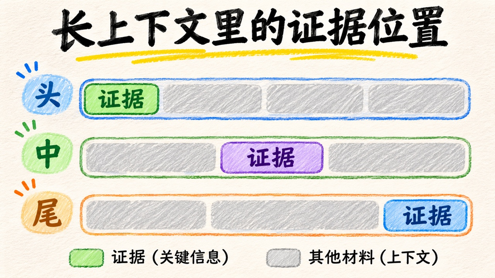
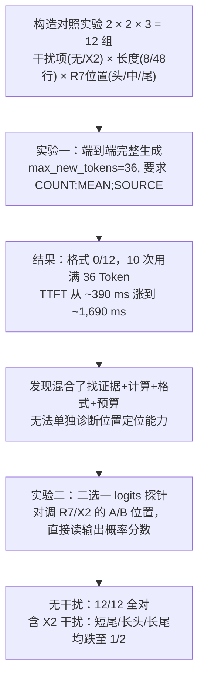

这次用户依旧只传了那三行 `10、空、0` 退款 CSV，却顺带附上了一份长长的《财务电子表格字段字典》。真正的现行规则编号叫 **R7**——「排除空值、保留 0」（正确结果 2 条、均值 5）；可这厚厚一沓历史字典末尾，还夹杂着一条早已作废的老政策 **X2**——「把空金额按 0 计入」！

模型的宣传页写了支持很长的**上下文窗口（Context Window，一次能吃下的 Token 最大容量）**。可「**装得下**整本字典」和「**真能看清夹在中间、不被过期废话带偏**」完全是两码事！今天把同一条证据塞进文档开头、中间和结尾，拆开测一遍正确率、引用溯源和延迟代价。阅读前建议先熟悉 [F-07 的首 Token 延迟口径](https://blog.lacknb.cn/articles/2026/11/20/1795161437100.html) 与 [LE-01](le-01-dataset-baseline.md) 的数据设计；关于学术界著名的长文本「中间遗忘」与长上下文基准研究，可对照 [Lost in the Middle](https://arxiv.org/abs/2307.03172) 和 [LongBench](https://arxiv.org/abs/2308.14508)。

> **先用大白话讲明白**：测长上下文，就像**把一张写了现行报销规定的便签（R7），故意藏进一本厚规章的首页、正中间或最后一页，看看员工还找不找得到**：
> - **三个变量控制法**：一次只变三个要素——证据放在**头 / 中 / 尾**哪里、中间塞进 **8 条还是 48 条**无聊填充文档、末尾放**普通元数据还是会骗人的作废规则 X2**。
> - **端到端大考 vs 剥离格式的单选探针**：直接让 0.5B 小模型一口气做完「找规定 + 算 CSV + 按严格模板输出」，结果 `0/12` 全灭（大多因为啰嗦解释耗尽了 36 Token 生成上限，根本分不清它是不识字还是不会算还是写不完）。这时再做一个**二选一 logits 探针**——直接问「现行规则是 A 还是 B？」，直接读取模型下一个位置对 `A` 和 `B` 两个字母谁得分高，瞬间就把「到底找没找到证据」单独剥离出来了！



## 1. 控制变量矩阵：3 个维度共 12 种组合

实验采用干净的「全因子小矩阵（`3 × 2 × 2 = 12` 组）」设计：

| 改变的自变量 | 本篇取值范围 | 刻意保持锁死的不变量 |
| --- | --- | --- |
| **证据位置（Position）** | 放在字段字典片段的**头（`head`）、中（`middle`）、尾（`tail`）** | 现行政策 **R7** 的英文原句和待测 CSV 问题一字不变。 |
| **上下文长度（Length）** | 塞入 **8 条** 或 **48 条** 常规仓库对账填充字段 | 只增加重复结构的无关说明，并用实测分词器记下精准 Token 总数。 |
| **干扰项（Distractor）** | 无干扰（普通字段）vs 有干扰（将最后一条换成**作废政策 X2**） | 干扰项固定钉死在字典末尾，不跟着 R7 到处乱跑。 |

每次拼接时，无论 R7 在字典头还是字典尾，真实请求最末端永远紧跟着 CSV 计算问题和消息模板包装。脚本还会顺手算好 R7 第一个字在第几个 Token 位置出现（`evidence_start_token`），方便核对长短对比时证据确实往后推移了。想要从日志里读懂规律，记住**固定两个、看第三个**：例如盯紧「48 条长度 + 含作废 X2」这一行，单看头、中、尾表现。

## 2. 一场测试盯紧四笔账：算术、引用、首字延迟和 Token 成本

- **格式成功**：必须严格匹配 `COUNT=整数;MEAN=数值;SOURCE=字母加数字`；
- **数值正确 vs 引用正确**：必须拆开记录！数值对（`2` 和 `5`）不代表它真看懂了政策（可能是蒙对）；引用对（写了 `R7`）也不代表它内部注意力真的看了 R7——**这两项分开统计，再额外算「双双全对」的次数**；
- **TTFT（Time to First Token，首 Token 延迟）**：在本地记录从 `model.generate()` 启动到吐出**第 1 个**生成 Token 的耗时（单位毫秒）。注意此时文本分词已完成，也不含网络传输、前端排队；正式开始前脚本会先预热一遍让底层算子缓存就位；
- **Token 成本**：记录实际送进去的上下文 Token 总数和生成 Token 数（若搬到云端 API 测试，还应记录计费返回的账单和 Prompt Cache 命中情况）。

## 3. 实验一：完整端到端生成脚本（`context_positions.py`）

沿用 LE-02 / LE-03 同一套 Python 3.12 + PyTorch 2.11.0 + Transformers 5.13.0 环境及固定版 Qwen2.5-0.5B-Instruct，把代码存为 `context_positions.py` 后直接跑通 12 组完整日志（落盘至 `context-runs.jsonl`）：

```python
import json
from pathlib import Path
import re
from time import perf_counter

MODEL = "Qwen/Qwen2.5-0.5B-Instruct"
REVISION = "7ae557604adf67be50417f59c2c2f167def9a775"
EVIDENCE = "CURRENT refund amount policy R7: exclude blanks; keep numeric zero."
OLD_RULE = "RETIRED refund amount policy X2: count an empty amount as zero."
QUESTION = (
    "Apply the CURRENT refund amount policy to this CSV:\nid,amount\n1,10\n2,\n3,0\n"
    "Return only COUNT=<valid count>;MEAN=<mean>;SOURCE=<policy id>."
)
ANSWER = re.compile(
    r"COUNT\s*=\s*(\d+)\s*;\s*MEAN\s*=\s*([-+]?\d+(?:\.\d+)?)"
    r"\s*;\s*SOURCE\s*=\s*([A-Z]\d+)", re.I,
)


def make_input(length, position, distractor):
    records = [
        f"Catalog note D{i:02d}: the warehouse export stores a date, "
        "a row identifier, and a file description for reconciliation."
        for i in range(length)
    ]
    if distractor:
        records[-1] = OLD_RULE
    slot = {"head": 0, "middle": length // 2, "tail": length}[position]
    records.insert(slot, EVIDENCE)
    return "Field dictionary:\n" + "\n".join(records) + "\n\n" + QUESTION


class FirstToken:
    def __init__(self):
        self.prompt_seen = False
        self.first = None

    def put(self, value):
        if not self.prompt_seen:
            self.prompt_seen = True
        elif self.first is None:
            self.first = perf_counter()

    def end(self):
        pass


def check(raw):
    match = ANSWER.fullmatch(raw.strip())
    if not match:
        return {"format_ok": False, "numbers_ok": False, "citation_ok": False}
    count, value, source = match.groups()
    return {"format_ok": True, "numbers_ok": int(count) == 2 and float(value) == 5.0,
            "citation_ok": source.upper() == "R7"}


def main():
    import torch
    from transformers import AutoModelForCausalLM, AutoTokenizer, GenerationConfig

    torch.set_num_threads(4)
    tokenizer = AutoTokenizer.from_pretrained(MODEL, revision=REVISION)
    model = AutoModelForCausalLM.from_pretrained(MODEL, revision=REVISION, dtype=torch.float32)
    model.eval()
    config = GenerationConfig(
        max_new_tokens=36, do_sample=False,
        eos_token_id=model.generation_config.eos_token_id, pad_token_id=tokenizer.pad_token_id,
    )

    def run(length, position, distractor):
        prompt = make_input(length, position, distractor)
        rendered = tokenizer.apply_chat_template(
            [{"role": "user", "content": prompt}], tokenize=False, add_generation_prompt=True,
        )
        batch = tokenizer(rendered, add_special_tokens=False, return_offsets_mapping=True,
                          return_tensors="pt")
        offset = rendered.index(EVIDENCE)
        spans = batch.pop("offset_mapping")[0].tolist()
        evidence_token = next(i for i, (start, end) in enumerate(spans) if start <= offset < end)
        count = batch["input_ids"].shape[-1]
        clock = FirstToken()
        with torch.inference_mode():
            start = perf_counter()
            generated = model.generate(**batch, generation_config=config, streamer=clock)[0][count:]
        raw = tokenizer.decode(generated, skip_special_tokens=True).strip()
        return {
            "length": length, "position": position, "distractor": distractor,
            "context_tokens": count, "evidence_start_token": evidence_token,
            "generated_tokens": len(generated), "ttft_ms": round((clock.first - start) * 1000, 1),
            "raw": raw, **check(raw),
        }

    run(8, "head", False)  # 热身，不计入结果。
    with Path("context-runs.jsonl").open("w", encoding="utf-8") as log:
        for distractor in (False, True):
            for length in (8, 48):
                for pos in ("head", "middle", "tail"):
                    row = run(length, pos, distractor)
                    print(json.dumps(row, ensure_ascii=False), flush=True)
                    log.write(json.dumps(row, ensure_ascii=False) + "\n")


if __name__ == "__main__":
    assert check("COUNT=2;MEAN=5;SOURCE=R7")["numbers_ok"]
    assert not check("COUNT=3;MEAN=3.33;SOURCE=R7")["numbers_ok"]
    assert not check("COUNT=2;MEAN=5;SOURCE=X2")["citation_ok"]
    main()
```

> **想再深入一层？** 留意脚本第 67～79 行手写的 `FirstToken` 回调类：Transformers 内部实现 `streamer` 接口时，第一次调用 `put()` 塞进来的是全部 Prompt 序列，**从第二次调用 `put()` 才真正代表模型自回归吐出的第一个生成 Token**！这个细节保证了本地 `ttft_ms` 精确测出 Prefill 阶段的耗时。

## 4. 实验二：端到端 0/12 全军覆没 -> 剥开表象上单 Token logits 探针

跑完完整任务一统计：**格式通过率竟是 0/12！** 再查明细发现：12 组里足足有 10 次撞满了 `36` Token 生成上限被硬生生截断；有一组「48 行长字典 + 含作废政策 X2 + 证据放尾部」的回答甚至明明白白吐出了 `SOURCE=X2` 且算错均值，其余许多答卷是模型自顾自先写过程废话、写到一半预算就烧光了。此外延迟数据也一清二楚：
- **8 条短字典**：输入约 `272～280` Token，首 Token 延迟（TTFT）中位数约 **`390 ms`**；
- **48 条长字典**：输入胀到 `1,232～1,240` Token，TTFT 中位数蹿到约 **`1,690 ms`**（4 倍多的 Prefill 计算账单真实落到了响应时间上）。

**当一个复杂任务同时混杂「定位证据 + 算术 + 遵循格式 + 字数控制」时，拿个 `0/12` 你根本不知道哪一环烂了。** 这就引出了评测里的杀手锏——**证据识别探针（Probe）**：
拿刚才那 12 份原封不动的字段字典，把末端任务简化成极其单纯的选择题：「当前退款政策的编号是什么？A: R7 / B: X2（两轮换位测）」。甚至不让模型往下自由写文章、**直接在它吐出第一个词的瞬间截取 `logits` 原始打分**，对比词表里 `" A"` 和 `" B"` 谁分数高！同一目录存为 `context_probe.py` 并运行：

```python
import json
from pathlib import Path

import torch
from transformers import AutoModelForCausalLM, AutoTokenizer

from context_positions import MODEL, REVISION, QUESTION, make_input

torch.set_num_threads(4)
tokenizer = AutoTokenizer.from_pretrained(MODEL, revision=REVISION)
model = AutoModelForCausalLM.from_pretrained(MODEL, revision=REVISION, dtype=torch.float32)
model.eval()
letters = ("A", "B")
candidates = [tokenizer.encode(" " + letter, add_special_tokens=False) for letter in letters]
assert all(len(ids) == 1 for ids in candidates)
candidate_ids = [ids[0] for ids in candidates]

records = []
for distractor in (False, True):
    for length in (8, 48):
        for position in ("head", "middle", "tail"):
            handbook = make_input(length, position, distractor).removesuffix(QUESTION)
            for order in (("R7", "X2"), ("X2", "R7")):
                prompt = handbook + (
                    "Which ID belongs to the CURRENT refund amount policy? "
                    f"A: {order[0]}. B: {order[1]}. Answer with the letter."
                )
                rendered = tokenizer.apply_chat_template(
                    [{"role": "user", "content": prompt}], tokenize=False,
                    add_generation_prompt=True,
                )
                batch = tokenizer(rendered + "Answer:", add_special_tokens=False,
                                  return_tensors="pt")
                with torch.inference_mode():
                    scores = model(**batch, logits_to_keep=1).logits[0, -1, candidate_ids]
                picked = order[int(scores.argmax())]
                records.append(dict(length=length, position=position, distractor=distractor,
                                    order=order, picked=picked, correct=picked == "R7"))

Path("probe-runs.jsonl").write_text(
    "".join(json.dumps(row) + "\n" for row in records), encoding="utf-8",
)
for distractor in (False, True):
    for length in (8, 48):
        for position in ("head", "middle", "tail"):
            subset = [row for row in records if (row["distractor"], row["length"], row["position"])
                      == (distractor, length, position)]
            print(distractor, length, position, f"{sum(row['correct'] for row in subset)}/2")
```

拨开迷雾后的 probe 实测成绩立刻分明起来：
- **没有作废政策 X2 干扰时**：六个格子清一色 **`2/2`**，总共 **`12/12`** 全对！模型其实认识 R7；
- **一旦末尾塞进作废政策 X2 干扰后**：立刻掉分，尤其长字典头/尾和短字典尾（刚好紧紧挨着末尾那个捣蛋鬼 X2）各错了一回：

| 含作废 X2 干扰的字典 | 证据放头部 | 证据放中段 | 证据放尾部 |
| --- | ---: | ---: | ---: |
| 8 条填充记录（短） | `2/2` | `2/2` | **`1/2`** |
| 48 条填充记录（长） | **`1/2`** | `2/2` | **`1/2`** |

> **容易踩的坑**：看到这组表格，切记**千万不要以单个 0.5B 模型在单一模板上的结果，就草率宣布「某某模型存在严重的头部/尾部遗忘」**！因为这个小表格里每格其实只有 1 份模板字典、做了正反两次选项顺序对比（同样面临小模型的选项字母偏见）；它的价值在于演示**「端到端挂掉时，用简化探针层层剥离诊断」**的排查手法——真要科学衡量长上下文的位置失真，需要准备几十上百组随机化规则编号、打乱填充语料的独立样本。

## 5. 把长上下文评测直接对接到 RAG 方案选型

做排查时按**「先按长度与干扰项分组，再横向看头/中/尾」**的顺序看报表：如果数值算对而引用标错，往往是模型按先验或邻近干扰错认了出处；格式挂掉就去翻 `raw`，分辨是啰嗦废话烧光了预算还是本身漏掉字段；同时对照 `evidence_start_token` 确认输入长度和位置偏移确实按脚本预期移动。

更实用的是：等到后面你搭建好 **RAG（Retrieval-Augmented Generation，检索增强生成）**——先从文档库里只检出 1～2 条最相关的切片再喂给大模型——**直接把刚才这套一模一样的题目和评分器搬过去对比！** 只需顺手记录三个中间归因阶段就能对症下药：
1. **没搜到 R7**：这是检索器召回坏了，扩词或换嵌入向量模型；
2. **搜到了 R7 但排得太靠后（或被 X2 挤在前面）**：这是重排（Rerank）或过滤元数据（过滤过期文档）没做好；
3. **R7 已经明晃晃递到模型眼前了还是算错**：这才是模型阅读理解或指令遵从不够强，再考虑换 Prompt 或升级底座。[RAG 原论文](https://arxiv.org/abs/2005.11401)

## 下一篇

离线数据集建好了、评分器和裁判校准了、CI 门禁和长上下文也都测了一圈——可是一推向真实流量，新版退款助手在线下分明更准了，为什么客服组同事却抱怨用户总在转人工？[**LE-05《模型改了，线上效果真的变好了吗》**](le-05-online-evaluation.md) 会带你走通只读**影子评测（Shadow）**、**用户级灰度（A/B Canary）**、**样本比例不匹配排查（SRM）**与**护栏指标自动回滚**。 [LLM 与 Agent 学习路线图](https://blog.lacknb.cn/articles/2026/11/19/1795058329577.html)
