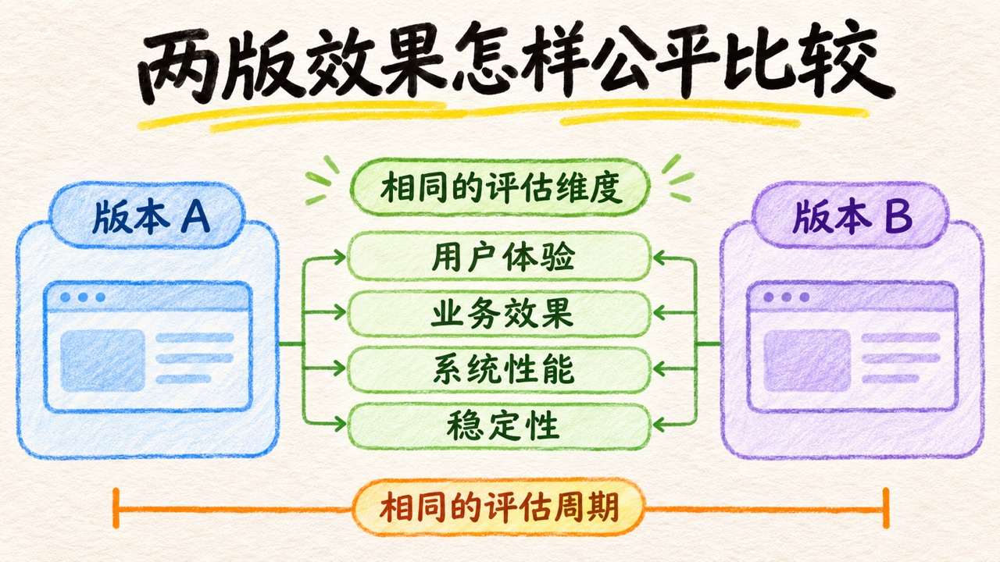

把提示词里「排除空金额，保留真实的 0」说得更清楚后，通过率从 62.5% 变成 75.0%。这个差值看起来不小。评测集却只有八条，每条生成三次。需要弄清三件事：两版做的是不是同一批题，哪些题改好了，八条题能把总体差值估到什么程度？

本篇沿用 [LE-01](le-01-dataset-baseline.md) 的退款分层。A 是基线，B 加了一句统计规则。以下用合成的 0/1 成功记录演示统计。每一位表示一次试验通过与否。

## 1. 固定比较单位和实验条件

**成对比较（paired comparison）**指让 A 和 B 都跑同一条任务，再在这条任务内取差值。业务合同、数据切分、模型版本、抽样参数、生成预算和评分器保持一致，只换提示。如果环境会随时间变化，可以交错运行 A 与 B，记录请求时间和失败状态，避免把服务波动当作改动效果。

| 样本层 | A 与 B 怎么比较 |
| --- | --- |
| 普通 | 测不含缺失等边界的基本统计，确认改提示后基本任务没有退化。 |
| 边界 | 测空金额、全空、真实零值和负数等行为，记录错在哪个字段。 |

对每题先算三次的通过率，例如空值题的 A 是 `0/3`、B 是 `2/3`，配对差为 `2/3`。然后对八个题的差值取平均，八题等权。一条题运行三次提供了题内稳定性信息，但同题的试次共享输入和难点，不能因此当成三道独立题。

## 2. 以题为单位重采样

**Bootstrap（自助重采样）**从现有数据有放回抽样，再在抽取的样本上重新计算统计值。这里每轮在两个层内各抽四条题，抽中哪一题，就一并取这题 A 和 B 的全部试次。这样保留原来的层数、同题配对和题内相关性。在每轮算出 B 减 A，把 5,000 轮差值的第 2.5 和第 97.5 百分位用作名义 95% 的示意区间。

这里的区间反映在固定数据层占比下，观察到的题目差异带来的不确定性。样本很小时，区间粗糙，也可能低估真实不确定性。若真实流量里边界占比只有 10%，生产估计应使用预先定义的权重，不能把本例的 50% 直接套用。 [Bootstrap 方法](https://academic.oup.com/biomet/article-abstract/68/3/589/218600) · [集群重采样研究](https://pmc.ncbi.nlm.nih.gov/articles/PMC5965657/)

## 3. 用标准库复算差值和区间

保存为 `paired_eval.py`，运行 `python3 paired_eval.py`。输出中的 **pp（percentage points，百分点）**是两个百分数相减的单位，例如 75.0% 减 62.5% 是 12.5 个百分点。

```python
from collections import defaultdict
from random import Random
from statistics import mean

# 题号、分层、A 的三次结果、B 的三次结果。
trials = [
    ("g1", "normal", "111", "111"),
    ("g2", "normal", "111", "110"),
    ("g3", "normal", "110", "111"),
    ("g4", "normal", "111", "111"),
    ("e1", "edge", "000", "110"),
    ("e2", "edge", "100", "010"),
    ("e3", "edge", "110", "100"),
    ("e4", "edge", "010", "111"),
]


def rate(bits):
    return bits.count("1") / len(bits)


def percentile(ordered, p):
    index = (len(ordered) - 1) * p
    lower = int(index)
    upper = min(lower + 1, len(ordered) - 1)
    return ordered[lower] + (ordered[upper] - ordered[lower]) * (index - lower)


by_layer = defaultdict(list)
for key, layer, a, b in trials:
    assert len(a) == len(b) == 3
    delta = rate(b) - rate(a)
    by_layer[layer].append(delta)
    print(key, layer, f"{delta * 100:+.1f} pp")

a_score = mean(rate(a) for _, _, a, _ in trials)
b_score = mean(rate(b) for _, _, _, b in trials)
for name, values in by_layer.items():
    print(name, f"{mean(values) * 100:+.1f} pp", f"n={len(values)}")

rng = Random(2026)
values = sorted(mean(
    rng.choice(group)
    for group in by_layer.values()
    for _ in group
) for _ in range(5000))
low, high = percentile(values, 0.025), percentile(values, 0.975)
assert round(a_score, 3) == 0.625 and round(b_score, 3) == 0.750
assert low < 0 < high
print(f"A={a_score:.1%} B={b_score:.1%} delta={(b_score-a_score)*100:+.1f} pp")
print(f"interval=[{low*100:+.1f}, {high*100:+.1f}] pp")
```

普通层的平均差是 **0.0 个百分点**，边界层是 **+25.0 个百分点**。逐题看，`e1`、`e4` 改善，`e3` 退化，普通层也各有一题改善和退化。总体差值 **+12.5 个百分点**，名义 95% 区间是 **[-12.5, +37.5] 个百分点**，包含 0。5,000 次重采样只让区间计算更稳定，实际独立的信息仍来自八条题。

## 4. 结果离发布决定还有哪些证据？

先约定值得采用的业务增益，例如 **至少 +5 个百分点**。再分别检查关键失败、成本和延迟。如果区间覆盖了可能退化的范围，补足独立样本，专门查看边界层退化的题和失败标签。若某项要求是「禁止错误归档」之类的强约束，应设置专门的零容忍检查。平均分提高时也必须满足该检查。若需要中途多次判断上线效果，应按预先设计的监测规则执行，避免每天看同一指标直到出现想要的结果。

## 下一篇

[**LE-04《把效果评测接入 Prompt 和模型回归》**](le-04-regression-gates.md) 将数据版本、差值、失败例和阈值放进同一个发布检查。 [LLM 与 Agent 学习路线图](https://blog.lacknb.cn/articles/2026/11/19/1795058329577.html)
