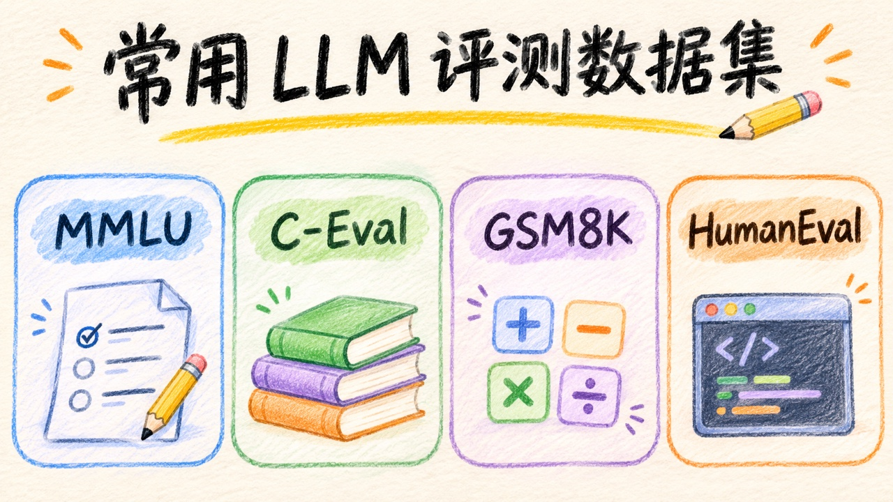
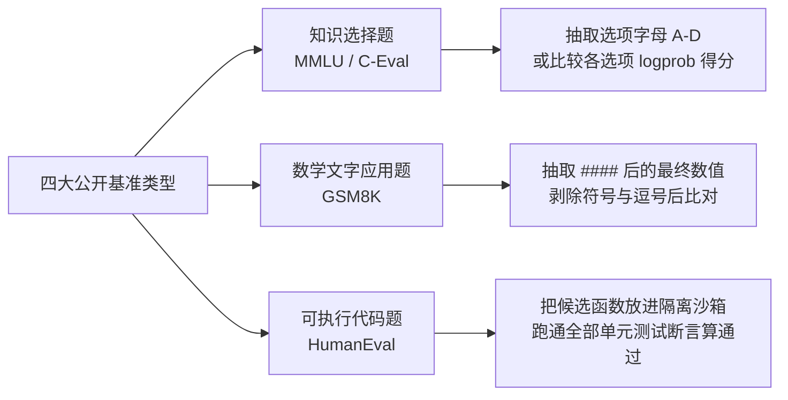
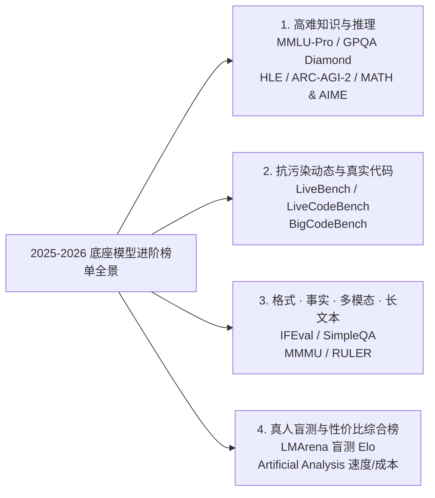

前面三篇一直在打磨咱们的退款助手评测集：要求忽略空金额、保留真实的 `0`，并能讲明白均值分母为什么是 `2`。可当你打开模型官网准备选底座模型时，满屏都是各种公开榜单分数——MMLU、C-Eval、GSM8K、HumanEval……

这些分数到底哪一个能帮我们挑出更适合做退款统计的模型？与其听宣传口径，不如直接翻开这四大考试的**真实原题**和**自动阅卷规则**，亲眼看看它们到底考啥、怎么批卷。

> **先用大白话讲明白**：选模型时看**公开基准（Benchmark）**，就像**给孩子挑家教前先翻翻他的历史模考成绩单**：
> - **MMLU / C-Eval 就像「多学科百科选择题（英语 vs 中文）」**：四选一，考的是物理、会计、代数这类通用知识积累；光看它得分高，只代表他知识面广、做选择题稳，不代表他按你要求吐出干净 JSON 不出错。
> - **GSM8K 就像「小学英文数学应用题」**：要求步步推算，最后在 `####` 后面交出一个具体数字；最接近咱们按规则做多步算术，但注意它默认只查最后一个数，不查解释过程合不合理。
> - **HumanEval 就像「上机写 Python 函数」**：不看代码长得像不像标准答案，直接跑**单元测试（Unit Test）**看功能对不对——相当于「让程序直接算，不靠嘴巴心算」。



下面的真实原题概要与字段结构均来自四大基准的官方公开记录（具体原始英文/中文原文与许可条款请以对应主页为准）。

## 1. MMLU 与 C-Eval：同样考选择题，语言与算分细节藏着猫腻

**MMLU（Massive Multitask Language Understanding，大规模多任务语言理解）**涵盖从初中数学到专业法律、抽象代数的 57 个英文学科或任务。以测试集 `abstract_algebra/test` 的第 0 条真题为例：题目问有理数域的扩展 `ℚ(√2, √3, √18)` 相对有理数的扩张次数，四个选项依次是 `0`、`4`、`2`、`6`。原始数据行里的 `answer` 存的是整数 **`1`**——注意它是**从 0 开始计数（zero-based index）**，代表第二个选项 **`B`（也就是 `4`）**！要是你的读题脚本误以为选项从 1 开始或者直接把数字 `1` 当字符串去匹配，整个跑分瞬间全部错位。[MMLU 原论文](https://arxiv.org/abs/2009.03300) · [MMLU 数据卡与样本](https://huggingface.co/datasets/cais/mmlu)

**C-Eval** 是一套多层级、多学科的中文综合评测集，原论文覆盖 52 门学科。看验证集 `accountant/val` 的 `id: 4` 样本：四个选项考「关于战略管理哪种说法是错误的」，标准答案 `C` 对应的是把战略管理当成一锤子买卖的错误描述。数据行分别存储 `A` 到 `D`、`answer` 和题干。还要留个心眼：该数据集仓库标注 **CC BY-NC-SA 4.0（非商业性使用-相同方式共享）**，二次分发和商用场景里一定要核清所使用版本与许可边界。[C-Eval 原论文](https://arxiv.org/abs/2305.08322) · [C-Eval 样本](https://huggingface.co/datasets/ceval/ceval-exam/viewer/accountant/val) · [数据卡](https://huggingface.co/datasets/ceval/ceval-exam)

> **想再深入一层？** 同样叫选择题**准确率（Accuracy，答对题数 ÷ 已评分总题数）**，业界居然有两种截然不同的拿答案方式：
> 1. **自由生成 + 正则抽取**：让模型正常吐出一段回答（比如「我选 B」），再用规则抠出字母；极大受制于提示词格式和抽取正则的松紧度。
> 2. **条件对数概率（`logprob`）比大小**：根本不让模型自由说话，直接把题面分别接上 `A`、`B`、`C`、`D` 送进模型，算哪个选项的条件概率最高就选谁！这种方法不受输出客套话影响，但对候选空格、Token 分词边界极为敏感。
> 此外，算总分时**微平均（全部分学科混在一起按题数总和算比例）**与**宏平均（每个学科先算各自准确率，再把 57 科等权求均值）**在各科题数极不均衡时，算出的总分可能差好几个百分点！[LM Evaluation Harness 任务接口](https://github.com/EleutherAI/lm-evaluation-harness/blob/main/docs/task_guide.md)

## 2. GSM8K：考小学应用题，其实全盯着结尾一个数字

**GSM8K（Grade School Math 8K）** 收录了大约 8 千多道需要 2～8 步加减乘除的英文小学数学应用题。翻开 `main/train` 第 0 条原题：Natalia 在 4 月卖了 48 个发夹，5 月卖出数量是 4 月的一半，问两个月一共卖了多少？标准答案文本先给出计算推导，然后在末尾固定写着 `#### 72`。因此，标准评分脚本往往只抓取 `####` 后面的最终数字 **`72`**。[GSM8K 数据、样本和许可](https://huggingface.co/datasets/openai/gsm8k) · [OpenAI 数据集说明](https://github.com/openai/grade-school-math)

**归一化（Normalization）** 会把允许等价的格式先洗干净再比对——例如教学练习里可以把 `72.0` 或带千位逗号的 `1,000` 统一变成干净数值。但在公开榜单正式复现时，千万要先看一眼评分框架的默认清洗规则：很多基准默认只剥掉逗号和 `$` 货币符号，然后直接做字符串精确比对！更要命的是，模型如果在草稿里写「我一开始算成 70，后来发现应该是 72」，最后拿不拿分全看正则取「第一个匹配」还是「最后一个匹配」。而且只比末尾数字的机制决定了一件事：**就算模型推导过程胡说八道最后蒙对 `72`，GSM8K 照样算它满分。** [Harness 的 GSM8K 任务配置](https://github.com/EleutherAI/lm-evaluation-harness/blob/main/lm_eval/tasks/gsm8k/gsm8k.yaml)

## 3. HumanEval：不看代码长相，直接跑通单元测试才算数

**HumanEval** 是经典的代码生成基准。看第 0 题 `HumanEval/0`：它给出一个叫 `has_close_elements(numbers, threshold)` 的函数签名与英文文档字符串（检查列表里是否存在两个**不同下标位置**的元素，它们之差的绝对值小于给定阈值），每条数据包含 `prompt`、测试套件 `test`、`entry_point` 和参考解法 `canonical_solution`。判卷时把模型续写的函数体拼回去，直接放到单元测试里真刀真枪地运行！[HumanEval 原始仓库](https://github.com/openai/human-eval) · [HumanEval 数据卡与样本](https://huggingface.co/datasets/openai/openai_humaneval)

**单元测试（Unit Test）**只管输入喂进去、输出结果是否满足 `assert` 断言——模型先排序再比邻近元素也好，暴力双层枚举也罢，只要全部测试断言一次通过就算过。如果让模型对每道题采样生成很多份候选代码，还能计算 **pass@k**（抽样 `k` 份代码里至少有 1 份跑通全部测试的概率估计值）。

> **容易踩的坑**：上线跑模型吐出的未知代码时，**千万不要裸跑 `exec()`！** 必须关进无网、限核、带强制超时强杀的隔离沙箱（比如本系列 Sandbox 专题讲的隔离环境）里执行，否则模型哪怕误写个 `rm -rf` 或死循环就能把评测机直接拖垮。本文下面的小脚本只执行自己手写的几行纯净断言代码。 [HumanEval 原论文](https://arxiv.org/abs/2107.03374)

## 4. 用 Python 直观体验这三种截然不同的批改机制

把下面代码保存为 `read_benchmarks.py` 运行一遍。代码里 MMLU `abstract_algebra/test[0]` 的索引答案、C-Eval `accountant/val` 的标签以及 GSM8K `Natalia 发夹题` 的参考数 `72` 均对应上面读过的真实样本，输入文本部分则做了简化演示，方便你直观看到三种判卷脚本的逻辑差异：

```python
from decimal import Decimal
from itertools import combinations

def choice_correct(prediction, expected):
    return prediction.strip().upper() == expected


# MMLU：模型给出 B，数据中的 1 指第二个选项。
assert choice_correct(" B", "ABCD"[1])
# C-Eval：按字母标签判定。
assert choice_correct("c", "C")
assert not choice_correct("A", "C")


def demo_gsm8k_answer(text):
    marker, sep, answer = text.rpartition("####")
    if not sep:
        raise ValueError("missing final-answer marker")
    return Decimal(answer.strip().replace(",", ""))


assert demo_gsm8k_answer("A model calculation. #### 72.0") == Decimal(72)


def has_close_elements(values, threshold):
    return any(abs(a - b) < threshold for a, b in combinations(values, 2))


assert has_close_elements([0.0, 1.0, 3.0], 1.1)
assert not has_close_elements([0.0, 1.0, 3.0], 1.0)
assert not has_close_elements([0.0], 1.0)
print("选择题键、最终数值和三条函数断言均通过")
```

## 5. 为什么老四大榜单已经不够用了？2025–2026 主流进阶基准与排行榜全景

前面四节帮咱们摸清了 MMLU、C-Eval、GSM8K 和 HumanEval 的老底——但如果你今天再去挑底座模型，只盯着这「老四大」一定会误判！原因用大白话讲就两条：

1. **考卷太简单、学霸全挤在 99 分——叫「饱和效应（Saturation）」**：就像高三学生天天刷同一套期末基础卷，尖子生全都考 90～98 分，榜单看着只差 0.3 分，根本看不出谁真能啃硬骨头；
2. **老题在网上传了好几年、模型早就偷偷背过答案——叫「数据污染（Data Contamination）」**：如果训练集里早就把公开题库吞进去了，考高分更像「背题大赛」，一遇到没见过的新规则照样抓瞎。

所以 2025～2026 年业界评价底座模型，早已升级成一套**分维度考场矩阵**：



### 5.1 高难度知识与推理：专治「全员考 99 分」

- **MMLU-Pro**：相当于 MMLU 的加压升级版——把原来的「4 选 1」直接拉到**「10 选 1」**，并且大幅增加需要多步逻辑推导的题目比例，防止模型靠排除法蒙对选项。[MMLU-Pro 官方仓库](https://github.com/TIGER-AI-Lab/MMLU-Pro)
- **GPQA Diamond（Graduate-Level Google-Proof Q&A，博士级防搜索问答）**：由物理、化学、生物博士亲手编写的超高难专业题，「防搜索（Google-proof）」意思是外行就算现场查搜索引擎、花半小时看资料也做不对。其中 **Diamond（钻石子集）**是公认最干净、信噪比最高的 198 道精选核心题，常用来看模型在理科深度推理上的硬功夫。[GPQA 官方仓库](https://github.com/idavidrein/gpqa)
- **HLE（Humanity's Last Exam，人类最后一场考试）**：汇集全球跨学科前沿专家出题的超高门槛基准（含纯文本与图文题），专门用来探明当前大模型在极深专业知识与长链推理上的天花板。[HLE 官网](https://lastexam.ai/)
- **ARC-AGI / ARC-AGI-2（Abstraction and Reasoning Corpus，抽象推理语料库）**：不考背过的历史或编码语法，而是给你几个「彩色小方块按新规则变形」的图案例子，让你现场悟出规律并画出下一张网格！大白话讲，它考的是不靠死记硬背的**流体智力（Fluid Intelligence）**——至今依然是区分「背题机器」和「真正现场归纳规律」的重要试金石。[ARC Prize 官网](https://arcprize.org/)
- **MATH / AIME / FrontierMath**：GSM8K 考的是小学文字应用题，现在看数学能力已经普遍升级成看美国高中数学竞赛级（MATH、AIME）乃至未公开的研究级难题（FrontierMath），考复杂的符号变换、几何构造与严格求解。

### 5.2 抗污染动态题库与真实工程代码：专治「提前背题」

- **LiveBench**：为了彻底躲开数据污染，它**每月持续滚动发布新题**，来源涵盖近期最新论文、新闻和动态数学/编码/推理题，并且**所有题目都配了确定性自动评分规则，完全不靠 LLM 当裁判**（免除了裁判偏差）。[LiveBench 官网](https://livebench.ai/) · [GitHub](https://github.com/LiveBench/LiveBench)
- **LiveCodeBench**：做编程评测最怕模型在 GitHub 或刷题网站上「见过原题」。LiveCodeBench 会给每一道 LeetCode、AtCoder、Codeforces 比赛真题严格标上**发布时间戳**，只拿「晚于模型训练知识截止日期」之后的新题来考，一秒照出真实编程功底有没有掺水分。[LiveCodeBench 官网](https://livecodebench.github.io/) · [GitHub](https://github.com/LiveCodeBench/LiveCodeBench)
- **BigCodeBench**：HumanEval 只让你补全一个几行长的孤立 Python 小函数；而 BigCodeBench 专门考**现实工程里的多库协同调用**——比如「用 `pandas` 清洗表格、再用 `matplotlib` 画图、最后写进指定文件」，直接对应真实研发写脚本的能力。[BigCodeBench 官方仓库](https://github.com/bigcode-project/bigcodebench)

### 5.3 格式遵循、事实幻觉、多模态与长上下文：专盯业务可用性

- **IFEval（Instruction-Following Eval，指令遵循评测）**：只考模型「听不听话」，不考它聪不聪明！题目里会塞入可由程序硬核检查的格式死命令——例如「必须用纯 JSON 输出」「全文不得超过 120 个词」「答案里必须包含 3 个指定英文关键词」。这跟咱们退款助手里要求「绝对不要加多余注释、严格按 Schema 输出」是一模一样的能力。[IFEval 数据集](https://huggingface.co/datasets/google/IFEval)
- **SimpleQA**：专门测简短客观事实问答，重点看模型「不知道的时候会不会老实说不知道」，把瞎编答案（幻觉）的概率和盲目自信暴露出来。[SimpleQA / simple-evals](https://github.com/openai/simple-evals)
- **MMMU（Massive Multi-discipline Multimodal Understanding，大规模多学科多模态理解）**：如果业务里要看合同扫描件、财报截图或工程图纸，就看这类大学级图文混合推理基准。[MMMU 主页](https://mmmu-benchmark.github.io/)
- **RULER**：早期看长上下文流行在长文章里塞一句暗号看能不能找回来（即「大海捞针 Needle-in-a-Haystack」），但模型很快能应付单点搜寻；**RULER** 把难度升级到「多条线索跨段追踪、全局词频统计和跨段聚合问答」，避免长文本一多就丢细节。怎么用自己的退款 CSV 字典复现这类长上下文退化测试，我们在 [LE-06《长上下文的有效性如何评测》](le-06-long-context-eval.md) 会亲手做一遍。[RULER 官方仓库](https://github.com/NVIDIA/RULER)

### 5.4 人类盲测偏好与成本/速度综合排行榜

- **LMArena（原名 Chatbot Arena）**：这是业界知名度最高的**双盲真人对战榜**——每次给你同一个问题让两个匿名模型作答，由真实人类用户盲选谁写得更好，再套用国际象棋 **Elo 积分制（Arena Elo Rating）**排榜。大白话讲，它测的不是客观题对错，而是「真用起来回答是不是自然、周到、对人类胃口」（这种两两盲比思维，也正是 [LE-03《LLM-as-a-Judge 与人工校准》](le-03-llm-judge-calibration.md) 中成对比较校准的核心思路）。[LMArena 官网](https://lmarena.ai/)
- **Artificial Analysis**：工程选型只看智力总分常常会踩进成本陷阱！Artificial Analysis 把公开推理跑分、每百万 Token 的 API 账单价、**首字延迟 TTFT（Time to First Token）** 和**生成吞吐速度（tokens/s）** 摆进同一张对比面板，方便工程师直观挑出「性价比甜点模型」。至于如何在自己机房真实测出合规吞吐与成本账单，可以看部署专题的 [SERV-11《怎样做两种推理引擎的生产基准》](serv-11-engine-benchmark.md)。[Artificial Analysis 官网](https://artificialanalysis.ai/)

### 5.5 2025–2026 主流进阶基准与榜单速查表

| 维度 | 基准 / 排行榜 | 主要考什么 | 批改 / 排榜机制 | 读榜时盯紧什么坑 |
| --- | --- | --- | --- | --- |
| 高难知识推理 | **MMLU-Pro / GPQA Diamond / HLE** | 10 选 1 百科、博士级理科与前沿难题 | 客观选项 / 唯一专家答案匹配 | 容易为了刷高分狂拉「思考 Token」推高延迟与开销 |
| 流体智力与数学 | **ARC-AGI-2 / MATH & AIME** | 陌生规律归纳与竞赛级数学推演 | 新网格矩阵 / 符号数值精确匹配 | 区分裸模型单发输出 vs 额外搜索试错成本 |
| 抗污染动态 | **LiveBench / LiveCodeBench** | 按月新题、按时间戳切分新竞赛题 | 无 LLM 裁判的客观规则或单测 | 核对受测模型训练截止日期是否晚于题集切片 |
| 真实工程代码 | **BigCodeBench** | 多 Python 库协作工程脚本 | 隔离环境运行单元测试 | 偏重 Python 生态，需结合业务主力语言看 |
| 格式与事实边界 | **IFEval / SimpleQA** | 硬性格式字数约束、事实幻觉率 | 代码正则/规则检查、事实精确与拒答率 | 高准确可能伴随保守拒答，需同时看拒答率 |
| 多模态与长文本 | **MMMU / RULER** | 专业图文推理、长文跨段聚合追踪 | 客观匹配与长上下文多跳校验 | 长文本下延迟飙升与上下文腐化曲线 |
| 真实体验与性价比 | **LMArena / Artificial Analysis** | 人类盲测好感度、价格/速度/智力权衡 | 盲测 Elo 积分；多基准结合实测延迟计价 | 盲测容易偏爱「废话长、排版好看」的长回答 |

> **大白话小结**：回到开头的问题——挑退款助手或任意业务底座模型时，按这 **3 步**看模型榜最不容易交学费：
> 1. **先用 `IFEval` + `LiveBench` 筛底盘**：保证指令听话（能稳定按 Schema 输出）、而且不是靠背老题库刷出来的高分；
> 2. **按业务需求补看对应维度并用 `Artificial Analysis` 算账本**：需要理科深度推理补看 `GPQA Diamond / ARC-AGI-2`，需要看图补看 `MMMU`，需要超长上下文补看 `RULER`；再把候选模型的 TTFT、吞吐和百万 Token 账单排在一起，砍掉又贵又慢的；
> 3. **公开高分永远只是「初筛入场券」，永远不能替你做业务验货**：最后决定谁上线的，还是用 [LE-01](le-01-dataset-baseline.md) 亲手搭建的业务留出集（比如咱们退款 CSV 的空值忽略、`0` 值保留与 JSON 合同），同时存档数据集版本、切分方式、Prompt 和抽取规则备查（若涉及带工具、环境与多步执行的 Agent 公开榜，可另看 [AE-04](ae-04-public-benchmarks.md)）。

## 下一篇

搞懂了公开基准考什么，下一篇就真刀真枪把评测框加起来！[**LE-02《公开基准实战，怎样复现并比较模型结果》**](le-02-reproduce-benchmark.md) 会用业界最通用的 `lm-eval` 框架锁定 GSM8K 的 8 条固定样本，在本地跑通两款小模型，让你亲眼见证同一句话为什么「换一套抽取规则，得分瞬间从 0 变成 1」。 [LLM 与 Agent 学习路线图](https://blog.lacknb.cn/articles/2026/11/19/1795058329577.html)
