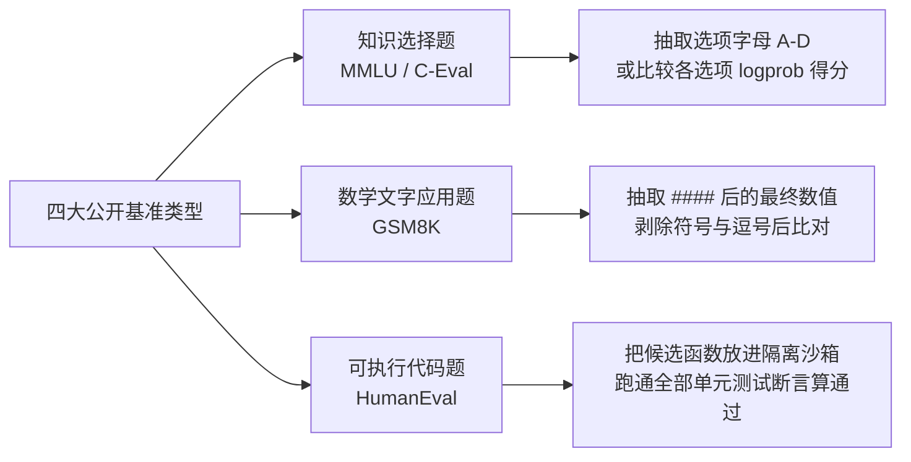

前面三篇一直在打磨咱们的退款助手评测集：要求忽略空金额、保留真实的 `0`，并能讲明白均值分母为什么是 `2`。可当你打开模型官网准备选底座模型时，满屏都是各种公开榜单分数——MMLU、C-Eval、GSM8K、HumanEval……

这些分数到底哪一个能帮我们挑出更适合做退款统计的模型？与其听宣传口径，不如直接翻开这四大考试的**真实原题**和**自动阅卷规则**，亲眼看看它们到底考啥、怎么批卷。

> **先用大白话讲明白**：选模型时看**公开基准（Benchmark）**，就像**给孩子挑家教前先翻翻他的历史模考成绩单**：
> - **MMLU / C-Eval 就像「多学科百科选择题（英语 vs 中文）」**：四选一，考的是物理、会计、代数这类通用知识积累；光看它得分高，只代表他知识面广、做选择题稳，不代表他按你要求吐出干净 JSON 不出错。
> - **GSM8K 就像「小学英文数学应用题」**：要求步步推算，最后在 `####` 后面交出一个具体数字；最接近咱们按规则做多步算术，但注意它默认只查最后一个数，不查解释过程合不合理。
> - **HumanEval 就像「上机写 Python 函数」**：不看代码长得像不像标准答案，直接跑**单元测试（Unit Test）**看功能对不对——相当于「让程序直接算，不靠嘴巴心算」。



下面的真实原题概要与字段结构均来自四大基准的官方公开记录（具体原始英文/中文原文与许可条款请以对应主页为准）。

## 1. MMLU 与 C-Eval：同样考选择题，语言与算分细节藏着猫腻

**MMLU（Massive Multitask Language Understanding，大规模多任务语言理解）**涵盖从初中数学到专业法律、抽象代数的 57 个英文学科或任务。以测试集 `abstract_algebra/test` 的第 0 条真题为例：题目问有理数域的扩展 `ℚ(√2, √3, √18)` 相对有理数的扩张次数，四个选项依次是 `0`、`4`、`2`、`6`。原始数据行里的 `answer` 存的是整数 **`1`**——注意它是**从 0 开始计数（zero-based index）**，代表第二个选项 **`B`（也就是 `4`）**！要是你的读题脚本误以为选项从 1 开始或者直接把数字 `1` 当字符串去匹配，整个跑分瞬间全部错位。[MMLU 原论文](https://arxiv.org/abs/2009.03300) · [MMLU 数据卡与样本](https://huggingface.co/datasets/cais/mmlu)

**C-Eval** 是一套多层级、多学科的中文综合评测集，原论文覆盖 52 门学科。看验证集 `accountant/val` 的 `id: 4` 样本：四个选项考「关于战略管理哪种说法是错误的」，标准答案 `C` 对应的是把战略管理当成一锤子买卖的错误描述。数据行分别存储 `A` 到 `D`、`answer` 和题干。还要留个心眼：该数据集仓库标注 **CC BY-NC-SA 4.0（非商业性使用-相同方式共享）**，二次分发和商用场景里一定要核清所使用版本与许可边界。[C-Eval 原论文](https://arxiv.org/abs/2305.08322) · [C-Eval 样本](https://huggingface.co/datasets/ceval/ceval-exam/viewer/accountant/val) · [数据卡](https://huggingface.co/datasets/ceval/ceval-exam)

> **想再深入一层？** 同样叫选择题**准确率（Accuracy，答对题数 ÷ 已评分总题数）**，业界居然有两种截然不同的拿答案方式：
> 1. **自由生成 + 正则抽取**：让模型正常吐出一段回答（比如「我选 B」），再用规则抠出字母；极大受制于提示词格式和抽取正则的松紧度。
> 2. **条件对数概率（`logprob`）比大小**：根本不让模型自由说话，直接把题面分别接上 `A`、`B`、`C`、`D` 送进模型，算哪个选项的条件概率最高就选谁！这种方法不受输出客套话影响，但对候选空格、Token 分词边界极为敏感。
> 此外，算总分时**微平均（全部分学科混在一起按题数总和算比例）**与**宏平均（每个学科先算各自准确率，再把 57 科等权求均值）**在各科题数极不均衡时，算出的总分可能差好几个百分点！[LM Evaluation Harness 任务接口](https://github.com/EleutherAI/lm-evaluation-harness/blob/main/docs/task_guide.md)

## 2. GSM8K：考小学应用题，其实全盯着结尾一个数字

**GSM8K（Grade School Math 8K）** 收录了大约 8 千多道需要 2～8 步加减乘除的英文小学数学应用题。翻开 `main/train` 第 0 条原题：Natalia 在 4 月卖了 48 个发夹，5 月卖出数量是 4 月的一半，问两个月一共卖了多少？标准答案文本先给出计算推导，然后在末尾固定写着 `#### 72`。因此，标准评分脚本往往只抓取 `####` 后面的最终数字 **`72`**。[GSM8K 数据、样本和许可](https://huggingface.co/datasets/openai/gsm8k) · [OpenAI 数据集说明](https://github.com/openai/grade-school-math)

**归一化（Normalization）** 会把允许等价的格式先洗干净再比对——例如教学练习里可以把 `72.0` 或带千位逗号的 `1,000` 统一变成干净数值。但在公开榜单正式复现时，千万要先看一眼评分框架的默认清洗规则：很多基准默认只剥掉逗号和 `$` 货币符号，然后直接做字符串精确比对！更要命的是，模型如果在草稿里写「我一开始算成 70，后来发现应该是 72」，最后拿不拿分全看正则取「第一个匹配」还是「最后一个匹配」。而且只比末尾数字的机制决定了一件事：**就算模型推导过程胡说八道最后蒙对 `72`，GSM8K 照样算它满分。** [Harness 的 GSM8K 任务配置](https://github.com/EleutherAI/lm-evaluation-harness/blob/main/lm_eval/tasks/gsm8k/gsm8k.yaml)

## 3. HumanEval：不看代码长相，直接跑通单元测试才算数

**HumanEval** 是经典的代码生成基准。看第 0 题 `HumanEval/0`：它给出一个叫 `has_close_elements(numbers, threshold)` 的函数签名与英文文档字符串（检查列表里是否存在两个**不同下标位置**的元素，它们之差的绝对值小于给定阈值），每条数据包含 `prompt`、测试套件 `test`、`entry_point` 和参考解法 `canonical_solution`。判卷时把模型续写的函数体拼回去，直接放到单元测试里真刀真枪地运行！[HumanEval 原始仓库](https://github.com/openai/human-eval) · [HumanEval 数据卡与样本](https://huggingface.co/datasets/openai/openai_humaneval)

**单元测试（Unit Test）**只管输入喂进去、输出结果是否满足 `assert` 断言——模型先排序再比邻近元素也好，暴力双层枚举也罢，只要全部测试断言一次通过就算过。如果让模型对每道题采样生成很多份候选代码，还能计算 **pass@k**（抽样 `k` 份代码里至少有 1 份跑通全部测试的概率估计值）。

> **容易踩的坑**：上线跑模型吐出的未知代码时，**千万不要裸跑 `exec()`！** 必须关进无网、限核、带强制超时强杀的隔离沙箱（比如本系列 Sandbox 专题讲的隔离环境）里执行，否则模型哪怕误写个 `rm -rf` 或死循环就能把评测机直接拖垮。本文下面的小脚本只执行自己手写的几行纯净断言代码。 [HumanEval 原论文](https://arxiv.org/abs/2107.03374)

## 4. 用 Python 直观体验这三种截然不同的批改机制

把下面代码保存为 `read_benchmarks.py` 运行一遍。代码里 MMLU `abstract_algebra/test[0]` 的索引答案、C-Eval `accountant/val` 的标签以及 GSM8K `Natalia 发夹题` 的参考数 `72` 均对应上面读过的真实样本，输入文本部分则做了简化演示，方便你直观看到三种判卷脚本的逻辑差异：

```python
from decimal import Decimal
from itertools import combinations

def choice_correct(prediction, expected):
    return prediction.strip().upper() == expected


# MMLU：模型给出 B，数据中的 1 指第二个选项。
assert choice_correct(" B", "ABCD"[1])
# C-Eval：按字母标签判定。
assert choice_correct("c", "C")
assert not choice_correct("A", "C")


def demo_gsm8k_answer(text):
    marker, sep, answer = text.rpartition("####")
    if not sep:
        raise ValueError("missing final-answer marker")
    return Decimal(answer.strip().replace(",", ""))


assert demo_gsm8k_answer("A model calculation. #### 72.0") == Decimal(72)


def has_close_elements(values, threshold):
    return any(abs(a - b) < threshold for a, b in combinations(values, 2))


assert has_close_elements([0.0, 1.0, 3.0], 1.1)
assert not has_close_elements([0.0, 1.0, 3.0], 1.0)
assert not has_close_elements([0.0], 1.0)
print("选择题键、最终数值和三条函数断言均通过")
```

> **大白话小结**：回到开头的问题——挑退款助手底座模型该怎么看公开榜？
> 1. 优先参考任务形态贴近的成绩：需要中文业务指令理解看中文综合榜，需要算术推理参考 GSM8K，如果方案本身是「让大模型写一段 Python 代码算均值再执行」，那 HumanEval 参考价值反倒更高；
> 2. **公开高分永远只能当「入围筛子」，不能代替业务验货**：许多模型训练语料可能早已见过公开数据集（俗称**数据污染 Data Contamination**），而且公开题库根本不测你的特定 JSON Schema、空值处理和 `0` 值保留合同！选型前必须拿回 [LE-01](le-01-dataset-baseline.md) 建好的本地数据集跑一遍实测，并把数据集版本、切分方式、Prompt 和抽取规则白纸黑字存档备查。

## 下一篇

搞懂了公开基准考什么，下一篇就真刀真枪把评测框加起来！[**LE-02《公开基准实战，怎样复现并比较模型结果》**](le-02-reproduce-benchmark.md) 会用业界最通用的 `lm-eval` 框架锁定 GSM8K 的 8 条固定样本，在本地跑通两款小模型，让你亲眼见证同一句话为什么「换一套抽取规则，得分瞬间从 0 变成 1」。 [LLM 与 Agent 学习路线图](https://blog.lacknb.cn/articles/2026/11/19/1795058329577.html)
