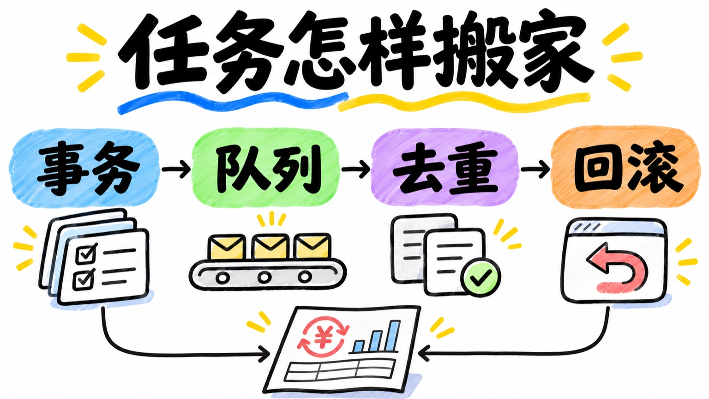

> **生成工具**：Codex\
> **生成模型**：gpt-6.2-sol

## 先用大白话理解

小店原先是同一个人接单、算账、存报告。客人变多后，可以让柜台只开单，把计算任务交给后厨。搬家期间最怕两种情况，柜台说“接了”，但后厨永远没拿到单子，或者两个后厨拿到一张单都去归档，留下两份收据。

样例任务 `r-17` 的 CSV（逗号分隔值文件）有两条有效退款 8.00 元和 2.00 元，及一条缺失记录。用户应看到 2 条和 5.00 元，并在确认以后只得到一个归档收据。

## 先让两条路径都认得同一张单

把接入、状态机、任务计算和归档切成清楚的职责。HTTP（超文本传输协议）接入验证输入并持久化任务；工作进程（Worker）从队列领取，装载输入文件并计算；用户确认通过另一条受控路径提交归档。长任务接入可返回 `202 Accepted` 与任务编号，客户端用查询或事件流追踪进度。此时接入实例可以按请求压力扩缩，工作池按队列最老等待时间、消费率和沙箱可用槽扩缩，分别负责两种负载。

队列里放 `job_id`、租户身份的安全引用、输入对象与版本引用，工作进程从数据库重新拿状态。大文件留在受控对象存储。新旧执行器要认同同一个任务编号、状态含义、报告输入摘要和归档唯一键。迁移期间数据库是任务归属的依据。消息用于唤醒工作进程。

## 任务与通知怎样一起登记

接入端连续做“数据库写任务”和“请求队列发消息”时，可能在两者之间掉电。事务发件箱（Transactional Outbox）把任务和待发事件先放同一个数据库事务，两行要么都提交，要么都撤销。转发器稍后读取未发记录，队列确认接收后再标记。若发出后突然断电，恢复时可能再发一次，消费者需要容忍重投。 [AWS 事务发件箱模式](https://docs.aws.amazon.com/prescriptive-guidance/latest/cloud-design-patterns/transactional-outbox.html)

```sql
BEGIN;
INSERT INTO jobs VALUES ('r-17', 'csv');
INSERT INTO outbox (id) VALUES ('r-17');
COMMIT;
```

上面只有一个任务事件。实际系统还应有独立事件 ID 和类型，任务下一阶段可以产生另一条事件。需要压住并发时，工作进程以原子更新领取 `queued` 状态并记录代次、租约和到期时间。旧进程的代次作废后，完成写入时仍要再次校验代次。否则超时接手虽然正常，旧进程恢复后还可能覆盖新结果。

## 两次投递怎样只落一笔归档

幂等的意思是，同一动作被重复提交时，只留下这项动作应有的一次可见效果。实验用 SQLite（进程内关系数据库）的唯一键在收据表里约束 `r-17`，两次插入只保留一行。真实目标若是外部对象存储，在数据库写收据前后都可能掉电；此时要把操作 ID 传给目标作为幂等键，或用确定的对象名及条件写入，恢复后查询目标结果再补收据。对于外部目标既无法幂等也无法查证的动作，遇到结果不明要挂起并核对，避免自动再提交。

把业务操作 ID 和传输层 ID 分开。投递两次可对应两个消息 ID，但业务操作 ID 可以仍是 `alpha/r-17/archive`。此处假设一条任务只能归档一次。如果产品允许多次独立归档，键还要加入动作实例，键对应不同意图要拒绝混用。

## 用三次小流量变化迁移

1. 先让新进程只读旧任务，计算对照结果，收据仍由原执行器写。拿同一输入比字段和内容摘要，观察队列延迟和失败分类。
2. 将小比例新任务分配给新执行器，入队时持久化所有权，后续重试仍按原任务归属。增加流量前核对任务接受量、完成量与待处理量，允许同一事件出现多次。
3. 若错误率升高，将新分配调回旧路径，让已分配的新任务先排空，或经过有版本感知的接手流程再恢复。等历史任务都完成以后再删旧字段和旧消费者。流量回到旧路径后，再检查剩余队列与未知终态。

## 实际回放

[演练脚本](experiments/production-refund/README.md)执行两类故障。首次在任务写入后、发件箱写入前抛出异常，事务撤销后任务行数为 0。再成功提交 `r-17` 和待发记录，模拟转发器在标记前重发，队列有两次投递，SQLite 最终只有 1 笔收据。数据库事务和唯一键实际运行，消息重投使用进程内列表。拿到真实部署后可补一次队列确认丢失与目标已写但回包丢失的恢复演练。接下来把这些证据接到发布门槛。 [生产化专题目录](llm-agent-learning-roadmap.md)
