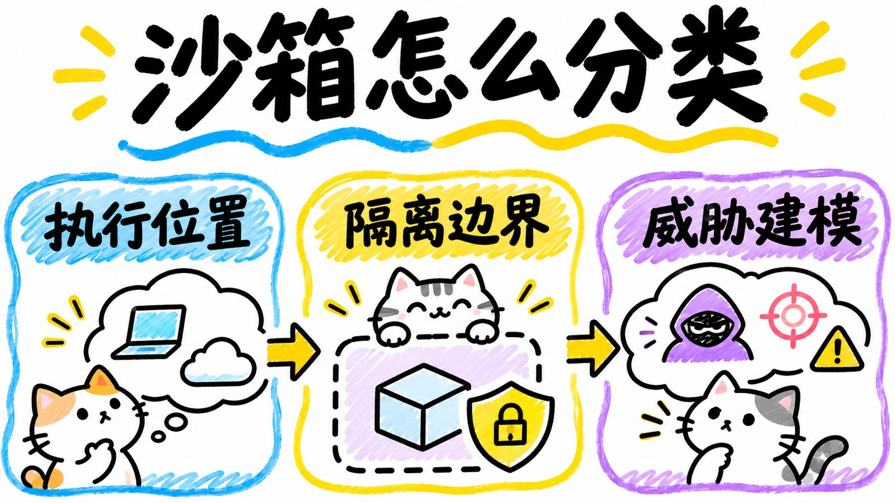

> **生成工具**：Codex\
> **生成模型**：gpt-6.2-sol

## 先用大白话理解

你请人算一张退款表，只给他那一张纸、一台计算器和一个交卷盒。他能算出答案，也能提交报告。财务柜、其他人的纸和寄信窗口还由你管理。沙箱（Sandbox）做的是类似的事。它给程序一个能完成工作的地方，同时规定程序能碰哪些东西、可以用多少资源、何时收回这个地方。

例子里，CSV（Comma-Separated Values，逗号分隔值）有三行退款 `4`、`NA`、`6`。 `NA` 代表没有金额。任务读这张表、排除缺失值、写 `report.json`。预期是两条有效记录、均值 `(4 + 6) / 2 = 5`。同组上一章的审批规则仍适用，交出草稿与归档是两个动作。读表运行环境只需要能交草稿。 [上一章的归档审批](sec-05-tool-approval.md)

## 1. 看两张标签，再问任务用途

| 问题 | 常见答案 | 对这个例子的影响 |
| --- | --- | --- |
| 跑在哪里 | 本机、远程自建、托管云 | 文件和日志经过哪些机器，计算和网络由谁负责 |
| 靠什么隔开 | 语言运行时、宿主进程策略、共享内核容器、用户态内核、虚拟机 | 程序请求读文件或发网络时，哪一层能拦住 |
| 用来做什么 | 浏览器、代码解释器、开发工作区 | 需要文件、网络、交互终端、安装依赖还是长会话 |

远程与虚拟机是不同维度。本机 Docker Desktop 的 Linux 容器跑在本机 Linux 虚拟机里，容器各自用隔离的视图，但同一 Linux 虚拟机内的普通容器共享那个客户机内核。托管服务即使都提供同一个 `create()` 接口，底下的实现和租户隔离边界也可能不同。采购或自建时，要拿到实际运行配置，不能从 API（应用程序接口）的名字推断内核边界。 [Docker Desktop 网络与虚拟机边界](https://docs.docker.com/desktop/features/networking/)

## 2. 一次读文件请求是怎样被检查的

把内核想成资源的管理员。普通程序想打开文件，会向操作系统发系统调用。管理员依据权限、当前看到的目录和隔离策略决定结果。不同机制的区别，在于有哪些管理员、它们分别能看到什么。

| 隔离机制 | 读退款表时发生什么 | 选型时怎么看 |
| --- | --- | --- |
| WebAssembly（WASM）运行时 | 模块只能调用导入的宿主能力。如果宿主只导入一个读取指定文件的接口，模块就通过这个接口拿数据 | 适合可以编译或接入受支持运行时的计算。看导入函数、内存上限和执行预算 |
| 宿主进程策略 | 原生程序仍用宿主系统调用，宿主内核按策略允许或拒绝 | 能复用已有工具。看规则覆盖的进程树、路径、网络与操作系统版本 |
| 普通容器 | 进程用自己的挂载和网络视图。Linux Namespace（命名空间）隔开视图，cgroup（控制组）计量和限制资源 | 镜像生态广。健康配置同样要检查挂载、能力、网络和共享内核 |
| gVisor | Sentry 在用户态处理许多应用看到的 Linux 系统调用，实际宿主交互再经它的边界 | 关注系统调用兼容性、文件和网络性能，尤其测试真实工具链 |
| MicroVM | 任务运行在独立客户机内核内，VMM（Virtual Machine Monitor，虚拟机监控器）负责虚拟设备和机器边界 | Firecracker 是一种实现。看硬件虚拟化、访客镜像、虚拟设备、文件与网络策略 |
| 通用 VM | 客户机也有独立内核，通常支持更多设备、系统和管理模式 | 支持较复杂的系统与设备，取舍在启动、资源和运维成本 |

Kata Containers 把虚拟机边界接到容器工具链上。用户操作仍像创建容器，底下可给工作负载分配轻量虚拟机。隔离层多一层仍要给文件和网络定权限。比如把一整个主目录映射进去，虚拟机里的程序就能通过被授权的共享方式看到它。 [WebAssembly 安全模型](https://webassembly.org/docs/security/) · [gVisor 安全架构](https://gvisor.dev/docs/architecture_guide/security/) · [Firecracker](https://github.com/firecracker-microvm/firecracker) · [Kata Containers](https://katacontainers.io/)

## 3. 用退款例子写一张可验收的边界表

| 资产或行为 | 本任务允许什么 | 怎么看到结果 |
| --- | --- | --- |
| 输入表 | 只读当前任务的三行 CSV | 报告算对，尝试以可写方式打开输入被拒 |
| 输出 | 只收任务目录内的报告 | 路径和内容符合约定，下载后校验 |
| 另一组织的文件 | 不给任务挂载，也不允许读取 | 用合成标记文件确认不能读 |
| 子进程 | 若任务需要，子进程继续受同一边界限制 | 子进程能启动，仍读不到上述文件 |
| 网络 | 这个计算无需联网 | 合成监听器的访问失败，同时查实际路由或配置 |
| 时限与清理 | 命令有超时，环境结束后销毁 | 查实例是否消失，再查挂载产物是否另行清理 |

这里的威胁建模，是把「我怕报告泄露」翻成「哪个程序通过哪条路径能接触哪一份数据」。这份最小任务适合用预装 Python、只读输入、单独写目录和无出站网络来验收。代码编辑 Agent 可能还需要 Git、编译器和包缓存，就应另外写清哪些仓库、网络目的地和缓存可用。碰到跨租户场景，先决定哪一层负责把租户隔开，再做性能比较。

## 4. 三个容易混在一起的判断

第一，目录里看不到另一个文件，可能是文件没挂进来，也可能是内核拒绝。这两种现象都要写在验收记录里，后续更换挂载方式时效果可能不同。第二，能从应用下载报告，说明应用提供了一个受权出口。它不说明沙箱自己可以联网。第三，销毁执行环境并不自动处理独立存储。留档的报告与临时工作区应各有保留期和清理责任。

下一篇用同一张表在本机跑三次，分别观察正常访问、macOS 内核拒绝和 Docker 文件不可见。 [本机边界实验](sbx-02-local-isolation.md)
