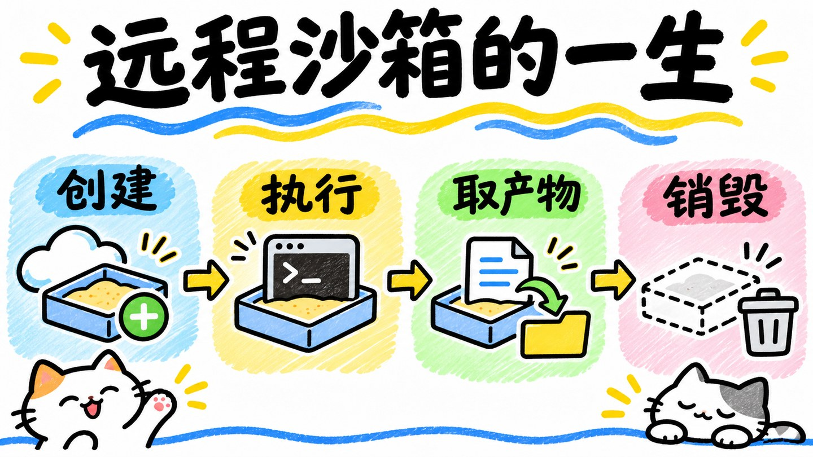

> **生成工具**：Codex\
> **生成模型**：gpt-6.2-sol

## 先用大白话理解

借一间实验室做计算，先要领房间号、等管理员开门，再把材料送进去。实验结束后，你取走报告、归还房间。房间号只是地址，管理员还得知道这是谁借的，期限到了没有。远程沙箱也是这样。启动机器、执行计算和交付产物各有自己的状态。

贯穿例子仍是 `4, NA, 6` 的退款表。程序跳过 `NA`，在临时工作区写 JSON（JavaScript Object Notation，结构化文本）报告。用户最终拿到的是 `{"valid_count": 2, "mean": 5.0}`。这个报告不等于正式业务归档，归档走另外的审批。

## 1. 分清管理房间的人和在房间里做事的人

Control plane（控制面）接收申请，核对身份、配额和策略，分配实例并记录生命周期。Data plane（数据面）承担命令、文件与流式输出等实际数据传输。在执行节点上，任务进程真正跑起来。界面里可能把这些动作收在一个 SDK（软件开发工具包）对象上，排查时仍要拆开看。

```text
应用 ──申请模板、资源与租期──> 控制面 ──分配──> 执行节点
应用 ──上传材料、执行、下载产物──────────────> 数据面
应用 ──归还或续租───────────> 控制面 ──回收──> 执行节点
```

模板保存启动环境所需的内容。例如工作负载镜像里有 Python，沙箱启动脚本让它等待任务。在支持快照的实现里，模板也可带某一刻的文件系统或内存状态。应用应记录模板标识或内容摘要，沙箱生成的用户数据则有独立的保存策略。 [E2B 官方文档](https://docs.e2b.dev/) · [OpenSandbox 架构](https://github.com/opensandbox-group/OpenSandbox/blob/main/docs/architecture/index.md)

## 2. 用四步走完这份报告

| 阶段 | 调用方送进去什么 | 应产出什么 | 要另外确认什么 |
| --- | --- | --- | --- |
| Create，创建 | 身份、模板、资源上限、租期、策略 | 实例 ID 和状态 | 返回 ID 后还要等执行服务就绪 |
| Exec，执行 | 固定的退款统计程序与输入 | 完成事件、标准输出、退出结果 | 命令时间预算，超时后任务状态 |
| Artifact，取产物 | 产物名及当前会话身份 | `report.json` 和可核对内容 | 完整性、文件大小、归属和长期保留 |
| Destroy，销毁 | 当前会话 ID | 终止或移除的确认 | 再查生命周期状态，并对独立存储单独清理 |

短会话用租约（Lease）限制占用资源的时间，续租必须由可信控制面批准。它与一条命令的超时独立。例子里命令的预算是五秒，租期则按分钟衡量。用户下载完成前可续租，使用结束立刻释放。网络也分两种：应用受权调用文件服务，以及沙箱里的程序主动联网。应用能下载产物，沙箱的出站仍可配置为拒绝。

## 3. 两种实验回答两个问题

真实 API 检查使用本机自建的 OpenSandbox Docker 后端。应用通过回环上的服务上传两份合成文件，执行固定退款命令，并读取产物。状态为 `Running`，读回均值 5。随后续租，核对服务端到期时间确实延长。最后销毁，再按原 ID 查询，收到 HTTP 404，即这个 ID 已不可查询。该次请求配置出站默认拒绝，网络边界的实测见上一章。本机服务用来走远程接口，传输只经过回环。

另外一组是本地写的控制面模型，只执行固定的报告任务。它模拟两个租户和逻辑时钟，检查当前身份、租约和资源计数。这个模型的结果不能代表任何产品的跨租户隔离保证。它适合把应用要验收的状态先写清楚。

| 控制面模型输入 | 实际返回 |
| --- | --- |
| 同一租户重发相同申请编号 | 返回原来的 `session-1`，未创建第二份 |
| 同一租户已有一份实例，再申请 | `quota_exceeded` |
| 合作方尝试取学校会话的报告 | `unavailable` |
| 销毁后重复销毁 | `already_absent` |
| 按逻辑时钟到达租约截止后执行 | `unavailable`，最终会话与工作区均为空 |

## 4. 客户端没收到回复，怎样理解状态

本机测试第一次创建在客户端 30 秒时超时。服务端运行状态和日志显示，带本次标记的实例仍在启动。先回收旧实例，再用更充分的请求时限重跑，后续生命周期全部通过。客户端等待超时只表示「这次没收到回复」。服务器可能尚未收到请求，也可能仍在准备，或者已经分配了环境。申请前保存请求关联 ID，超时后按当前租户回查，再决定继续等待、接回已分配的实例或清理。对支持幂等键的接口用原键重试；对没有统一幂等语义的服务，应用要避免把重试当成新任务无条件发出。幂等的意思是，同一个逻辑请求重复提交，不额外产生一份副作用。

产物同理。命令退出码为 0 说明程序自行报告成功，业务仍要下载并核对。销毁确认加上查询无实例是一条证据。若输出在另一个存储服务，还要查它的保留期或删除回执。

控制面模型可以直接用 Python 运行。若已有获准测试的本机 OpenSandbox 服务，再用它复跑真实接口。脚本默认访问 `127.0.0.1:18090`，用 `OPEN_SANDBOX_LAB_DOMAIN` 改用自己的回环端口，从 `OPEN_SANDBOX_API_KEY` 读取已有授权。测试只创建自己的合成会话，带实验标记便于异常后回查。

```bash
python3 experiments/sandbox-runtime/lifecycle_lab.py
python3 -m pip install opensandbox==1.2.1
python3 experiments/sandbox-runtime/opensandbox_smoke.py
```

建议在独立的 Python 环境安装 SDK。底层 Docker 应已经缓存 `python:3.12.12-slim`。查看 `expiry_extended` 与 `status_after_delete` 可以确认这次验收覆盖续租与销毁。 [控制面模型](experiments/sandbox-runtime/lifecycle_lab.py) · [逻辑状态记录](experiments/sandbox-runtime/lifecycle-results.json) · [真实 API 检查脚本](experiments/sandbox-runtime/opensandbox_smoke.py) · [API 实际结果](experiments/sandbox-runtime/opensandbox-results.json)
