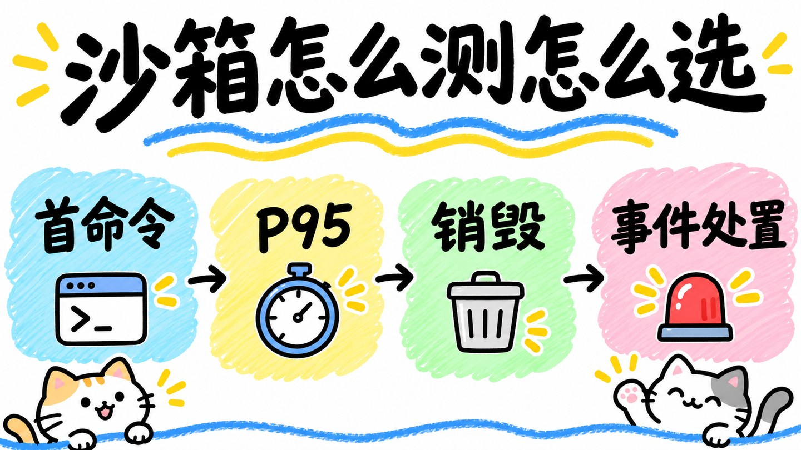

> **生成工具**：Codex\
> **生成模型**：gpt-6.2-sol

## 先用大白话理解

两家复印店都说「一分钟出件」。第一家从你按取号键算，第二家从操作员已经站好、机器已预热开始算。数字不写清起点，就不能直接比。沙箱也一样，你看到的「启动快」可能是拿到房间号、拿到第一条命令输出，或整个报告已做好。

这次让三个路径都执行同一份固定 Python 程序，读 `4, NA, 6`，生成两条有效记录、均值 5 的报告。程序启动并完成基础初始化后打印 `READY`。测量到客户端收到这行的时间，再独立验证报告确实已算对。这样可以把首条输出和业务完成分开，不会把空壳就绪当成交付完成。

## 1. 三种时间各从哪开始、何时结束

| 量 | 起点 | 终点 | 包含的工作 |
| --- | --- | --- | --- |
| macOS 进程 | 启动带策略的本机进程 | 客户端收到 `READY` | 子进程创建、应用策略、解释器加载 |
| Docker 新实例、镜像已缓存 | 调用 `docker create` 前 | `docker start` 后客户端收到 `READY` | 创建容器、启动、解释器加载与输出转发 |
| Docker 常驻实例 | 调用 `docker exec` 前 | 客户端收到 `READY` | 进入已启动容器、启动该次子进程、输出转发 |
| 容器移除 | 调用 `docker rm` 前 | 删除命令确认返回 | 之后另查列表核验 ID 不存在 |

镜像已经缓存，Docker Desktop 也已经运行。常驻路径不含首次创建容器的时间。宿主用 Python 3.14.0，容器用 Python 3.12.12，代码和输入相同，解释器与系统不同。这里比较的是这台机器的使用路径。

## 2. 每组十次，P95 怎么算

P50 是中间的一半样本不高于它的典型值。我们取中位数，偶数样本时取排序中间两项的平均。P95 用最近秩法：把耗时从小到大排，取第 `ceil(0.95 × n)` 项。`n` 表示样本数，`ceil` 向上取整。这里 `n=10`，所以 P95 就是第 10 项，也就是组内最慢的一次。单位是毫秒，千分之一秒。读这样的 P95 时应把样本数一起看，特别是在推断线上少数慢请求时。

| 路径 | 次数 | P50（毫秒） | P95（毫秒） |
| --- | ---: | ---: | ---: |
| 本机进程策略 | 10 | 54.33 | 129.89 |
| Docker 镜像命中，新建到首输出 | 10 | 295.51 | 472.07 |
| Docker 常驻实例执行到首输出 | 10 | 181.85 | 201.17 |
| Docker 删除命令确认 | 10 | 25.59 | 49.94 |

机器为 macOS 15.5 arm64，Docker 28.5.1。Docker 路径走 Desktop 的 Linux 虚拟机。测量是串行单任务，没有拉镜像、开新虚拟机、RPC 跨公网或排队。RPC 是远程过程调用，含网络往返和服务处理。因为本次路径都在本机，结果不用于云端厂商的排名。复制到自己的机器时，先确认相同镜像摘要、明确缓存状态、增加样本并记录失败率，再比较数值。 [原始样本和环境](experiments/sandbox-runtime/local-results.json)

## 3. 会话快了，残留下来的状态也要算进去

常驻实例减少了每次创建成本，它会保留工作目录里的状态。只有同一受权任务重复用同一个环境时，才适合把这个保留状态视为便利。若分配给另一个任务，就要独立证明工作区、环境变量和缓存的清理。实验确认，删了容器仍可在宿主挂载目录看到报告。随后由临时目录管理器清理，才验证根目录已消失。生产环境应分别核对容器、持久卷、对象存储和旧访问句柄。

一个实用的验收顺序是先检查文件、网络、身份、子进程和审批的边界，再设首输出、成功率和资源上限，最后对满足边界的候选做性能比较。退款任务只有三行，预装解释器和只读输入足够。若工作负载需要多小时的编辑工作，则应额外测重新连接、暂停恢复和长时间资源占用。

## 4. 出现边界异常时，先看证据指向哪一层

| 看到的情况 | 先做什么 | 用什么证据恢复 |
| --- | --- | --- |
| 正常任务失败，发现工作区误设为只读 | 暂停发布，复核挂载和策略版本，回滚配置 | 复跑同一合成任务，报告正确，负样本仍被拒 |
| 合成的另一团队标记文件意外可读 | 停发相关会话、禁止涉及范围的继续执行，保留受控日志与实例元数据 | 确认影响范围，按可信基线重建，复核跨租户访问策略 |
| 删除成功但挂载产物仍在 | 查存储责任、保留期和删除队列 | 数据存储的独立回执，旧引用不可再取 |
| 客户端丢回执，命令或销毁状态未知 | 按租户和任务 ID 回查，确认后再重试 | 服务端状态与最终产物一致 |

疑似隔离异常时记录具体实例、运行时版本、挂载、出站策略、时间窗口和审计事件，并根据实际接触范围评估凭证轮换。回滚后执行已定义的良性边界用例，核对无新异常和状态清理。这些是防御验收步骤，具体响应以团队的事件处置流程为准。 [本机边界验证](sbx-02-local-isolation.md) · [实验脚本](experiments/sandbox-runtime/local_lab.py)
