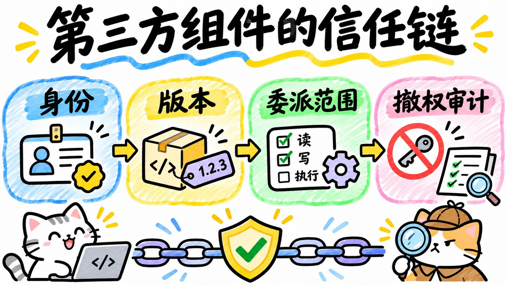

> **生成工具**：Codex\
> **生成模型**：gpt-6.2-sol

退款助手接入一个能读档案摘要的服务。加载成功，只代表程序能找到它。还要确认这是谁发布的、接入时审核了哪版、当前任务授权它做什么。信任链把这些答案连到每次实际调用。

## 1. 先看组件分别占哪个位置

| 组件 | 中文含义与常用位置 | 接入时的检查 |
| --- | --- | --- |
| 第三方模型 | 根据输入生成说明或动作建议 | 供应商、模型版本、数据处理与留存，出站只给当前任务必要字段 |
| MCP Server | MCP 是 Model Context Protocol（模型上下文协议），服务提供工具与资源 | 固定受审服务身份、能力清单与版本，网络授权核对目标服务和范围 |
| Skill | 给助手使用的步骤说明、资源或脚本 | 审核来源、清单和依赖，脚本权限单独管理，描述更新触发复核 |
| A2A | Agent-to-Agent（智能体间交互）协议，帮助代理交换任务和结果 | 校验服务身份、任务与交接产物；下游动作由执行边界再核对 |

说明书告诉系统「服务会做什么」，身份和版本来自可信注册与发布记录。摘要用来比对内容是否变化，已审核的发布来源提供「谁发布」的证据。SLSA（Supply-chain Levels for Software Artifacts，软件产物供应链保障规范）描述了怎样生成和校验来源证明。 [MCP 授权规范](https://modelcontextprotocol.io/specification/2025-11-25/basic/authorization) · [Agent Skills 规范](https://agentskills.io/specification) · [A2A 规范](https://a2a-protocol.org/latest/specification/) · [SLSA](https://slsa.dev/spec/v1.2/)

## 2. 让同一个合成服务经历升级和撤权

| 变更 | 实测决定 |
| --- | --- |
| 已登记的服务身份、版本和说明，授权有效 | 允许查看摘要 |
| 服务简介或产物变更 | 进入版本复核 |
| 服务身份不同，或任务不同 | 拒绝 |
| 委派中有归档动作 | 交给审批代理决定 |
| 改成新一代只读委派 | 旧委派失效，新委派只可读 |
| 委派过期或撤回 | 拒绝，并保留决策记录 |

每次检查都回查当前授权台账。委派记录保存调用主体、租户、目标服务、任务、动作集合、截止时间和授权代数。权限收窄时增加代数并发新 ID，失效的旧记录不能继续用。实际系统还要核对连接器的下游授权和令牌失效传播。这个夹具只检查应用策略，不联网，也没有校验真实供应商的身份协议。 [实验代码](experiments/agent-guardrails/trust_lab.py) · [审计样例](experiments/agent-guardrails/trust-results.json)
