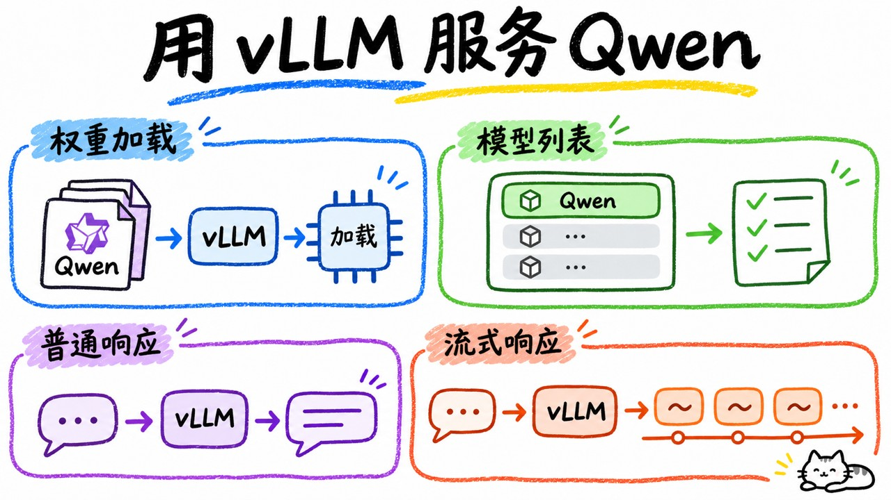

> **生成工具**：Codex\
> **生成模型**：gpt-6.2-sol

上一部分已能保存模型和适配器。现在把 Qwen2.5-0.5B-Instruct 变成一个能收 HTTP 请求的推理服务。退款表有 `4`、`NA`、`6` 三行，按有效条数与均值判断，期望 `{"count":2,"mean":5}`。首个验收先确认模型被正确加载、两种响应都结束，再判断统计有没有算对。

## 1. 固定权重与服务入口

vLLM 是负责调度和执行语言模型推理的服务引擎。Qwen 名字里的 0.5B 表示约五亿参数，Instruct 表示经过指令适配。把同一 revision 固定下来，分词器、聊天模板与权重随版本一起核对。不同设备后端可以共用 HTTP 接口，支持的量化、内核和功能要按实际版本确认。

以下在具备 vLLM 的独立实验环境运行。示例用 Hugging Face CLI 把固定 revision 下载到实验目录，再以 FP16（16 位浮点）加载。Linux NVIDIA 环境按安装文档选匹配的 CUDA 版本。Linux Arm CPU 可用 vLLM 的 CPU 镜像，Apple Silicon 也有单独的 vLLM-Metal 插件，三者的内核能力不能互相替代。 [vLLM 安装](https://docs.vllm.ai/en/stable/getting_started/installation/index.html) · [vLLM-Metal 安装](https://docs.vllm.ai/projects/vllm-metal/en/stable/installation/)

```bash
hf download Qwen/Qwen2.5-0.5B-Instruct \
    --revision 7ae557604adf67be50417f59c2c2f167def9a775 --local-dir ./qwen-0.5b
vllm serve ./qwen-0.5b --served-model-name refund --dtype float16 \
    --host 127.0.0.1 --port 18080 --max-model-len 1024 \
    --enable-request-id-headers
```

`--served-model-name` 给客户端一个稳定 API 名称。`--max-model-len` 限制提示加生成的长度，单位是 Token（词元）。首轮监听 `127.0.0.1`，只给本机访问。修改外部监听前，应由接入层负责授权、流量和请求体大小。 [vLLM Quickstart](https://docs.vllm.ai/en/stable/getting_started/quickstart/) · [Qwen 模型与固定版本](https://huggingface.co/Qwen/Qwen2.5-0.5B-Instruct/tree/7ae557604adf67be50417f59c2c2f167def9a775)

## 2. 请求模型列表和一次普通生成

```bash
curl -fsS http://127.0.0.1:18080/v1/models
curl -fsS http://127.0.0.1:18080/v1/chat/completions \
    -H 'Content-Type: application/json' \
    -d '{"model":"refund","messages":[{"role":"user","content":"Refund CSV: 4, NA, 6. Ignore NA. Give count and mean."}],"temperature":0,"max_tokens":48}'
```

Chat Completions 是这里使用的聊天生成接口形状。每条 `messages` 有角色和内容。引擎先按模型模板把消息拼接成可供分词的文本，模型只接收 Token ID。温度设为 0，意图是采用贪心生成，`max_tokens` 是输出预算。普通响应正文取 `choices[0].message.content`，同时读 `finish_reason` 和 `usage`。模型列表可用于核对服务名，真正确认能推理还需要发一条生成请求。

## 3. 流式响应与普通响应对照

把 `stream` 设为 `true`，请求体加 `"stream_options":{"include_usage":true}`。用 `curl -N` 关闭客户端输出缓冲。SSE（Server-Sent Events，服务器发送事件）以空行分隔事件，每个事件可以包含一行或多行 `data:`。拼接 `choices[0].delta.content` 得到可见文本。状态事件可能只提供角色，最后的用量事件可能没有 `choices` 内容，读到 `[DONE]` 才是该协议形状的完整结束。

```bash
python3 experiments/serving/probe.py --server http://127.0.0.1:18080 --model refund \
    --quick --out /tmp/serv-01.json
```

此处的 vLLM 验证做到启动阶段。Linux Arm CPU 容器 v0.21.0 载入了权重，日志显示加载用时 33.84 秒并进入预热。vLLM-Metal 0.33.0 启动过程到达模型注册检查。两条路径均未完成 HTTP 验收，因此上面的 vLLM 结果应在可用的独立实验环境按步骤验收。

同一探针在 SGLang v0.5.23 的兼容接口已完成实际对照。模型名为 `refund`，普通和流式响应均为 74 个输入 Token、21 个输出 Token，结束原因为 `stop`，流式收到 `[DONE]`。答案数值是 `2` 和 `5`，但外层有 Markdown 围栏，严格的裸 JSON 校验未通过。该结果用来展示请求与用量字段如何读。 [vLLM 启动记录](experiments/serving/vllm-startup.json) · [SGLang 真实响应](experiments/serving/sglang-probe.json)

逐题业务评分要求完整的 JSON 对象，条数与均值相符。Markdown 代码围栏、报表多余字段或算术错误会让业务评分失败。还应在下一步分别验证工具调用与结构化输出的模板和解析器兼容性。 [探针脚本](experiments/serving/probe.py)

[返回 LLM 与 Agent 学习路线图](https://blog.lacknb.cn/articles/2026/11/19/1795058329577.html)
