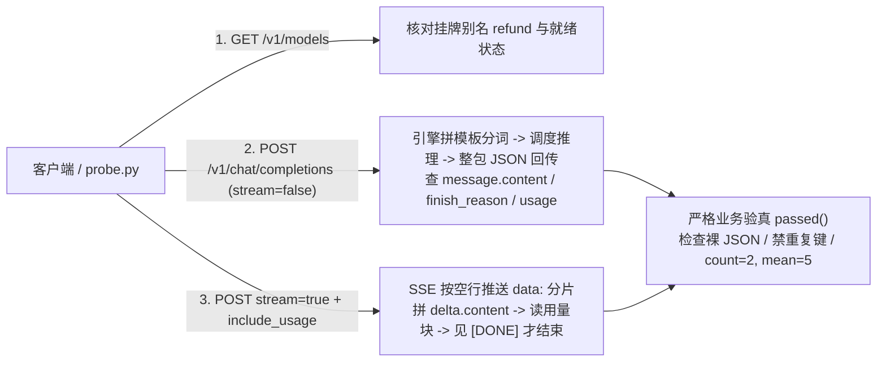

> **生成工具**：Codex\
> **生成模型**：gpt-6.2-sol

上一部分我们已经拿稳了微调与导出的模型文件。可躺在硬盘上的权重文件自己不会回消息——要想让网页前端、自动化 Agent 或下游退款系统随时通过 HTTP 接口调用它，第一步就是把它塞进一台 **推理服务引擎（Inference Server）** 里开门营业。

继续拿老朋友退款表 `4`、`NA`、`6` 当首张测试门票，合同预期结果还是 `{"count":2,"mean":5}`。这一篇先帮你从最稳的启动参数、三道基础接口验证（模型列表、普通一次性生成、SSE 流式生成）讲起，并把常见的新手误区一次性挑明：**「HTTP 返回了 200 OK、甚至流式顺畅吐完了 `[DONE]`，也远远不代表大模型按业务规定把账算对了！」**

> **先用大白话讲明白**：搭一个 **vLLM Server** 就像**把刚刚培训出徒的计算大师请进「带自动排号窗口的营业厅」**：
> - **以前单脚本调用（摆路边小摊）**：一次只能接一个人的活儿，谁都不来也要干等着加载模型。
> - **vLLM 推理服务（专业多窗口营业厅）**：一启动就把模型权重、词表和聊天模板稳稳载入显存，在 `127.0.0.1:18080` 开出一扇标准化的 OpenAI 兼容收件窗口；不仅能同时排好几个人的队、把请求切块塞进显卡一块算，还能选「等算完全部打包给你看」或者「边想边逐字通过传真广播（SSE）给你看」！
> - **营业厅门检只管递送不管对错**：哪怕收银机正常打了小票、还礼貌说「欢迎下次光临」（对应 `finish_reason: "stop"` 和 `[DONE]`），里面数字是不是算错、或者有没有擅自多套一层代码块围栏，还得业务验收脚本自己逐字复检！



## 1. 先锁定权重与启动参数，再拉起本机营业厅

**vLLM** 是目前最主流的高吞吐大模型推理与调度引擎之一。型号名里 `Qwen2.5-0.5B-Instruct` 的 `0.5B` 指约 5 亿参数，`Instruct` 表示它是已经过对话指令适配的版本。永远先把模型仓库精确的 Git `revision` 钉死，确保对应的分词器、聊天模板和权重是一一配套的。

虽然客户端用完全一致的 HTTP 接口就能访问不同平台，但**引擎底层与硬件内核绝不能混为一谈**：
- Linux NVIDIA GPU 环境按官方手册挑选匹配 CUDA 版本的常规安装；
- Linux ARM CPU 环境可使用 vLLM 官方 CPU 镜像；
- Apple Silicon（Mac）则依赖独立的 **`vllm-metal`** 插件。三套后端支持的量化格式、算子能力与调度细节互不通用，切记按实战机型的版本文档核实！[vLLM 安装](https://docs.vllm.ai/en/stable/getting_started/installation/index.html) · [vLLM-Metal 安装](https://docs.vllm.ai/projects/vllm-metal/en/stable/installation/)

下面两行命令在独立实验环境里先把模型拉到指定本地文件夹，再启动监听回环地址的服务进程：

```bash
hf download Qwen/Qwen2.5-0.5B-Instruct \
    --revision 7ae557604adf67be50417f59c2c2f167def9a775 --local-dir ./qwen-0.5b
vllm serve ./qwen-0.5b --served-model-name refund --dtype float16 \
    --host 127.0.0.1 --port 18080 --max-model-len 1024 \
    --enable-request-id-headers
```

拆解这里最关键的 4 个启动开关，以后每次上线都会用到：
- **`--served-model-name refund`**：给外部调用方发一个稳定清晰的逻辑服务名（以后换底座升级模型时，前端代码依然叫 `"refund"`，不用跟着改目录路径）；
- **`--dtype float16`**：指定以 16 位半精度浮点加载权重（注意不同硬件如纯老旧 CPU 对半精度算子支持不同）；
- **`--max-model-len 1024`**：设定单个请求允许的「输入提示 + 输出回复」总 Token 上限——它直接决定了启动时要预先划出多大一块显存 KV Cache 池子，瞎设太大容易一开机就 OOM；
- **`--host 127.0.0.1` + `--enable-request-id-headers`**：开发试跑只绑死本机回环地址，并且开启透传或返回请求追踪 ID 头，方便下一篇从浏览器一路追到后端日志！（要是真要对外放开监听，外层一定要挡着网关做 API 鉴权、限流与请求体大小限制。）[vLLM Quickstart](https://docs.vllm.ai/en/stable/getting_started/quickstart/) · [Qwen 模型与固定版本](https://huggingface.co/Qwen/Qwen2.5-0.5B-Instruct/tree/7ae557604adf67be50417f59c2c2f167def9a775)

## 2. 冒烟验证第一关：查模型名片，再发一笔普通整包请求

营业厅亮起绿灯后，用两句标准 `curl` 试探窗口通不通：

```bash
curl -fsS http://127.0.0.1:18080/v1/models
curl -fsS http://127.0.0.1:18080/v1/chat/completions \
    -H 'Content-Type: application/json' \
    -d '{"model":"refund","messages":[{"role":"user","content":"Refund CSV: 4, NA, 6. Ignore NA. Give count and mean."}],"temperature":0,"max_tokens":48}'
```

接口使用的是标准 OpenAI **Chat Completions** 协议形状：引擎接到你的 `messages` 角色消息数组后，在服务端内部套上模型自带聊天模板渲染长文本、送进分词器切出 Token ID；而 **`"temperature": 0`** 要求尽量走确定性贪心解码（在具体并行实现上未必永远逐比特完全复现，但能压低随机乱飘）、**`"max_tokens": 48`** 封住最多只许写 48 个新词。收到整包返回后，重点盯紧三个字段：可见回复正文 `choices[0].message.content`、停笔原因 `finish_reason`（期望 `"stop"` 而不是 `"length"` 半途腰斩）以及计费账单 `usage`。

> **容易踩的坑（`/v1/models` 返回 200 不等于服务就能推理）**：很多健检脚本只图快查一下 `GET /v1/models` 拿到名字 `refund` 就判定上线成功。那只相当于看见「窗口牌子挂好了」，权重计算卡死或模板崩掉照样报错！真正靠谱的就绪探测必须真发出一条极短提示的生成请求并读到正常结束标记。

## 3. 冒烟验证第二关：开启 SSE 流式响应，对照实测与「围栏陷阱」

想让前端逐字像打字机一样吐字，只需要在请求体里加 `"stream": true` 和 `"stream_options": {"include_usage": true}`，如果用命令行测试记得给 `curl` 加上 `-N` 参数关掉客户端输出缓冲！

**SSE（Server-Sent Events，服务器发送事件）** 是以连续空行分隔一条条事件的文本流，每条内部带有 `data:` 前缀。前端或脚本解析时务必遵守三条铁律：
1. 顺着字节流先拼完整事件再 `json.loads`，逐块累加 `choices[0].delta.content` 就能得到完整回复；
2. 最初的握手事件可能只有 `"role": "assistant"` 没有内容文字，而**启用了 `include_usage` 后的倒数第二条用量事件里，`choices` 列表往往是空的 `[]`**——写取值代码千万别直接硬写 `event["choices"][0]` 而不判空，否则就在临门一脚崩溃！
3. 必须一直读到明确标着 `data: [DONE]` 才算这条流完整善终。

我们直接运行本专题共用的标准化 HTTP 探针 [experiments/serving/probe.py](experiments/serving/probe.py) 来跑一次快速验货（同时测普通与流式响应，还会用 `unique_object` 检查严防重复键）：

```bash
python3 experiments/serving/probe.py --server http://127.0.0.1:18080 --model refund \
    --quick --out /tmp/serv-01.json
```

> **想再深入一层？（如实报告本机的启动验真 vs 兼容引擎实测）**
> 严谨区分本实验环境里两条路径各自到底跑到了哪一步（所有记录一字不改归档在仓库中）：
> - **vLLM 本机验证进展**（见 [vLLM 启动记录](experiments/serving/vllm-startup.json)）：Linux ARM64 CPU 容器 `v0.21.0` 成功完成了完整权重载入（耗时 **`33.84` 秒**）并进入编译预热阶段；macOS `vllm-metal 0.33.0` 也跑到了模型注册检查环节，但这两者在该实验环境里均未拿到完整 HTTP 生成回包——要在独立 Linux CUDA / 受支持实验环境中按上面命令跑全 HTTP 验收。
> - **同探针在兼容服务（SGLang `v0.5.23`）上的真实 HTTP 对照实测**（见 [SGLang 真实响应](experiments/serving/sglang-probe.json)）：服务名同样叫 `refund`，普通请求与流式请求分别耗时 `557.26 ms` 和 `608.895 ms`（TTFT `214.997 ms`），两者一模一样消耗了 **`74` 个输入 Token 与 `21` 个输出 Token**，`finish` 均为 `"stop"`，流式清晰等来了 `[DONE]`。可精彩的是查看 `passed` 结果时竟然是 **`false`！** 为什么？因为模型虽然老老实实算对了 `2` 和 `5`，却在外面自作主张包了一层 ```` ```json\n...\n``` ```` Markdown 代码围栏！对于严格要求直接进业务解析的下游程序而言，这照样是一次不通过的业务失败！

> **大白话小结**：拿到任何新部署好的模型服务节点，验收永远得拆成互不代替的三张勾选项：**① 服务拉起就绪；② 协议和流式能干净走到 `stop` 和 `[DONE]`；③ 返回文字过得去严格的业务 JSON/算术评分器（不能多带多余闲话和围栏，下一步还得测结构化约束与工具调用兼容性）。**

## 下一篇

接口是能打通了，可一旦把服务搬进网页里，用户点完生成键往往发现：「明明浏览器网络面板里显示 HTTP 状态 200 秒回，屏幕上愣是卡着半天不出字！究竟是模型太慢、中间网关代理偷偷攒住了消息，还是浏览器没渲染出来？」[**SERV-02《一次请求从浏览器到引擎再回浏览器》**](serv-02-request-lifecycle.md) 会给每一条请求贴上统一的 `X-Request-Id` 跟踪单号，穿起浏览器、本地代理和引擎，一毫秒一毫秒算清时间都花在了哪一关！

[返回 LLM 与 Agent 学习路线图](https://blog.lacknb.cn/articles/2026/11/19/1795058329577.html)
