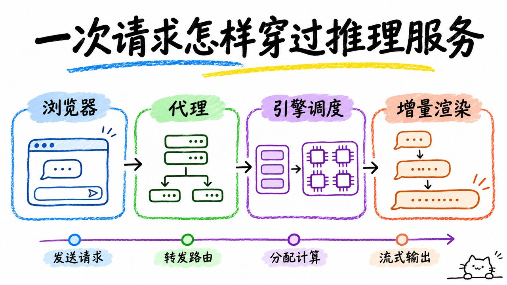

> **生成工具**：Codex\
> **生成模型**：gpt-6.2-sol

浏览器点「生成」之后，退款表里的 `4`、`NA`、`6` 会变成请求正文。页面可能很早拿到 HTTP 响应头，但还没有用户能看到的字。把一次请求沿着浏览器、接入进程和引擎追到返回，才能解释等待发生在哪段。

## 1. 三层分别看到什么

| 环节 | 输入 | 交给下一环节 |
| --- | --- | --- |
| 浏览器 | 用户操作与退款表 | `fetch` 发出的 JSON 请求、`X-Request-Id` |
| 应用代理 | HTTP 方法、请求头和字节正文 | 同一请求标识与模型请求 |
| 引擎入口 | 角色消息、模型名、采样参数 | 模板后的提示 Token、请求 ID、生成预算 |
| 调度与模型 worker | 可调度序列和缓存状态 | 新的 Token ID 和完成状态 |
| 输出处理与代理 | Token ID、停止原因 | 解码后的 SSE 文本事件 |
| 浏览器 | 任意大小的网络数据块 | 按空行拼 SSE，追加到页面 |

SSE（Server-Sent Events，服务器发送事件）承载的是事件行。HTTP 字节块可能只含一半 JSON，也可能含多个事件。示例页面用 `TextDecoderStream` 做有状态的 UTF-8 解码，之后再拼完整的 `data:` 事件。先追加到 DOM（Document Object Model，页面文档对象模型），再用 `requestAnimationFrame` 记录后续帧回调。帧回调表示浏览器进入了一次渲染周期，实际屏幕呈现时间还有合成等环节。

## 2. 运行本机追踪页面

```bash
python3 experiments/serving/proxy.py --upstream http://127.0.0.1:18080 \
    --port 18090 --mode flush
```

打开浏览器 `http://127.0.0.1:18090` 并点「生成」。这个标准库代理只绑定回环地址，同源转发模型列表和聊天请求。若上游是 MLX-LM，可在页面地址加 `?model=default_model`。代理把回包的请求标识写在响应头，同时打印上游响应头、传给浏览器的响应头和首次写出的局部时间。

浏览器使用 `performance.now()`，代理使用本进程单调时钟。可在各自进程内做时间差，联合查看靠同一个 ID 关联。不要拿两个进程的相对时间相减。服务层还可以使用引擎内部 ID 区分模型的请求，日志里需要一条外部 ID 到内部 ID 的映射。

本次在 Apple M1 的 Chrome 上运行，代理上游是 MLX-LM 0.32.2。浏览器在 33.50 ms 读到响应头，104.00 ms 读到第一个数据块，149.50 ms 拼出首条 SSE，149.60 ms 写入第一段文本，394.80 ms 收到结束事件。代理靠相同 `browser-ae28e302-9a9b-43cd-8997-4e75776f3e49` 关联到上游。代理自身在 14.849 ms 收到上游响应头，75.883 ms 才写出第一段 SSE 数据。两组时钟分别从各层开始计时。

页面显示 `Count: 3` 和 `Mean: 4.0`，格式和统计都与期望不同。这条请求仍完整走通 HTTP、SSE 和页面渲染。 [浏览器和代理记录](experiments/serving/browser.json)

## 3. 将可见结果与引擎计时对上

响应头返回时，引擎可以只有角色事件，也可能尚在排队。第一个内容事件表明文本已到达客户端。请求缺少正文时，先比对最后一个状态、是否收到 `[DONE]`、是否产生错误。浏览器拿到正常结果后仍要核对业务统计。协议级成功、请求终止和数据正确是三条独立证据。 [浏览器页面](experiments/serving/trace.html) · [代理代码](experiments/serving/proxy.py) · [Fetch API](https://developer.mozilla.org/docs/Web/API/Fetch_API)

[返回 LLM 与 Agent 学习路线图](https://blog.lacknb.cn/articles/2026/11/19/1795058329577.html)
