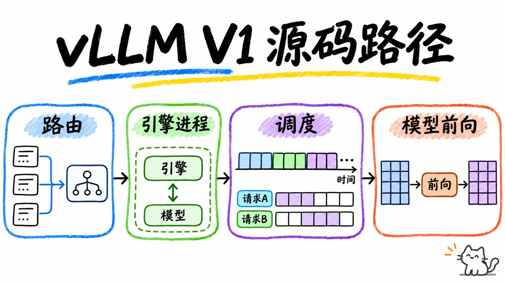

> **生成工具**：Codex\
> **生成模型**：gpt-6.2-sol

我们从一次发送退款表的 `POST /v1/chat/completions` 开始。在客户端看到的文字是 JSON，在模型入口则是 Token ID。两者之间跨过 API 进程、引擎核心与模型执行层。本文固定到 vLLM `v0.33.0rc3` 的 Git commit `4ba787ec9959e566d3b587a796dff07673324da5`，文件和函数以该版本为准。 [固定版本源码](https://github.com/vllm-project/vllm/tree/4ba787ec9959e566d3b587a796dff07673324da5) · [V1 架构](https://docs.vllm.ai/en/stable/design/arch_overview/)

## 1. 路由和模板发生在 API 侧

`vllm/entrypoints/openai/chat_completion/api_router.py::create_chat_completion` 接收解析后的 `ChatCompletionRequest`，调用 `OpenAIServingChat.create_chat_completion`。若处理器返回完整对象，路由包装成 JSON 响应。如果返回生成器，路由用 `StreamingResponse` 发送 SSE（服务器发送事件）。入口包着取消和负载处理装饰器。 [路由入口](https://github.com/vllm-project/vllm/blob/4ba787ec9959e566d3b587a796dff07673324da5/vllm/entrypoints/openai/chat_completion/api_router.py)

`OpenAIServingChat._create_chat_completion` 先调用 `render_chat_request`，处理角色消息和模板，并准备采样参数。接着收集对本次请求的 ID，调用 `engine_client.generate`。用固定 Qwen revision 的分词器实际渲染探针中的退款表。结束在助手起始标记，末尾 Token ID 是 `[151645,198,151644,77091,198]`，对应结束标记、换行、消息开始、助手角色、换行。完整输入、模板文本和 Token ID 已归档。 [聊天处理](https://github.com/vllm-project/vllm/blob/4ba787ec9959e566d3b587a796dff07673324da5/vllm/entrypoints/openai/chat_completion/serving.py) · [输入追踪](experiments/serving/prompt-trace.json)

## 2. 从异步生成器进入调度循环

| 位置 | 跟哪个函数 | 交接的数据 |
| --- | --- | --- |
| API 进程 | `AsyncLLM.generate → add_request → _add_request` | `EngineCoreRequest`、接收输出用的本地队列 |
| 跨进程客户端 | `EngineCoreClient.add_request_async` | 请求消息送到 Engine Core |
| 引擎核心 | `EngineCore.step` | `scheduler.schedule` 产生的 `SchedulerOutput` |
| 模型执行器 | `model_executor.execute_model` | 本轮序列、Token 数和 KV 块计划 |
| Worker | CUDA 路线从 `Worker.execute_model` 跟至 `GPUModelRunner.execute_model` | 模型前向结果与下一 Token 采样输入 |
| API 输出处理 | `OutputProcessor.process_outputs` | 将引擎输出分给对应请求并增量解码 |

KV Cache 是缓存已处理 Token 的注意力键和值，调度器的输出说明本轮哪条序列计算多少位置、占用哪些块。引擎核心拿到模型输出后调用 `scheduler.update_from_output` 形成对外输出，内部状态可能继续留在运行队列。Apple Metal 插件和 CPU 后端可以选择不同的 Worker，源里的 `GPUModelRunner` 是 CUDA 参考路径。 [异步引擎](https://github.com/vllm-project/vllm/blob/4ba787ec9959e566d3b587a796dff07673324da5/vllm/v1/engine/async_llm.py) · [EngineCore](https://github.com/vllm-project/vllm/blob/4ba787ec9959e566d3b587a796dff07673324da5/vllm/v1/engine/core.py) · [Scheduler](https://github.com/vllm-project/vllm/blob/4ba787ec9959e566d3b587a796dff07673324da5/vllm/v1/core/sched/scheduler.py)

## 3. 对照一次生成回包

固定分词器实际得到 74 个提示 Token。CPU 容器的 vLLM 0.21.0 启动记录验证到了独立的 API 进程、Engine Core、Worker、权重读取和预热阶段，HTTP 回包未收集。因此本文将 v0.33.0rc3 的调度路径作为源码阅读，将 74 个 Token 作为本次输入的真实数据。兼容接口的输出形状另用 SGLang 实际回包对照，首段可见输出是代码围栏，最终正常结束并报告 21 个生成 Token。 [vLLM 启动记录](experiments/serving/vllm-startup.json) · [兼容接口回包](experiments/serving/sglang-probe.json)

公开记录把可实测的请求正文、模板和 SSE 回包，与上述源码静态阅读对应起来。要验证每一次 CUDA 调度和实际内核的时间，用相同的请求 ID 或批次 ID 开启引擎日志和设备追踪。API 层拿到角色或内容事件的时刻，包含进程间排队和输出处理。 [输出处理源码](https://github.com/vllm-project/vllm/blob/4ba787ec9959e566d3b587a796dff07673324da5/vllm/v1/engine/output_processor.py)

[返回 LLM 与 Agent 学习路线图](https://blog.lacknb.cn/articles/2026/11/19/1795058329577.html)
