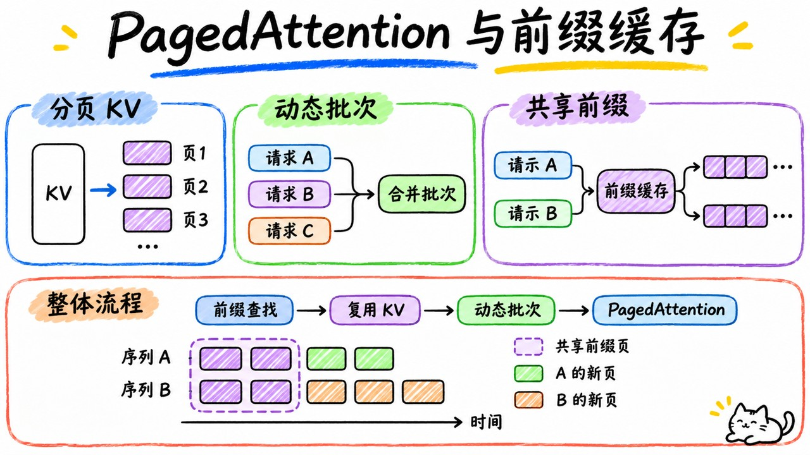

> **生成工具**：Codex\
> **生成模型**：gpt-6.2-sol

同一个退款助手收到两份报表。报表规范完全相同，CSV 的最后几行不同。引擎能复用已处理过的规范，但后续每个请求要单独计算和生成。PagedAttention（分页注意力）、Continuous Batching（连续批处理）和 Prefix Cache（前缀缓存）决定三件不同的事。

## 1. 在逻辑序列与物理缓存之间加块表

KV Cache 为模型保存已处理位置的 Key 和 Value，二者是在当前层从隐藏表示投影得到的张量。PagedAttention 把缓存按固定数目的 Token 划为块，让逻辑相邻的位置可通过块表访问物理上不相邻的内存。请求可以边生成边申请新块，结束或取消后归还引用。

教学块大小取 4。两条报表的头 8 个 Token 连续相同，第三条只改了第一个位置。

| 请求 | Token 序列 | 物理块 ID | 可复用 Token |
| --- | --- | --- | ---: |
| A | 10,11,12,13,14,15,16,17,50,51 | 1,2,3 | 0 |
| B | 10,11,12,13,14,15,16,17,80,81 | 1,2,4 | 8 |
| C | 8,11,12,13,14,15,16,17,80,81 | 5,6,7 | 0 |

前缀缓存以此前路径和本块 Token 等信息形成键。C 的第二块数字与 A 一致，但上下文不同，本例不能共享。尾部只有两个 Token，保留为请求自己的不满块。实际 vLLM 缓存对完整块计算标识，还会考虑适配器和多模态等额外标识，面向多租户的部署需按业务配置共享边界。 [PagedAttention 论文](https://arxiv.org/abs/2309.06180) · [vLLM Prefix Cache 设计](https://docs.vllm.ai/en/stable/design/prefix_caching/)

## 2. 把释放块与下一轮调度接上

在连续批处理中，每个调度步都可调整活动序列集合。A 完成后，B 的共享块仍有引用。A 的尾块可释放，新到的 D 可使用新的预算加入。不同请求不会因为此前组成过同一批就必须一起结束。当前正在执行的内核仍有自己的批次，加入和退出发生在可调度的边界。

这与静态批处理的差别体现在长短混合负载。若每批等最慢的请求结束，其他槽位可能空闲。连续批处理能把部分空闲资源交给等待请求，但增加并发也会增加对缓存与计算的争用。要用实际负载测试等待时间和输出间隔。

## 3. 用相同请求形状比较缓存

```bash
python3 experiments/serving/simulate.py --out /tmp/serving-simulation.json
python3 experiments/serving/probe.py --server http://127.0.0.1:18080 \
    --model refund --out /tmp/serv-04.json
```

探针依次跑串行异前缀、串行同前缀和并发同前缀。异前缀组在可共享文本开头插入不同标记。同前缀组先有一次自然填充，其余请求能共享多少取决于块大小、复用策略和运行状态。每组取请求数、首字延迟、可见输出间隔与完成 Token 速率，服务器支持时再读取缓存查询、命中与队列计数。并发组沿用已热的前缀，应解释为暖缓存的排队与吞吐对照。

实际引擎测量使用 SGLang v0.5.23 的 Apple Metal 后端。每组 8 条，设备缓存 Token 是组前后 `sglang:cached_tokens_total` 的计数差，输入模板和系统指令相同的开头仍可命中。首字指客户端第一段可见文字。下表是这次 SGLang 观测，vLLM 的块行为示例来自源码与上一节演算。

| 任务组 | 设备缓存 Token 增量 | 首字 P50（ms） | 首字 P95（ms） | 可见事件间隔中位数（ms） | 输出 Token/s |
| --- | ---: | ---: | ---: | ---: | ---: |
| 串行异前缀 | 490 | 161.8 | 170.2 | 20.1 | 28.5 |
| 串行同前缀 | 2,050 | 54.2 | 236.0 | 24.7 | 32.0 |
| 并发 4 同前缀 | 2,304 | 112.1 | 127.4 | 34.7 | 83.1 |

同前缀组的缓存增量更大，首字中位数降低。已有暖前缀时，并发提升输出速率，同时可见事件间隔变长。小样本的 P95 取到最大值，可能被首条冷请求或系统抖动主导。 [原始负载和采集指标](experiments/serving/sglang-probe.json)

缓存命中可以减少重复 Prefill（预填充），也就是避免为相同前缀重算部分 Key 和 Value。输出生成还要继续计算。一次小压测只用于辨认指标和协议，容量选型要接更长的、固定到达过程的负载。 [实验脚本](experiments/serving/probe.py) · [块表模拟](experiments/serving/simulated-results.json)

[返回 LLM 与 Agent 学习路线图](https://blog.lacknb.cn/articles/2026/11/19/1795058329577.html)
