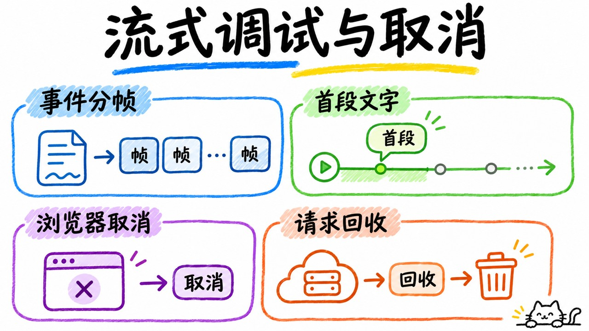

> **生成工具**：Codex\
> **生成模型**：gpt-6.2-sol

退款页面的用户点了生成，首段文字直到最后才一起出现。也可能用户点取消，浏览器停了，模型却还在生成。前者需要逐层查缓冲，后者需要逐层查断开有没有传到调度器。

## 1. 记录五个边界

1. 请求开始发送。
2. HTTP 响应头到达，浏览器可以读到状态和请求 ID。
3. 第一个网络数据块到达，以及第一条完整 SSE（Server-Sent Events，服务器发送事件）。
4. 第一段非空 `delta.content` 被追加到页面。
5. 结束事件到达，或者出现错误、取消或提前 EOF（End of File，流结束）。

第一个数据块和第一个事件是两个时间点。用量事件可能没有文本。Python 探针的 `first_line_ms` 记录第一行可读的时刻，浏览器记录首次 `read()` 返回的数据块。两者都不等于抓包里第一个物理字节。TTFT（Time to First Token，首 Token 延迟）在客户端以可见内容近似；若模型或代理合并 Token，这个时间还包含缓冲和解码。

## 2. 让同一代理分别转发和缓冲

```bash
python3 experiments/serving/proxy.py --upstream http://127.0.0.1:18080 \
    --port 18090 --mode flush
python3 experiments/serving/proxy.py --upstream http://127.0.0.1:18080 \
    --port 18091 --mode buffer
```

`flush` 模式在收到上游内容后逐行写出。`buffer` 模式先读完上游的正文，再发头和数据。这提供了一组人为可控的缓冲对照。真实反向代理、网关压缩、HTTP 客户端和浏览器事件循环都可能改变到达节奏。需要分别记录读取和写出事件，测到缓冲层再修改设置。响应正文是 UTF-8，可用增量解码保留跨网络块的字符，收到空行才认为 SSE 事件完整。 [HTML SSE 规范](https://html.spec.whatwg.org/multipage/server-sent-events.html)

在 Apple M1 的 Chrome 与 MLX-LM 上对同一短输入实测，浏览器时间从点击后的请求流开始。

| 代理模式 | 响应头（ms） | 首块（ms） | 首条 SSE（ms） | 首段文字（ms） | 结束（ms） |
| --- | ---: | ---: | ---: | ---: | ---: |
| 逐行转发 | 33.50 | 104.00 | 149.50 | 149.60 | 394.80 |
| 读完再写 | 343.30 | 344.10 | 344.20 | 344.20 | 344.40 |

缓冲模式在首段抵达后约 0.2 ms 就送到结束事件。代理日志显示上游响应头约 3.8 ms 已就绪，但向浏览器发头等到 326.1 ms。两次单次请求的总时间受运行状态影响，本对照聚焦事件被缓冲到一起的形状。

取消测试在页面加 `?long=1&model=default_model`，改为易持续输出的长请求。浏览器在首段后触发取消，停止显示并记录 `AbortError`。代理对同一请求记录 `connection_closed`，其 `finally` 关闭上游连接。这个浏览器实验验证到代理。独立 SGLang 试验中，单条请求关闭后，引擎的中止计数增加 1，运行请求最终为 0。两份记录的引擎和请求不同，不能拼成同一次完整时间线。 [本机追踪记录](experiments/serving/browser.json) · [SGLang 独立回收试验](experiments/serving/sglang-protocol.json)

## 3. 从断开继续查到引擎回收

浏览器的 `AbortController.abort()` 会停止该 fetch 数据流。代理感知写端断开后应关闭上游连接。引擎感知断连后，再把请求从等待或运行队列移走，并释放引用的缓存块。客户端只有中止事件的情况下，可以确认本地流程停止。验证引擎端可进一步查同一请求 ID 的 Abort 日志、运行计数回落和终止原因，必要时用独占服务避免别的请求扰动计数。在连接经负载均衡或中间代理时，也要区分正常用户取消和代理读超时。

慢客户端场景用固定生成长度和限速读进行压测，观察待发送队列、水位与响应增量。设置最大响应缓冲和合适的空闲超时。做回归时分别覆盖成功、用户取消、服务端错误、网络提前关闭。 [代理代码](experiments/serving/proxy.py) · [浏览器追踪](experiments/serving/trace.html) · [AbortController](https://developer.mozilla.org/docs/Web/API/AbortController)

[返回 LLM 与 Agent 学习路线图](https://blog.lacknb.cn/articles/2026/11/19/1795058329577.html)
