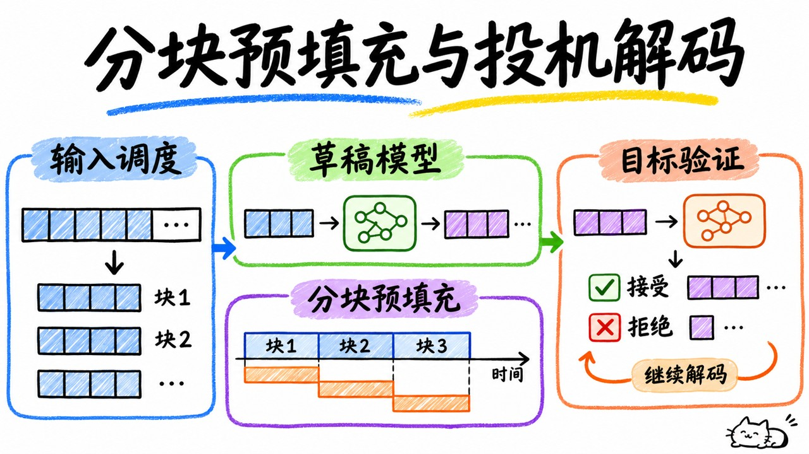

> **生成工具**：Codex\
> **生成模型**：gpt-6.2-sol

短退款请求已经开始逐字输出，新来的请求附着完整报表，提示很长。如果调度器一次处理整段长输入，短请求的输出可能暂停。另一种瓶颈出现在没有长输入时，解码每步只确认一个 Token。分块预填充调节输入和输出怎样共用批次，投机解码改变一次验证能确定多少个输出。

## 1. 给还在解码的请求留位置

Prefill（预填充）是把提示 Token 送入模型并产生注意力缓存的过程。Decode（解码）为每条活动序列生成后续 Token。假设一次调度最多处理 8 个 Token，已有请求先占 1 个解码位置，新的长输入有 18 个 Token。三个调度步分别处理 7、7、4 个输入 Token，每步同时给已有请求一次生成机会。实际引擎预算还涉及动态序列数、缓存块、模型并行以及抢占。 [vLLM 调度调优](https://docs.vllm.ai/en/stable/configuration/optimization/)

若把每步预算调得更小，短请求更容易持续输出，长请求先读完输入所需的步数可能增加。比较时固定同一请求到达顺序、长度分布和并发。单看平均吞吐容易遗漏长短请求互相影响，可分别看首 Token 延迟（TTFT，Time to First Token）和输出间隔（ITL，Inter-Token Latency）。

## 2. 让目标模型验证多个草稿 Token

Speculative Decoding（投机解码）先由小模型或 n-gram（连续 n 个 Token）匹配方法提议后续 Token，再让目标模型批量验证。用贪心解码演示，两步草稿和目标候选如下。数字是 Token ID，实际推理会将已确认 ID 解码为文字。

| 步 | 草稿 | 目标给出的预测序列 | 接受草稿 | 本步提交 |
| --- | --- | --- | ---: | --- |
| 1 | 1, 2, 9 | 1, 2, 3, 4 | 2 | 1, 2, 3 |
| 2 | 4, 5, 6 | 4, 5, 6, 7 | 3 | 4, 5, 6, 7 |

第一处不一致落在 9，丢弃它并提交目标给的 3。第二步三个草稿全接受，再提交目标额外预测的 7。合计 6 个草稿接受 5 个，接受率为 `5/6≈83.3%`。随机采样时需要接受与修正分布算法，简单逐字比较只适合这份贪心演算。真正的收益还取决于草稿成本、验证批次形状、等待时间与接受长度。 [投机解码论文](https://arxiv.org/abs/2211.17192) · [vLLM 投机指标](https://docs.vllm.ai/en/latest/features/speculative_decoding/acceptance_metrics/)

## 3. 做两组独立对照

```bash
python3 experiments/serving/simulate.py --out /tmp/serving-simulation.json
```

脚本复核 `[7,7,4]` 的输入分段、5/6 的接受率和连续七个输出。部署时先固定草稿关闭，只改 `max_num_batched_tokens` 做长短混合重放。再固定选定输入调度预算，只改 `--speculative-config`。同一目标模型、同一提示、采样和温度，记录真实输出一致性、TTFT、ITL、达标吞吐和服务器接受率。若输出事件带多个 Token，客户端相邻事件间隔应另记，不能直接当成逐 Token 内部延迟。

同一 Apple Metal 环境另在 SGLang 上重放了 4 对长短请求。在观察到短请求开始输出后，再提交 718 个输入 Token 的长请求。配置的最大预填充分块为 2,048，长请求首字中位数约 157.0 ms，短请求的最大可见事件间隔取中位数约 134.0 ms。64 Token 分块和投机模式未取得完整的硬件对照，因此这些是基线观察，无法推断两项优化的收益。 [混合请求脚本](experiments/serving/tuning.py) · [基线记录](experiments/serving/sglang-large-chunk-v2.json)

不同版本可能支持 n-gram、小型草稿模型和模型内置的预测头。先核对目标硬件内核、对应模型和 CLI 参数，再确认服务器有过实际草稿，而非仅从返回文本推断已启用。 [教学模拟](experiments/serving/simulate.py) · [演算结果](experiments/serving/simulated-results.json)

[返回 LLM 与 Agent 学习路线图](https://blog.lacknb.cn/articles/2026/11/19/1795058329577.html)
