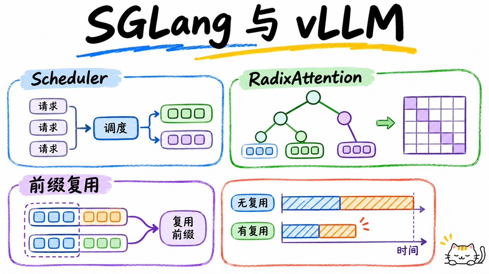

> **生成工具**：Codex\
> **生成模型**：gpt-6.2-sol

同一退款规则连着多份 CSV，要求每份只返回两项统计。SGLang 是一种模型服务运行时，也提供 OpenAI 兼容的聊天接口。它用 RadixAttention 管理可共享的提示前缀。Radix Tree（基数树）是把共享前缀压缩在同一路径上的索引，适合用 Token 序列找已存在的 KV（Key、Value 注意力缓存）。本文固定 SGLang `v0.5.23`，源码 commit 为 `297e54fd105e974cdf401e5b4d20253a22c16f90`。 [SGLang 论文](https://arxiv.org/abs/2312.07104) · [固定源码](https://github.com/sgl-project/sglang/tree/297e54fd105e974cdf401e5b4d20253a22c16f90)

## 1. 从 HTTP 到 Scheduler

沿 `python/sglang/srt` 下的几处入口阅读。

| 阶段 | 源码位置 | 交接结果 |
| --- | --- | --- |
| 转换聊天请求 | `entrypoints/openai/serving_chat.py::OpenAIServingChat._convert_to_internal_request` | 请求文本或输入 ID，以及采样参数 |
| 分词控制 | `managers/tokenizer_manager.py::TokenizerManager.generate_request` | 分词后的请求送到 Scheduler，异步等结果 |
| 选下一批 | `managers/scheduler.py::Scheduler.get_next_batch_to_run` | 选择预填充和运行批次，考虑缓存与预算 |
| 执行与输出 | `Scheduler.run_batch` 后进入设备后端，`DetokenizerManager.handle_batch_token_id_out` 接收 ID | 文字增量回到上游，并在流式处理器组成事件 |

Apple Metal 的模型 worker 从 `hardware_backend/mlx/tp_worker.py` 进入 MLX（Apple Silicon 机器学习框架）后端。服务协议入口可以共享，设备上的内核与可用功能随部署后端改变。 [聊天处理源码](https://github.com/sgl-project/sglang/blob/297e54fd105e974cdf401e5b4d20253a22c16f90/python/sglang/srt/entrypoints/openai/serving_chat.py) · [调度源码](https://github.com/sgl-project/sglang/blob/297e54fd105e974cdf401e5b4d20253a22c16f90/python/sglang/srt/managers/scheduler.py)

## 2. Radix 树的前缀匹配

令同一退款规范分词后以 `[10,11,12]` 开头。第一份报表续上 `[30,40]`，第二份续上 `[30,50]`。树中若只存在第一条，第二条沿 `[10,11,12,30]` 走到分叉处，再为 `50` 补预填充。节点可用 KV 索引表示对应设备内存位置。插入可能拆分一段边，淘汰时需尊重仍被在途请求使用的缓存与具体策略。实际复用长度还会受页面对齐、请求类型和后端限制。

vLLM 对完整 Token 块及其祖先路径计算键，SGLang 可沿树查同一 Token 前缀。两者都要满足上下文和实际 KV 格式兼容。仅看接口的模型名或同一字符串前缀，无法确定缓存命中。 [SGLang RadixCache](https://github.com/sgl-project/sglang/blob/297e54fd105e974cdf401e5b4d20253a22c16f90/python/sglang/srt/mem_cache/radix_cache.py) · [vLLM 前缀缓存设计](https://docs.vllm.ai/en/stable/design/prefix_caching/)

## 3. 用同一请求验证兼容接口

在 macOS 的独立源码检出中，可用固定代码版本和官方 Metal extra 安装。本次把固定 revision 的 Qwen snapshot 转成浮点 16-bit MLX 目录，两个引擎读取同一份目录和模板。

```bash
git clone --depth 1 --branch v0.5.23 https://github.com/sgl-project/sglang.git
cd sglang
cp python/pyproject_other.toml python/pyproject.toml
uv venv --python 3.12 .venv
uv pip install --python .venv/bin/python -e 'python[srt_mps]'
SGLANG_USE_MLX=1 .venv/bin/python -m sglang.launch_server \
    --model-path "$QWEN_FP16" --served-model-name refund --dtype float16 --disable-cuda-graph \
    --host 127.0.0.1 --port 18081 --enable-metrics \
    --context-length 2048 --max-total-tokens 4096 --max-running-requests 8 --mem-fraction-static 0.2
```

实测 Apple M1、SGLang v0.5.23、MLX 0.32.4。启动日志确认进入 `MlxModelRunner`，分配的 KV 池为 4,097 个槽，包含一个填充槽。普通和流式回包均消耗 74 个输入 Token、21 个生成 Token，流式收到结束事件。原始答案用代码围栏包住了正确的条数和均值，严格裸 JSON 评分未通过。

串行异前缀组报告设备缓存 Token 累计量增加 490，随后串行同前缀组增加 2,050，两组各 8 条。异前缀仍有一段相同的模板和系统提示，所以也有命中。取消探针单独发出长流，在收到首段后关闭连接，`num_aborted_requests_total` 从 1 增到 2，运行队列回到 0。计数用于验证独占实验里的单次回收，不替代共享生产环境的逐请求日志。

同一套环境的 JSON Schema（结构约束）探针起初返回 HTTP 500，报告语法未接受候选 Token。增加 `--mlx-enable-sampling` 后返回 200 和裸 JSON，但把均值错答成 4。这是有约束的语法通过和业务错答同时发生的例子。源码显示该开关会启用 MLX 路径的语法词表遮罩。工具调用另需配置解析器并按业务验收。 [Metal 采样配置源码](https://github.com/sgl-project/sglang/blob/297e54fd105e974cdf401e5b4d20253a22c16f90/python/sglang/srt/arg_groups/fields/device.py) · [SGLang 请求与指标](experiments/serving/sglang-probe.json) · [开关启用后的协议结果](experiments/serving/sglang-protocol-sampling.json)

比较时记录 `/v1/models`、普通和流式文本、`finish_reason`、用量、缓存计数和取消。工具、结构化字段和 JSON 语法需另用版本对应的解析器验收。 [SGLang Apple Metal 指南](https://github.com/sgl-project/sglang/blob/v0.5.23/docs/docs/hardware-platforms/apple_metal.mdx) · [共用探针](experiments/serving/probe.py)

[返回 LLM 与 Agent 学习路线图](https://blog.lacknb.cn/articles/2026/11/19/1795058329577.html)
