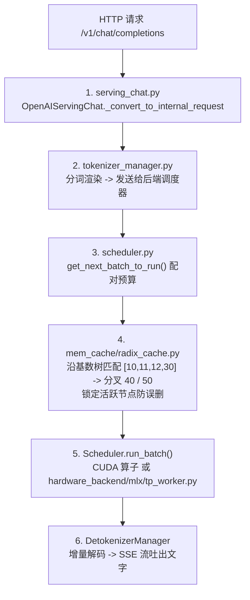

> **生成工具**：Codex\
> **生成模型**：gpt-6.2-sol

前面几篇我们拆了 vLLM V1。而在本专题多次用来真正跑通 HTTP 流式生成、并发缓存命中甚至测试中断回收的另一个高速引擎，就是 **SGLang**！

和 vLLM 一样，SGLang 也暴露标准 OpenAI 兼容接口；不同的是它在缓存调度上主打标志性的 **RadixAttention（基于基数树 Radix Tree 的自动前缀 KV 缓存共享）**。今天我们锁定 SGLang **`v0.5.23`**（精确 Git Commit `297e54fd105e974cdf401e5b4d20253a22c16f90`），从 HTTP 入口进门，沿着 `RadixCache` 分叉树、再到 Apple Metal 实测中一段很有趣的「**语法约束 500 报错翻车与开启采样开关修复**」现场，把整条链路摸透。[SGLang 论文](https://arxiv.org/abs/2312.07104) · [固定源码](https://github.com/sgl-project/sglang/tree/297e54fd105e974cdf401e5b4d20253a22c16f90)

> **先用大白话讲明白**：**RadixAttention** 和传统按固定块号算哈希的区别，就像**查一本会动态分裂书签目录的《前缀词典树》**：
> - **Radix Tree（基数树 / 压缩前缀树）**：假设先后有两份退款表进来，都带着相同的开篇规则 `[10, 11, 12]`，然后第一份接 `[30, 40]`，第二份接 `[30, 50]`。Tree 先把公共主干 `[10, 11, 12, 30]` 存在同一条树枝上并指明各自对应显卡里的哪几个 **KV 显存槽位**；等第二份来时顺藤摸瓜一路命中到 `30`，当场只把分叉叶子拆成 `40` 和 `50` 两根小细枝，只补算尾巴一个 `50` 就完事——连末尾不齐整块的单字也能自然拼出公共路径！
> - **LRU 淘汰也看谁正被踩着**：如果显存快满了要砍树枝腾地方，只要那条树枝上还挂着正在路上没算完的请求（引用计数未归零），淘汰机制就绝不准砍它！



## 1. 从 HTTP 入口进到 Scheduler 主循环（v0.5.23 源码锚点）

顺着 `python/sglang/srt`（SGLang Runtime）包下面这四个关键节点走一遍，结构与 vLLM 各司其职却各有风格：

| 运行阶段 | 核心源码文件路径及类/方法 | 这一步交接出什么东西？ |
| --- | --- | --- |
| **1. 协议转换** | `entrypoints/openai/serving_chat.py::OpenAIServingChat._convert_to_internal_request` | 解析请求消息、套模板，转成含采样与约束设置的内部请求体。 |
| **2. 分词控流** | `managers/tokenizer_manager.py::TokenizerManager.generate_request` | 在单独控制进程里做完 Tokenization，异步送进后端等待输出。 |
| **3. 批调度选人** | `managers/scheduler.py::Scheduler.get_next_batch_to_run` | 结合当前已命中前缀树结果与显存空闲槽位，编排出这一轮 Prefill 或 Decode 批。 |
| **4. 运算与还字** | `Scheduler.run_batch` -> 设备后端 -> `DetokenizerManager.handle_batch_token_id_out` | 算出新 Token ID 回流给反分词进程，拼字打包发 SSE。 |

值得注意的是跨平台结构：在我们的 Apple Silicon（M1）实机测试里，只要指定启用 Metal，执行层就从 `hardware_backend/mlx/tp_worker.py` 切进 MLX 后端 [聊天处理源码](https://github.com/sgl-project/sglang/blob/297e54fd105e974cdf401e5b4d20253a22c16f90/python/sglang/srt/entrypoints/openai/serving_chat.py) · [调度源码](https://github.com/sgl-project/sglang/blob/297e54fd105e974cdf401e5b4d20253a22c16f90/python/sglang/srt/managers/scheduler.py)——**对外 OpenAI HTTP 接口完全长一个样，底下真正跑得通什么语法约束内核和量化算子，却高度绑死于当下跑在哪个后端之上！**

## 2. Radix 树前缀匹配 vs vLLM 分页块哈希：同一颗心，两种组织法

具体拿一串序列看分叉：令同一份退款规则前缀编成 `[10, 11, 12]`。
- 第一份表接着写 `[30, 40]`：树里拉出一条根边 `[10, 11, 12, 30, 40]` 对应 5 个 KV 槽；
- 第二份表接着写 `[30, 50]`：树遍历对比前 4 个元素全相同，就在 `30` 和 `40` 之间**一刀劈开边**，公共前缀缩成共享父边 `[10, 11, 12, 30]`，下面挂两条子边 `[40]` 和 `[50]`——第二份表只用算最后一个 **`50`** 就够了！

对比两种主流思想：
- **vLLM Prefix Cache**：把完整块（比如每 16 Token 一整块）连同其前驱块哈希算指纹登记进哈希表，整块对齐才能复用；
- **SGLang RadixCache**：把共享过的 Token 前缀维护在一棵**基数前缀树**上（同样受到物理页粒度、多模态/微调适配器等状态约束）[SGLang RadixCache](https://github.com/sgl-project/sglang/blob/297e54fd105e974cdf401e5b4d20253a22c16f90/python/sglang/srt/mem_cache/radix_cache.py) · [vLLM 前缀缓存设计](https://docs.vllm.ai/en/stable/design/prefix_caching/)。

> **容易踩的坑**：不管是 vLLM 还是 SGLang，**绝对不要只凭客户传的「模型别名相同」或「表面字符文本看着差不多」就赌前缀一定能复用！** 只要中间多了一个空格造成 BPE 分词边界漂移、或者换了一套系统提示、不同租户带了隔离标签、或者缓存规格不一致，树和哈希都照样会失效。必须通过引擎真实指标计数器验证复用量！

## 3. 真机踩坑与全功能验收记录（SGLang v0.5.23 Apple Metal）

以下是在 macOS Apple M1 上拉起固定版本 SGLang + MLX `0.32.4`（加载已转好的 16-bit Qwen2.5-0.5B-Instruct 目录）的实际验证步骤与记录（[SGLang Apple Metal 指南](https://github.com/sgl-project/sglang/blob/v0.5.23/docs/docs/hardware-platforms/apple_metal.mdx)）：

```bash
git clone --depth 1 --branch v0.5.23 https://github.com/sgl-project/sglang.git
cd sglang
cp python/pyproject_other.toml python/pyproject.toml
uv venv --python 3.12 .venv
uv pip install --python .venv/bin/python -e 'python[srt_mps]'
SGLANG_USE_MLX=1 .venv/bin/python -m sglang.launch_server \
    --model-path "$QWEN_FP16" --served-model-name refund --dtype float16 --disable-cuda-graph \
    --host 127.0.0.1 --port 18081 --enable-metrics \
    --context-length 2048 --max-total-tokens 4096 --max-running-requests 8 --mem-fraction-static 0.2
```

启动日志确认拉起 **`MlxModelRunner`**，分出了含 1 个填充槽在内的 **`4,097` 个 KV 缓存槽**。用仓库共用的 [probe.py](experiments/serving/probe.py) 与 [protocol_checks.py](experiments/serving/protocol_checks.py) 跑了一圈真刀真枪的功能体检，揭露了两个极有价值的现象：

1. **常规生成 + 缓存复用 + 断连回收全通过**：
   - 普通与流式请求消耗严格对齐：`74` 输入 Token、`21` 输出 Token、流式等来 `[DONE]`（但内容被 ```` ```json ```` 包围，所以裸 JSON 检验失败，见 [sglang-probe.json](experiments/serving/sglang-probe.json)）；
   - 串行异前缀 8 轮 -> `sglang:cached_tokens_total` 增 **`+490`**（模板头小公共前缀）；切到串行同前缀 8 轮 -> 增量猛跃至 **`+2,050`**；
   - 独占环境下发长流请求在吐出首块后强断连接（见 [sglang-protocol.json](experiments/serving/sglang-protocol.json)），引擎立刻捕捉到中止并记 `num_aborted_requests_total` 由 `1.0` 跳升至 **`2.0`**，活跃请求稳落 **`0.0`**！
2. **结构化输出 JSON Schema 的精彩两幕戏剧**：
   - **未加 MLX 采样开关前**（[sglang-protocol.json](experiments/serving/sglang-protocol.json)）：发出严格 JSON Schema 请求直接砸回 **`HTTP 500`**！报错原文清晰写着 **`Grammar accept_token failed: Tokens not accepted: 73594`**（原因：当前 Metal 默认路径没打开对应的语法词表遮罩逻辑，导致语法状态机拒收正常产出 Token！）；
   - **加上 `--mlx-enable-sampling` 启动参数后**（[sglang-protocol-sampling.json](experiments/serving/sglang-protocol-sampling.json) 与 [Metal 采样配置源码](https://github.com/sgl-project/sglang/blob/297e54fd105e974cdf401e5b4d20253a22c16f90/python/sglang/srt/arg_groups/fields/device.py)）：接口立刻顺畅返回 **`HTTP 200`** 和干干净净的裸 JSON，再也没出现讨厌的 Markdown 代码围栏！……可定睛一看输出内容却是 **`{"count":2,"mean":4}`**（均值还是算错成了 `4`，`passed: false`）！

> **大白话小结**：这就是本系列一直在强调的核心工程觉悟：**结构化约束解码（JSON Schema）能 100% 保证它写出「长得合法的 JSON 壳」，可半点儿也保证不了里面那个算术数字算得对！** 所以比较任何两大引擎（如 vLLM vs SGLang）时，不仅要验模型列表、文本回包、`finish_reason`、用量、缓存命中、断开回收，还要专门针对当前运行平台单独测一遍「结构化约束 + 工具调用解析器 + 端到端业务数值正确率」！

## 下一篇

搞清了两大主力开源引擎的内部架构，现在回到咱们手头的产品发布线：**今天我们把最大输出改成了 48 Token，还挂了微调后的新模型——明天线上用户突然报一个莫名其妙的错，怎么在一秒之内查出那位倒霉用户昨晚踩中了哪个版本、用的什么权重和模板？万一发上去搞砸了，怎样不靠手忙脚乱改代码、直接一秒把线上流量切回昨晚的铁打稳定版？** [**SERV-12《模型注册、产物血缘与可回滚发布》**](serv-12-model-registry.md) 会用本地 MLflow + SQLite 演示一遍标准化的发布清单指纹锁与 `champion` 别名一键回滚！

[返回 LLM 与 Agent 学习路线图](https://blog.lacknb.cn/articles/2026/11/19/1795058329577.html)
