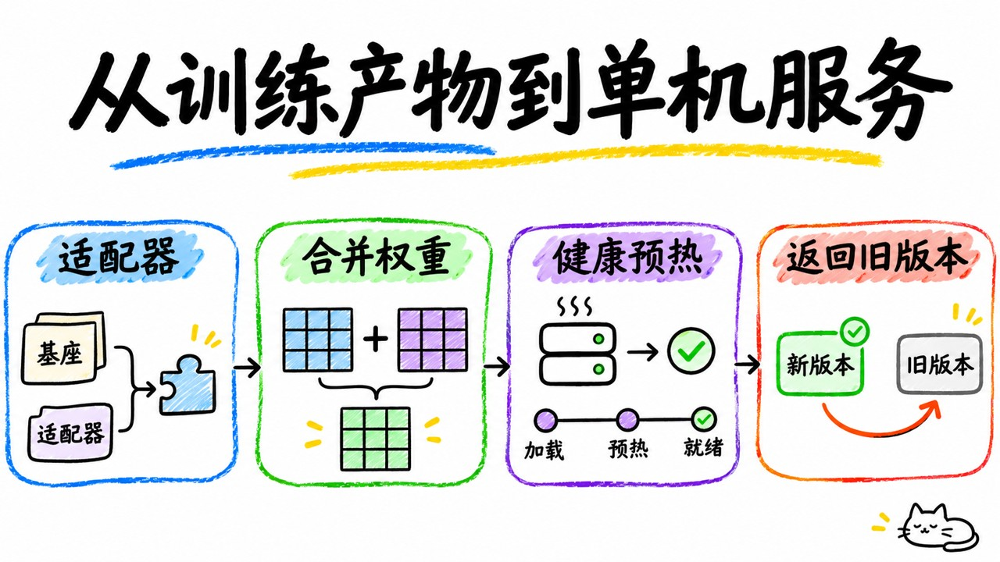

> **生成工具**：Codex\
> **生成模型**：gpt-6.2-sol

上一部分留下了退款助手的独立 LoRA 适配器与合并后的整套权重。现在把这两种产物交给单机推理服务，使用相同的提示、采样和输出预算检查结果。服务还要在冷启动时挡住用户请求，并在新发布失败时让入口能回到上一套已验证的配置。 [TRN-09 的训练与导出源稿](trn-09-unsloth-finetune-export.md)

## 1. 先列部署清单和两种加载方式

| 字段 | 本例 |
| --- | --- |
| 基座与分词器 | Qwen/Qwen2.5-0.5B-Instruct，同一固定 revision |
| 模板 | 基座自带的聊天模板 |
| 独立产物 | `lora/adapter_config.json` 与 `adapters.safetensors`，基座单独加载 |
| 合并产物 | `merged/`，模型配置、Tokenizer 与合并权重 |
| 推理预算 | 温度 0，最多 48 个输出 Token，固定四张退款表作为最小回归 |
| 发布 ID | 由代理写入 `X-Release-Id`，用这个 ID 查回实际权重和配置 |

LoRA（Low-Rank Adaptation，低秩适配）用小矩阵保存相对基座的变化。选择独立加载时，服务要明确支持这份适配器格式、目标层和基座 revision。合并路径适合只支持单套权重的加载器，交付体积更大。量化和可用内核需要另行验收。不能把文件读成功视作模型行为一致，应逐条跑生成对照。

## 2. 在同一个后端加载两套实际训练产物

以下两个命令分别使用上一部分产出的目录。MLX-LM 的 `default_model` 指启动参数选择的模型，不需要客户端从所有本地缓存的模型名猜测。MLX 是 Apple Silicon 的机器学习计算框架，本机实验使用 `mlx-lm==0.32.2`。

```bash
python -m mlx_lm server --model "$MLX_BASE" --adapter-path "$TRN_OUTPUT/lora" \
    --host 127.0.0.1 --port 18144
python -m mlx_lm server --model "$TRN_OUTPUT/merged" \
    --host 127.0.0.1 --port 18145
python3 experiments/serving/probe.py --server http://127.0.0.1:18144 --model default_model \
    --quick --out /tmp/adapter.json
```

两条 MLX-LM 路径都返回 74 个输入 Token、10 个输出 Token，普通和流式都生成 `{"count":2,"mean":4}` 并正常结束。结果逐条核对应覆盖全套回归，此处实际用一条报告冒烟，观察到相同的输出与相同的业务错误。部署端已经能够读取两套产物和复现输出，业务验收仍需拒绝错误均值。 [独立适配器响应](experiments/serving/adapter-probe.json) · [合并模型响应](experiments/serving/merged-probe.json)

本机另用同一个已启动引擎做接入实验，两条代理地址以 `refund-01` 和 `refund-02` 标识。健康接口都返回 200，依次请求旧、新、旧地址，回包头依次为 `refund-01 → refund-02 → refund-01`。限制并发为 1 后，持有长流时第二条请求收到 429，关闭长流后新请求恢复到 200。两条代理地址的手动选择是切换演练。 [接入验收脚本](experiments/serving/deployment_check.py) · [接入验证结果](experiments/serving/deployment-check.json)

## 3. 单机运行时把就绪、限流和回滚接上

进程在线说明它能接受健康检查，就绪表示模型和模板能完成预期的冒烟请求。启动后先访问 `/health`，再做实算或最小文本生成并核对预算，最后开放入口。一个长流占用容量时，代理的并发闸门可以让后来的请求得到 HTTP 429。服务要在取消和异常路径都归还并发槽位，防止一个断流使整台机器一直满载。独立适配器、合并模式都要测流式。

容器环境要固定镜像 digest、CPU/GPU 类型、内存与共享内存、可读的模型挂载位置、容器网络和 Entrypoint。工作进程大文件宜只读挂载，探针走模型 API。Linux Arm CPU 容器的一次启动验证了模型挂载、读取和进入预热，健康和回滚验证来自上面的本机接入实验。 [容器启动记录](experiments/serving/vllm-startup.json)扩到 Linux NVIDIA 时需走对应容器与驱动路径，MLX 进程依赖 macOS Metal，不能把 macOS 本地结果直接外推到 Linux 容器。 [vLLM Docker 运行方式](https://docs.vllm.ai/en/stable/deployment/docker/) · [MLX-LM](https://github.com/ml-explore/mlx-lm)

切换先加载和预热新发布，再按新请求替换指向，旧请求继续绑定旧发布。指标或业务校验变差时退到上一个已就绪的地址，并用 `X-Release-Id` 验证绑定恢复。生产实现需要原子的入口切换和连接排空。 [探针](experiments/serving/probe.py) · [本机接入代理](experiments/serving/proxy.py)

[返回 LLM 与 Agent 学习路线图](https://blog.lacknb.cn/articles/2026/11/19/1795058329577.html)
