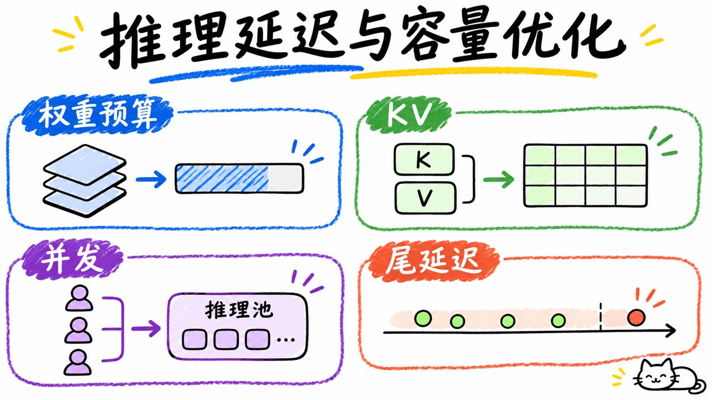

> **生成工具**：Codex\
> **生成模型**：gpt-6.2-sol

单台服务器只能放下有限的模型状态。即使权重装得进去，请求量一大，缓存也会随输入和输出增长。目标是先算大头，再用真实负载把资源指标对到用户可见的响应。

## 1. 对 Qwen 的每项内存手算一遍

以 Qwen2.5-0.5B-Instruct 为例，公开配置有 24 层、2 个 KV 头、每头 64 个分量。权重逻辑参数约 4.94 亿，用 16-bit 即每元素两字节估算，权重约 942 MiB。MiB 是二进制兆字节，每 MiB 为 1,048,576 字节。

```text
KV 每 Token 字节 = 2（K 和 V）× 24 × 2 × 64 × 2 = 12,288 B
每请求保留 3,000 个位置，块大小为 16 时，实际分配 3,008 个位置
4 条独立请求的 KV = 4 × 3,008 × 12,288 B = 141 MiB
```

这笔预算按逻辑形状 `[layer, K/V, position, head, head_dim]` 估算。复用前缀、不同 KV 数据类型、跨卡分片或分页对齐会改变每卡用量。还需分配激活、内核临时工作区、图捕获状态和运行时保留空间。生产 OOM（Out of Memory，内存不足）要区分加载时、预热时、长请求入队后和解码中发生。 [Qwen 模型配置](https://huggingface.co/Qwen/Qwen2.5-0.5B-Instruct/blob/7ae557604adf67be50417f59c2c2f167def9a775/config.json) · [vLLM 优化指南](https://docs.vllm.ai/en/stable/configuration/optimization/)

## 2. 指标应区分首字、解码节奏和总成功

TTFT（Time to First Token）是首 Token 附近的延迟，客户端以第一段非空内容为准。ITL（Inter-Token Latency）指两 Token 之间间隔，若 SSE 一次发多个 Token，探针测到的是相邻可见事件间隔。吞吐统计可用完成 Token 每秒。达标吞吐用满足业务正确和延迟阈值的请求数除以总秒数。P95 这里用排序后向上取整的第 `ceil(n×0.95)` 个样本，小试的 8 条输入时相当于最大值。

Apple M1 的 MLX-LM 同进程对照，16-bit 模型保持不变。每组 8 条，按业务校验和 1.5 秒内结束共同统计达标吞吐。

| 负载 | 首字 P50（ms） | 整条 P95（ms） | 可见事件间隔中位数（ms） | 输出 Token/s | 达标请求/s |
| --- | ---: | ---: | ---: | ---: | ---: |
| 异前缀串行 | 224.5 | 605.9 | 28.4 | 20.0 | 0.95 |
| 同前缀串行 | 85.6 | 469.6 | 28.4 | 27.5 | 1.31 |
| 同前缀并发 4 | 139.6 | 794.6 | 39.9 | 55.4 | 2.64 |

同前缀变暖后，首字 P50 下降。把并发加到 4 后，输出速率提高，整条 P95 和可见事件间隔也上升。实际通过数仍为每组 4/8。 [逐条原文和计时](experiments/serving/mlx-probe.json)

异前缀、同前缀和并发同前缀使用相同类型的退款表，冷暖顺序固定，并发组接在同前缀组之后。重复长系统规则用于放大前缀影响，压力并非生产流量。单次表中若出现越快越不准，先对照完整输出和结束原因，再查上下文、停止和格式。

## 3. 一次只改变一个成本项

用固定模型及相同压测流切换预热、前缀缓存、批预算或权重量化。量化后要重新测质量，改最大长度要记录拒绝请求的比例。缓存命中和吞吐改善若伴随尾延迟升高，应按用户目标选并发上限。采集服务端队列、正在运行的请求、缓存水位、预填充和解码时间，与客户端结果相互佐证。同样的吞吐在不同请求长度结构下可能对应完全不同的并发容量。

```bash
python3 experiments/serving/simulate.py --out /tmp/serving-simulation.json
python3 experiments/serving/probe.py --server http://127.0.0.1:18083 --model default_model \
    --out /tmp/serving-probe.json
```

[内存演算](experiments/serving/simulated-results.json) · [负载探针](experiments/serving/probe.py)

[返回 LLM 与 Agent 学习路线图](https://blog.lacknb.cn/articles/2026/11/19/1795058329577.html)
