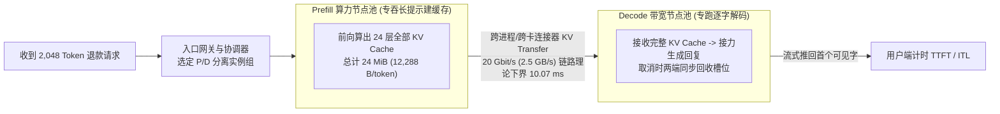

> **生成工具**：Codex\
> **生成模型**：gpt-6.2-sol

单卡服务摸熟之后，真正上大规模并发或超大参数模型时，一台孤零零的显卡必然撞上两堵死墙：要么同一秒涌进几十份退款表单卡排队爆表，要么模型权重加超长报表显存大到一张卡压根吞不进去！

把活派给多张 GPU，看似都是加机器，其实每一种切法干的事情南辕北辙；不仅如此，哪怕是在算力利用率上极有讲究的现代架构，还会把「首次吞下巨长输入」跟「慢慢吐字回复」直接拆到两组完全不同的显卡集群上（**PD 分离部署**）！要想不踩互联带宽掉进反变慢的坑里，必须从「一条请求先落到谁手上、哪几字节要顺着网线飞过去」一清二楚算起。

> **先用大白话讲明白**：多卡推理的四大分工阵型和 **PD 分离**，就像**扩展一家火爆的连锁餐饮后厨**：
> - **四种并行阵型一眼辨真身**：
>   1. **DP（数据并行）=「同一栋楼开两间一模一样的独立厨房」**：客人进门由前台随机派去甲或乙，两间厨房互不打扰（零层间通信），最能抗高并发，但两家都要存一整套昂贵大模型；
>   2. **TP（张量并行）=「一张巨型案板四位大厨合着一块剁同一块肉」**：每一层矩阵计算横竖切成四份分摊到 4 张卡，单模型能塞进四倍容量且单请求极快——代价是**算完每一层都要在显卡高速专线（如 NVLink）上集体吼一嗓子汇总**，跨慢速网线直接卡死；
>   3. **PP（流水线并行）=「流水线传菜带：0 号卡专切配前 12 层，传给 1 号卡专炒后 12 层」**：只在层段交接那一刻递一次盘子，跨普通 PCIe/跨机网络也能用，但很容易前面切完等着后面空转产生「流水线气泡」；
>   4. **EP（专家并行）=「特色菜馆里每位大厨只挂自己招牌的几个小炒专家档口（MoE）」**：门控指谁去做菜才把那个 Token 发过去再合回来（普通稠密小模型如 Qwen 0.5B 不需要它）。
> - **Prefill / Decode 分离部署（PD 分离）=「集中猛火暴炒备好高汤底料（Prefill 池） -> 用超快管道抽去慢火精炖出菜窗口（Decode 池）」**：吞几千字长上下文极其吃算力（Compute-bound），慢慢逐字吐字极其吃显存带宽（Memory-bound）；硬把俩混在同一张卡算很容易互相打架卡出长尾延迟。拆开之后各自按需扩容，唯一的全新账单就是：**必须把 P 池刚熬好的整个 KV Cache 半成品原汁原味传到 D 池卡上！**



## 1. 一张对比表理顺四种多 GPU 并行分派方式

| 并行方式 | 一条退款请求究竟落在哪？ | 层与层之间靠什么互相通信？ | 最大优点与核心代价 |
| --- | --- | --- | --- |
| **DP（Data Parallelism，数据并行）** | 路由指派给某一个拥有全套权重的独立副本 | 仅在入口服务路由层分发，副本间层内无需互传激活 | 最稳最能抗吞吐并发；但每个副本要独吞全量模型显存 |
| **TP（Tensor Parallelism，张量并行）** | 同一条请求同时在多张卡上并行切块算同一层 | **层内频密全规约/全收集通信** | 最能大幅压低单请求延迟、塞下超大单层；高度依赖 **NVLink** 等超高速互联带宽 |
| **PP（Pipeline Parallelism，流水线并行）** | 第 0 卡跑前半层组，算出中间隐状态交给第 1 卡跑后半组 | 只在跨阶段交界处点对点发一趟激活张量 | 显著削减每卡所需存放层数且对互联要求较低；容易因阶段负载不均造成卡空转（气泡） |
| **EP（Expert Parallelism，专家并行）** | 针对 [F-13](https://blog.lacknb.cn/articles/2026/11/20/1795161347233.html) 的 **MoE 混合专家**架构，由门控只挑少数对应专家所在的卡执行 | **All-to-All** 全交换把 Token 派给专家再收回来 | 专治千亿级稀疏专家模型显存与算力分配；跨卡动态分发容易负载倾斜掉长尾 |

牢记一句硬件拓扑决定成败的口诀：**高速 NVLink、常规 PCIe 插槽与跨机器普通以太/RDMA 网络之间带宽与微秒级延时差距悬殊——很多时候互联拓扑选型比你多插两张 GPU 还决定最终表现！**[vLLM 并行和伸缩](https://docs.vllm.ai/en/stable/serving/parallelism_scaling/)

## 2. 分离 Prefill 与 Decode 后：亲手算一笔 KV 跨卡搬家传输下限

既然把 **Prefill（吃进整篇输入并建立好注意力键/值张量）** 与 **Decode（接着一字一字吐输出并追加结尾缓存）** 拆到两组互不打扰的独立机器上，就必须把刚建好的上下文 **KV Cache** 实时从 P 端搬到 D 端（或由 D 端用自身协议重建对应状态）。

直接拿我们再熟悉不过的固定版本 `Qwen2.5-0.5B-Instruct` 官方配置算一笔硬账：它有 `24` 层、GQA `2` 个 KV 头、每头 `64` 维，K 与 V 各 1 份，16-bit 浮点每个数占 `2` 字节。假设一个退款报表附着完整的字典和对话长达 **`2,048` 个 Token**，按张量形状 `[layer, K/V, token_position, KV_head, head_dimension]` 算清还没分片压扁时的逻辑纯体积与传输时间下界：

```text
每个 Token 的 KV 字节数 = 2 (K与V) × 24 层 × 2 个 KV 头 × 64 维 × 2 字节 = 12,288 字节
整份 2,048 Token 上下文逻辑总 KV 体积 = 2,048 × 12,288 B = 25,165,824 B = 24 MiB
假如两端之间单向可用网络有效吞吐是 20 Gbit/s（对应 2.5 GB/s）：
25,165,824 B ÷ 2.5e9 B/s ≈ 0.010066 秒 ≈ 10.07 ms（理想单向传输下限！）
```

> **容易踩的坑（别拿 `10.07 ms` 理论值直接冒充线上实测开销！）**：
> 这个 `10.07 ms` 用仓库 [simulate.py](experiments/serving/simulate.py) 可以准确算出验证（已入 [simulated-results.json](experiments/serving/simulated-results.json)）；但它**仅仅是把 24 MiB 纯载荷塞满 20 Gbit/s 网线的「物理带宽绝对下限」**！真正在生产级集群里跑起来：KV 分页格式与内存布局（需先打包还是能零拷贝 RDMA 直传）、前端到底命没命中历史共享缓存（要是 D 端原本就热着相同前缀那部分根本不用传！）、连接器异步握手同步、队列拥堵排队、**甚至到底是由 P 端还是由 D 端负责吐回第 1 个可见 Token**，全都会改写用户真实体验到的延迟！况且本例仅针对单卡也能装下的 0.5B 模型展示精确算式；要是换成 70B 大模型长文本，每 Token 体积瞬间暴涨几十倍，互联带宽不够时分离甚至会比同池硬混更慢！[Qwen 模型配置](https://huggingface.co/Qwen/Qwen2.5-0.5B-Instruct/blob/7ae557604adf67be50417f59c2c2f167def9a775/config.json) · [vLLM 分离式预填充](https://docs.vllm.ai/en/stable/features/disagg_prefill/)

## 3. 真要上多卡/PD 分离测试，怎么公平评估到底划不划算？

（诚实标注环境范围：本地实验环境未搭建 NVIDIA 多 GPU 及跨机器网络集群，以上传输计算基于公开模型规格与设定网络速率推演，上真机集群务必按照下方对照实验测量。）

科学对比是否上多卡切分或 PD 分离，一定要按四档同源基线阶梯对比：**同卡单进程基线 -> 同机多卡同池 -> 同机多卡 PD 分离 -> 跨机 PD 分离**。而且一定要注意跨机测试的记账纪律：
- 各自机器用自己的单调时钟记录局部阶段耗（Prefill 入队 -> 算完 Prefill -> KV 发完 -> Decode 入队）；
- 客户端从同一个统一时钟卡死全链路端到端 `TTFT P95`、吐字间隔、整条总耗时、**达标吞吐（SLO Goodput）**以及传输连接失败率；
- 连接器在P/D两端的版本、分片方向和 KV 张量内存排布必须严丝合缝匹配；**还要特意模拟发一个「刚进 Decode 就撤回取消」的信号，验证 P 端和 D 端两家是不是都能老老实实释放掉占着的缓存槽位！**

## 下一篇

搞明白了单卡和多卡架构的理论，如果公司现在正好要在两款或者多款主流开源推理引擎（比如 `vLLM`、`SGLang`、`MLX-LM`）里拍板选一套上线——怎么写出一份**老板看了放心批预算、架构师看了挑不出毛病**的生产引擎对比评测报告？为什么随便测两把只看最高 `Token/s` 会严重误导选型？[**SERV-11《怎样做两种推理引擎的生产基准》**](serv-11-engine-benchmark.md) 会以 Apple M1 上实测 **SGLang `v0.5.23` vs `MLX-LM 0.32.2`** 并发 4 轮打擂台的全部真实数字带你立稳基准合同！

[返回 LLM 与 Agent 学习路线图](https://blog.lacknb.cn/articles/2026/11/19/1795058329577.html)
