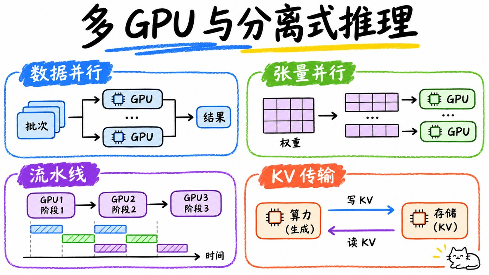

> **生成工具**：Codex\
> **生成模型**：gpt-6.2-sol

退款助手可能同时读到几十份报表，也可能遇到单份材料长到一张卡容不下。两种问题都可能用多卡处理，但每张卡承担的工作不同。先看请求落在哪里，再看计算过程中哪些字节要走互联。

## 1. 一条请求怎样分到多卡

| 方式 | 对一条退款请求的分配 | 主要通信 |
| --- | --- | --- |
| DP（Data Parallelism，数据并行） | 路由给一个拥有完整模型的副本 | 服务路由。普通稠密单卡副本之间不为每层交换激活 |
| TP（Tensor Parallelism，张量并行） | 多张卡分别执行同一层的一部分矩阵 | 层内归约、聚合或其它集合通信 |
| PP（Pipeline Parallelism，流水线并行） | 卡 0 算前一组层，卡 1 算后一组层 | 阶段边界的激活传输 |
| EP（Expert Parallelism，专家并行） | 混合专家模型按门控结果把 Token 发给对应专家 | Token 分派、结果返回，常涉及全交换 |

混合专家（MoE，Mixture of Experts）在部分层让门控网络选专家。普通稠密 Qwen 0.5B 实验不需要 EP。DP 提升独立请求处理能力，但每个副本都有一份权重和自己的 KV 缓存。TP 增加单模型可用空间，同时每层增加通信。PP 减少每卡需要驻留的层，还会受阶段不均和空转影响。NVLink、PCIe 和跨机网络有不同的带宽与延迟，拓扑往往和卡数同样重要。 [vLLM 并行和伸缩](https://docs.vllm.ai/en/stable/serving/parallelism_scaling/)

## 2. 分离 Prefill 与 Decode 后，缓存要传过去

Prefill（预填充）处理整段输入并建立注意力缓存。Decode（解码）逐步生成输出并追加缓存。分离式部署让不同工作进程分别承担两段，可按输入长度和输出负载分别扩容。解码端要拿到目标请求的注意力 Key 和 Value 张量，或者用自己支持的方式重建所需状态。

用固定版本的 Qwen2.5-0.5B-Instruct 算一笔账。24 层、2 个 KV 头、每头 64 个分量，K 和 V 各一份，假设使用 16-bit 浮点即每分量 2 字节。如一条退款报告的完整提示占 2,048 个 Token，未分片的逻辑缓存体积为

```text
每 Token 字节 = 2 × 24 × 2 × 64 × 2 = 12,288 B
总字节 = 2,048 × 12,288 B = 25,165,824 B = 24 MiB
20 Gbit/s 单向有效吞吐对应 2.5 GB/s
理想单向传输下限约为 10.07 ms
```

缓存按 `[layer, K/V, token_position, KV_head, head_dimension]` 理解。缓存布局、分页取整、缓存复用、压缩和并行分片会改变真实传输的数据量。10.07 ms 是传满这些字节的带宽下限，真实延迟还包括排队、连接器调度、握手、同步和拷贝。首字时间还取决于谁返回第一个可见 Token。 [Qwen 模型配置](https://huggingface.co/Qwen/Qwen2.5-0.5B-Instruct/blob/7ae557604adf67be50417f59c2c2f167def9a775/config.json) · [vLLM 分离式预填充](https://docs.vllm.ai/en/stable/features/disagg_prefill/)

## 3. 记录传输和尾延迟，评估是否划算

先在同卡单进程记录基线，再对照同机多卡同池和同机分离，最后比较跨节点分离。每个请求记录接入、预填充入队与完成、KV 发送完成、解码入队和第一个可见内容。跨机阶段用各自单调时钟测局部耗时，端到端另用同一客户端时钟测量。报告在相同模型、并发与到达分布下的 P95 首字、解码间隔、整条延迟、达标吞吐和传输失败情况。取消之后，双方也要能回收请求状态。缓存连接器必须与两端版本和张量格式匹配。

```bash
python3 experiments/serving/simulate.py --out /tmp/serving-simulation.json
```

教学脚本复核 12,288 字节每 Token、24 MiB 负载和 10.07 ms 下界。这里没有 NVIDIA 多卡与跨节点测试环境，数值是公开模型配置加设定链路速率的计算结果。 [脚本](experiments/serving/simulate.py) · [结果](experiments/serving/simulated-results.json)

[返回 LLM 与 Agent 学习路线图](https://blog.lacknb.cn/articles/2026/11/19/1795058329577.html)
