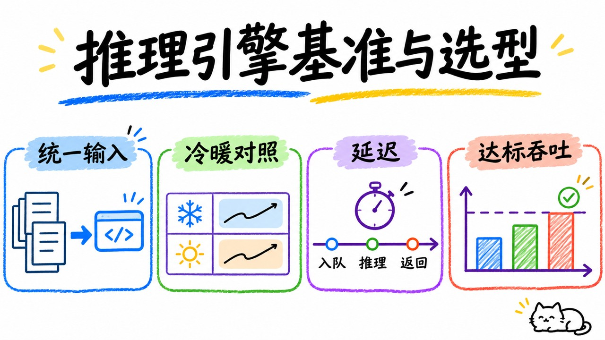

> **生成工具**：Codex\
> **生成模型**：gpt-6.2-sol

把两套推理引擎放在同一个退款任务上，先确定什么叫完成。输出可能很快，却含错均值或格式错误。只比较 Token 每秒，会漏掉用户实际可用的吞吐。

## 1. 先锁定实验合同

固定模型仓库和 revision、Tokenizer（分词器）、Chat Template（聊天模板）、权重和 KV 类型、流量规模、温度和生成长度。每个请求保留稳定 ID，记录请求正文与原始响应。冷态用新进程或明确清空的运行状态，暖态用相同的预热步骤。冷进程与冷权重文件页不是同一个条件。把取消或故障注入放在独立场次，避免影响主基准。

本次退款集合含有效样本、零值、缺失和小数均值，共 4 种，压力测试重复两轮。业务评分要求裸 JSON 对象里的 `count`、`mean` 同时正确，拒绝重复键和额外键。达标请求还需在 1.5 秒内完整结束。这个小实验用固定并发，客户端一条结束后补下一条，属于闭环压测。生产基准应另外用固定速率或真实到达轨迹的开环负载，暴露排队累积。

## 2. 先校验协议，再读性能

普通生成与流式文本应在同一解码条件下核对。分别验收模型列表、可见增量、结束信号和 Token 用量。取消至少需要客户端停止、代理转发断开、引擎同一请求终止中的相应证据。把原始错误、限流、取消和业务错答分开计。部分协议字段由引擎实现和版本决定，公共字段成功只能代表覆盖到的能力。

实测用 Apple M1 的 SGLang v0.5.23 与 MLX-LM 0.32.2，读取同一份 16-bit MLX 权重目录，使用同一聊天探针和预热顺序。以下取同前缀暖态、并发 4 的一轮。SGLang 允许最多 8 个运行请求，两套引擎保留各自内存池和调度实现。

| 引擎 | 协议完成 | 业务通过 | 首字 P95（ms） | 整条 P95（ms） | 输出 Token/s | 达标请求/s |
| --- | ---: | ---: | ---: | ---: | ---: | ---: |
| SGLang v0.5.23 | 8/8 | 4/8 | 127.4 | 519.2 | 83.1 | 3.96 |
| MLX-LM 0.32.2 | 8/8 | 4/8 | 481.1 | 794.6 | 55.4 | 2.64 |

两者这轮的输出长度合计均为 84 Token，且都只通过 4 条。SGLang 的取消计数有独立探针，MLX-LM 的浏览器运行验证了取消传播到代理。vLLM 金属与 CPU 路径在这一轮只记录了启动，未取得可与 SGLang 做同条件的业务和性能评分。表中结果是小规模本机测量，不能据此作生产引擎选型。 [SGLang 原始结果](experiments/serving/sglang-probe.json) · [MLX-LM 原始结果](experiments/serving/mlx-probe.json) · [取消探针](experiments/serving/sglang-protocol.json)

## 3. 写成可操作的选型报告

先设置业务门槛，任何候选未达正确性下限就继续调试模板、输出约束或模型。通过门槛后再比较同一 SLO 下的吞吐。SLO 是服务等级目标，常把首段响应、整条完成和错误率一起约束。每成功请求成本可先按 `测试窗口归属成本 / 窗口内达标请求数` 估算，窗口成本应包含预热、空闲与并行副本。正式报告说明租用计费、吞吐分母和失败重试归属。

增加引擎内部队列和缓存指标、并发池状态、长短输入分桶、冷暖两组重复。比较 vLLM 与 SGLang 的部署候选时，显式列出同硬件、同精度和参数是否同义。结构化输出、工具调用可用性以及适配器挂载、日志、升级、回滚都要计入操作成本。 [vLLM Benchmark CLI](https://docs.vllm.ai/en/latest/benchmarking/cli/) · [SGLang 基准入口](https://docs.sglang.io/) · [共用探针](experiments/serving/probe.py)

[返回 LLM 与 Agent 学习路线图](https://blog.lacknb.cn/articles/2026/11/19/1795058329577.html)
